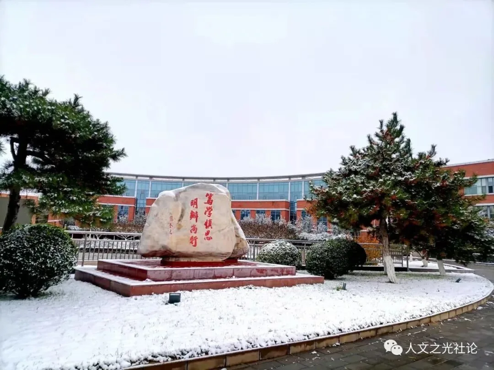
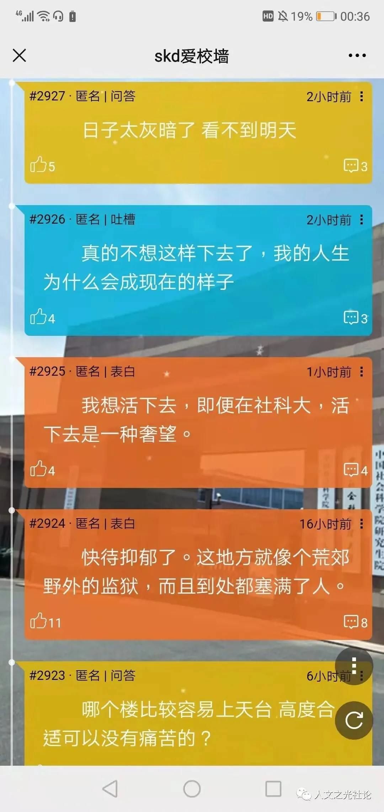
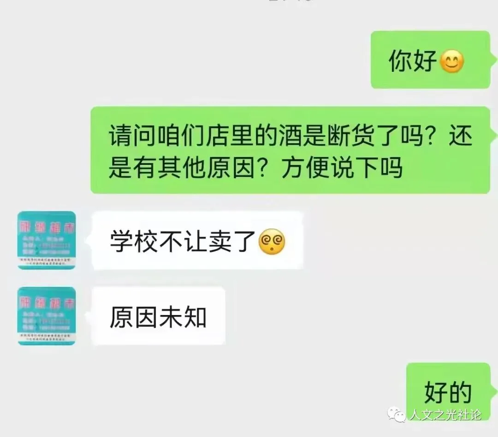
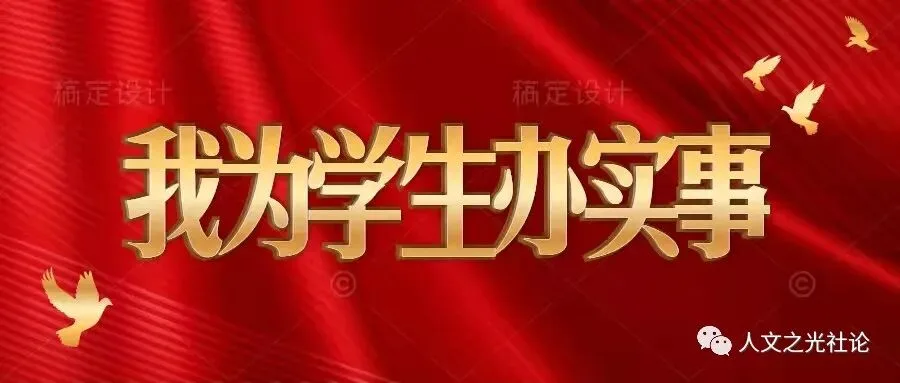
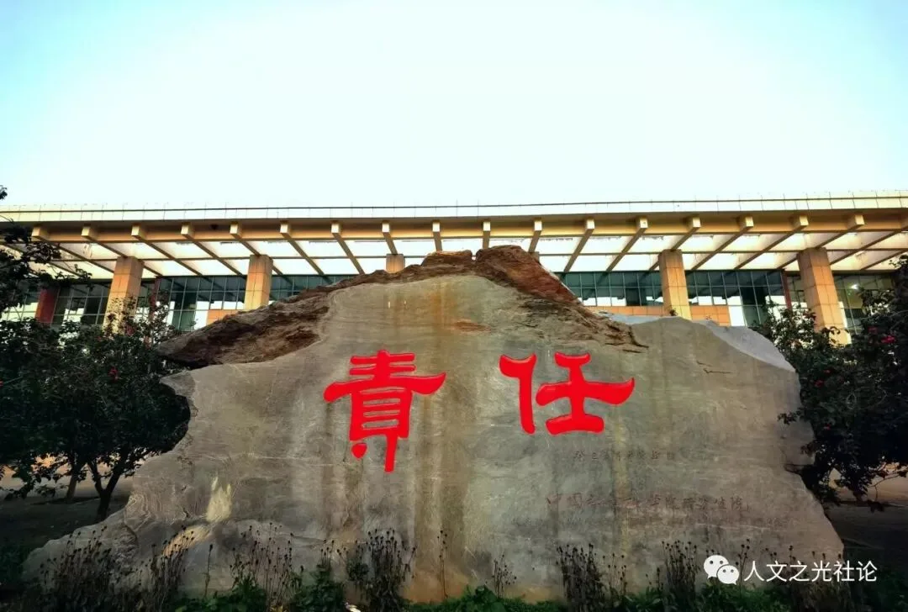

## 1 办怎样的一流大学

社科大到现在已经办了四年了。四年来有没有什么进步呢？楼也没盖起来，宿舍还老化了，人越来越多，越来越挤，学校声誉不断下跌，招生分数线也越来越低了……同学们还在苦等着“双一流”的消息。总之，一切不容乐观。再加上疫情的影响，搞了个不合理的封校政策，使得各种各样的矛盾在酝酿和激荡当中达到了它爆发的临界点。但这并不是一件坏事。在这样剧烈的矛盾运动当中，恰恰可以迅速地推它进步，让它充分地发展起来。

要解决怎么办好社科大的问题，首先要解决社科大是为谁办的问题。今天的校领导和部分同学仍然盯着教育部的双一流评选看，我们认为这样的格局是很低的，是被别人牵着鼻子走。要办好一所大学，首先要明白：这所大学培养的成果是什么？培养的目标是什么？它是为谁培养人的？一所大学的主人究竟是谁？

试问，若非校园内的矛盾已令人无法忍受，同学们为何要这般悲愤绝望呢？

我们知道，大学就像一个容器，输入的是学生，输出的也是学生。那么学生就是它向社会贡献的产品。一流的大学，不是大楼的大学，也不是大师的大学，是一流大学生的大学。而这一流的大学生也不是自封的，而是由不断发展中的社会共同评判出来的。要完成一流大学生的培养绝不是校方单向的活儿，而是全校师生一起同社会互动，积极响应社会发展的需要，共同努力、协作出的结果。

所以在办一所大学的问题上，不仅仅是学校的行政管理者是学校的主人，而是全校的师、生、职工都是这所学校的主人。如果我们不仅能够响应社会发展的需要，还能够引领社会发展的需要，把人类社会历史运动到这个阶段以来最先进的那些实践方式引入到我们的教学和工作和生活当中，充分地试验，为中国社会的发展提供新的动力和素材，那么我们还需要教育部的“双一流”之类指标为我们脸上贴金吗？一所好的大学要走在时代的前面，而不是跟在教育部评估标准的屁股后面，这格局太小了。

## 2 怎么办

在一个社会主义国家办好一所大学，要充分地吸收社会主义运动的先进经验和成果。我们发现，这个时代的生产方式已经由分工和区隔逐步地走向联合与协作。参与的主体越多，一个团体就越能够发挥人的主观能动性，就越能够创造性地打开局面，也就越能够创造性地为社会发展提供动力和素材。

接下来谈谈人的问题。到今天为止，社科大的领导团队的工作是令广大师生失望的。无论在同学当中，还是在教学行政管理团队内部，仍然存在着各种各样的山头和派系意识，存在着各种歧视。部分师生不把中青人当自己人，中青人自己也不把自己当自己人。这样的对立，才会造成某些干部欺上瞒下，才会阻塞渠道，才会给学校穿小鞋。把中青人不把自己当自己人，是中青人在体制内所受到的不团结的氛围的影响，你不把他当自己人，你照顾他，你在体系内和稀泥，不能一个尺度评价，最终的结果，就是他也不把自己当自己人。这都是干部队伍没有主人翁意识，没有团结一致地把学校办好的想法的结果。

当同学间民愤迭起时，管理层不直面问题，竟选择禁酒？逻辑何在？责任何在？

而这样的问题事实上又是学校管理团队的服务意识欠缺，管理思想长期停滞在旧模式中的结果。为什么会有这样的结果呢？这是由于学校的行政管理系统长期闭门造车，缺乏与全校师生互动，走的是一条官僚路线。只有在与师生的互动当中充分地发挥各方的主观能动性，充分地考虑各种可能性，开拓思路，积极作为，学校的行政管理团队才能够逐步成长为一个适合建设一流大学的团队；行政管理团队、行政管理团队中的每一位教职员工也才能成长为一流的教育工作者，得到自身素质的全面提高和发展；同学们也才能在这样的团结互动当中成长为真正的一流学子。

当然，改造不是一朝一夕就能够完成的。我们根据目前意见和矛盾较为集中的问题逐一提出一些适合学校团队落后现状和接受能力的改进建议，先头痛医头，脚痛医脚，一步步慢慢来：

第一，同学们对各种行政措施的意见最多，各种具体决策缺乏周全考虑，缺乏理性，缺乏一贯性。

例如，封校政策封学生不封老师、快递、外卖；为了不聚集而禁酒但却要聚集起来线下上网课；封了校但基础设施又跟不上。又，良乡高教园管委会管得着望京么？望京的封校政策引良乡高教园算哪门子事情？

因此，我们建议：

1.建立一个长效的沟通机制，搞一个沟通交流和收集信息的平台，定期召开见面会，由学生点名职能部门参加对话。在对话会上确定问题的解决方案，敲定解决的步骤和时间。目前由于学生会权益部门要经由校团委同各部门协调，就陷入了原来行政系统当中固有的官僚做派的阻隔和影响，受到各种层级观念、冗长的决策链条的拖延和损耗。因此建立直接的对话机制是能够节约时间和行政资源，提高学校整体运行效能的。

2.决策结果设置公示期和冷静期。一切重大决策以及一切与学生切身利益相关的决策，必须由相关教师、学生和行政管理团队充分讨论、共同做出，并及时公告。近来若干涉及学生切身利益的决策很多没有文件，也没有公告，连现代行政管理最基本的文书管理都没有，如何能够服众？“刑不可知，威不可测”，以这种封建理念来管理学校，如何展现时代的先进性？

我们不是仅仅要求决策透明化，而是要求参与决策。要求透明化仅仅是做被动的决策对象，是当不了主人的。而在校园内尚且不能得到充分的当家作主训练，又如何在中国社会做主人呢？如果一所学校只能培养出驯服的工具来。它又如何能够在中国社会的发展当中发挥一流学校的作用呢？

3.行政管理团队应适时体验学生的生活，做到充分互动。建议设一个社科大领导体验日，体验一下社科学子的日常。包括但不限于0：00抢图书馆座位，中午12：00去一食堂吃饭或者二食堂吃饭，下午五点去羽毛球场排队等等，没有感同身受过就不会真正改变。

4.更具体些，疫情防控政策不要一刀切，即使是审批制，也希望全校统一审批，或者制定各院审批的统一标准。例如，望京封校措施不合理，校外住宿生可随意进出，其他同学却不能出。而且希望能对出校面试、实习的同学放松一些，现在已经有很多同学因为封校失去了面试的好机会，白白浪费了offer，最终就业率也是学校面子上的数据啊。

第二，对校园的软硬件设施和教学生活资源的意见也很多，望京校区尤其突出。例如，有同学提出望京图书馆座位制度不合理，有人预约有人不预约，常起矛盾冲突；有同学提出公共设施运用不合理，党员活动中心等教室资源沦为学生干部狼人杀场所等。

良乡校区呢？也民怨沸腾。基础设施建设迟迟不见推进，明辨楼基建问题迟迟无法解决，各种行政人员总百般阻挠利用寒暑假时间对宿舍防水问题进行一次统一大修。这些都是官僚作风导致的结果。

当然，在硬件上的客观条件，不是一朝一夕能改变的，但好的制度设计可以使有限的资源得到更加充分的利用。而好的设计一定是由更广泛的参与和更充分的讨论得出来的。

### 因此，我们建议：

1.建立两个校区分别设立教学资源和生活资源管理委员会，由热心同学自动报名参与，与行政团队随时开展集体协商，开展调查研究和资源使用机制的设计活动。

2.就图书馆爆满、自习室缺乏，想学习都困难，解决自习室和图书馆容量问题，可：

（1）将原有的闲置区域改为自习室。140、研教楼和党校楼的会议室在不使用时向同学们开放；

（2）教室增设插板，保证每个座位至少有一个插口；图书馆走廊也增设插板和座位

（3）提高图书馆空间使用率，例如一楼沙发区增加座位，笃学讲堂在没有讲座时允许同学预约；

（4）良乡、望京的图书馆预约制度要合理，不使用时要终止预约，预约后发生空置要对预约排序作一段时期的靠后限制作为处罚。

3.良乡校区的小卖部、食堂可进行如下改进：

（1）一食堂增开两至三个档口

（2）一食堂菜品严格按照菜谱

（3）一食堂严格按照时间供应，不提前断菜

（4）增加清真食堂菜品丰富度

（5）二食堂增设用餐座位

（6）错开研究生和本科生的教学时间表。原先实行双轨制时，食堂的吃饭时间是错开的。从来不存在什么拥挤和爆表的问题。恰恰是教务部门的懒政和一刀切才导致了今天的问题。

（7）增加座位（但是会更挤）

（8）把闲置的1978咖啡厅变为新的用餐场所

（9）如有可能，把包厢也对外开放

4. 望京校区要建立一个教学、生活服务的对接会。望京校区远离行政服务部门的核心，许多问题更显得突出。有关行政部门和校领导要定期到望京校区听取意见，积极改进。

目前，大家认为望京校区的生活、服务设施可作如下改善：

（1）开饭闭餐时间要延长，食堂菜品质量和价格需再锤炼改进

（2）进行基础设施建设，增设小卖部等生活服务场所，可先建临时房屋，再建永久建筑；

（3）可建设临时房、建设健身房等

（4）要在望京校区开设打印成绩单和开具各类教务、党团证明的便捷渠道，要能及时盖出有效印章来。

（5）完善现有公共空间管理规则，要优先考虑学习需求，不得霸占公共资源进行娱乐活动。

第三，同学们对教学行政管理很有意见。

首先是行政工作态度不到位，脱离群众：之前团委对冬奥会志愿者直接拍脑袋武断决策，叫嚣“不用管他们”等等都是例证。

教务管理、学生工作管理不勤勉，不细致。缓考的同学直接登了零分，因病休学的同学，却在记录上出现了处分，等等。这必须要求从工作态度到工作方法上的全面改进。必须由同学和教学管理团队共同参与这一改进过程。

其次，之前的决策冷静期等机制在封校这个例外状态中似乎失效了。学生是最主要的利益相关方，为什么很多决策还是在拍脑袋，一味唯上，老是被拿来当虎皮的高教管委会成了官僚懒政的护身符。

第四，教学质量问题。教学是大学运行的核心环节。社科大的教学应该走在全国前面，许多措施应该具有开创性。建议在一个阶段的教学完成之后，组织全校各学科的师生充分讨论，根据培养方案实施中的问题不断完善培养方案。需要切实将教学评议等评价体系与培养方案挂钩，要建立对教师教学效果的客观、全面、充分的评价机制。教师、教学都要向本学科发展的当前最高水平看齐，充分发掘、利用全北京、全中国的教学资源为本校服务。例如，可充分利用北理资源开设数学课程，可合办经济学-数学双学位项目等。

并且，当初社科大声称要进行国际化培养。但却在国科大、清华、人大等其他高校都维持学生出国交流现状的当下逆势而为，阻碍学生出国交流，取消全部国际交流项目。为此我们要求合理评估出国交流安全性，不搞出国交流一刀切。

第五，招生问题。本校的招生方案未能考虑各省市考生的实际需求，导致同学们不能够选择自己心仪的专业。只能通过降转和各种转专业的方式。解决这一不匹配的问题。而这一不匹配造成了同学们的青春年华和有限教学资源的大量浪费。因此要在充分调查研究的基础上，审慎地修订招生计划，解决招生指标和考生需求不匹配的问题。

总之，在大家都做主人翁的情况下，在师生职工的全员充分参与下，社科大是一定能办好的，是能够为这个时代的中国发展做出贡献的。一流大学不是等来的，不是什么部门的恩赐，而是我们大家一起团结一心，在自己的校园内，在中国社会的广阔天地中挣出来的！

倘若同学们有任何关于学校治理的意见，都可以点击阅读原文，在共享腾讯文档中提出，也可在后台给我们留言。我们将会积极采取多种途径汇总大家的意见，与学校进行沟通。期待与同学们一起，把学校变得更好！
