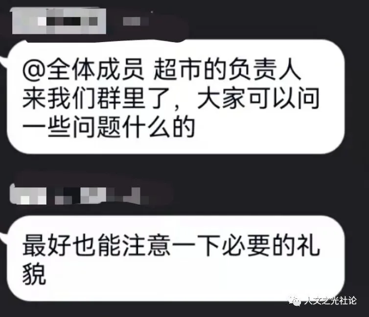
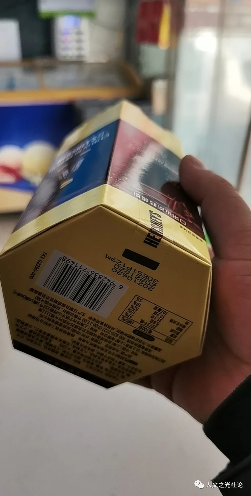
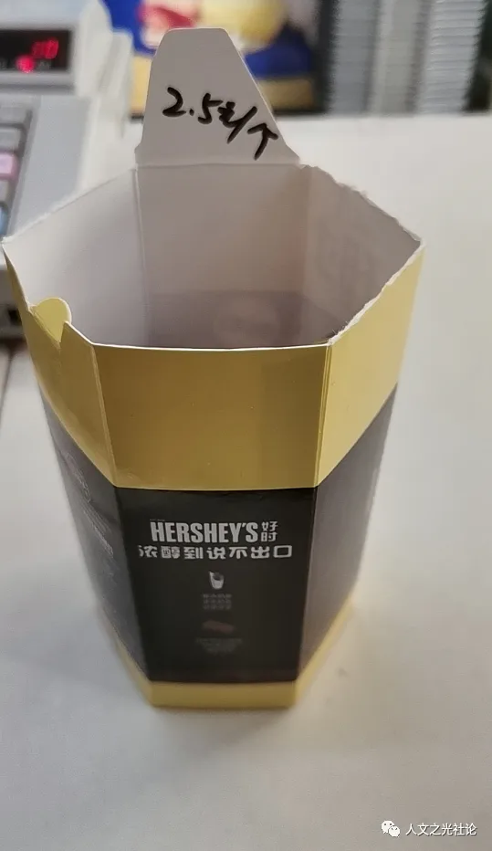
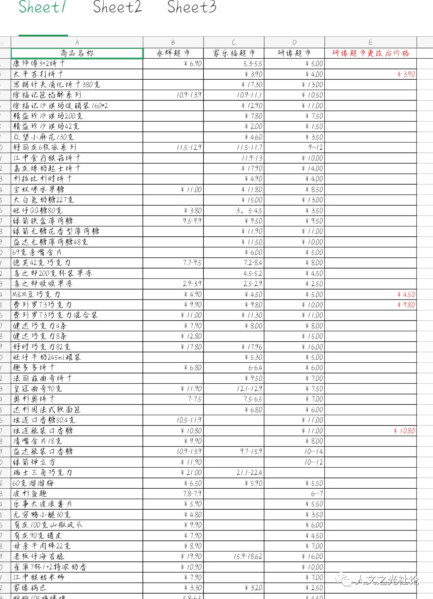
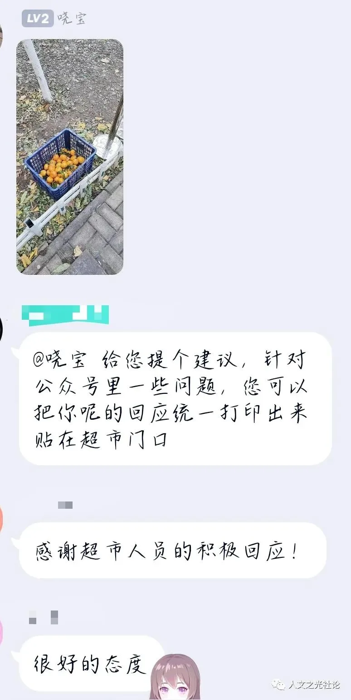

今天，研缘超市的负责人来到群中，就同学们关心的超市相关问题进行了问答～

研缘超市负责人：

大家好，我是学校超市负责人。

我看公众号有反应超市物价贵，学校后勤部和权益部每年都会对超市价格进行调查，均不高于周边超市和良乡高校其他校内超市，大家对哪方面价格有疑惑可以跟我说，如果确实存在定价过高超市会立即调整。

以下是问答的记录🦋同学们以后的问题也可以继续提出～

Q 您的意思是找不出一样商品的反例吗？如果有商品价格高于校外5公里内的大型超市，应当向谁反映呢？

A 哪个超市也不敢说自己比周边5公里的价格全部便宜啊

Q 那怎么保证有调研的呢

A 我可以发给你，有调研记录。进货价格是供货商控制的，并且超市在去年在周边以及部分超市做过价格调研，所以在价格制定上有一定的依据，超市经营方式也会不同，有不同的优势产品（在价格上更优惠，更具优势），所以还会存在价格差异的情况；超市根据同学们反应的情况，核实相关情况，与供货商取得联系，并相应做出调整。

Q 您加群可以透露一下是学校要您来的，还是您自己扫码来的？

A我自己来的

Q 涨价过于随意、频繁，部分商品单次涨价幅度过大，如绿豆冰沙卖完后重新进货从1.5变成3.5，没有相应的公示，有些同学会有些困惑。

A 涨价厂家控制，今年市场上的价格普遍上涨，针对价格的涨落，超市表示今后对价格调整的产品，会在价签旁标明。

Q 您好 可以问一下为什么不卖酒了吗？有传言说是因为超市酒价过高，学校后勤不让卖了？

A 这个我们只是接到了后勤处的通知，酒下架。

Q 想问下后勤处没有说明原因吗?不可能直接命令你们下架吧

A 呃，没给说

Q 为什么香蕉正面完好，背面多处磕损？请解释一下

A 包装问题，如果有一些黑点不存在烂的不影响食用确实需要包装的更好看。

A 有问题的都会挑出去扔掉，但是水果避免不了有烂的，店里微信有记录，有问题反应到我这里的都是积极处理

Q 请问为什么超市在结账的时候经常都不扫码，甚至直接报价格，这样不会让人怀疑有偷偷加价的嫌疑吗？买了这么久从来没拿过一张小票。我都很奇怪，不扫码记账你们怎么盘点啊？请您回应一下

A 有时候是为了节省时间，常卖的都能记住价格

Q 可是我每次都问收银员要小票，有些商品根本不打价格，我问收银员，他说这些商品打不出来价码，价格不透明，怎么确定没有加价？

A 有些商品出厂时就没条形码，需要打小票上确实打不上

这个产品，只有大盒有条形码，小的并没有，大盒同学们买回去太多了

Q 那是不是应该把商品的标签标好，有些商品看了半天都没找到价码在哪里，都得去结账那里问，但人一多，要么就是超出心理预期也只能硬着头皮结账，要么就是都不要了，浪费半天排队时间，也不好意思让后面人等着重新结账吧

A 在价签方面，目前确实存在一定问题，受制于超市员工目前较少，只有一个员工理货，所以存在工作量过大的问题，超市会进行整改。

Q 不扫码很多时候不是没有码，买饮料经常就是没扫码。你能告诉我那些全国都卖的饮料没贴条形码？我们为了不吃亏还得谨记所有的商品的价格吗？客观来说不扫码不给小票真的跟不正规，希望整改

A 这个可以，每次都扫码没有问题

Q 超市目前文具，练习册不能完全满足同学需求。 A 目前文具方面确实经营的有些乱，一定会改进业务。

Q 学校超市部分生鲜食品（水果、三文治等）有摆放过久的现象。 A 超市一直注重生鲜产品质量问题，严格把控，绝对保证食品新鲜度，不会存在摆放过久，产品过期或者超市从来售卖隔夜果切水果等问题，但不能排除有些同学前一天买，第二天食用，因此食品过期的情况。

Q 果切制作不干净，保存不当，有烂掉的水果，水果口感不好。

A 下学期会更新升级水果台，改进卫生条件，并学习研究如何更好地提升水果品质以及包装质量。 Q 面包种类太少，不上新。

A 由于超市面积小，不能摆放太多，目前是总共有四个面包品牌，为了尽可能增加品种，会定期来回替换。

Q 没有散称零食，只有包装好的高价零食。 A 由于人手少，分装难度大，超市空间小，没有足够的地方摆放，并且之前实施过，但是事实情况显示同学们需求并没有那么大，从而长时间堆积导致产品出现过期情况，但以后会根据同学们的需求进行调整。

Q 算错价格，并且总是算多，或者直接四舍五入。 A 没有入，可能之前会有价格调整，因为没有及时标明新的价格，同学可能误以为是四舍五入。

Q 包装、取火腿肠有时不注意卫生。

A 确实存在这个问题，超市正在考虑改进，以解决卫生问题。

Q 部分收银员业务不熟练。

答：会重新招新的员工，并进行专业的培训。

Q 希望考虑一下自动收银机。

A 空间和网络条件不允许，也考虑到学生人数不算太多。

Q 请问这边人手总共是多少，有可能延长营业时间吗，有时候自习回来比较晚，想买一点夜宵只能外卖，实在不方便。还有，这边接不接受学生兼职，钱给得少一些也可以。如果能来这里夜班兼职，没人的时候摆货跟自习，我和好几位朋友都愿意，也便利其他同学半夜来买东西

A 兼职问题单独跟我说吧，这个不属于问题反馈

感谢超市负责人主动出面为大家回答问题！此外，超市负责人还上传了详细的价格表，在qq群中即可查阅。

我们也希望其他部门能尽快积极面对同学们的疑问和诉求～

关于12月1日座谈会有关于超市价格的回复

首先，感谢社科院大学（研究生院）及校领导的支持和关心，感谢同学们的支持和认可。研缘超市自随研究生院一起入住良乡新校区以来一直秉承“方便同学，服务校园”的理念为广大师生提供服务。

研缘超市始终不断在薄利经营的同时优化服务品质。研缘超市除积极配合学校学生会（研究生会）会做市场调研、控制价格外，还积极进行市场价格调研，研缘超市坚持每年两次进行市场调研：调研北京理工大学、北京工商大学、首都师范大学、北京职业技术学院等周边院校的超市，调研华联超市、京东超市、等学校周边超市；调研良乡镇上华冠超市、良乡镇上家乐福超市、半岛广场的永辉超市、绿地缤纷城永辉超市等大型商超；调研部分同学对价格预期、建议等，通过一系列市场调研分析方便研缘超市为全校师生提供更符合学生消费习惯物美价廉的产品。

自新冠疫情爆发以来我研缘超市人员积极配合学校疫情管理，校内居住，非必要不外出，未能及时进行市场调研。12月1日座谈会同学提出超市价格高于周边超市，超市人员在做好疫情防护工作的前提下立即对周边超市进行调研，因疫情管控周边院校不允许外校人员入内，此次调研选取了周边规模较大的良乡家乐福超市和半岛广场永辉超市。以下是12月9日三家超市售价对比图，此次调研共253种产品，研缘超市其中204种售价低于周边超市平均价格，与周边超市价格持平的有28种，价格略高于周边的有21种，现已对需要进行价格调整的商品全部进行价格调整。近期超市会增加特价商品品项，加大特价优惠力度；并且每日增加零利润特价水果，以更好的回馈广大师生。

研缘超市一直在社科院大学（研究生院）的支持和指导、同学们的监督和陪伴下成长。作为一家小超市研缘超市确实在经营中存在一定不足，同学们提的批评建议，研缘超市始终坚持“有则改之无则加勉”的态度积极面对，以鞭挞研缘超市更好的服务同学们。

研缘超市会在“方便同学，服务校园”的前提下更加注重服务品质，确保超市不出现任何存在质量瑕疵的商品。下一步加强与同学们及学生会的沟通交流，积极听取他们的意见建议，及时发现和改正经营中存在的不足，做一家学校放心、同学们舒心、服务贴心的校园超市。

研缘超市

2020年12月13日
