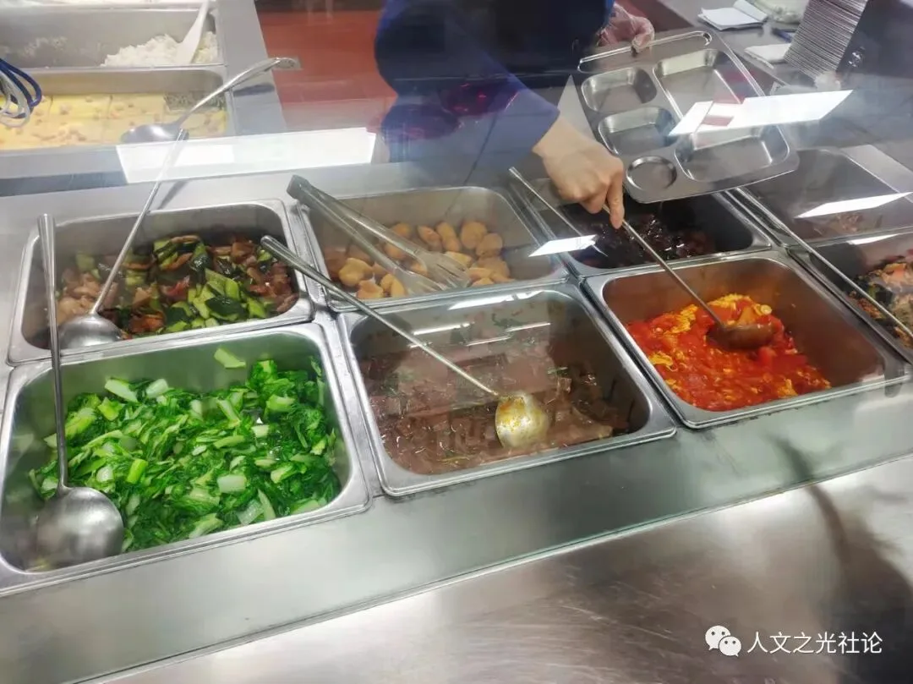
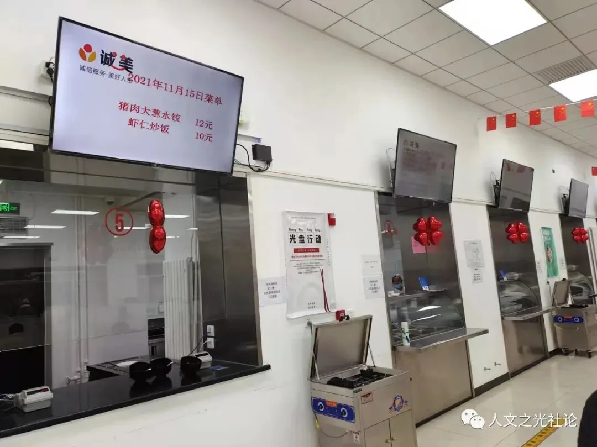
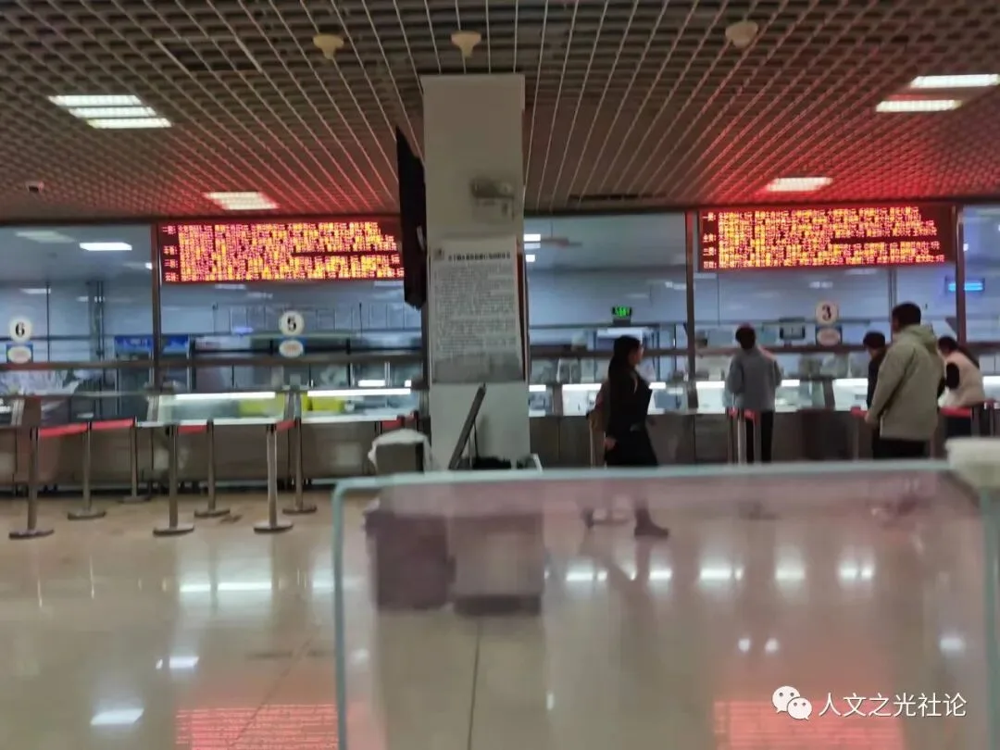
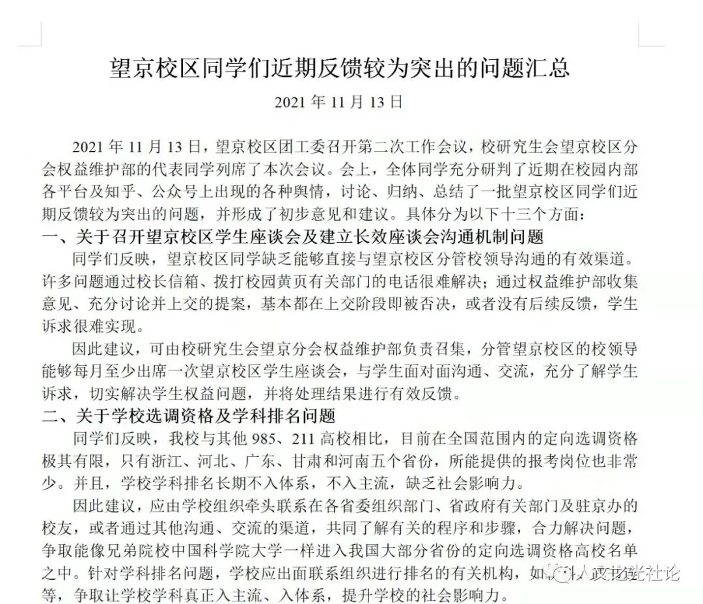
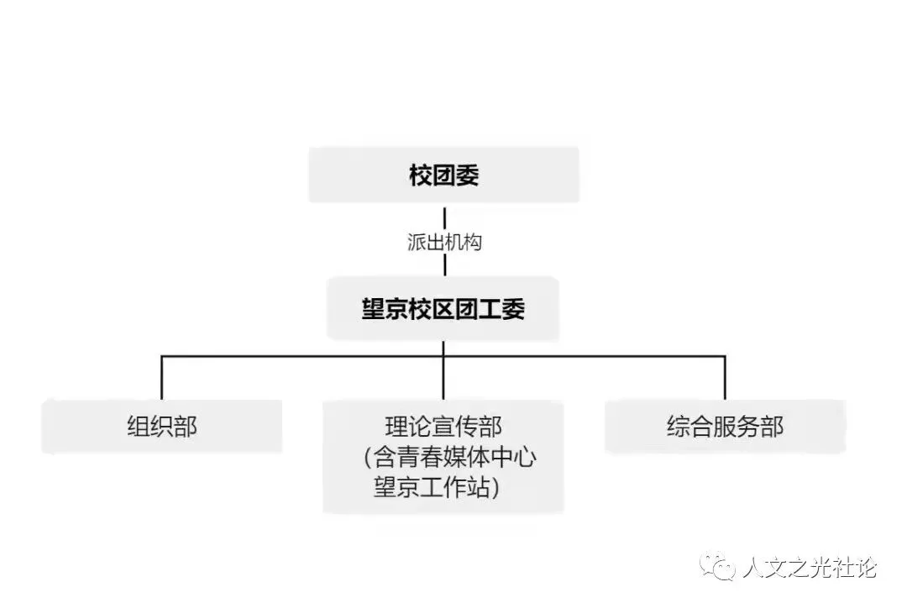

在所有老师同学们的共同努力和发声下，大家反映的一些生活类诉求得到了回应！

让我们直接进入正题吧，来看看大家的生活有哪些改善~

## 1 望京校区食堂

望京食堂关于近期同学意见的回应以及整改措施：

食堂方面在周日注意到校区同学在公众号留言对食堂提出的意见和建议后，于当日召开紧急会议，对同学们的意见建议进行反思研究，并于周一开始逐步整改。对于因食堂方面工作不周而给校区同学用餐带来的不愉快体验，向同学们表示歉意。

关于同学们反映的菜品存在口味咸、油大的问题：食堂后期会重点改进，改善菜品的质量、风味以及样式。

关于特色窗口：食堂后期会增加菜品小吃的种类，考虑增加关东煮、糖葫芦等小吃。对于同学们想吃的其他特色小吃，可以向食堂提出建议，食堂会研究增加。

关于同学们反映的晚饭质量较差的问题：因为加工时间的问题，晚上的菜品是少于中午的，因此食堂后期会通过调整荤素搭配以提升菜品质量，并增加特色窗口种类来解决。

关于同学们反映的大小份菜菜量不均的情况：前期在由学生倡议、校方定价后，食堂对工作人员大小份的打餐量进行了专门培训，但是难免出现个别工作人员打餐量不合理的情况，针对此问题，如果同学们觉得菜量过少，可直接要求工作人员再次添加。

其他：目前，食堂方已经向学校申请在食堂增加热饮机等设备提升食堂就餐体验。

后续同学们如果对食堂有意见和建议，欢迎直接找食堂经理沟通反馈。

经群友反映，目前望京食堂的菜品似乎尚未有明显变化。我们期待食堂能够信守承诺，得到教职工和学生们的一致认可。

2

良乡校区一食堂

今天，有同学发现一食堂的档口明显增多，排队队伍有肉眼可见的缩短。经询问和观察，中午开设了十三个档口，晚上开设了约十个档口。

大家很高兴看到一食堂的效率得到提高，但也有同学发现有时某些档口虽然开设但却没有得到足够管理。望日后为食堂增设更多人手，确保窗口、菜品充足供应长效实施。

此外，大家还希望食堂能够尽快出示公告，让所有人看到这样的改变是长期而有效的~

## 3 良乡校区超市

之前研缘超市的负责人已经与同学们进行了交流。今天我们的同学发现，超市的价签有了更清晰和准确的标明。

如果同学们仍有任何疑问，欢迎继续同超市进行交流沟通！

## 4

望京校区团工委

之前，望京校区的同学们向校团委提交了关于近期问题的汇总，其中包括座谈会、选调以及众多同学和教职工们关心的生活、权益问题。

今天，校团委成立了在望京校区的派出机构团工委，并开始正式纳新。

*“望京校区团工委组织架构于本月初刚刚得到校团委正式批准，本月12日召开的第一次工作会议才正式开始工作，13日紧急召开的第二次，当天夜里就提交了这份文件。”*

> *“共青团中国社会科学院大学望京校区工作委员会简称望京校区团工委，是共青团中国社会科学院大学委员会（以下称校团委）派出的代表机关，性质为工作委员会。望京校区团工委的任务是在校党委领导下、校团委具体指导下，根据校团委授权，开展我校望京校区的团的工作。”*

同学们表示希望望京校区团工委能够成为一个科学高效开展工作的机构，避免官僚主义、形式主义的作风，真正为望京校区做实事。并希望有关行政机构继续入驻，更好服务望京同学。

不难看出，随着师生间互动交流的进行，同学们生活中的一些问题得到了暂时的解决。这些互动甚至争论绝然不是杂乱无章的漫天炮火，也不是漫天许愿、情绪宣泄，而是同每一个人都息息相关的。我们相信，在全校教职工与广大同学们的共同努力下，一切困难终将被克服。今天的微小改变，会成为社科大改变的第一步。随着学生进一步参与到当家做主的活动之中，更主动地为学校的发展作出更多努力，监督工作的实施，参与决策的制定，每一个人都会更加成为全面发展的人。社科大才能办得更好。
