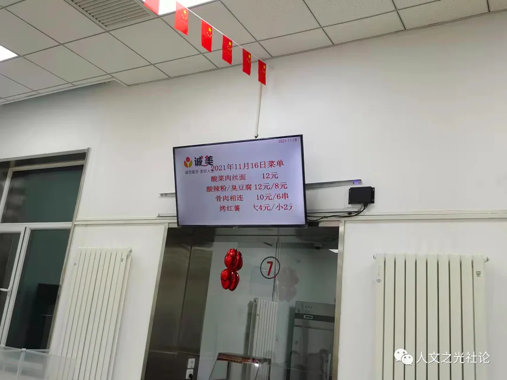
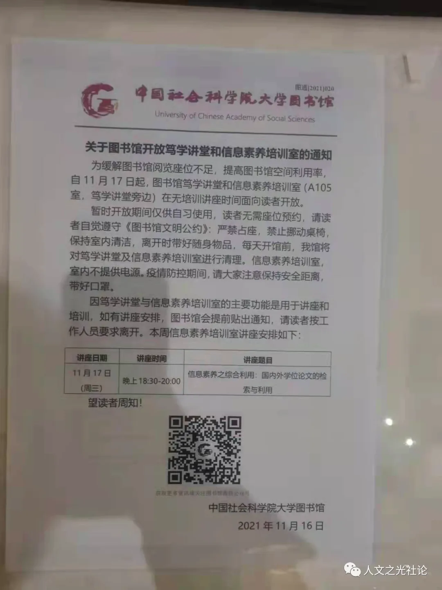

1

关于望京食堂：

今天很高兴收到来自望京的同学回复，即望京食堂确实得到了改善。就今日情况而言，望京食堂餐食种类增加较多，且有各式花样，新增的餐食价格也在可接受范围内。同学们的就餐需求在一定程度上得到了满足，我们也希望食堂相关方能够继续信守承诺，响应同学呼声，为全体同学、教职工不断优化完善就餐体验，保持并在其他方面做出进步。人文之光社论将持续跟进关注此事，和广大同学、食堂方以及有关部门一道为望京校区食堂生态良性运转而努力。

2

关于良乡校区图书馆：

经过同学反映和实地观察，图书馆座位上座率仍然十分的高，图书馆笃学讲堂门口已经张贴了与电子文件相同的告示，表明将和信息素养培训室于11月17日（即明日，本周三）起在无培训讲座时间开放作为自习室，图书馆座位预约时间也根据同学投票结果进行了调整。权益部同学在多部门奔走中，更是在广大同学一致努力之下达成了此目标。我们非常欣喜地看到每个社科大学生的自习空间得到了扩展，也感谢权益部和积极参与投票的、反映图书馆自习实况的同学们做出的不懈努力。
