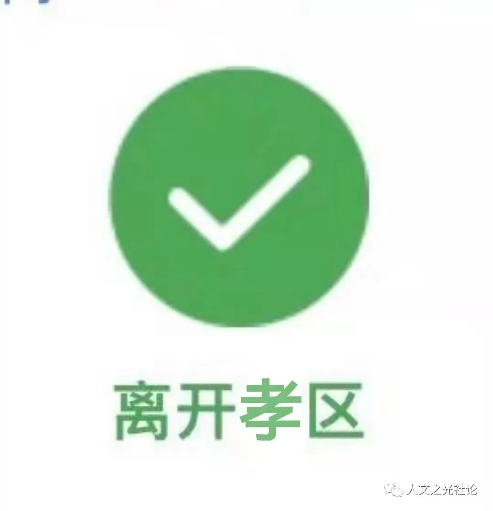

自10.22日起，社科大的同学们已经被封在学校里快一个月了。

而自11.3日出现了次次密接的学生起，更加严厉的完全封校也已经进行了整整两周了。

虽然“在疫情防控大形势之下”，一切非常的措施似乎都可以被合理化；但对于这份昨日晚间频频出现在各个学生群与朋友圈的文件，我想还是有必要作一些说明：

首先，这份文件的公布有什么依据呢？如果开头的“根据教育部，北京市，良乡高教园区”属实，那么首先，教育部到底是什么样的政策？

在教育部官网上可以轻易查到，目前能够提供凭依的防疫政策应当是\<高等学校、中小学校和托幼机构春季学期新冠肺炎疫情防控技术方案\>,而在这份文件里，作出的要求是“高校要落实主体责任、做好监测预警、坚持登记制度，加强场所、活动和员工管理，落实健康教育。师生要加强个人防护，保持社交距离。”，这实际上还是给予了各高校根据具体的情况制定具体的防疫政策的充分自主性，并没有硬性的“一刀切”的要求。

那么近期北京市的防疫政策又如何呢？可以参考这份根据北京市疫情防控新闻发布会所做出的最新政策权威解读。

不难看出，目前北京市的防疫政策也主要是针对进出京流动的严格控制，以及对于线下非必要聚集的防控，并没有禁止京内正常流动，各高校也还是拥有很大的自主性。

而且随着目前北京市无高风险地区，仅剩两个中风险地区的最新部署，相信疫情防控局势稳中向好。

接下来，良乡高校园的政策呢？根据学工处下发的“关于近期学生进出校相关规定的通知”，我们没法知道到底是高校园下发了何种文件，所有依凭，只有一句“非必要不出校”的口头规定，到底何为“非必要”，何为“必要”，仍留有较大的操作空间。

我们不妨也看看其他高校。

同属高教园的北理：据可靠消息，因为北理校区多人员流动复杂，目前事实上是可以正常进出校的，并无审批上的困难。

清华？目前是完全不封。

而人大：经过不懈的舆论讨论后，现在是审批可以出校。

然后看看曾经也出现过密接的北大，在核酸全员阴性后，北大也早已解除封校，目前已经接到提前放假的通知。我们前十四天的封校，是出于出现了次次密接的客观要求，那么继续封校的依据到底是什么？

自10月26日起我们开展了全员核酸，而在检测出全员阴性后我们仍然是态度决绝地进入了完全封校状态。在如上所述的校方言必称落实北京市疫情防控政策控制人员流动的背景下，到底发生了什么？

1.线下或是线上？

部分课程改成了“线上”授课，不过是所有学生聚在一起听视频会议授课。如果仅仅是为了避免所谓“风险”，那么请问把学生聚集在线下教室一起收听线上课是为何故？校方一再强调大连某高校的聚集性传播案例反映出的聚集性传播风险，那为什么看不到该事件正是在封校的情况下校内聚集引起的呢？

2.究竟能否封住病毒？

我们能看到的是，目前的有限审批仍然是事务性的，即，根据“出校干什么”判定能不能出校。可是，如果是为了最大化避免传播风险，难道不应该是根据“去哪里”以及“怎么去”来判断能否出校吗？为什么要让各班辅导员来审批，而不是通过一直在关注疫情动向、掌握了整体疫情情况的医务室来进行审批？

唯一合理的解释，就是这一政策并不是以最大化避免传播风险为核心，而只是为了把行政的压力下压到各班的基层干部，分散责任，并“疏解”这段时间以来同学们的情绪。

3.各类校园文教活动现状

以校园歌手大赛暂时停办、艺术团排练受阻，各类社团、读书会无法开办为代表，同学们的校园文化生活受到了巨大的冲击，可是心理中心却能够组织班级同学一起看电影。我并不抨击为同学们放电影这一行为，我热烈欢迎心理中心为了疏解同学压力所做的一切政策，只是不禁纳闷为何对于社团活动却有另一根准绳。如果是“必要”与“非必要”的区别，那是否应该给出明确的标准：何为“必要”的活动。至少目前看来，这个标准相当随意，随管理人员的心意，已经激化了封校期间的紧张状况。

4.禁酒

此事据传是因有人醉酒寻衅而起。不得不说，如果每个大学生都喝酒而且酗酒，禁酒自然必要。不过本没有多大饮酒群体，学校却因此剥夺所有人饮酒乃至超市售酒的权利。因噎废食，又是何必呢？

5.学生心理

自再次严格封校以来在爱校墙上充斥着各种各样的信息，或因封校打乱了自己原有的生活计划而苦恼，或烦闷、焦躁，更有甚者进行赌咒、对骂、展示轻生意向。在每个人的心理健康多多少少都因此受影响之时，心理中心的资源却依然紧张，有不少同学向我反映预约了被排到很久以后，或者干脆得不到回应。

6.座谈会

目前而言，已经召开的座谈会当中，法学院林校长亲临的座谈会应当是相对最“有效”的了，林校长态度诚恳、听取意见当然是应当得到称赞的。但是即使林校长亲自来开，也无法在会上向同学们作出明确的保证与解释：什么事情能办，什么事情不能办，为什么有些事情办不了，办得了的又后续应该如何办？甚至于会议的内容也没有办法公开。更不必说其它学院乃至班级层面是座谈会了，目前看来，只有历史学院20级的班会有较为诚恳的交流。

对于目前的封校政策，我们难免会思考为什么，明明如上所述，北京地区高校有不同程度的封校政策，我们却还要选择这种“骂声最多”而缺乏实际效果的方式来执行国家的防疫要求，我们或许可以从行政领导同志的角度出发来分析。

首先，目前这种实质上的一刀切的简单粗暴封校政策，突出一个核心优势：“方便”，这个方便不是同学们方便，不是教职工方便，不是老师方便，而是管理方便。通过让大多数同学继续保持被封校状态即可保持当前“良好的防疫态势”，无疑能够最小化自己所要承担的责任。

其次，这种封校方式的运行成本相对较低，在其他实行较为严格报备制的学校，学校会要求学生明确载明出校目的，并且会严格核查，而我们的这种封校政策无需如此复杂，因为其预设的条件就决定了有出校资格的人的数量极其有限，因此可以办到用最少的成本来完成任务。另外，做出这一决策并不需要什么特别预案，只需要按照原有的今年入学时的封校政策照抄即可。

最后，这种方式，是类似于“苦一苦学生，骂名我来担”的好事，只要可以完美完成任务，社科大或许也会成为防疫优秀单位，而做出这种决策所需的，仅仅只是挨学生们“成不了气候”的骂罢了。学生们在狭小的校园里被集体“关押”了一个多月导致无论情绪还是精神都备受煎熬这一事实，很有可能被视为决策路上可以舍弃的小细节而被忽略了，借用一句话便是“只要疫情防控不出岔子，哪管它洪水滔天”。

在凶狠的新冠疫情面前，我们从没忘记过防疫的重要性，也从一而终地坚持着国家层面关于疫情管控的正确决策。但是，当决策细化到社科大这座小学校，成了一套形同虚设、毫无尊重、诘难师生生活的管理制度时，事情的性质还一样吗？

事实证明，不尊重客观事实与民心的政策也难得到响应。苦闷，焦虑，甚至乎抑郁的情绪在这么一个狭小的校园里蔓延着，被积压着，被放大着。而令人遗憾的是，诸位政策的制定者似乎没有听见广大师生的不满，没有听见校园每个角落失望的叹息。叹息积累多了，是要化成呐喊，发泄出来的——在今晚的六号楼，我们便听到了这样的呐喊。人不可能总是理性的，更何况不理性的封校政策正逼着人们丢掉理性，逼着人们在焦虑、煎熬、不适中度过每分每秒呢？没有人希望看到令人遗憾的事件发生，也没有人希望校园的大门继续被毫无道理地严锁着，只关着希望出去呼吸一口新鲜空气的师生，而防不了任何病毒——这是既有毁人健康的，又有害人心灵的。
