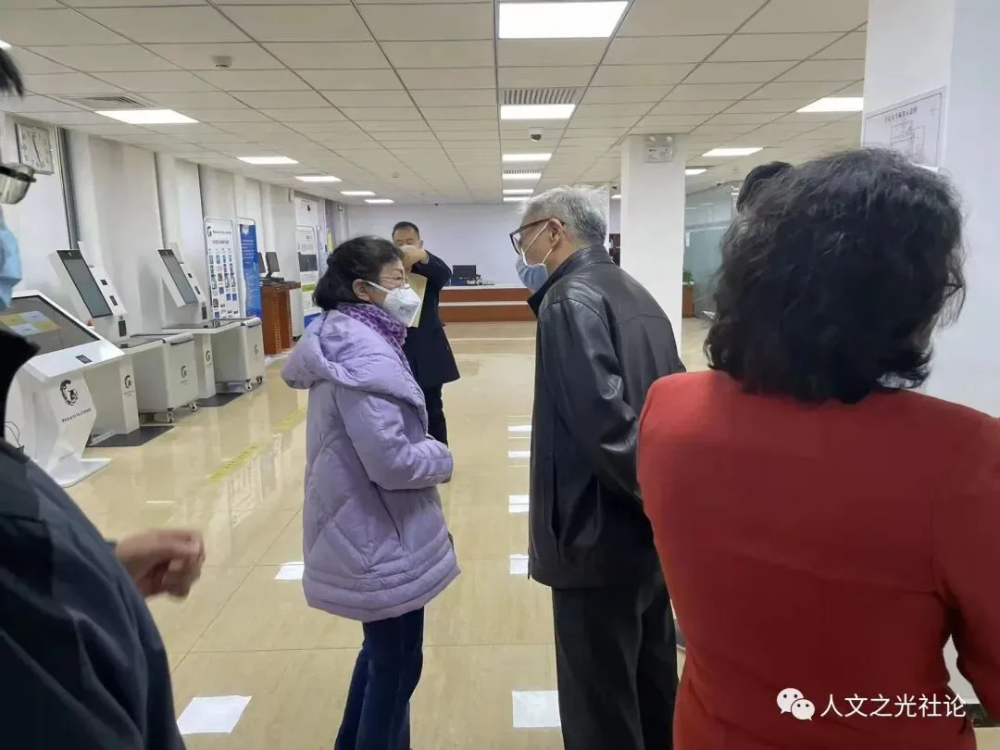
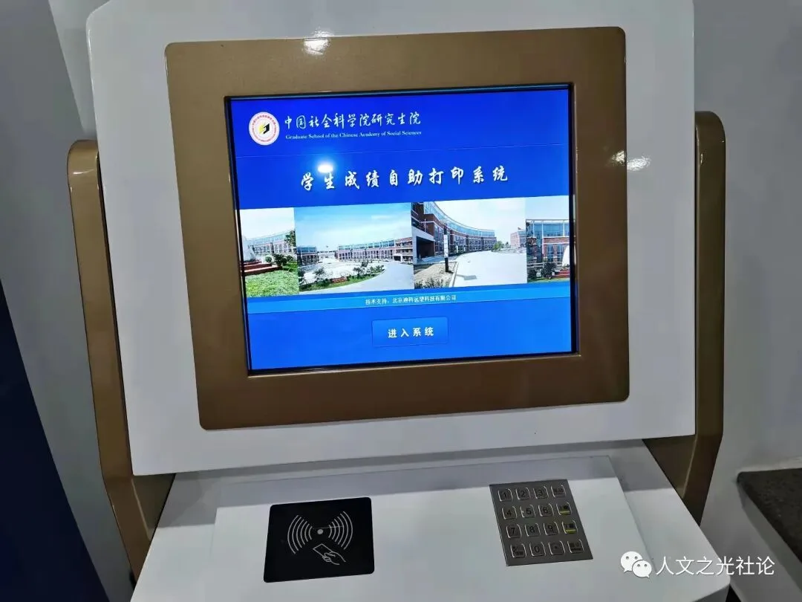
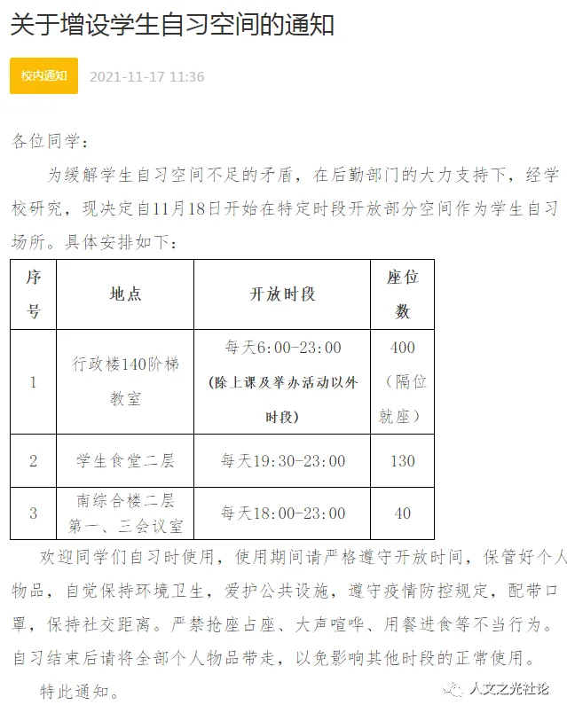

通告

：

自11月13号本平台公开向广大师生征稿以来，已经陆续收到很多投稿。昨日最新封校政策一经发出，更是引起了同学们热烈的讨论。最近，人文之光社论陆续收到多篇文章，它们各有侧重，表现了越来越多的同学积极提出自己的看法，充分体现了同学们对于学校公共事务的热忱，把自己的观点真诚地展现出来。下面有的同学们的观点和言论可能会稍显尖锐激烈，但是人文之光平台正是致力于关于学校公共空间的建构、公共事务的讨论，以促社科大之发展，因而下面我们将同学的投稿甚至批判性观点都如实展示出来，以供同学们思考、辩论甚至批评。

由于公众号推送机制的问题，我们无法一时分享所有文章，但人文之光社论也郑重承诺，符合国家法律与道德规范，并乐意接受人文之光社论合理意见的文章，都将予以推送。

1

今日变化汇总

1.望京校区再次传来好消息，昨日（11月17日）上午，中国社会科学院大学党委常务副书记、校长张政文教授抵达望京校区，在食堂与同学们进行了交谈。同学们十分激动，积极传递自己的诉求。但也有观点认为：校长对于诸如食堂、水果等细节问题的关注，并不能真正解决问题。师生主人翁意识需要依赖于更加长效的机制才可以建立。

另外，望京校区自助成绩打印单的问题终于得到解决，安装了自助打印机器。

广大同学们也希望，良乡校区教务处可以正视目前存在的问题，积极作为，为全校师生教学与学习有效助力。

2.企业微信发布消息，将行政楼140阶梯教室，学生食堂二层与南综合楼二层第一、三会议室部分时段作为自习室开放。激起广泛讨论，绝大多数同学认为140教室缺乏电源、空间狭小、占用艺术团排练时间，无法作为自习场所。

据悉，将140作为自习教室的意见来自法学院座谈会，被校方采纳并执行。它本来就不是真正代表同学意愿的解决办法，更没有经过广泛的调研和论证。那么，为什么在有些时候领导“兼听则明”，有些时候领导“偏听则暗”，我们又避免这样的问题呢？不难看出，唯一的出路在于，部分负责人应当改变“为人主”的心态，让全校师生，共同成为这个学校的主人。

2

下面是这几日同学们的来稿：

怎样做校园生活的主人：从140的使用谈起这些天来，学校的“管理者”们以肉眼可见的速度在进步：他们积极地回应各种诉求，提出各种各样的解决方案并付诸实施。事情看上去很顺利，但，进步的只是他们。也就是说，目前为止，将自己视作“管理者”的，只有校领导。

在140改作自习室这件事上，同学们提出建议和校方草率地作出决定，使得一场不大不小的风波在进步的道路上出现了。支持和反对这项决定的双方在墙上、在朋友圈里相互攻击，看上去各有各的道理。

这实在也是一件大好事。同学们开始把自己的意见拿到公众场合讨论了，哪怕这个讨论仍然是以情绪宣泄为主的形式进行的。墙上的言论再怎么激烈，再怎么不堪，再怎么看上去不负责任，它都使得意见和意见背后的矛盾得到了充分的展现。当然，艺术团的一些同学声明艺术的重要性，提出了对使用时间的合理化建议，相比其他冷嘲热讽的同学而言，他们的讨论是带有建设性的，提供了一个思考的方向：我们应该怎样做决策？

就140这件事本身而言：有的同学认为它没有公示，没有遵循“决策冷静期”的约定。也有同学认为，校方没有做好调查研究，仅在小范围开研讨会，吸取个别建议就匆匆做出决策，有失偏颇了。校领导和有关部门也觉得冤屈：自己明明锐意进取，积极地及时地为大家解决问题，反倒落了一身的意见。出现这种各方对决策都不满意的情况，真正的问题在于，这件事儿该谁来做决策？谁要做自己学习和生活的主人？

大家在呼吁，大家在提出要求，大家在“祈求”校领导，要求校领导，勒令校领导，要他倾听，要他回应，在这个过程当中，大家并不是这个学校的主人，大家只是被管理者，是行政命令的对象。而他们是管理者，他们出政策，他们做决定，他们来管理，学生们只是被动的执行者。那么，无论这些意见多么尖锐，无论这些诉求多么具体，多么富有建设性，大家仍然不是社科大的主人，在校方眼里不过是发牢骚的“公子哥”。因为，最终做出决定的不是我们，是他们。

谁才有资格对140的使用做出决定？个别同学的个别意见恰恰是在校方的独断之下，变成了管理的决定。看上去同学的意见好像得到了体现，但它也仅仅是一个“体现”，这个体现并不具有任何必然性，也并不“同学们”。

在这样一个行为模式里，我们看到的是升斗小民呼喊青天大老爷垂怜，看到的是一切交由父权制家长支配和决定。看上去大家的诉求得到了实现，但这实现却不是由大家完成的。看上去大家仍然是孩子，需要有个爹。当然，这也怨不得同学们。不仅在校园围墙内，在校园外的广阔土地上，这也是一种普遍心态。然而，社会总是要进步的，有同学说“一流大学生要引领社会进步”，那么，大家为什么不能走在社会前面，从校园内开始积极地做社会的主人翁呢？

回到事情本身上来吧。140如何使用是一件什么事呢？这是一件同学们自主安排校园生活空间的事情。究竟哪个空间要作为学习空间？哪个空间要作为活动空间？如何更充分地使用这些空间？同学们自己是应该能够通过调查研究、充分讨论拿出一个办法来的。如果各种各样的意见只能在校方那里被采纳、被汇总、被比较、被研究，同学们终究还只是一个个许愿的个体，还不是这个学校的主人。

之前有同学说，一流大学是一流大学生的大学，而一流的大学生要做学校的主人，我是极为赞成的。在这个小小的校园里，一流大学生要做校园的主人，首先要做的是自己生活的主人。等待垂怜、要求照顾，本质上还同饭来张口衣来伸手的公子哥儿做派没有太大区别，还不是独立的人。在生活上，我们哪天不在依赖校方向保姆或者父母一样的“关爱”或者垂怜，哪天能把这种等靠要的思想和发脾气闹糖吃的状态摆脱掉，自己着手管理自己的生活，自己的事情自己解决，我们哪天才是这个学校真正的主人翁。

例如，同学们这两天反封校，呐喊者有之，行为艺术者有之，但缺乏的恰恰是那种主人翁的精神。有的同学害怕病毒带进校园，有的同学又想出去。这时候，大家为什么不能够一起开个讨论，出个解决方案呢？比如，同学们可以讨论出校园防疫管理的标准，比如仍然是审核制，同学们可以商定是相互之间进行审核，比如，要由五位随机产生的同学同意，等等，大家或许发现这样出校更困难，于是委托校园管理部门进行审核。政策可能最后和过去一样，但这政策却是同学们自己商定出来的。大家自己可以随时再根据情况改变它。在这件事情上，同学们锻炼了自己自我管理的能力。也只有真正做了自己生活的管理者，同学们才能体会到现有的行政部门的难处，理解各种条件的约束和局限，掌握在有限条件下最大限度协调各方利益、满足大家需要的能力。

那么，同学们怎样管理自己的学习生活呢？看了墙上的讨论，受了些启发：我们应当充分地利用现有的意见平台，提出建议，在上面附议、讨论，提出不同的意见和看法，并由利益相关或感兴趣的同学约定时间和地点，在公共空间进行公开、充分的讨论和表决。这或许是一种新的决策方式。它不是由全体同学来做决定，而是由那些与此相关的同学自己就自己的问题提出解决方法。同学们可以在校园信息平台等公共空间里提出倡议，并向大家解释和说服自己的倡议，争取足够的附议。持其他建议的同学也在这样的平台上提出自己的看法。一旦话题的讨论达到一个人数标准，比如30人或50人，经过了一段公示期之后，各方就可商定时间地点进行讨论并给出决议，最终形成管理制度，由大家自己执行或委托校园行政管理部门执行。在这样的机制下，为了说服大家，同学们将自觉地进行细致而周全的调查研究，考虑各方的利益，设想各种方案，或许能够有所发明创新。当然，这个方案只是一种设想，到底应该怎样去管理，也是应当在充分的讨论中得出的。

中国社会科学院大学的同学们能不能够超越这些局限性，真真正正的做自己生活的管理者和主人呢？如果大家通过锻炼具备了这样的能力，能够超越那些冷嘲热讽，我想应该就能够超越现有的一流高校，培养出有责任有担当的社会主义新人，建设一所能够对这个社会有所贡献的大学。
