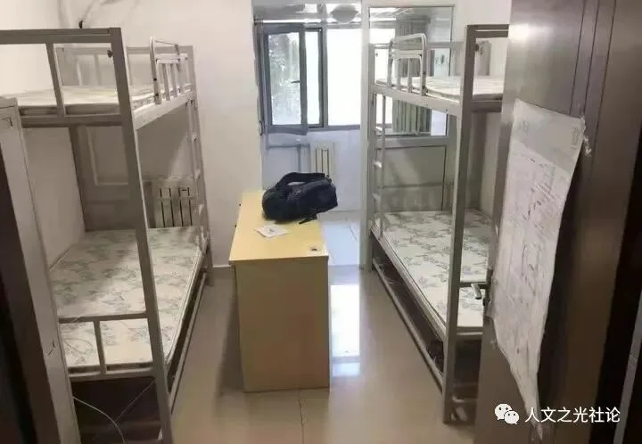
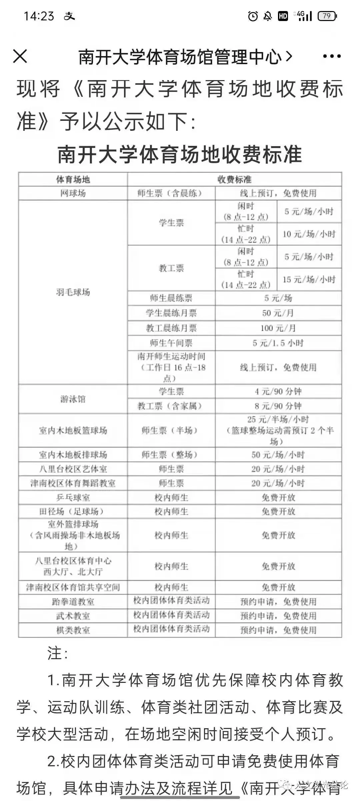

这里是第三期心声汇总~

### 封校问题

> “麻烦了，不想被困在学校了。想留下来考试可以申请留下嘛，其他人可以先走缓解北京交通压力！不然按照要求，望京硕士生最早要等到今年的最后一天才能走，疫情还不知道怎么发展呢？”

> “望京校区的封校非常不合理。望京校区本身校区过小设施不完备，甚至没有超市。封校后学生生活基本用品哪怕只是卫生纸都需要自己凑单从美团下单，生活成本陡然上升。同时，望京校区没有操场，最基本的运动条件都无法满足，每次看到学校小健身房人又多又挤，就只能自己在宿舍简单运动运动。每天挤在这样一个小的封闭的环境，又不能运动，甚至散步5分钟就能逛完整个校园，大家学习后和课余想休息休息，就只能躺在宿舍里，再这样待下去对学生的身心健康极为不利。为什么清华、北大、人大等设施齐全的学校都能出校门而我们却不行呢。希望校领导能认真考虑望京校区的实际情况早日解封。”

> “学校的基础设施建设对学生的容纳能力与封校政策完全不匹配，不要说图书馆连走廊都是人、教室坐满听课的学生，就连食堂都有学生迫不得已在油浸浸的桌上自习，路边的凳子上也有同学盯着寒风学习，倘若是尚未转寒的天气，领导或许看了要称赞一句学校氛围好，但这是氛围的问题吗？显然是自习资源严重匮乏之下的无奈之举。就我个人而言，几乎每天都要经历在学校食堂、教室兜一圈发现没有座位，最后只能回到宿舍学，我甚至去过操场上自习，只为走出宿舍，去看看人。如果不封校，至少我们可以去附近的咖啡厅和商场，当然根本上还是学校设施的不完善。”

“”

> “学校的封校政策是非毕业生也不能返所见导师，难道非毕业生的学术指导就比不上毕业生的重要吗？现在的学术研究发展也关乎着学生的未来呀。skd教学质量本就烂穿地心，好不容易联系到导师给予指教，结果不让出校，校领导是可以担保给学生每人一篇sci了吗？这样无脑的封校政策就是在浪费别人的时间，浪费别人的生命！现在的严格封校真的是在故意消磨大家分化大家吧，毕业生似乎已经被解禁，之后的学生就缺乏“合理”要求出校，校领导继续高枕无忧，懒政怠政。”

“现在的状态不如各回各家！反正都是网课，反正都是见不到导师，不如回家，比这样还安全，还省去了线下上大课的集聚”

双一流问题

“双一流如果无了学校就尽力帮学生找找出路，

比如选调多谈几个省下来（甚至是让同学们也一起写信都行啊）；

比如出国多进几个list，多去argue一下;

再比如把闲置的办公室腾给考研学生上自习 甚至给考上研的同学奖学金（真的不是很困难吧…...）

还有比如就业除了北京 多去省政府转转 社科院的影响力还是有的 多宣传一下 让大厂大企业的hr不卡同学们的简历（就业率真的很重要）；

这不比双一流这个虚名更实在？

同学们只是希望看见学校是站在学生这边 一起努力 希望学校是真正在为学生着想而已。”

### 行政问题

> “上周末学院开了座谈会，针对同学们提出的问题（奖学金迟迟未发，学院没有专任教师，望京办事不便等），学院答复是这些问题很早之前就向学校相关办公室反应过，但是迟迟未批复，比如奖学金方案迟迟一年未批。希望学校，当学生向学校提出工作意见时，学院需要学校批复文件时，务必要在五个工作日内完成。”

> “现在主张精简办事流程，一站式办公，取消了几十项证明材料，现在学校又重新拾起党中央已经禁止的“开证明”，学校不读国家文件的吗？我返所还得让导师开证明？中期考核是学校规定的，也要开证明，学校忘了是自己规定让学生搞形式主义的瞎耽误功夫的中期考核这件事的吗？请代为反馈，谢谢！”

“我很担心学校以为我们只是对封校不满......我代表我个人对教务处学院踢皮球更不满（这点问题都解决不了谈什么建议）。”

### 招生和毕业问题

> “学校硕士毕业论文的要求参考文献至少要八十篇，三分之一的外文文献比例，三分之一的近五年文献比例，这个要求不太合理，研究汉字的，古代文学的，不需要阅读这么多外文文献。建议学校考虑各专业的特殊性而设置毕业论文要求，给予各专业自主权。”

“说实话，生活上的小事真的没那么在意，现在好两天过两天仍然就会懈怠下来。真正决定咱们学校好不好的因素只有两个，一个毕业生去向，一个招生分数，至少要想办法，各种办法，稳住招生分数，否则明年新一届拿着那个分进来，这学校就彻底毁了，再想往上高，高不上去了，锚定住了；

至于毕业生问题，社科大的领导层不能再局限在自己的幻想中了，18级所言，社科大学生身份去向一个正常的985 211的夏令营都被拒绝，这务必是要拿出来解决方案的。校领导不能再自持身段，要主动出击，让其他同等级高校看到我们，了解我们，在保证毕业生去向的基础上才能保证招生分数。”

### 导师问题

“希望大一本科生学业导师能尽快落实，如果有的学院考虑延迟的话，一定要提供每个方向的答疑老师。孩子攒了比较多问题了…...”

### 住宿问题

“希望解决京籍研究生和非京籍研究生住宿同权问题。社科大离很多京籍同学家太远了。不逊于从天津或许河北某些地区到社科大需要花的时间。”

“宿舍隔音差，靠近楼道的宿舍不堪其扰，午睡是妄想，更难以忍受的是经常凌晨十二点甚至一两点还能听到同学在楼道蹦跳，对于睡眠浅、科研压力大的硕博同学实在是很困扰的事。建议：

1. 可否在各楼道铺设地毯；

2.靠近楼道宿舍设置隔音装置；

3.门禁设置在凌晨十二点；

4.敬告各位同学上下楼梯请轻声。”

“投稿：关于京籍研究生四人间不合理问题。

这个问题真的苦恼京籍学生很久了，当初分宿舍大家真的欲哭无泪，求助无门，和公寓办反应他们表示这个规定不是他们定的，他们只是执行，但是这个规定从何而来并不知道。

同样大小的宿舍住三个人已经很挤了，四人间只有一张桌子和椅子，每个人半层的铁皮柜子，完全无法满足日常学习生活需要（光课本和衣服铁皮柜子已经放不下了）。理解学校宿舍紧张但是北京籍研究生和博士一年级也要在学校上课，而且一年里的课程基本上是每天都有的，良乡的地理位置不可能每天地铁往返。（良乡坐地铁哪怕最近的西南四环也要一个小时，不是所有研究生都有条件自驾上学）

由于宿舍无法学习，四人间住四个人非常不方便，白天只能全天都在图书馆教室，晚上在宿舍完全没有地方学习。研二之后为了给室友腾出位置只能不住在学校，一些手续等都需要同学帮忙办理，学校和集体很多活动也都无法参加，几乎没有怎么体验过校园生活。

虽然北京籍研究生和博士人数很少，但是宿舍问题贯穿大家生活学习始终，希望学校能给京籍学生（至少是一年级）安排三人间（至少保证每个人在宿舍有自己柜子和桌椅），而且四号楼三人间还有空余，这些空房间为什么不能给京籍同学住呢？明明有条件协调就因为这一条“硬性规定”给京籍同学带来太多苦恼。哪怕是空着都不愿意给京籍同学提供，让人寒心。看着别的同学的两人间和三人间都很羡慕，京籍同学做错什么了要忍受这样条件的宿舍。希望学校尽快解决。新宿舍楼竣工遥遥无期，以前住四人间带来的损失学校也根本无法弥补，只希望学校能尽快改进这一不合理规定，给同学们带来改善。”

> “天气冷了，外卖送过来经常凉了，希望能够在望京学生宿舍楼里安排一台微波炉使用。学生宿舍无法使用加热的电器，学校食堂虽然有微波炉但是使用实在不便，食堂关门以后便无法使用。”

> “不知道有没有同学反映京籍研究生四人间的问题，真的四人间完全没办法住四个人，北京籍研究生和在职学生都是四人间，但是北京籍学生一年里也要正常上课啊，不可能每天往返，真的很不方便，然后研二为了给室友腾位置只能不住在学校，很多事情都要同学帮忙办理，而且研究生宿舍楼现在21级改成三人间了，据说是有完全空的三人间，希望学校可以协调一下。”

“我就说门禁的事吧，侧门不开防火隐患很大，很多学校都没有门禁。”

> “建议：三号楼六楼住着研究生，和一楼到五楼之间隔开，一直没有热水器。没有热水器导致同学们打水要去4号楼或者大水房，从六楼下来真的很不方便，尤其是冬天，非常容易摔倒，研究生只能走侧门，侧门一楼很窄小的空间存放着十几个暖瓶，上下楼也不方便。之前向权益部反馈过这个问题，不得不说一年了都没有得到有效反馈，可以采取安装热水器，或者让研究生也能去三号楼一楼去打水，但是都被学校否决了。很多同学上下楼打水，增加了暖瓶破碎烫伤的风险，尤其是冬天，真的太难了。希望学校考虑到学生的安全，能够采取相应措施。”

### 体育场所问题

> “社科大室内篮球场地收费太贵，别的学校如南开大学半场仅需25一小时，全场仅需50。而社科大需要75一小时，全场150。场地昂贵，宁肯控制也不让一两个同学上去活动。场地脏滑，高收费但维护条件差！”

“望京的操场能不能改一下，没有跑步的地方，连网球场都没有，每天不运动真的不行。求搞一个网球场！”

### 食堂问题

“望京食堂的面太少了，作为北方人，已经吃了两个月米饭了，真的受不了了，求让食堂多一点面吧！！！！！！而且现在食堂的面也不好吃，很不好吃，领导去吃一下就知道了。”

“建议：望京食堂开设麻辣烫/麻辣香锅窗口，谢谢！”

“建议撤销食堂餐桌上的隔板，隔板无法起到防疫的效果，反而会因打饭饭菜而制造同学们之间的矛盾。”

“建议食堂增加饭菜种类，提高饭菜质量。若晚饭饭菜加入了中午的剩菜混炒，请标明特价，让同学们辨识清楚。”

“邀请炒饭入驻学校、改善生活，可以反映一下嘛，学校的饭我是真吃不下去了。”

### 图书馆问题

“建议图书馆周六日八点开馆，十点闭馆。增加同学们学习时间。”

“建议图书馆开馆前通风半小时，保证同学们来了之后空气清新。因为等同学们到了之后再通风，有同学会怕冷。”

### 奖学金和补助问题

“专业奖学金一等和三等之间的差额过大，几乎是三等的两倍，且三等不能覆盖学费，这与国家政策不符。请学校做出调整，兼顾公平。”

“棒！希望解决奖学金问题 一等一万五，三等八千，还不足以覆盖学费，差两倍，希望学校兼顾公平，惠及以后的学生。”

“补助太低了，却拨钱给无需保暖的梧桐树穿衣服，说一下吧，拜托了”

“建议提高补助水平，增加返所交通补助。”

### 医务室问题

“建议医务室周六日安排医生上班，方便同学们及时就医。另，请组织医务室人员培训，提高医术。”

“还有医务室周末不上班的问题，生病不能及时就医的同学表示很绝望。”

### 课程质量问题

> “讲课老师水平参差不齐，有的老师连最起码的专业性问题都会出错，且在学生指出错误后语言含糊不明，甚至说出‘ppt引用的内容是不是马克思说的不重要’这种话，直接给学生在学术研究上产生完全错误的指导，很难不让人怀疑教师的专业性和对学术的尊重。”

“强烈建议加快课程评价体系的建立！！！！某些老师连自己的专业知识都搞不明白，误人子弟......”

### 心理健康问题

“希望能在心理中心设立反性暴力服务与相关热线，开设性别研究讲座，倡导性别安全关系与性别包容。”

### 艺术团问题

“希望能够增加学校钢琴数量！”

### 疑问

“想了解学校是否所有学科都参加了第五届学科评估，例如法学有没有参加（不是指专硕）？”

“能不能让教务处提前一个月或者二十天公布期末考试安排啊，方便掌握复习进度。”

“学校可以有公告栏吗，学校公章的那种，而不是所有的新闻口口相传。或者我不太懂我们学校的工作机制，层级是否有人可以说清呢？（能不能增设线下公告栏呢？）”

希望学校相关部门能够回应同学老师们的心声，拓宽同学们的发声途径。微信公众号的后台也一直接受同学们的留言与投稿~
