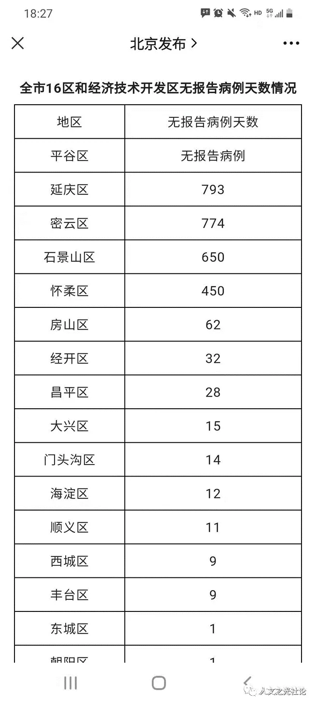
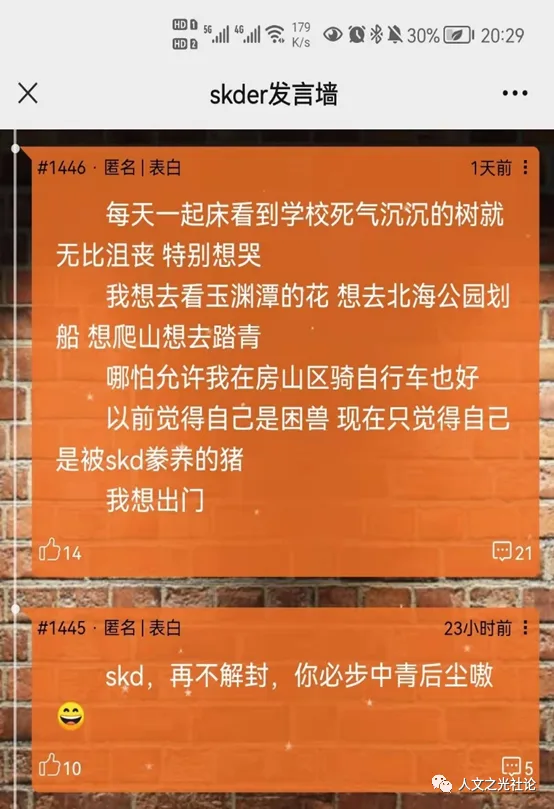
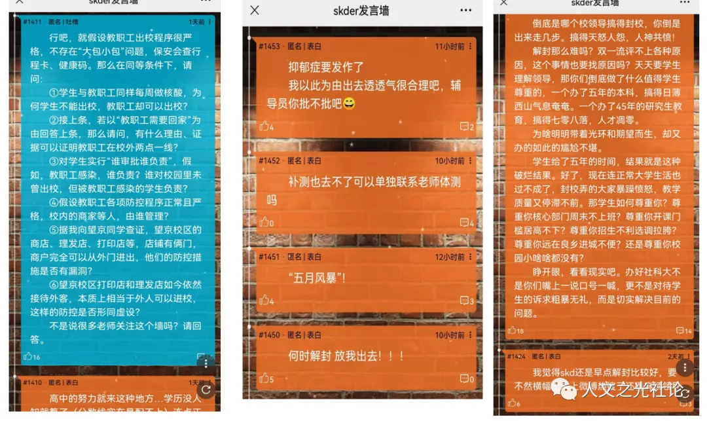

## 1

“嗨您好，想反映一下关于最近的封校事宜以及实习的情况。首先，就是迷惑的周边学校纷纷解封而社科大审批越来越严格的情况。近日望京校区施工，每天工人甚至可以不戴口罩在校园里进进出出，而学生仅仅是去对面便利店或者见导师都不被允许。其次，是关于实习的问题。关于我校研一同学是否能够实习，是否能够在上课期间实习，四点下课之后是否能够去实习等一系列问题都没有一个明确的规定，不同的学院不同的班级都有着自己的规定。

怎么处理政策和现实之间的问题，不能必须等到有人发声，学校再来解决这件事吧。”

## 2【主编投稿】

北京的疫情防控近日颇有成效，看着已经归零的新增数字和房山区六十多天无本土新增的消息，我们真欢喜，不少同学估计也开始规划清明节的出行计划，玉渊潭盛开的的樱花更是让大家在网络上神往，但回过神了，大家才发现一个重要的问题：社科大的校门依然紧闭。

自2月25日以来，大多数同学已经在学校里度过了一个月的封闭时间，本来大家心里预期的3月中旬放开也因为新增疫情而被迫延期，同时原先较为宽松的审批也全面收紧，至今已经过去了接近两周，而在北京已经社会面清零的情况下，不少同学在几天前就开始盼望着学校进出校政策的改变，但很遗憾，截止本稿时间，依然没有任何关于改报备的学校官方消息。同学的情绪逐渐不满，skder发言墙上从几天前也是一大片呼吁报备的声音，想象着可以像去年一样，成为北京学校合理化管理的先声，成为北京高校的典范（但可笑的是，去年社科大的解封也是迫于学生们的愤怒与压力）。然而在30号下午，陆续传来北京工业大学和北京科技大学解封的消息，同学们开始着急起来了，这和去年下半年封校的形式是何等的相像，因此我们不禁开始思考，为什么每次社科大的解封与否都要看我们学生是不是已经到了忍耐的界限呢？

先来看看同学们的怨气从何而来吧？首先是封校必然带来的同学们生活上和心理上的各种生活不便利，然后是学校每次的政策调整实在是过于缓慢，最后是流言蜚语带来的困惑。

生活不便利顾名思义，社科大校园不仅小，而且很实在的说很多设施也在一个缺失的状态，这一现状是我们当前不得不接受的。在这样的现状之下，社科大学生们的生活质量直接与外界挂钩，五年以来，社科大周边的环境不断改善，我们的生活本应有所改善。不可否认，周边的设施是社科大同学的日常生活的不可或缺的一部分。而长期的封校导致同学们的生活质量受到严重影响，更不用说封校给实习，见导师，就医的同学带来的不便利了，尽管可以申请出校，但每次进出都需要申请，不仅仅是同学，老师、保安，都要随时处于这种紧张状态当中，，承担不必要的风险，增加本来可以消沵的隔阂，但这样的程序如果可以废止的话，又何乐而不为之呢？

而生活上的不便利，自然也会对同学们的心理产生很大的影响，在skder发言墙上，我们可以看到铺天盖地的求解封帖子，还有不少的表示因为封校而感到抑郁，甚至又有一些想要自杀的言论在墙上发表，在这样的低气压状态下，学校里的情绪普遍是低迷的，学生们不开心，生活和学习的效率都不如最佳的状态，更不用说各种小道消息中传来的“审批会收紧”这样的不利消息如同火上浇油把学生们渴望出校的心架在火上烤，作为学生，我们当然完全无法理解校领导为什么迟迟不宣布解封，那么就让我们也“通情达理”一些，从校领导的角度出发来思考一下为什么要不解封。

首先，目前这种实质上的一刀切的简单粗暴封校政策，突出一个核心优势：“方便”，这个方便不是同学们方便，不是教职工方便，不是老师方便，而是管理方便。通过让大多数同学继续保持被封校状态即可保持当前“良好的防疫态势”，无疑能够最小化自己所要承担的责任，同时也贯彻了学校一贯的“只要不做事就不会犯错”的指导思想。

其次，这种封校方式的运行成本相对较低，在其他实行较为严格报备制的学校，学校会要求学生明确载明出校目的，并且会严格核查，而我们的这种封校政策无需如此复杂，因为其预设的条件就决定了有出校资格的人的数量极其有限，因此可以办到用最少的成本来完成防疫任务。另外，做出这一决策并不需要什么特别预案，只需要按照原有的今年入学时的封校政策照抄即可，同时学校也不用冒着被“良乡大学城管委会”所批评的风险，可以安心等着北京其他甚至还没返京的高校陆续解封，而无需自己当出头鸟。

最后，这种方式，是类似于“苦一苦学生，骂名我来担”的好事，只要可以完美完成任务，社科大或许也会成为防疫优秀单位，而做出这种决策所需的，仅仅只是继续挨学生们“活该没有双一流”的骂罢了。学生们在狭小的校园里被集体“关押”了一个多月导致无论情绪还是精神都备受煎熬这一事实，很有可能被视为决策路上可以舍弃的小细节而被忽略了，借用一句话便是“只要疫情防控不出岔子，哪管它洪水滔天”。

于是从校领导的角度来考虑，这可真是件美事：我提前解封，可能还要挨批评，但是我要是晚解封甚至不解封，甚至还能被表扬“抗疫防疫先进”。他们把一切的风险推给了学生、推给了教职工、撇清了自己的责任。

当然，从领导的角度，我们还有一把不解封的“尚方宝剑”可以用：北京疫情形势尚未明朗，国内上海疫情依然严峻，我们还是要谨慎不解封。

但作为领导，我们应当知道的是，根据近日的通报可以推断，北京疫情已经得到了十分有效的控制，而且已经陆续有三所大学解封校园，这把“尚方宝剑”已经不再是可以糊弄学生的利器了。

所以，校领导必须要考虑，面对学生们越发渴望出校的心，以及陆续传来的高校解封消息，这样的美梦还能做多久呢？

事实也证明，不尊重客观事实与民心的政策难以得到响应。苦闷，焦虑，甚至乎抑郁的情绪在这么一个狭小的校园里蔓延着，被积压着，被放大着。而令人遗憾的是，诸位政策的制定者似乎没有听见广大师生的不满，没有听见校园每个角落失望的叹息。叹息积累多了，是要化成呐喊，发泄出来的——在发言墙上，有同学要去买横幅抗议封校。人不可能总是理性的，更何况不理性的封校政策正逼着人们丢掉理性，逼着人们在焦虑、煎熬、不适中度过每分每秒呢？没有人希望看到令人遗憾的事件发生，也没有人希望校园的大门继续被毫无道理地严锁着，只关着希望出去呼吸一口新鲜空气的师生，而防不了任何病毒——这是既有毁人健康的，又有害人心灵的。

除此之外，在诸多质疑声与怒骂声中，也有些耐人寻味的内容——对教职工进出学校政策的不满，更让人感到有趣的是，这样的质疑建立在推测上，也就是说尽管学校可能在教职工进出校政策上并没有什么特殊，但同学们还是在质疑，这就涉及到一个核心问题了，社科大的“流言治校”问题。

何谓流言治校？顾名思义，社科大的校园生活被各种各样的流言所支配的，就比如封校期间不断的流言：“教职工出校无限制；有人可以随意进出；某个校门的保安不会查”，还有前段时间闹的沸沸扬扬的换宿舍楼风波。尽管真假未辨，但还是会激起大家的怒火，在这样的怒火影响下，同学们的判断力自然会下降，而判断力的下降则会让更多的流言传播。

那么为什么在社科大，流言的市场这么大呢？很明显，这与不透明不公开的信息渠道有关系。每个社科大学生或许都经历过，很多通知和要求都是在转了几手的微信聊天记录中才能了解，各种各样的小道消息充斥在我们身边，而正是如此之多的小道消息才让本不应该被大家相信的流言大有市场。倘若学校在校园信息平台上，公开教职工进出校要求，那么哪里还会有关于教职工随便出校的流言呢？这样的不公开不透明不仅损伤了依然相信学校的同学的心，也让更多的流言继续滋生，恶性循环几轮下来，就会引发如同之前换宿舍楼风波中的信任危机。

这样简单的道理难道学校不明白吗？学校当然明白得很！学校明白中央关于今年维护稳定氛围的文件精神，知道进课堂考察课堂教学内容，但学校就是不愿去对已经迫在眉睫的信任危机采取任何有效的行政，这种治理失能已经严重影响到了各个方面的生活。学校明明有可以告知全校的移动校园系统，可是就连之前医务室因集中隔离无法线下上班的消息，都要靠不舒服的同学跑到医务室门口看到贴着的纸质通知才知道这样的，这样的低效显然不应该在一所以建设社会主义一流文科高校为目标的，分数线依旧有中流211水平的高校里出现，更不应该在第二轮双一流失利之后，急需反省与改变的社科大中出校。没错，高培勇校长在开学时严肃认真的发文，要完成多少项目标，这固然是好的，但为什么不公开目标的进展呢？校方可以说我们已经在什么地方有了怎么样的改善，但为什么不能将这些改善说出来让学生们知道呢？学校不说，很多学生不知道，那么即便校方在某些领域有很大的进步，学生也只会感觉学校正在停滞不前，甚至感觉学校在摆烂。

那么这样的情况有解决的方法吗？当然有！那就是人文之光社论在去年的文章中强调过无数次的“直接沟通机制”。何谓“直接沟通”？那就是没有中间人，直接让校领导和学生们对话，定期的在一个固定的场合直接对话，而不是现存的校领导自以为民主的“领导——学生干部——学生”体制，这样直接的沟通难道不能慢慢消弭过去校方和学生间的隔阂，让互信互利而平等的学校——学生关系重新降临在社科大吗？

但无论学校到底摆烂没有，但我们能看到的，普通同学们能看到的，就是一片死气沉沉：死气沉沉的校门，死气沉沉的通知平台，还有死气沉沉的行政速度。同学们还有太多疑问，物价补贴有多久没发了，新宿舍楼到底怎么分配寝室，到底什么时候能够恢复刷卡出校？但遗憾的是，不管如何发问，社科大的几个公众号里永远不会回答，只有无穷无尽的小道消息在本应为官方消息支配的信息渠道上加速疾行。

但遗憾的是，这一篇文章的效力，或许还不值得让官僚瞧上一眼。我们唯有在这个尚未完全解冻的早春里，在细碎的消息记录和流言中，期盼着不知道会不会到来的春暖花开。
