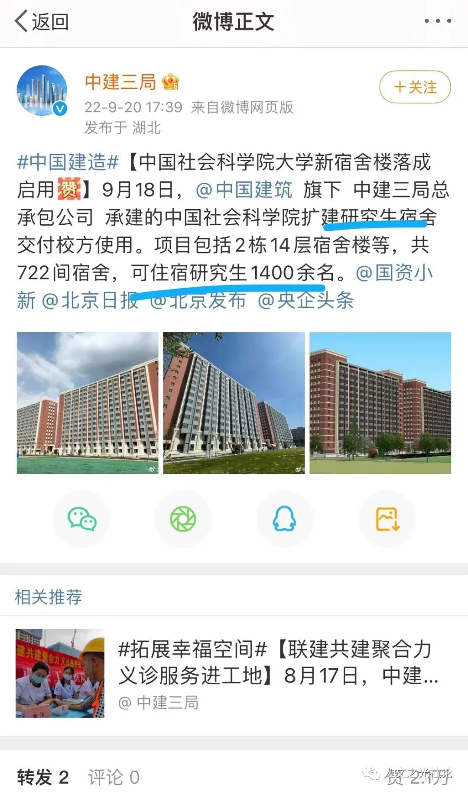

请学工处、后勤处、网络中心、教务处等相关部门及时关注并跟进问题。

## 1 后勤

## “投稿7号楼暑期后勤:

1. 8月份不赠送电费，不知道是只有新宿舍楼没有还是全部都没有。暑期有众多在校准备考研、实习、写论文的同学，学校各单位也发了众多关于后勤保障的通知，没想到却在电费补贴上偷工减料。如果只是7、8号楼没有那学校相关部门请给个合理的说法。

2. 7号楼热水水压极低，洗个头洗个澡要很久才能打湿、冲干洗发露和沐浴露，为何新楼的水压还远不如1-6号楼的水压呢”

## 2 校园网

“学校应该正面回应校园网流量问题。以前学校每月赠送50G的流量很多人根本用不完，但是现在每月50G基本到每月10－15号就用完了，而且根本没有大额使用流量的项目。想在流量方面从学生口袋里掏钱也要有个限度。建议每月流量需求比较大的同学拉宽带，学校现在流量流速快的超乎想象，每个月买流量的钱拿去拉宽带足以，而且还不限速。"

## 3 招生

## “您好我是今年新来到社科大的一名大一新生，我想就咱们学校以后招生提一些建议:

一多宣传宣传保研率

二试着增加一下选调省份。”

## 4 迎新

“救命啊，学校回复说迎新系统里传的照片不会用于校园卡，校园卡上用的是报名的照片，但是很多同学去年报名那会儿都是被封控的，自己拍的照片灰头土脸，如果作为校园卡照片，那真是看到一次就心梗一次的程度，请问可以沟通一下用迎新系统的照片吗？"

## 5 自习室

“自习室能不能不要打机械键盘啊，姐，我知道你着急告诉大家你有机械键盘，但你先别急？”

## 6 住宿

“你好 想投稿一下关于研究生新生住宿事宜 学校去年不是修好了新楼嘛 为什么要把今年研究生安排在小小的旧楼三人间 看历史学院发他们本科生都住新楼 一般学校不都是研究生宿舍条件比本科生好很多吗 学校这样安排真的好奇葩 。而且上面不是说扩建的是研究生宿舍吗，为什么是本科生住进去了?

如果是为了集中管理 研究生住在一起不是更方便吗？”

## 7 教学大纲

“1.历史学院专业拓展课“古代东方文明专题”的课程已经调整成11周的了，但是大纲仍然是16周的，也没有进行相应的调整。希望能够及时上传新的大纲。

2.截止到8月底仍未见到23年秋季学期所需教材清单，烦请教务处及时发送。

3.历史学院专业核心课“世界通史（二）”在“团队成员姓名及简介”一栏中把金德宁老师的介绍写错了。金老师是咱们社科大的老师，不是“中国科学院大学”的老师。希望能够请课程负责老师进行修改。

谢谢！！”

## 8 奖学金

“学硕有8000新生奖学金，专硕的新生奖学金取消了，并且也无学业奖学金。专硕征收了高额的学费，对于学生的奖助却几乎没有，这对于专硕的同学来说是否不公平呢？"
