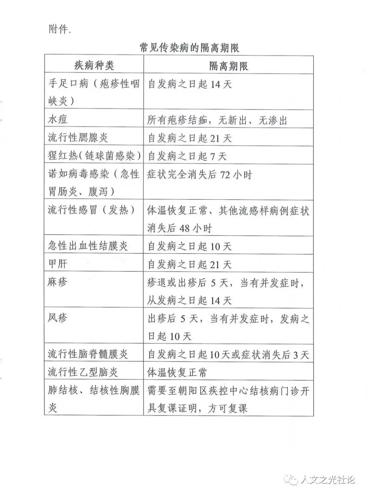
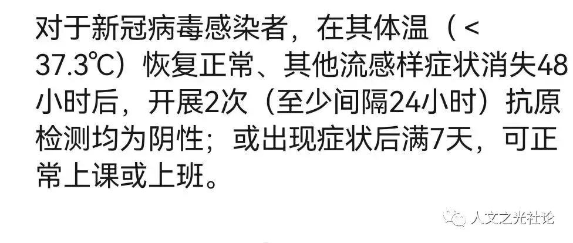
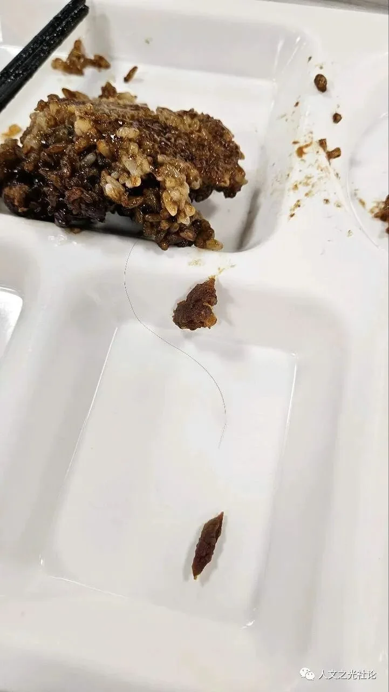

希望图书馆、后勤处、公寓办、学工处等部门及时关注并跟进问题。

## 1 防疫

> “关于新冠监测的问题:学校一直按照高校及疾控关于《普通高等学校传染病预防控制指南》，在各区疾控部门的监督指导下进行校园内的传染病防控，疾控部门要求校内常见的新冠、水痘、肺结核、诺如等属于聚集性传播疾病，确认人员患病后需进行隔离健康监测。不同疾病有相应的监测时长。如学生在校监测，学校会提供健康驿站进行监测，如学生离校回家休养，学校准予离校（这是和甲类传染病不同的地方，甲类传染病一旦发现是限制流动的）。附学校各类传染病监测期限供参考。”

【见《[【读者投稿】](http://mp.weixin.qq.com/s?__biz=Mzg2MjcwNzQ1Mw==&mid=2247485640&idx=1&sn=df33d8d54b77d7ea34792556fd724462&chksm=ce02835af9750a4c074978c6de66db6a594444516fc51ca1e0dc02a13edec784a057f40ab44a&scene=21#wechat_redirect)问题遥盼回应》第2条》】

## 2 医务室

“关于假期开诊的问题，医务室已经在8月26日提前恢复了日间门诊及夜间门诊，但每年由于新生开学，医务室还有大量相关准备工作需要做，目前只能轮岗开诊，望理解。”

【见《[【读者投稿】](http://mp.weixin.qq.com/s?__biz=Mzg2MjcwNzQ1Mw==&mid=2247485640&idx=1&sn=df33d8d54b77d7ea34792556fd724462&chksm=ce02835af9750a4c074978c6de66db6a594444516fc51ca1e0dc02a13edec784a057f40ab44a&scene=21#wechat_redirect)问题遥盼回应》第3条》】

## 3 图书馆

> “图书馆的数字资源数据库heinonline,剑桥期刊在线，牛津大学期刊出版社，等数据库为什么不能使用了?严重影响到学习，至少已经一个月不能正常使用，打所谓的图书馆数字资源管理的联系电话，永远打不通。”

## “回复一下新生图书馆：

图书馆的电脑有时候要登录上校园网账号才能正常使用，需要打开浏览器然后找到上网登录页：10.27.1.100”

“投稿，之前有的娃去图书馆找书找不到，可以关注（中国社科大图书馆）公众号，在公众号-微服务-馆藏查询中在线检索。方便滴很，不用搞那个破电脑了。”

## “您好，我想问下说图书馆电脑打开转圈的是望京校区还是良乡校区呀?”

【见《[【读者投稿】](http://mp.weixin.qq.com/s?__biz=Mzg2MjcwNzQ1Mw==&mid=2247485640&idx=1&sn=df33d8d54b77d7ea34792556fd724462&chksm=ce02835af9750a4c074978c6de66db6a594444516fc51ca1e0dc02a13edec784a057f40ab44a&scene=21#wechat_redirect)问题遥盼回应》第7条》】

## 4 食堂

## “食堂投稿:

建议望京校区的食堂多备些菜，同学们来的很多啦，12点去吃，好多菜都无了，过几天就要上课，12点的续菜真的很重要。”

“今天晚上食堂有糯米糕，我买了2.5的量，结果刚吃两口吃到一根头发，头发有点长，很掉胃口（附照片）

ps：本人男，没有这么长头发”

## 5 宿舍

> “投稿八号楼：虽然楼才盖好一年但是问题不断，有的墙皮已经开始脱落发霉，有的屋子飞满了不明小虫，抑或是那经常坏的电梯，还是午休期间的电转声，都能让人眼前一黑。这么多问题，不禁让人怀疑八号楼的质量和安全问题，尤其是经常坏的电梯，有一次电梯突然下沉一次把我吓死。”
