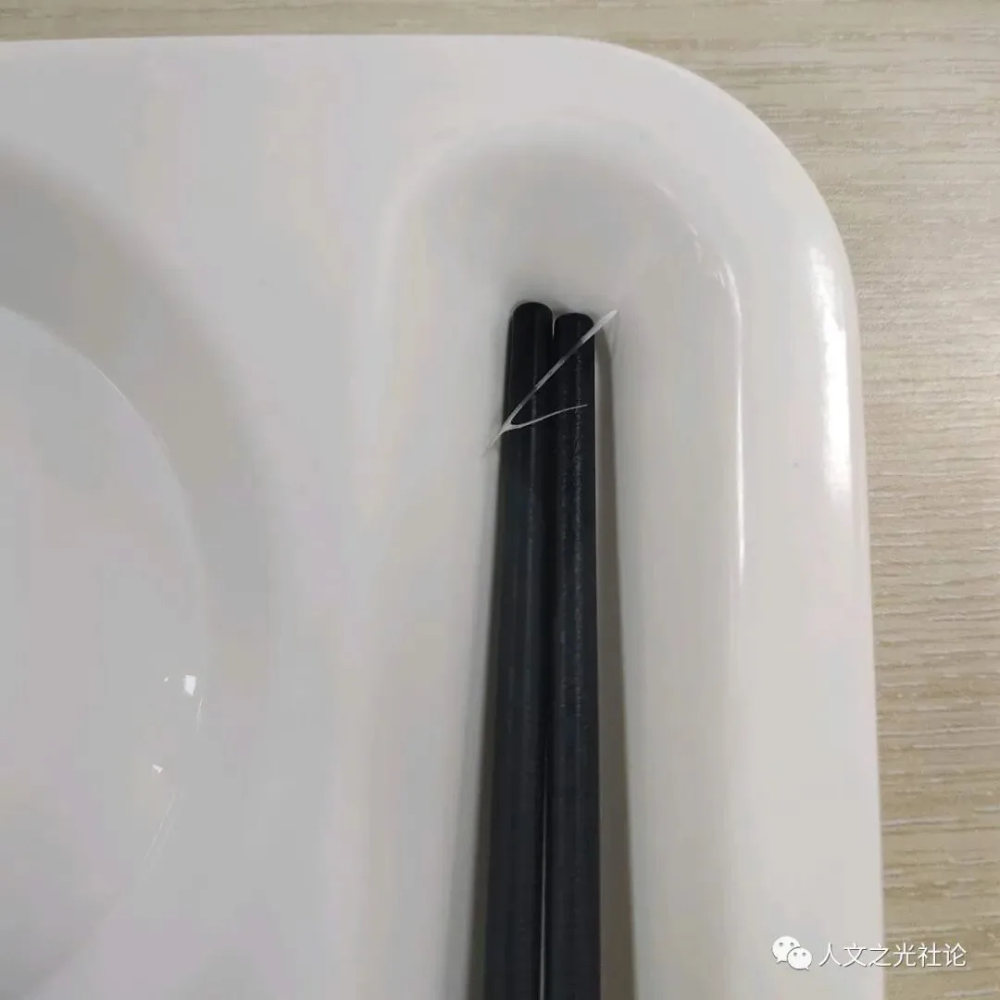

请校领导、学工处、教务处、后勤处、科研处、图书馆、望京办等相关部门及时关注并跟进问题。

## 1 军训

## “两周训练营，一生军旅情——小院军训开营仪式纪实

今天上午，在热烈的气氛中，我校本科大一、大二、大三、大四全体学生在操场上举行了军训开营仪式。相比于普通学校只有新生而稍显寡淡的军训，小院军训的全员参与，不仅展现了全体师生团结一心的感情纽带，更展现了哪怕是考公人、考研人和实习人在百忙之中也愿意和新生一同拼搏进取、昂扬奋发的精神样貌！

首先老师以极强的专业性正确指导了同学们鼓掌的方式和要求，在学校和各学院领导依次入座后，大家自发热烈鼓掌，教官和领导分别指挥，井然有序，伴随着嘹亮的歌声，鲜艳的五星红旗冉冉升起，全体师生庄严肃立，向国旗行注目礼，形成一道靓丽的风景线。

张树辉副校长发表了亲切的讲话，首先对小院近年来取得的成就进行了总结，接着激励同学们严格要求，刻苦训练，展现良好的精神面貌，迈好大学生生涯第一步。同学们沉浸在领导讲话中，不时爆发出热烈的掌声，操场内外充满了快活的空气。

之后，副校长还走到台下进行了视察，同学们热烈欢迎，笑语不断，都感受到了领导们与民同乐的亲切和办好军训、办好实事的热情。点赞！在未来的日子里，相信同学们也必将带着强健的体魄、顽强的意志、严格的纪律，用汗水谱写人生的精彩华章，为领导们交上满意的答卷！”

“ 今天有幸亲耳听闻今天张树辉副校长在开营仪式上的精彩讲话，让人十分震撼。校领导部署军训的勇毅担当，家校之间的和谐沟通……这一切都令我感动不已。

既然有如此丰功伟绩，那当然值得大书特书。因此，我强烈建议我们敬爱的校领导把自己讲话的全文释出让大家久久铭记其恩情。

并且面对全校大军训这样的盛事，我恳求学校有关部门能以这篇讲话为蓝本书一篇“高校军训的勇毅书写”铭刻在石头上。然后将石头立在行政楼前，勒石记功，永世留存。只有这样的行为才配得上这次讲话，才能更好的感动你我，感动小院，感动中国，感动世界，感天动地！”

“ 可以麻烦人文之光社论转发这篇文章吗:《[试论我校军训补训工作中的几对矛盾关系](https://mp.weixin.qq.com/s?__biz=Mzg5MjgxOTY0NA==&mid=2247484296&idx=1&sn=cc1acd247b81ede33c3644addf8e0459&scene=21#wechat_redirect)》

已经设置了白名单，如已有推送安排，放在副推也可。文章发出之后，有些同学跟笔者讲述了一些此前没有了解到的情况，也希望能通过人文之光社论的平台传播一下，欢迎读者对文章提出理性的批评和讨论，谢谢！”

## 2 自习室

> “开学了，考研人最怕的又来了，党校楼仅有的 3间考研自习室又要排课了。为啥每年开学都惦记这几间自习室呢？考研人时间紧，压力大，书也特别多，现在正是冲刺的时候，不要再折腾我们了好吗？求求了。学校教室紧张，为啥舞蹈室不安排在气膜室内体育馆，要占用两间大教室呢（就事论事，无意挑起对立）？本来是一间，去年教室清理的时候又给弄出来一间，也不是天天上课，一直锁着门。而且上课时时候放着音乐特别吵。走廊里放的全是鞋，整个走廊弥漫的都是臭鞋味儿。良乡偏僻，还有很多办公室和会议室有多少人天天来呢？非会议时间开门充分利用起来不行吗？说是有没有上课的空教室可以用，去学习学习就知道有多吵了，而且正常教室里面插座特别少，现在谁上自习不带电脑呢！考研自习室的插座很充足，能保证一个人一个插座，其他地方就是图书馆能保证吗（门口大厅也不是都有插座）？，求求你了，别折腾了，孩子怕考不上，良乡之大，真的容不下几间考研自习室吗？良乡之小，真的放不下一张考研桌子呢？”

“没见过任何一个学校当天通知，直接来人把学生书全扔了，教室不能学习，图书馆开那几个破位置够谁用，全为新生，一点不顾老生死活。望京校区领导能不能不要拍脑子决策?”

## 3 图书馆

“图书馆针对近期读者反馈的问题在图书馆主页（lib@ucass.edu.cn)中动态发布模块-新闻公告里进行了回复，连接地址:

https://lib.ucass.edu.cn/engine2/d/19539857/4713031/0?t=9758168&p=674796，

(注:碍于微信平台限制，烦请读者朋友们自行在浏览器内复制打开)

请帮忙转发，谢谢！”

> “图书馆的数字资源数据库heinonline,剑桥期刊在线，牛津大学期刊出版社，等数据库为什么不能使用了?严重影响到学习，至少已经一个月不能正常使用，打所谓的图书馆数字资源管理的联系电话，永远打不通。请图书馆回应一下这个问题。”

> “致图书馆各位领导大爷，别端着架子晚起早睡延年益寿了，多请俩人，没编制就开勤工俭学岗位让学生们帮忙开馆。你馆真金贵得很，书不全就算了，全校自习空间本来就不多，早点开门晚点锁门能怎么样啊？一直当缩头乌龟，就看不到学生的诉求吗？”

“ 希望新学期社科大图书馆别再养爷式开馆了，一碰见节假日放假也就算了，周六日也要歇一歇坚持不改早9晚9？

良乡大学城哪个学校不比你开馆时间长？双一流高校哪个是这样的？二本都比你开馆时间长！

希望学校搞清楚，自己是在办大学，不是官爷们养老的地方。

一个文科高校图书馆的职能是什么？这是学生学习的主阵地！学校不给学生提供学习空间，动不动就休息，还办哪门子大学？”

## 4 奖学金

## “奖学金问题：

关于2022级法学院新生奖学金问题，去年入学评的奖项，开学典礼颁发的证书，但是奖学金欠款拖了整整一年还没有动静，难道社科大是真没钱了吗？想拖到毕业不了了之？没钱也给学生们一个交代啊，不声不响算怎么回事。”

## 5 校庆

“ 45周年校庆的大事，希望有关部门有所作为，给好好举办一下，很多校友都想回母校看看。毕业了大家都很忙，很难得抽空一起回母校回忆一下青春，我们也希望这些校庆能够常态化，回来看看老师和同学。校庆不仅仅是校庆，也是联系校友和在校同学老师的重要桥梁和纽带。期待能够成功举办。

社会主义一流文科大学的建设，不仅需要在校同学和老师的努力，也需要校友的聪明才智。"

## 6 食堂

“一食堂的饭最近真的不错啊，早午晚饭种类丰富了很多，而且味道很好吃，而且每天都能做到菜品更新，真的超级棒，打饭的阿姨超级好，打的饭菜特别多，真的爱了。”

## “希望良乡校区一食堂清理餐具的时候仔细一点。”

## 7 宿舍

> “三号楼能不能做一做驱蚊啊，天天晚上蚊子嗡嗡嗡，喷药也不管用，咬了一身包，这几天能打死好几十只了，学校到底能不能做一次彻底的驱蚊，不然学生天天觉都睡不着，还学什么习。事。”
