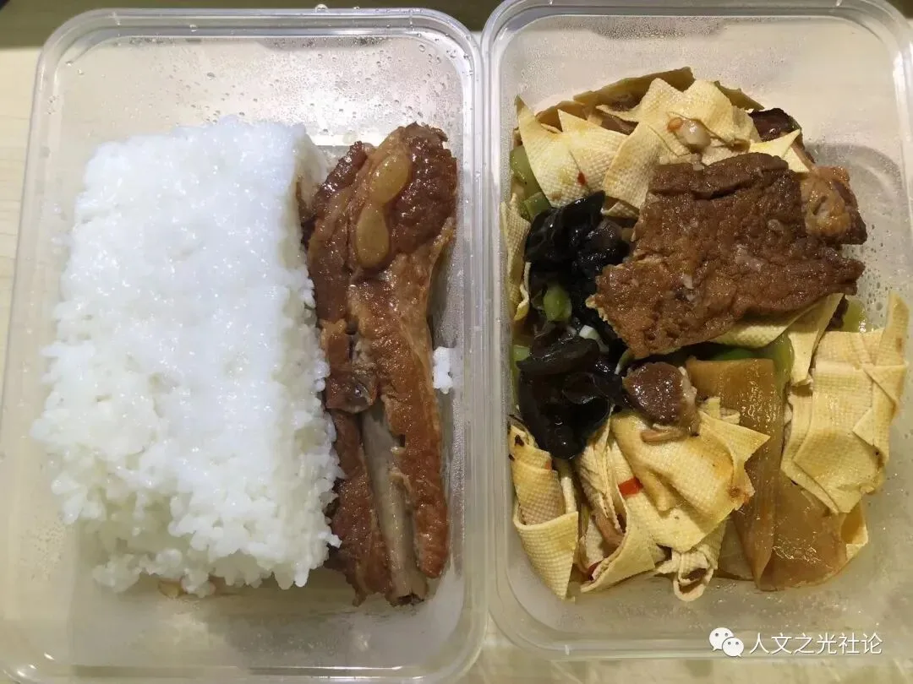
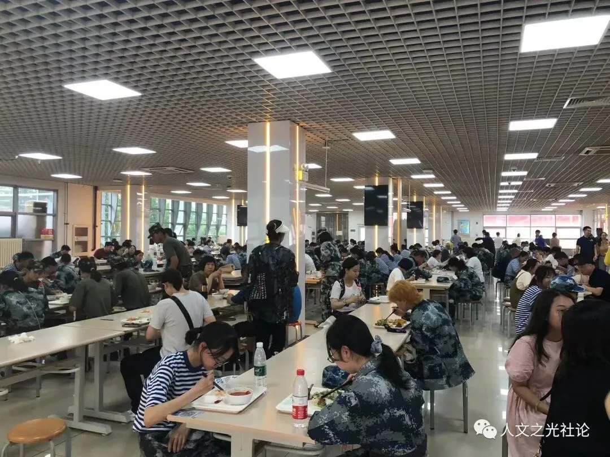
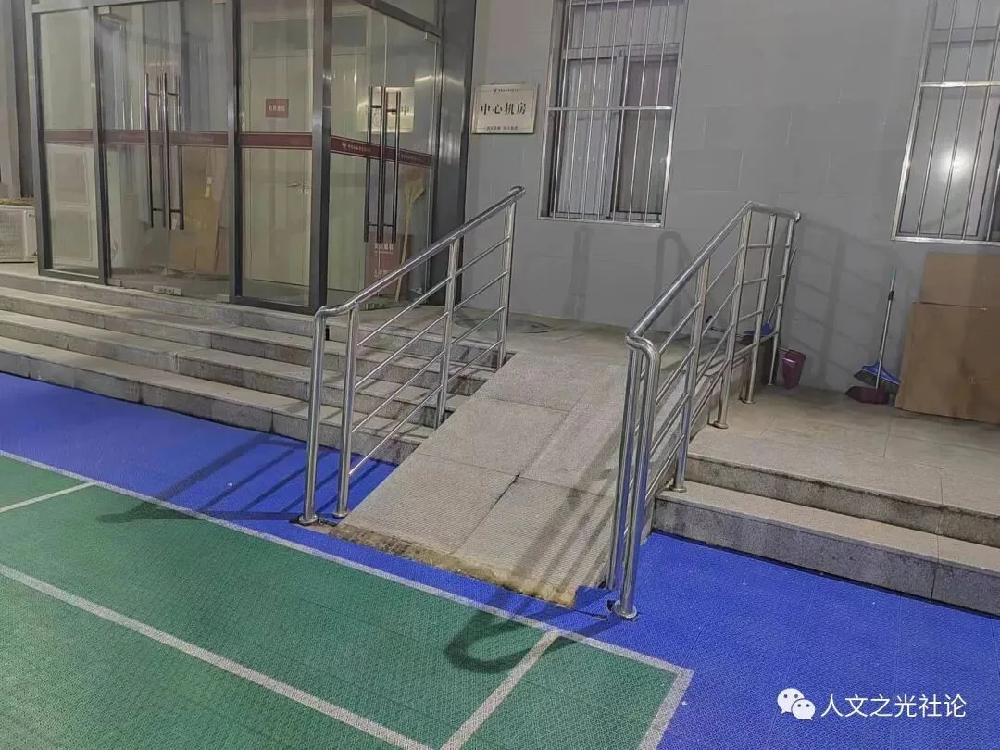

希望学工部、后勤处、公寓办、图书馆、教务处、望京办、科研处、财务处与医务室等部门及时关注并跟进问题。

## 1 宿舍

## “请后勤给六号楼正常使用的洗衣机被换掉一个说法。”

> “学校有些人难看吃相又一次暴露了。六号楼好端端的洗衣机，半数以上被改成了需要自己租购洗衣机桶或下载商家app的洗衣机。想必是原来的洗衣机恰不上烂钱，以旧换新并且引入这种商家能再吃一笔吧。不知道现在这所学校，是不是自上而下心里想着的都是将自己手中每一点权力变现呢？”

“良乡校区7，8号楼能不能考虑宿舍水卡每人分别计费啊？每个人洗漱的要求不一样分开计费更加合理啊”

## “学校开水房建议两月一换滤芯，两月之后的水质明显变差”

## 2 图书馆

> “我看到今天的投稿之一，牛津大学期刊库用社科院的深信服VPN是可以正常下载论文的，可能是社科大自己有VPN后没建设好，如果可以，希望代为转达，也希望可以帮到投稿的同学”

## “【1】

“良乡校区图书馆平均每天到馆120余人，最少时不足80人，座位预约平均使用率不足70%。”

——我发现学校每次都能搞一些数据来为自己偷懒辩护，就跟之前的校园网割韭菜一样。

有没有一种可能是你的偷懒行为，导致人员流失呢？寒暑假还好，有很多空教室供大家自习，矛盾不是很突出，你要是开放时间调整成一天只开仨小时，相信去的人更少，得出的数据对你也更有利，而且更环保。

图书馆也可以用同样的假期数据论证出倒果为因的结论：“三楼不需要开放，从来没见过假期去三楼自习的。”

【2】

这会把北大图书馆开馆时间摆出来了，倒也行，毕竟向北大看齐么～在非寒暑假状态北大总馆开放时间是周一到周日6：30-22：30，社科大希望也学学。

平常开馆时间社科大图书馆是不是又要找和自己一样开馆时间的高校来辩护啦，反正中国那么大～不断变换对比标准，只要找到有利于自己的就行

还记得之前一直早9晚9开馆的时候，图书馆也是摆出了一堆依据，而且还有北京市的文件为自己辩护～

真没啥好说的，偷懒可能只是有点难看，但还要论证自己很勤劳就有点恶心了。”

“ 投稿：给图书馆详细的回复点个赞，也更深地理解了图书馆工作面临的一些现实困难。不过还是切盼图书馆能做到更好（当然，这肯定不能单靠图书馆）。比如以下几点，仅作为建议：

1. 咱们是纯文科大学，基本没有做实验买设备的需要，与此相对应地，图书和数据库的经费还可以尽量争取。

2. 大院图书馆加挂了“大学图书馆总馆”的牌子，当然是利好消息。但大院下属的各所分布很广，从院部到北京各区都有，零零散散。很多专业性较强的图书，大院图书馆并不收藏，反而是在各所有（比如投稿人是学法律史的，不少参考书大院图书馆没有，法学所可能也没有，但中国历史研究院有）。将来的院校图书通借通还，有没有可能扩展到院属各院所？

3. 图书馆二馆和现存的图书馆是何种关系，会对读者使用图书有何影响？可能的话请图书馆惠予介绍。”

“ 投稿：望京校区图书馆还不恢复正常，每天晚上九点关门我也是服了，还只开一层楼。教室很多都被新生体检，教育大会占了。

我一会被赶到报告厅一会有被通知报告厅也有事，又得背上书拿到宿舍。我真的服了！

都开学了图书馆能不能赶紧恢复正常，能不能早点开门，晚点关门，这点正常的需求都不能满足，让学生怎么学习！

唉，可悲又无语。。。”

> “投稿：望京校区：还记得招生宣传上说着：人文之光。也自省学生与学校是荣誉与共的共同体。但迄今为止，估计只有skd的图书馆是九点开门，众多学生在门口等也雷打不动到九点开门。试问北京哪所高校新生开学后还保持九点开图书馆到大门。skd的图书馆真是天大的笑话，北京高校里的笑话。图书馆开门估计是外面下刀子，外面落枪子，图书馆开门员也都是准点开门准点关门。好一个人文之光，众多学生等着图书馆开门，仍卡着点开门，人文弃于何处？学校一直致力于双一流办学，可是学校方方面面真的做到了双一流高校的要求了吗？学校是为学生服务的，学生感受到学校的人文关怀，学生也就更有集体荣辱感。领导们，你们扪心自问一下，是不是只有办好了学校，管理好了行政，实事求是，着学生之所想，急学生之所需，才会越来越光照四方，是不是一个高校最基本的为学生工作的本分没尽到也就是只能在北京高校锈迹斑斑，成为人文暗淡之光。。”

## 3 食堂

“二食堂为什么没有筷子，连收拾餐盘的人也没有，吃完的餐盘都堆在那里快成山了。。。。。”

## “一食堂还餐车是宁死不改？不能恢复正门也放？”

## “刚开学一食堂变好看变干净了诶，今天菜也不错👍。”

## 4 自习

“偌大的图书馆，你自己数数总共几个座位？很多区域都不能改成自习室吗？很多同学包括我在内，去图书馆就是自习的，很少看书。动不动就放假，就不能学习一下其他学校让24小时值班的保安大哥开门关门，你们有假期，我们是学生，我们没有啊，不是你们关门早，我相信很多同学晚上回宿舍会更晚的。自习室也排课了，你自己数数除了上课占用的教室还有多少可供良乡几千学子用的座位？反倒是感觉学习变成了最不入主流的事情？ 地下自习室，你们不经常来还占用办公室的老师，怎么不去搬到地下自习室办公？有多少老师去过地下自习室感受过那里的条件和空气？真的建议来的少的人员去地下室共享办公，你一天我一天，节省学校教室资源。还有党校楼上的宾馆是怎么回事？每日入住率有多少?创收多少？这是哪个天才想出来的在教学楼上弄那么多房间当宾馆?

学校应该以学生为主，以学习为主。而不是以其他为主。说实话，很多同学，包括我在内，也没有别的诉求。只要睡好、吃好、有地方学习就满足了，其他的都是小事情，不足挂齿。难不成让我们都在宿舍自习吗？（新楼盖好就好了，新楼没有甲醛吗？盖好立马就能投入使用了吗？可以，又不是没有先例！）

学校总共4栋楼，你自己数数除了研教楼(个别教室还被占用），其他三栋楼有几个教室？假如有一天我变得很有钱，我要盖一栋楼。名字就叫:人文之光纯自习室大楼。”

> “望京这边是不是有病啊，教学楼全部锁上说要新生体检，报告厅二三楼也要清理说要新生开学教育，图书馆还只开放一层，一点学习的地方都不给别人留？？？教学楼五层楼那么多教室都不够新生用吗？？？几间也空不出来给人学习用？？？”

## 5 科研论文奖励

“投稿：6月已公示的去年年度学生科研论文奖励，至今还未发放，请科研处和财务处及时跟进。”

## 6 望京羽毛球场

“您好 想请问下望京校区天井羽毛球场后面的台阶是否有拆除的可能，或者能否往右移一些，目前已出现过多起撞到上面崴脚、摔到腰的事件发生。”

## 7 研究生体检

## “关于研究生体检的投稿：

研究生体检的管理只能用混乱来形容，首先是要求拟录取了就必须自行去体检，然后发了一张电子表格。这张电子表格上要求测嗅觉，然而所有三甲医院，包括全国最好的耳鼻喉科医院都说无法测嗅觉。打电话给学校医务室、教务处、招生办，都丢皮球，最后就说不需要填。结果开学了，竟然通知又要交160块钱，学校组织体检。请问这是在选什么？新世纪超级战士吗？为什么别的学校体检一次（如中国政法等学校），而社科大要反复体检？是怕学生在短短几个月突然得了绝症吗？为了这两次体检，这么零零星星就一共花了600+。”

## 8 军训

“社论你好，最近有小道消息说运动会项目/方阵可以抵销军训时长，想问一下具体情况，希望看到消息的老师能早点出文件，别等军训完了才姗姗来迟！”

## 9 导师制

## “ 想问一下教务处:

今年22级学业导师到底什么时候才能选？21级是12月，今年为何各个学院还没通知学生选导师？

到现在还不选，那什么时候22级才能有导师？那选了之后多长时间才能跟导师熟悉呢？你社科大号称的招生优势“导师制”为何还不见踪影？到底是教务懒政还是老师不配合应该拿出一个说法。

希望教务处尽快协调学院开展选导师工作，不要一周一周拖下去，尽快让导师和学生匹配。”
