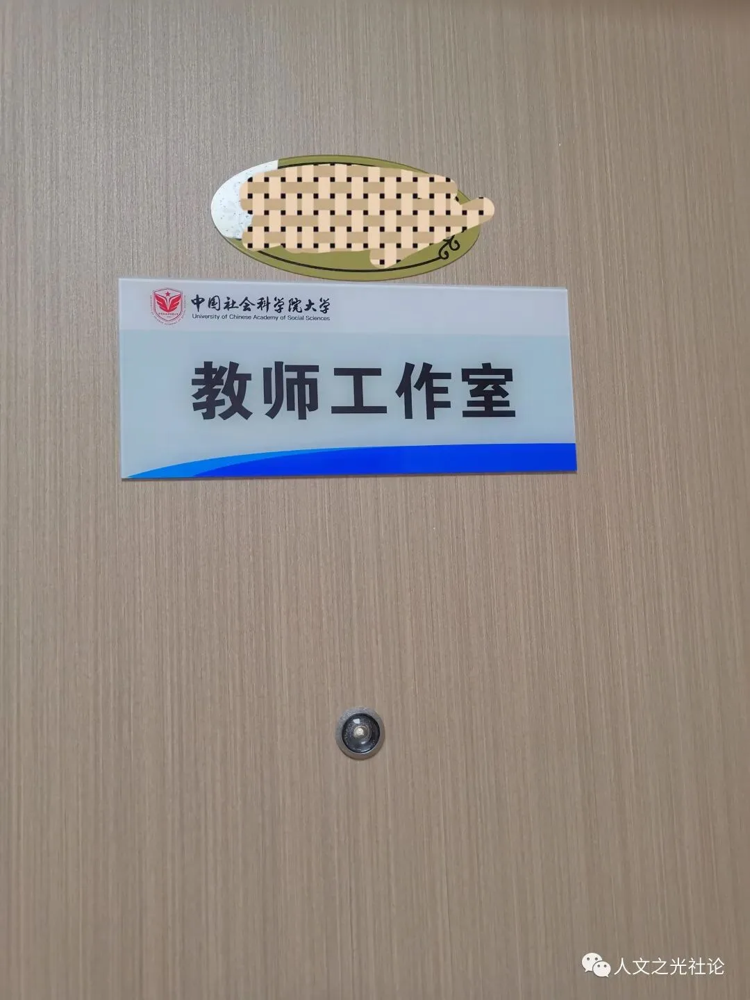

希望学工处、教务处、望京办、后勤处、招生与就业处、校友办等部门及时关注并跟进问题。

## 1 摆渡车

“ 各位领导、车队以及相关负责人你好，我们研究生工作日需要去建国门社科院上课，能不能安排一两趟直达班车呀，转来转去很累很麻烦。谢谢！（良乡校区）”

## 2 军训

## “ 23级新生军训过程中的几点管理问题

1.首当其冲的就是每次操课后的收队问题，几乎全是带到一食堂门口解散，没有考虑到部分同学在二食堂就餐或直接回到宿舍休息的需求，而且近400人几乎同时进入食堂，也极易造成人群拥堵、排队等候时间长等问题，不仅浪费了各位同学宝贵的休息时间，也存在一定的安全隐患。

2.军训团内部管理混乱。作为一支为北京众多学校提供军训服务的专业化团队，很难想象其内部管理方式竟如此混乱。各级人员之间传递信息仅仅依靠手机甚至大声喊话，部分基层教官无法收到上级指令的情况时有发生。更不必说部分参训人员下达指令冗长拖拉、词不达意、重章复沓 ，无论从言语上、行动上，还是思想观念上，丝毫不见解放军之精神风貌。这不仅让大部分人深受其苦，更让受训学生叫苦连天。近日来，部分受训学生对于此种现象的发声与反抗大家更是有目共睹，毋须多言。

最后，衷心的希望，这次军训能在各位新生的人生历程上留下美好的回忆而非深恶的痛绝；人民军队的光辉形象在广大社科学子的心目中能被真正的树立而非被一小戳人的恶劣行为而恶意曲解。"

## “新生关于新生军训下雨进入气模体育馆的质疑

1.关于新老生不同安排的质疑

在此并不是要将怨气迁移给老生们，我只是在质疑学校对新老生下雨天安排待遇的不对等（我没有用不平等因为老生状况具有特殊性）。在军训强度、着装等等事情上的不同是具有合理性，但请问学校和军训承办单位下雨天为什么让新生进入体育馆训练而老生回宿舍整理内务?

2.关于体育馆设施磨损的问题

四百余人进入气膜体育馆加速篮球场木地板的磨损和羽毛球场橡胶底的磨损，不利于学生在之后开展体育活动。

3.关于军训营长训练方式的质疑

该营长经常用让学生连续坐下再站起反复多次以让学生服从的命令去折腾学生， 我认为这种方式没有意义并具有侮辱意味，侵犯了学生的人格尊严。”

## 3 奖学金

## “新生奖学金貌似要去研院的官网查，印象中除了调剂应该都有的”

【见《【[读者投稿】重磅！好像有了霸气回复，可惜只应自习问题](http://mp.weixin.qq.com/s?__biz=Mzg2MjcwNzQ1Mw==&mid=2247485836&idx=1&sn=03605580b5c219c358f5a7300e356b76&chksm=ce02821ef9750b08bbd31eb1c7e8b6b31125343e0e61d77f63779eba9d987952223f279c14c2&scene=21#wechat_redirect)》第8条》】

## 4 图书馆

## “望京图书馆已正常开放～。”

【见《【[读者投稿】重磅！好像有了霸气回复，可惜只应自习问题](http://mp.weixin.qq.com/s?__biz=Mzg2MjcwNzQ1Mw==&mid=2247485836&idx=1&sn=03605580b5c219c358f5a7300e356b76&chksm=ce02821ef9750b08bbd31eb1c7e8b6b31125343e0e61d77f63779eba9d987952223f279c14c2&scene=21#wechat_redirect)》第2条》】

## 5 自习

## “教务处现在要清空自习室！

7-8号宿舍楼负责人还装死是不是？自习资源已经紧张到要打架的地步了，这宿舍楼里的“教师工作室”依然锁着不愿意拿出来当自习室？

负责人出来走两步，怎么在社科大上自习那么难！！！

你要是真有用我也不说啥，关键是就锁着啊（锁了一学期了），宁可把1学生逼去地下也不开开？学生是社科大的贱民吗？？？”

## “ 望京校区自习问题

望京的负责人是拍拍脑袋动几笔就想出来的决策吗，知不知道他的随口决定就关系我们这些人的切身利益。教学楼1楼到5楼都有课 包括报告厅也是课为数不多的几个没有课的教室，由于安排座位少早早的被占满了。

本来这个发放教学楼课表安排这一事项应该在新生体检之前就应该发放，好让我们根据教室课程安排去自主占位。现在马后炮式安排让我们这些被学校遗忘的老生“苟延残喘”地按照安排去占座，你猜怎么样，根本没有啦！！！ 备考的老生应该去哪里呢？图书馆开门晚关门早，作为备考人每天本来应该不想些无关之事，坐下来就投入到学习之中；现在却要为了座位问题每天像游击战一样来来回回找空闲座位！

诚然我很支持学校扩招，但相关配套措施跟不上，招再多的人就只会怨声载道、民怨沸腾。这些骚操作真是老奶奶进被窝给爷整笑了。”

## 6 宿舍

“ 同学反映学生公寓6号楼洗衣房洗衣机更换数量较多，看到同学反映的情况后勤处第一时间到现场查看洗衣房洗衣机实际情况，经现场查看，目前洗衣房洗衣机情况如下：

1.男生宿舍区洗衣房目前可用洗衣机有9台，可换桶洗衣机3台；

2.女生宿舍区洗衣房可用洗衣机7台，故障洗衣机1台（已报修），可换桶洗衣机4台；

3.同学反应的楼道内摆放的为待维修洗衣机，公寓办已妥善处理。

本次更换部分可换桶洗衣机是因为前期部分同学认为公共洗衣机每天使用量较大，担心卫生问题，提出过安装一人一桶洗衣机，后勤处考虑同学们的诉求，经前期调研和准备在公寓6号楼洗衣房增加了部分可换洗衣桶的洗衣机，同学们可自愿选择使用，目前洗衣服务提供商正在制定购桶方案，我们也将催促洗衣服务提供商尽快将可换桶洗衣机投入使用。”

“ “6号楼只是一半的，换成了新洗衣机，还有一半旧的，可以让他继续使用自己钟爱的老洗衣机”

反驳9.7第四位同学的发言，实际情况绝非如此，剩下的一半旧洗衣机只有一两台可以用，剩下的旧洗衣机只是摆放在原处，但已和刷卡机断开连接，完全不能用；新换的洗衣机只有那个必须下APP的洗衣机可以用，还有四台新换的另一款洗衣机必须要买厂家的桶才能用，但时隔一个多月宿舍管理老师依然说桶不能买，那几个新洗衣机实际上根本不能用。"

“ 社论君你好，回应昨天关于宿舍洗衣机的4.4。我不是反对更换新洗衣机，但是以这样的方式更换洗衣机却令人生疑。学校更换洗衣机大可以直接买几台新洗衣机并以原方式收费，但事实上却选择了这个新的更商业化更贵的商家。学校这个采购流程是如何招标的，其相关文件又是否能公开，内部是否存在权力寻租的可能?并且，想必不是每个人都乐意像这位同学一样给自己的手机无脑下载来路不明的app(或者这个app的安全性是由学校保证的?)，占用空间不说，还有可能损害手机……

这位自称由2号楼搬过来的投稿者用长篇大论盯着一元钱啰嗦半天，并且认为这种关注问题的方式更加高人一等，可见有些东西似乎并不与年龄成正比，令人遗憾。”

【见《【[读者投稿】重磅！好像有了霸气回复，可惜只应自习问题](http://mp.weixin.qq.com/s?__biz=Mzg2MjcwNzQ1Mw==&mid=2247485836&idx=1&sn=03605580b5c219c358f5a7300e356b76&chksm=ce02821ef9750b08bbd31eb1c7e8b6b31125343e0e61d77f63779eba9d987952223f279c14c2&scene=21#wechat_redirect)》第4条》】

## 7 食堂

“投稿：新学期回来以后感觉一食堂变化挺大的，整体感觉干净了很多，而且还增加了座位，菜品种类也比上学期多了一些，味道也不错，希望继续保持。”

## 8 就业

## “请学校领导争取一下全国各省的定向选调，考虑一下学生的就业问题。”

## 9 自习室大楼

“社论君，你好～回复第一条：我是校友办公室的同学，关于自习室大楼的问题，莫老师希望我这边和同学对接下，可以去找老师谈下。”

【见《【[读者投稿】重磅！好像有了霸气回复，可惜只应自习问题](http://mp.weixin.qq.com/s?__biz=Mzg2MjcwNzQ1Mw==&mid=2247485836&idx=1&sn=03605580b5c219c358f5a7300e356b76&chksm=ce02821ef9750b08bbd31eb1c7e8b6b31125343e0e61d77f63779eba9d987952223f279c14c2&scene=21#wechat_redirect)》第1条》】

## “纯自习室大楼真的会有吗!”

> “喜闻校友办回复要帮助建设自习室大楼，而盖楼无疑需要建材。因此我作为一介学子呼吁同学们以及校友们能踊跃向校友办捐赠砖块，早日促成我们人文之光纯自习室大楼的建成。”
