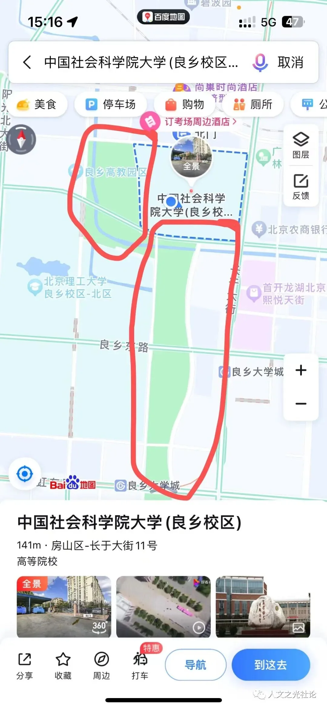

请后勤处、图书馆、教务处、校友办等相关部门及时关注并跟进问题。

## 1 食堂

## “批评一食堂，请一食堂负责人员进行改正：

1.一食堂最近的菜品质量，在严重下滑。开学时，份量很足，现在肉越来越少，越来越油腻，口味不断加重。是菜品不新鲜，要靠调味料来遮掩味道吗？！黑椒牛肉，没几片牛肉，全是洋葱。猪手里面全是骨头，只有薄薄一层皮！食堂的米饭，能不能煮得颗粒分明一点，本南方娃娃吃不习惯这么软烂的米饭。

2.一食堂的工作人员，态度很差。学生排队快排到涿州了，那边打饭磨磨蹭蹭的，一脸不耐烦。严重消耗时间，怀疑打饭人员，是在消极怠工摆烂！

3.一食堂，把筷子勺子放在一起，整个楼层去一个地方拿，真的是没眼见！。”

> “食堂最近又开始作妖了。就一食堂而言，一边是人满为患餐具都不够使用却又少开档口、晚上只有那么几个可怜的档口；一边是某些服务人员工作品质不佳有菜不给又一脸不耐烦；二食堂就更不用说了，档口不开餐具没有。真不理解难道张校长来一次食堂还不管用吗，还需请校长再来一次食堂吗？”

## “食堂投稿:

虽然现在望京食堂备菜很好啦，但是好像忽略了清真食堂，12点去就没有肉菜了，本来清真餐厅肉菜种类就少，希望多关注一下，谢谢！”

> “一食堂的打饭师傅们也是，我虽然没来几天，但已经遇上两次明明还有菜师傅们告诉我没有，不给我打的情况（落座吃到一半看到别人的餐盘中有我想要的菜）。我希望师傅们可以别这样，尽量让我们可以选择呢”

> “你好，想给望京食堂提点建议。食堂炒菜能不能不要放那么多的油，尤其是绿叶蔬菜，食堂烧的菠菜沾满了油，无法下口啊！！！糖醋排骨明明做的还不错，为什么出现频率却很低呢，可以多多安排糖醋排骨吗？以前的食堂有做过油泼面，很好吃，现在还能再做吗？”

## 2 宿舍

“ 如果京籍学生目前的住宿情况是被塞到四号楼的一改二改四的四人间，校方有没有可能帮助我们改善一下，毕竟四个人的房间只有两张桌子两把椅子是不是也很不合理呢，都是硕士生了，保证一人一桌一椅不过分吧，希望校方统计一下宿舍情况看看有没有可能对京籍生好点，而不是打包塞入一改二改四的小房间，以及同层混住问题也希望改善一下呢，现在感觉住宿情况没有那么困难呢。

以及可不可以管理一下绿化，校园生机勃勃是很好，但是蚊子确实很多，这可能跟个人体质有关系，但是希望校方能考虑一下部分过敏同学的身体，尝试解决一下蚊虫叮咬的问题。"

## 3 自习

> “望京校区的自习室是怎么安排的，教室都排上课，只有1 2层只能坐10人的教室是自习室，都已经满了，要不就整治一下1 2层自习室一个人占2 3张桌子的，要不就设几个自习室。”

“投稿 怎么听说良乡校区研教楼的考研自习室可能会取缔？？？如果真的我直接吊死在行政楼门口不开玩笑......别再折腾我们考研的了。”

## 4 图书馆

“想说一下学校图书馆的网站，所谓的改版了之后变得更难用了。要下载浏览器，下载了时常反应很慢。已经不止一个同学在图书馆群里咨询这个问题了。不知道网站的运行到底哪里出现了问题，希望引起相关部门关注。毕竟图书馆网站还是大家比较常用的学习资源之一。"

## “大家用图书馆网站没什么问题吗？

检索馆藏图书一直就是转圈状态，检索数据库也是转圈，这相当于基本报废了呀……

（网络状态：校园网，满格。其他网页都能正常打开。）”

## 5 校园整备

“ 看到有很多部门在关注这个号，很感动！再投稿一条：为了学校未来的发展（扩招/盖楼/改善配套设施等），建议相关部门努努力把学校西边的空地要过来，这块面积还不小，圈到校园里面。哪怕暂时是增加绿化，以备未来所需。趁现在除了绿化还没有其他用途（信息有限不一定正确）。未来开发成房地产什么的，想要就不可能了。为了学校的未来，一定要要过来。

如果能把南门的地也一起要过来，那更好了”

## 6 校园网

“望京校区新生想问一下，UCASS的WiFi网络网速这么差嘛？根本无法正常使用啊？！有解决办法嘛？”

## 7 自习大楼

“ 哈喽～同学你好，关于社科自习大楼的事情，校友办老师希望可以和同学先聊下，下一步具体如何安排需要和老师沟通，麻烦同学先删掉。

校友办老师是希望能和社论君还有之前投稿的同学先聊下想法。之前在投稿时，我们希望通过借助咱们这个平台联系到关心自习大楼成立的同学，以进行私下讨论当前学校学生自习存在的问题，以便后续工作的推进。

但由于没有及时看到社论君回复的刊登消息，导致了对情况的理解出现了偏差。请问社论君是否能够帮忙联系之前投稿过与自习大楼成立相关的同学的信息？”

(回应:

校友办的同学你好。本平台坚信包括校友办在内学校各部门的稿件都是各部门在综合考量各因素的前提下负责任、有公信力的回应；因此为学校公共利益而虑，本平台不会轻易撤下部门回应的稿件，以防止各部门理性的声音不能发出，耽误校生之间沟通及问题的解决。

因此，如若校友办想要撤稿，请为我们发出相关负责任的撤稿声明，我们将予以刊发以说明前稿作废。

至于前往交流，感谢校友办对本平台建议的咨询，不过本公众号仅代刊同学建议，自身并无对此事的看法，因此我们无法前去交流。但我们建议校友办联系教务处等部门就自习一事公开举办座谈会，以更好为同学们服务。很遗憾我们仅为一公众号平台，所以如果需要有向投稿同学代为转达的信息，我们只能做到帮忙转达。)

## “ 本毕业生同意捐砖”

## “ 社论君你好，请问捐砖地址如何填写？谢谢！”
