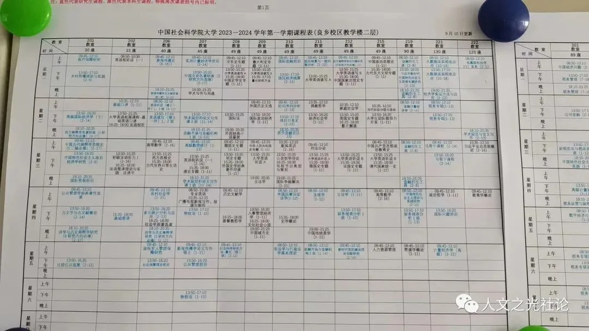
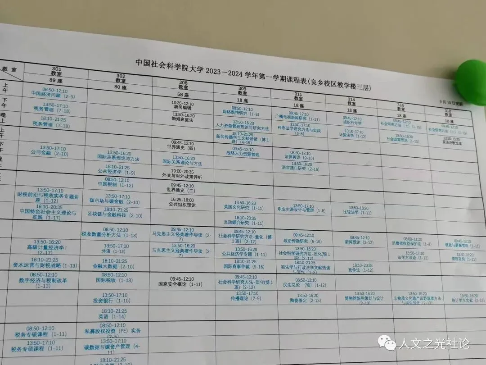
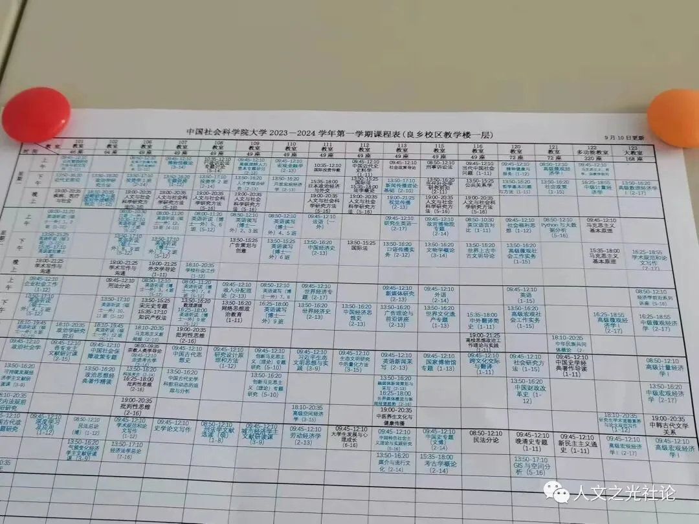
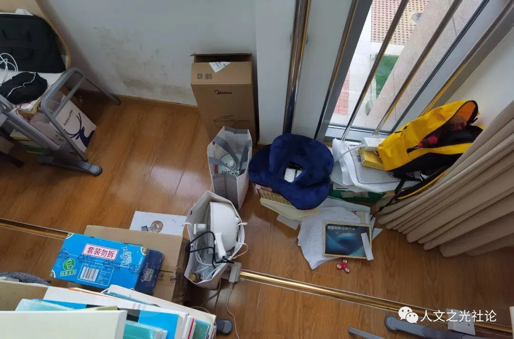
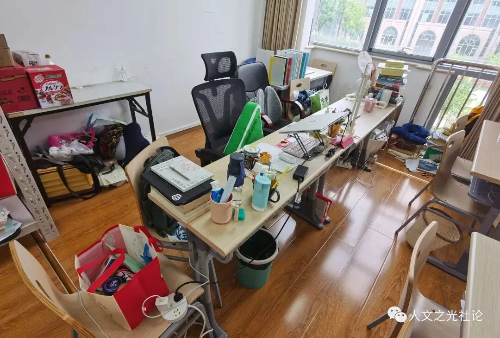

请学工处，图书馆，后勤处，教务处，校友办等部门及时关注并跟进问题。

## 1 有关军训的问题意见

## “ 社论君好！

我想和大家探讨一下今日发生的事情。

今晚，一位学姐向我们军训相关负责人公开表达了自己关于新生在七八号楼（宿舍楼）下军训的一些看法。今日下午，也有一位学姐公开向我们表达了自己的一些诉求。当然，愿意将自己对于一些安排进行表达，是一件勇敢的事情。但是，这种表达的方式以及内容，是不是可以进一步完善呢？

表达分为理性表达和非理性表达。确实，在面对一些不合理的安排的时候，我们的第一反应，是偏向非理性表达以及非理性思考的。譬如，在听到新生军训的声响时，一有些人选择直接将自己的想法大声表达出来，以此换取直接的回应。当然，这样的做法确实可以及时起效，可是这之中的某些做法是否太不恰当了？像是一些同学，采取直接向并非直接管理，也无权管理这系列事情的人宣泄，是否过于偏激？更何况，宣泄是在已经宣布解散且军训改了场地，这个情况下继续的。

首先，一个很明显的情况就是，学校没有那么多的场地来供我们军训。学校的功能区的大致划分也就是住宿区、食堂区、体育区、教学区。显然，在教学区军训最为不合时宜。食堂区那一段路与住宿区也有很大的重合交叠。而体育区，学长学姐们正于其中军训。（这很好，是应该的，没有引战的意思。）那么，划分下来，是不是只有住宿区这个空间可以进行协调与灵活处理了呢？在一开始，校方与军训方接收到学长学姐们的意见与建议后，我们便已经调低音量，放低声音，并且尽量避开各位休息的时间。比如在早上九点多才允许我们将口号喊出来。当然，可能这样的做法依然会存在扰民嫌疑，但是有这种意见时，难道不是应该更加地去探索其他解决方案而不是一味地宣泄么？如果说各位可以提出一些其他的合理的建议，我相信学校也会采纳听取。而，部分同学在表达自己想法时，停留在非理性的表达内容里，仅仅只是宣泄情绪。请问这种做法除了出了一口恶气这个利好之外，还有什么其他的便宜之处么？就此而言，这是三方都落不得好的事情。显然也无法解决问题。

在表达方式上，就我所知，可以被看到、被听到的平台就有如下：110，教务处，校长办公室，鸹貔万能墙，人文之光社论。在如此之多的选择之下，请问为何还选择这么一个不理性的方式进行表达呢？我是否可以认为，这是一种内外压力叠加之下的崩溃行为，而不是单纯的发表意见？（当然这也只是一种仅止于我的不当的猜测罢了）

现在，我们也即将在操场那边军训，也不会再打扰到各位的休息了，也希望大家可以多理性表达，理性思考。非理性的表达，可以解决的问题微乎其微，理性思考后的内容和表达，才是解决问题的不二法门。

感谢! ”

“ 我很理解学校军训任务重，时间可能比较紧，然而，噪音对我们日常生活的影响却不可忽视。请想象一下，当你在努力工作或者休息的时候，突然一阵高分贝的噪音打破了你平静的氛围，你是否也会感到困扰呢？

我并非是想指责你们，只是希望能共同找到一个解决办法，使我们的生活环境更加和谐。我建议换个地方，最起码离宿舍区远一点，这样就不会打扰到其他人了。相信你们的教养和素质一定能够理解并做到这一点。我也能理解宿管老师的难处，说深了不行，说浅了不管用。我看到过宿管跟教官交流，教官似乎爱搭不理，依然我行我素。我们想要安静的环境怎么就那么难？另外学工的通知在哪里？出个通知就不管了吗？（匿）”

“ 社论君你好，我想说的是有关军训的这种问题，需要高年级学生和低年级学生之间可以开诚布公的公开地进行一些问题讨论，而不是情绪化的在各自年级的群聊里面对互相进行情绪输出，有话就应该说出来，而不是在群体内共鸣共振，最后搞的高年级和低年级学生之间仿佛存在着水火不容的关系，这样的情况是不应该且不合理的。

我自己是一个高年级学生，但我感觉到这些天很多针对新生的言论其实很多是针对学校的，可以说午晚饭时间安排的不合理，但这应该是学校的问题而不是新生的问题，电梯问题也是学校军训时间安排的疏漏，导致了极其严重的拥堵，很多问题都是出在学校身上而不是新生身上的，希望大家可以在公共发言平台上以更理性的态度去讨论这个事情，而不是完全的避而不谈甚至是敌视彼此”

“ 关于向校有关部门询问关于老生打卡军训时间核算的问题： 每一天都有不少人反映打卡时间算少了的问题，学校相关部门是否应该真的想想是不是自己算的有问题呢？ 下雨天打卡只打上课卡没打下课卡，这种情况您工作人员有没有算上？ 8号上午下雨只打了一次上课卡，但是应该算2个课时，这种情况您工作人员有没有算上？ 昨天已经反映的问题为什么今天还存在？ 还有同学明明前几天就已经次数够了（算上上述下雨天打卡情况事实上就满了），反映了情况，老师说少打次数了（当然也没有实际具体的数据证明少了哪几次），然后补上后打满名单上仍然没有他。请问您工作人员应该收到好几次反馈吧？那是不是应该再重新算下次数？

既然下雨天让我们打卡，那就意味着这应该算进我们的打卡时长！不然搞这花里胡哨的干什么？计算时长负责人和军训组织负责人到底有没有沟通好情况？我们踏踏实实按学校制定的规则去拿军训学分，到头来你们有关部门还要算少时长，就连数数这种能力都没有吗？ 我们大四的要考研保研找工作，能不能不要有事儿没事儿给我们增加些没有必要的负担？都不奢求你们能额外给我们些实际的帮助，起码把你们职责范围内的事情做完这不过分吧？ 算少时长这个事情对于大四学生来说，不是小事，根据同学们的反馈就是学校算法有问题，所以这是绝大多数人都有的问题，奉劝贵部门不要等我们怒不可遏的时候再来收拾残局！”

## 2 我自习室到底在哪里？

## “投稿良乡校区自习室

学校真的不管考研考公人的死活了吗？第二天上课头天才把教室安排贴出来，看了下每间教室都有课，大概是没固定自习室了。既然如此，为何不早早发通知呢？没有看到贴在墙上信息的同学怎么知道搬东西呢？？？为何去年研教都有固定自习室，今年又不行了呢？此外，听说党校也要清空作教室，真诚发问现在学校还有自习室吗？（除了图书馆和行政）学校真的有考虑过考研考公的同学吗？？”

> “您好，我想再说一下望京校区的教室问题。 首先，课表同步慢就算了，直到本周才更新课表，3—5楼全部都是满满的课，1—2楼占座问题早就反映无数次了。 其次，占座问题也可以理解，谁都不想每天背着大书包到处跑。但是一人占俩座也行，一人占四个是不是就太过分了。在自习资源紧张的情况下，1—2楼的小教室实际人数都不到容纳量的一半。 要么增加教室资源，要么整治占座（哪怕让物业帮忙排排桌椅多加两套），也比有人“独享教室”，有人“无处可学”好得多吧。”

## “ 社论君好，想反映个事情

坐标：良乡校区党校楼203教室最后排。

这是把自习室当自己宿舍了吗/:?电饭锅/蒸笼都带到自习室来，两张桌子并到一起接了一堆线。两个人应该是对情侣，上午从没见过来自习室，有时候一整天都看不见人，这一排的位置就这样被占着。

现在党校楼还给排课了，原本上自习的地方就很紧张，好多考研/写论文的人找不到座位，这种人不经常来自习室，还把一堆私人物品带过来占座……

我好几次路过找座位，看到他俩人不在，但是东西就是一堆，我也没法用这个座位。教务处对这种情况装缩头乌龟吗？昨天下午来清理教室，这行政老师不看看最后的效果吗？

如果以后自习室的座位，谁占了之后就是谁的，爱来不来、想来就来，那到时候同学之间相互清理座位引起的矛盾争执，教务处是不是还要继续装死打马虎眼呢？

真的已经很克制了，不要再折腾考研/写论文的人了”

## 3 教学检查大开张

“林维校长开学就给我们高中般的温暖，雷厉风行查缺勤，没有课本就批评，不论选修必修要求闭卷，我仿佛在一个一流专科大学。”

> “看来林副校长并不清楚退改选阶段需不需要考勤的工作内容，就像他根本不知道同学们每学期平均需要选多少门课一样。不过林副校长既然如此精力充沛，那么不妨赶紧解决一下考研人一直存在的自习诉求，以及连“课表”都打不开没法看的选课系统，连必修选修都分不清楚以至于英专拓展现在还是选修的教务系统吧。麻烦我们“屈尊”走进教学的林副校长能做点实事而不是面子工程。”

> “请问尊贵的林校长，气势汹汹地查学生出勤率前要不要查查行政的出勤率、早退率和自己的教学出勤率？改必修、专选的结课考核方式时要不要看看社科大的教学评估还有没有用？“以身作则”四个字，以您为首的领导团队做不到，便不要自大妄为、一意孤行地以为自己了解教学，了解学生。知道您们擅长装聋作哑，听不见诸位师生的声音，但也请您们至少严于律己，别显得那么双标可笑。”

## 4 图书馆的两面性

“图书馆网站真的特别离谱，不知道这改了一暑假咋还越来越不好用了，首页就是个摆设，是不是专门骗领导用的？从里面查书根本点不开啊，就一直转圈。希望校领导看到这条自己用笔记本连上校园网，试试图书馆首页查书和数据库效果如何，中午预约座位看看体验怎样。真不知道改了个啥，会不会是那个大数据把服务器拉慢了，那个大数据只能锦上添花，现在是没有“锦”，希望校领导重视！！！

（本人Edge浏览器，校园网满格，浏览器打开其他学校对图书馆查书都正常）”

> “图书馆305的灯能换一下新的嘛？现在的灯光已经发黄了，不太明亮，希望可以拥有明亮灯光的学习环境，就像一食堂假期换的灯一样明亮，谢谢了。长时间在昏暗的灯光里学习对眼睛很不友好。”

> “来到小院已有一周的时间了。聆听了研究生院老师的讲座，可谓深入浅出，又红又专，娓娓道来，十分亲切。同时学习体验了图书馆阅览室，馆内处处弥漫着书香气息，环境优雅，藏书资源丰富，学者著作、期刊杂志、学位论文等各类文献应有尽有，图书馆里的任意一个角落都可以见到奋发有为的同学，这里的同学们可以说完全把学习当成一种兴趣来做了。图书馆内的校史馆和笃学讲堂更是引人入胜。一食堂的饭菜特别好吃，有家的味道，阿姨非常热情，最主要的是价格便宜并且份量很足。老师和同学们也都是和蔼可亲的。纵观整个社科校园，图书馆可谓是全校最精华的部分，也是最令我难忘的地方。小院虽小，五脏俱全。”

## 5 食堂

> “最近新生开学，听到了很多对学校食堂的谩骂声。有人说食堂没有“色香味”，有人说食堂师傅技术不行，有人说“吃出蛋壳”，然后这些人便纷纷讨论了什么外卖好吃，总结出了海底捞等优秀餐饮的独到之处。但是我想说，我们在学校，我们中有很多是普通人，至少沉默的大多数认为食堂很nice，它真的很便宜，便宜到我终于不用担心生活费不够的问题了。我们学校不可能为了所谓“色香味”便高薪聘请优秀厨师，白白增加学生用餐成本。希望同学们对食堂少一些谩骂，多一些对普通人的理解，毕竟大多数人并不是可以顿顿点外卖的“阔少爷”。”

## “一食堂如果再这么摆烂下去的话，那就麻烦张校长再来一次吧。”

## 6 研究生补助

## “（投稿）开学了，每个月的研究生助学金能不能开始发一发谢谢谢谢🙏”

## 7 推免名单何时出？

> “社论君好，往年这时候推免名单都已经进入公示期了，今年还没有出保研细则。虽然学校还未接到普通保研工作的通知，但是否可以考虑参考一下某些学校“先计算综合排名，再根据实际下发名额进行公示”的方法，让不确定自己能否拿到保研名额的边缘人一点心安？又或者在接到通知后尽快进行推免工作，尽早进行公示？（好多预推免都要过去了啊啊啊啊啊啊）”

## 8 京籍四人间回应

> “针对上一个同学的问题我回复一下，京籍四人间在现有的情况下已经塞不下两把椅子和桌子了，目前我们也购买了小板凳，但还是希望能跟其他学生一样有属于自己的桌子而不是在床上完成自己的作业，我们住的是一改二改四，不是一改二改三，也没有合理规划的空间，欢迎你来参观一下，请不要站着说话不腰疼。同时针对蚊子的问题，我也想说，你怎么知道我没穿长袖长裤没喷花露水，我肯定在做好我能做的事情的基础上希望校方也帮帮忙，但这也不是我的主要诉求。你来上学宿舍里没有桌子椅子供你写作业吗？其他的学生都有自己的一桌一椅，我们没有。我们四人间配备两张桌子两把椅子，请问如果空间够校方会刻意不提供吗？所以真正的问题是宿舍如此安排合适吗，北京生并不是所有人都具备走读条件，每天两三个小时在路上还能干点什么呢，我们也是希望校方可以结合一下目前的住宿情况对我们有更好的安排，谢谢。”

【见《[【读者投稿】食堂自习多点开花 自习大楼改于私下建设](https://mp.weixin.qq.com/s?__biz=Mzg2MjcwNzQ1Mw==&mid=2247485849&idx=1&sn=9f236f87ac5fca11d67619196606c04b&scene=21#wechat_redirect)》第2条》】

## 9 校友卡之谜

> “望京校区 为啥我出示电子校友卡还是不让我进去？刷门口的机器也识别不出 问保安也是需要提前在移动校园申请 问题是我毕业了学校把我移动校园注销了根本申请不了 请问这个校友卡设置有什么用呢？后续的工作没跟上相当于摆设吧……回去纯纯受气”
