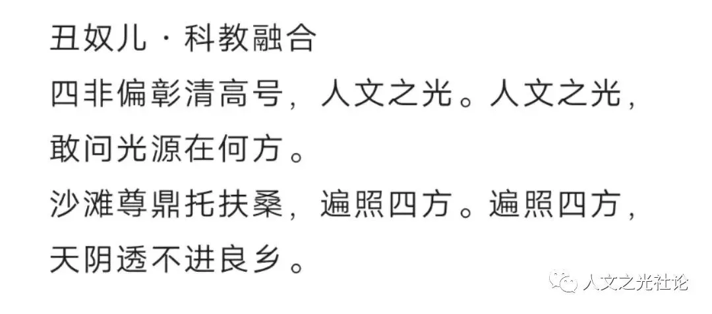
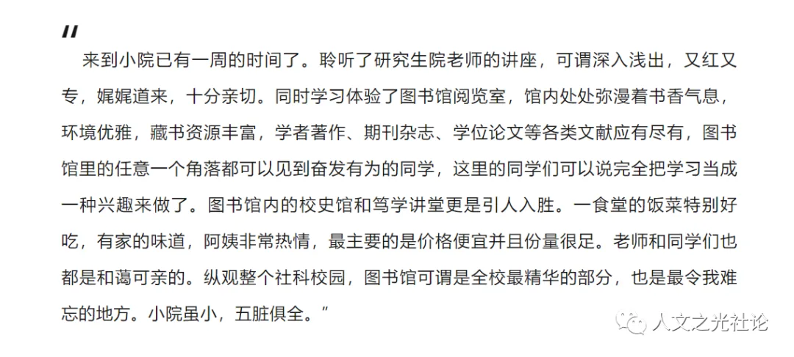
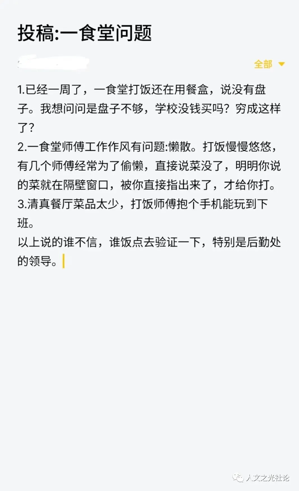

请后勤处、基建处、教务处、图书馆、学工处等部门及时关注并跟进问题。

## 1 诗词

## “ ”

2

军训

“

您好！关于大一新生今天的军训我想提个建议。按照计划今天上午我们在操场训练（今天休息时间格外少而且太阳很大）中午时间非常紧张然后就得集合坐车去考古博物馆，训练加上坐车真的很累，车上也不太能睡得着，希望学校能考虑取消今天的晚训让我们喘口气。谢谢！

”

“

军训投稿

1.走齐步正步同学们之间的距离可不可以拉大一点？每次走必打手，走完整个手都震麻了，真的不敢好好走

2.请解决一下音乐问题，两个喇叭不同步，方队脚步错乱

3.请教官们统一休息时间，不理解为什么别人休息我训练，别人休息我还在训练”

3

食堂

“

我真的很想知道这篇内容被创造时候作者的动机和精神状态....”

【见《[【读者投稿】军训和自习问题真的需要解决了](https://mp.weixin.qq.com/s?__biz=Mzg2MjcwNzQ1Mw==&mid=2247485867&idx=1&sn=cbb8df329f061efd67ada7910f68800a&scene=21#wechat_redirect)》第4条】

## “请教9.11第五条食堂第一段

便宜又好吃不行吗？非要便宜难吃或者好吃贵才是合理的？才是对的？才是应该的？我不太理解……而且我也穷，但我觉得我有资格说某道菜不好吃，至少有资格说某道菜里有鸡蛋壳这不OK”

（见《[【读者投稿】军训和自习问题真的需要解决了](https://mp.weixin.qq.com/s?__biz=Mzg2MjcwNzQ1Mw==&mid=2247485867&idx=1&sn=cbb8df329f061efd67ada7910f68800a&scene=21#wechat_redirect)》第5条）

## “

”

## “投稿

想问问学校真的听学生的意见吗，一食堂的倒饭的地方什么时候能改回来，加那几个桌子也没啥用不如倒饭，又不是所有人都住新楼那边，而且很多人吃完饭也要去超市，你这也对研缘超市和安信捷造成了影响。

我不知道学校到底能不能看到同学们的呼声，也希望能够加强我们学生和校方之间的沟通，不要让沟通变得如此艰难，不要每次提意见都在推卸责任。”

## “那个说对食堂多一点理解的不知道一食堂好的时候是啥样吗别人有诉求站什么制高点啊”

## “投稿一食堂二楼4号最边上窗口，打饭速度确实比旁边窗口快，但师傅素质是真差”

## “想了很久，建议取消打包盒，让非堂食的同学自带餐具打包。这样可以节省吃饭的时间”

## “建议食堂把筷子勺子餐具车放到两边，不然拿个餐具要穿越层层买饭队列，很不方便”

“望京食堂的菜名能不能认真取？写的糖醋排骨一点糖味醋味都没有，只有咸味，诈骗诈骗诈骗！”

## 4 保研

> “社论君好，想麻烦向学校反映一下。现在jyb好像还没通知到我校预推免信息。但很多学校要求写综排和综合成绩，能不能先交材料定排名。让保研边缘人心中有数，让可以保研的同学能如实填上信息不至于错过机会，谢谢！”

## 5 奖学金

“学业奖学金到底什么时候发，为什么在官网上找不到奖助学金发放制度相关的信息，这些不应该是透明的吗？”

## 6 教务问题合集

## “投稿:

我说教务处教学保障中心不要太闲，在教室空闲时间短暂使用教室电脑查个东西不知道有什么问题？《中国社会科学院大学教室使用管理规定》并未规定空闲时间不能临时使用电脑？

教务处平常弄个选课退课半天不来，多管闲事耽误别人倒是有一套。闲了没事干就去吃饭，别影响别人。”

> “好奇小院老师不常用邮箱吗？如果常用的话，希望小院能在关于师资力量的介绍中要求老师加上邮箱地址，办公电话（渠道汇总比分散开或许会更加节省学生寻找时间）。一方面，良乡五校中只有小院没有。另一方面，这样可以有效节省寻找老师沟通渠道的时间（毕竟仅仅有办公电话是不够的）。”

> “社论君您好，想请问一下为什么我们学校的研究生选导师机制仍旧如此“陈旧”呢？建议各学院组织老师们跟同学们有个正式的见面双选交流会，哪怕是拍个自我介绍的视频，也比网页上冷冰冰的个人信息和陈旧过期的研究方向要好。大家选男女朋友都要提前互相了解，更不用说选择自己的“学术情侣了”

## “投稿：

恕我实在不能理解学校近期出台的对教学要求的政策：选修要求闭卷、卡优秀率、压分。别的我不说，这几条可谓创死了想出国的学生。本身你社科大就是个双非，出国想申好学校已经很难很难了甚至有些好学校都不收双非了。出国对双非学生绩点的门槛已经很高了，你还卡我分数？因为均分不够机筛都过不了的话我怎么和普通一本学生的均分九十多去比？也许有人会杠了说你有本事门门课都学好门门课冲优秀呗🥺可是术业有专攻我要修这么多门课（有些学院基本上一门课只有两学分）我哪能兼顾，创死我得了别整这形式主义。再一个，学校出台了这些政策就能达到评上双一流这个结果吗？只会背书的学生能成为双一流的学生吗？开卷作为结课方式的一种没有考察学生的知识面深度与广度没有考察学生的语言组织能力和信息搜集能力吗？

学校保研结果据说已经很难看了就业更难看，您还要间接断了学生出国的路子吗。”

> “教务处选课系统为什么还是一塌糊涂?不仅在能用的时候点课表显示数据错误；还有几率根本用不了，在进去的时候显示“培养方案已修改，请联系管理员”然后根本选不了课。教务处某些人口口声声说自己不是孙子，悦纳师生们的建议，但这个问题又不是没有反馈，教务处却依然选择对同学们退改选课系统不变熟视无睹，干的这是人事吗？林维查来查去，怎么不去好好查查教务处是怎么在做事的，连个选课系统都搞不定。”

> “您好！我想投稿一下结课方式。林大校长不知道您从哪里学习的，大学生都得闭卷考试？就是你想评双一流，你也看看双一流的结课方式啊！据了解，清华的毛概，近代史纲等课结课都为开卷可查资料，北大有很多课结课方式也很灵活，非要把同学们培养成八股文接班人然后被random打分你才能办好社科大吗？？？就抛开同学们的想法，能不能了解一下老师的想法和课程本身？（还有上课让带书这个事，真离谱了，书这么贵，用电子书我们就不是学习了？?”

> “有一说一，教学大检查的出发点挺好的，高校学风确实很成问题，该抓还是要抓。只是领导们是否应该注意一下政策的实际效果呢？听到一些所里老师都在批评检查的繁文缛节，让他们不想来上课。如果教学检查反而把科教融合积攒的成果抵消了，是不是应该及时变通调整呢？真的请领导们多多关注呀，用好社科大的资源很重要，这也是师生们的愿望。”
