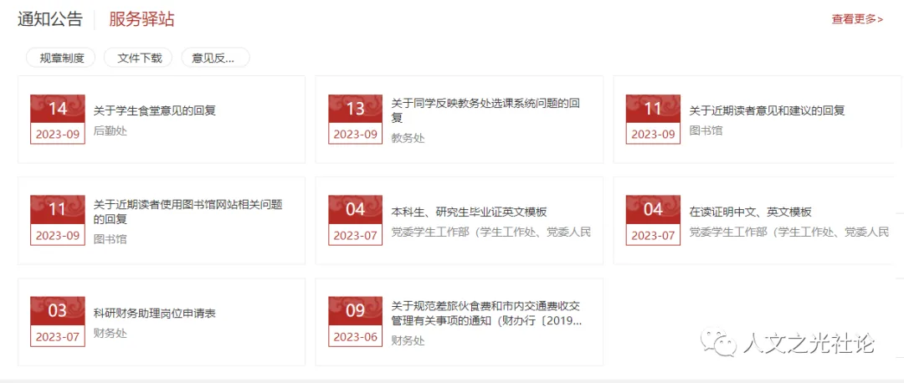
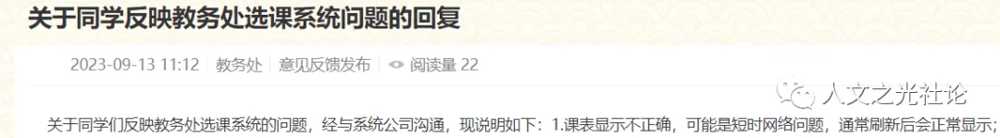

请学校相关部门及时关注并跟进问题。

## 1 军训

> “ 请求军训站在主席台上的教官，不要再用你那瓜子仁一样大的脑容量来秀智商和优越了。大伙在自己方队练得这么好，怎么到你手下就怨气冲天？！装口口啊装，你不尊重学生，永远别想学生配合你！”

(注:此稿有些言论过激，故社论菌以“口口”代替，请大家自行体会当事人的愤怒)

## 2 食堂

“近期，部分同学反映关于良乡校区学生食堂的相关问题，后勤处已在校园门户网站意见反馈栏目中回复，请大家关注。谢谢！”

(注:原文如此。社论菌“按图索骥”在校园门户网上找了半天，最后终于找到了部门回复所在地，可惜每个回复的阅读量都寥寥无几。这里社论菌也呼吁各部门的回复可按通知公告处理，方便教职工与学生们关注并继续跟进。

)

“说好的食堂会开两个窗口提前打饭，到了食堂结果食堂工作人员没有一个人知道这回事，还说“绝对不可能提前开饭的！”请给一个解释！！！ 天地不仁，以万物为刍狗！？”

“请问食堂可不可以设立饮水机～每次吃完饭忘了带水都很渴。在风味食堂那，没有地方买矿泉水，谢谢～”

> “一食堂是真的炸裂啊啊啊啊啊啊啊，十二点十分才下课，到食堂排了快半个小时队，打饭阿姨走路慢吞吞的还一脸不情愿的样子去了半天回来告诉我菜都没了？？？？真离谱啊上午有课的同学不配来食堂吃饭是吗？？二食堂也就只有自选能吃也天天都吃那些东西，一食堂又这副德行，求求某些领导别老盯着选修课还闭卷考，整顿一下学校食堂好吗？？？？？我们只是想吃饱饭这很难吗？？😅😅😅😅😅😅😅”

“一今天是2023年9月14号望京食堂的火腿炒肉好吃极了，值得表扬，₍₍Ϡ(੭•̀ω•́)੭✧⃛)

## 3 宿舍

“投稿:建议寝室楼增加洗衣房数量，一栋楼只有一个洗衣房根本不够用，经常需要排长队。建议寝室楼增加公共厕所。”

“投稿，【良乡校区】麻烦早上9点前可以有热水洗澡，因为全校早上跑步运动的人不少，若能为我们爱运动提供热水洗澡，真是感激小院了”

## 4 图书馆

## “图书馆的门禁能不能换成能刷脸的 一直要带卡太麻烦了”

## 5 自习

> “忽然想到，既然学校没有办法提供考研自习室，是不是可以把隔离点那里的板房拆掉建成自习室呢，虽然简陋了点，但是地理位置很好，甚至不用爬楼，不知道林校长愿不愿意为学生开辟几间自习室”

## 6 教务问题

“同学你好！社科大的本科教学相关工作由教务处负责，研究生教学相关工作由研究生教育管理部（学位办）负责。请设定标题内容和事务归属部门参考。”

“按照教务处的回复刷新了好多遍网站，打开选课系统的课表仍然提示“操作失败”，不知道是怎么回事。”

> “学校什么时候能平衡一下学生去所里上课与老师来良乡上课的关系呢？极个别的课就几个学生去所里上课可以理解，但是超过 20 人，30 人，甚至 40 人，50 人的课几十个学生再去所里就不太让人理解了。拿 16 周来说，几十个人要跑 16 次。而很多课一个老师讲一次，就不能老师来良乡一次，给几十个学生讲课吗？或者老师去所里比来良乡距离还远呢？而且又不是大学不给钱，为什么要这样麻烦呢？不太理解。就如其他大学请个专家开讲座，那也得去大学讲啊。不是不想去所里上课，就几十个人一起去无法理解。”

## “希望规划评估处可以尽快推出”中国社会科学院大学好课推荐“栏目。

在经历上学期的教学检查之后，我们也很关心什么样的课是大家喜欢、学校认可的好课。现在新学期已经开始了，希望能尽快出分析报告和各学院的“好课推荐”。

谢谢！”

## 7 校园网

> “想问一下学校什么时候才能升级一下校园网啊，望京这么一点点的地方自从开学之后刷视频全都是卡一分钟放一分钟，教室是这样，宿舍也是这样，b站是这样，抖音也是这样，与其花27万在行政楼造一个没人用的快递柜，能不能花点钱到大家日常用的东西上啊”

## 8 快递外卖

## “社论君好，想投稿反映一下最近两天，我在多多买菜上很不良好的经历。

10号，我下单两件商品。

11号5点显示到达，五点半左右去取的时候，没找到，当时觉得可能是时间没那么准确，第二天中午再去取的时候，也还是没有。

12号，我向站点反映，站点告诉我可能是被偷了或者送错了送到了别的地方。

时间来到今天，站点告诉我他看了75%的地方，都没有找到，大概率是偷了。我于7点18分询问站点，我要怎么处理，两分钟后，站点在群里发了一则长长的公告，大意是：自提丢了自负，怕丢可以加钱放柜子里。

当真领教了。当真长了见识。

结果大概有这样两种可能性。

其一，站点放错了，在其他地方找到了，顺利退款，不过这种顺利还要借助站点所说的“不难为我”的情况下。

其二，站点没放错，我吃哑巴亏。

但是，同胞们，我想要看看别的可能性，明天我要尝试去查监控，所以就可能有其他可能性。

其三，保卫处之类的单位拒绝我，不许查看监控。

其四，找到问题的真正原因。”

## 9 科研奖励

## “回复一下今天那个科研奖励的:

咱就是说，有没有可能，有个东西叫个人所得税”

【见《[【读者投稿】一食堂风评并不理想....](https://mp.weixin.qq.com/s?__biz=Mzg2MjcwNzQ1Mw==&mid=2247485918&idx=1&sn=3c68bbee84f230f8bb9b81c54ca0565f&chksm=ce02824cf9750b5a4b2bca9071c0ad02806631194d3bbf0222a18b16dfbc758657cb3fcc6bff&scene=21#wechat_redirect)》第4条》】
