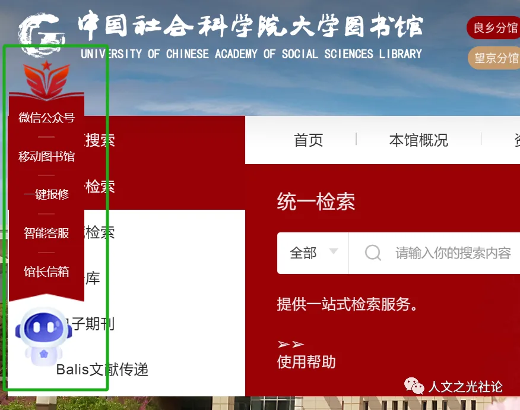
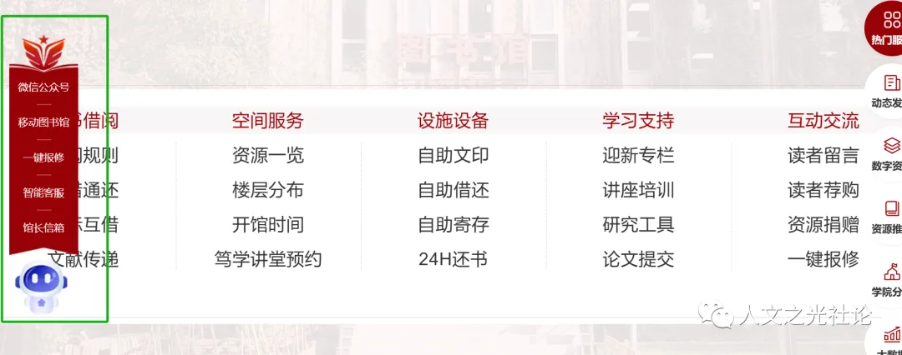
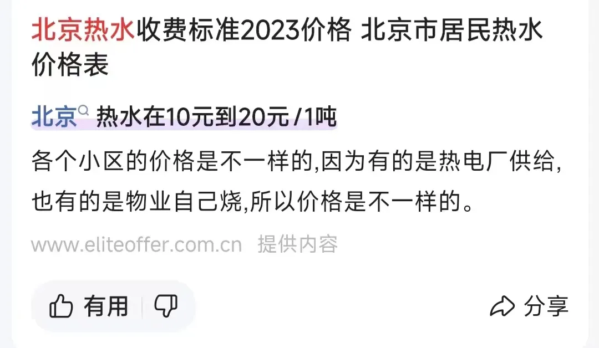

请相关部门及时关注并跟进问题。

## 1 图书馆

## “走廊不就是读书区吗，那不然去哪”

(见【读者投稿】回复《[油盐不进更显社科本色](https://mp.weixin.qq.com/s?__biz=Mzg2MjcwNzQ1Mw==&mid=2247485952&idx=1&sn=e815a019598a9bd522f2189b48096301&scene=21#wechat_redirect)》第7条)

## “这是哪位小可爱（nt 设计的图书馆网站页面？

左边的那一溜悬浮页整得跟弹窗广告一样，永远在网页最前端遮挡着文字和链接。

你下拉网页，它就跟着上下滑动，反正是不遮挡住你誓不罢休。

弹窗广告好歹还有个最小化和关闭按钮，您这设计，真是太牛逼太反人类了！

要想避免遮挡，得把浏览器显示比例缩小到80%，这样才能看到整个网站的全貌。

这个网站设计病得不轻，得赶紧治治！”

## 2 宿舍

> “我想反对一下17号那条关于“水费计费方式问题”的投稿。如果按个这个每次用热水就刷卡的机子，那洗手池怎么办，也安一个嘛，刷个牙接点热水我还得刷个卡，有点不方便。而且我了解的刷卡洗澡的大学一般都是用的公共浴室，我们独立卫浴是不是有点不合适？如果有人用水多，让TA多交一点钱就是了嘛。明明是宿舍内部的沟通问题，却想借学校强制力量让全学校的人都感到不方便，我觉得不是很可以。”

## “热水一顿40元真的贵很多 北京市居民水平都没怎么高

当然上一篇同学提到的分摊不均问题也很重要，现在高校基本都是刷卡机制，没有见过这么落后的洗澡热水使用方法。”

(见【读者投稿】

《[油盐不进更显社科本色](https://mp.weixin.qq.com/s?__biz=Mzg2MjcwNzQ1Mw==&mid=2247485952&idx=1&sn=e815a019598a9bd522f2189b48096301&scene=21#wechat_redirect) 》第5条)

> “请问3号楼为什么不能增设任何插座插头？女生这边吹头排长队，自己有吹风机也不能用？想熨个衣服也完全不行！但是据我所知，其他的678号楼每层楼都有空余的插座。希望学校后勤部门能给解决一下！”

## 3 班车

“回复一下17号的第6条，社科学子公众号和学校官网的班车运行路线表均显示该班车为16:35从良乡校区发车。列表行数较多，请同学确认时间和班车路线。”

(见【读者投稿】《[油盐不进更显社科本色](https://mp.weixin.qq.com/s?__biz=Mzg2MjcwNzQ1Mw==&mid=2247485952&idx=1&sn=e815a019598a9bd522f2189b48096301&scene=21#wechat_redirect) 》第6条)

## 4 望京校区

“望京图书馆厕所真的味道很大，每次上厕所都臭得要命，能不能搞些除味剂或者什么卫生香之类的，净化一下空气吧！！！”

## “望京校区的理发店是不开了吗？”

## “我想问一下望京食堂什么时候恢复炒饭和炒饼啊 食堂阿姨做的炒饼真的好吃😋😋😋”

## 5 教务问题

## “投稿：降转和教务处

自五月转专业开始以来，教务处在降转工作上多次出尔反尔、玩忽职守，严重挑衅学生信任底线。据统计，今年共有32名2022级学生降转入2023级，关注少数群体是创建文明社会的重要考核指标之一，试问学校和教务处：关注师生中的少数群体是否应该是创办双一流大学的重要素质之一呢？以下整理近两个月来降转生遇到的种种困难：

1.必修退课反复无常。上学期期末选课时，降转生课表内被统一提前内置大一年级公共必修课（思修、军理和计算机），经逐一找负责老师退课后恢复正常，但在这学期初再次“死灰复燃”，好似鬼打墙一般重新出现在课表内，又需要降转生逐个找负责老师退课。可以理解教务处为方便降转选课提前更改学籍信息的做法，但统一内置后又逐个退课的方式又是否增加了工作量和复杂程度，又是否增加了学生的困惑和无端焦虑，无人在意。

2.正选抽签疑点重重。上学期期末正选抽签时全体降转生意外发现，32人中没有一个人的一节课抽中，这是否可以让我们合理怀疑教务处在抽签时屏蔽了降转生？试问此举的理由或者借口是什么呢？

3.培养方案大惊失色。23级培养方案公布后，部分公必及通识选修学分的更改引起降转关注。新方案中公必模块的《劳动理论》课程被删去，更改为实践教学《劳动教育》课程，但奇怪的是，教务系统中《劳动理论》课程学分及成绩仍占据公必模块的一席之地，经同学询问负责老师后得到的回复却是“忘记删除了”，试问教务处工作态度和效率在哪里？与此同时，教务处认为降转不能以《劳动理论》替代《劳动教育》，劳动课程是响应国家政策开设的，同时也是一以贯之的。既然学分相同、同为劳育，为何不能替代？难道是在否认理论的劳育课程不算劳育吗？我们不希望听到学校给出一个“降转活该白修”的答复。

4.退改选出尔反尔。上周是在校本科生退改选时间，本周是新生退改选时间。降转生在发现上周无法进入选课系统后，询问负责老师得到答复“降转应该是和新生一起”，同时上周一周降转生始终无法打开选课系统，这也给降转生及时查看课程教室变更造成了一定困扰。本周新生退改选开始后，降转生惊喜地发现所有人还是无法进入选课系统，经邮件询问负责老师后得到答复“老生退改选已在上周结束”。讲转们纷纷啧啧称奇、拍手叫好！教务处这是为我们带来了一出偷天换日、瞒天过海、可堪春晚的耍猴魔术表演！试问教务处还有多少戏法，尽管通通使出来罢，让我们再开开眼！

社科大的转专业政策一向是值得宣传的包容开放的好政策，但如果善后工作和售后服务没能做好，无疑是为转专业同学平添压力和烦恼。如果连三十来人的学籍信息都难以应付，请问教务处拿什么来创办双一流呢？”

> “吐槽一下教学考试周的安排，教学时间13周就结课了，但要学院安排考试时间请问了一定要拖到17周到19周吗，空出来的一个月？想不明白，早点考完早点抢票回家（还便宜好抢）或者还能多一个月做自己的东西不好吗！是没有自己的生活和学术需求吗！（听说有同学结课先回家待一个月再回来考试，有点好笑）”

## 6 校园文化

“希望ucass可以卖一些周边产品，书签，雨伞，月饼🥮之类的，看别的学校都有好羡慕”
