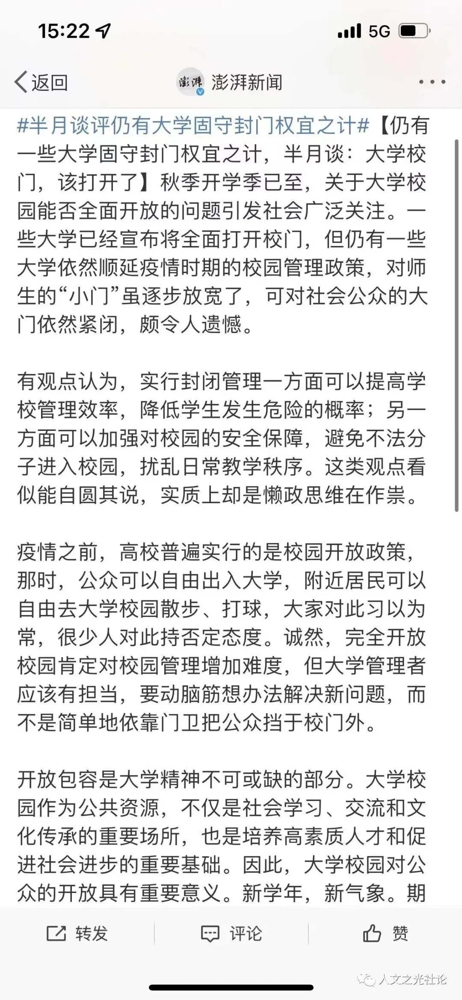
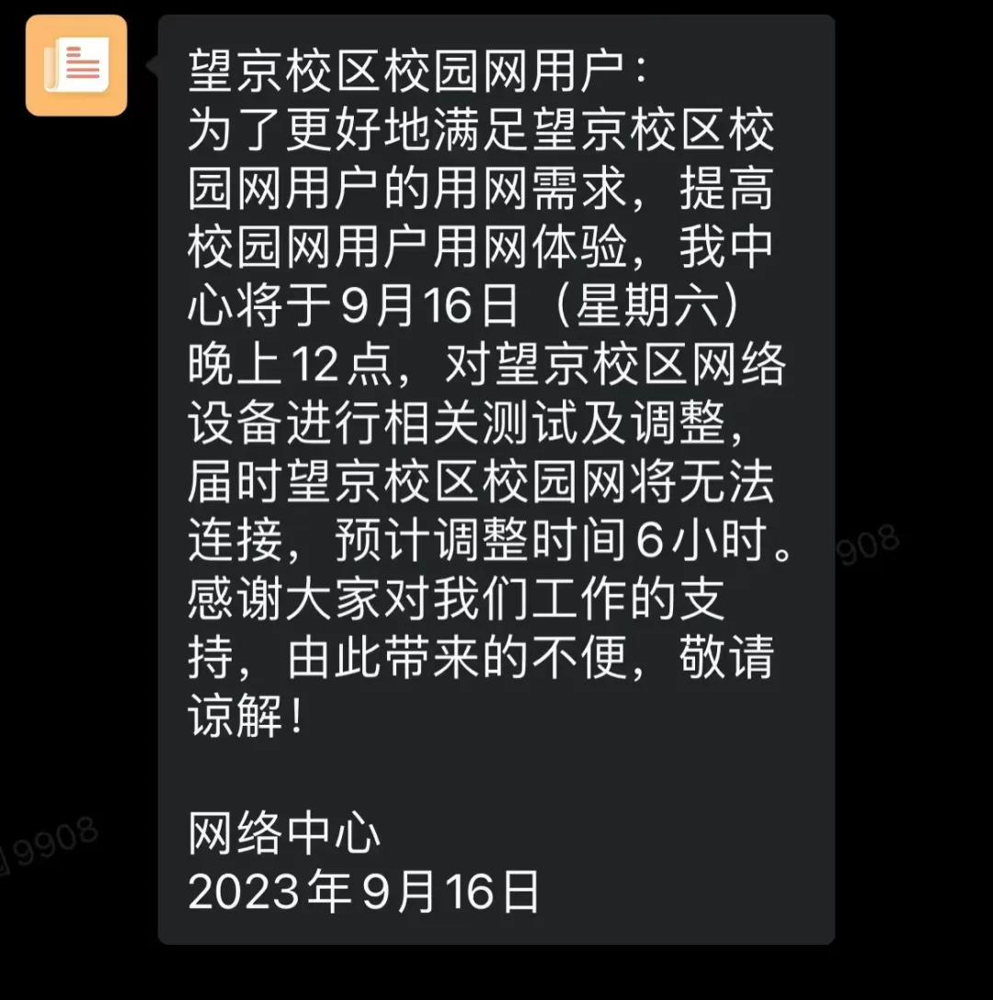
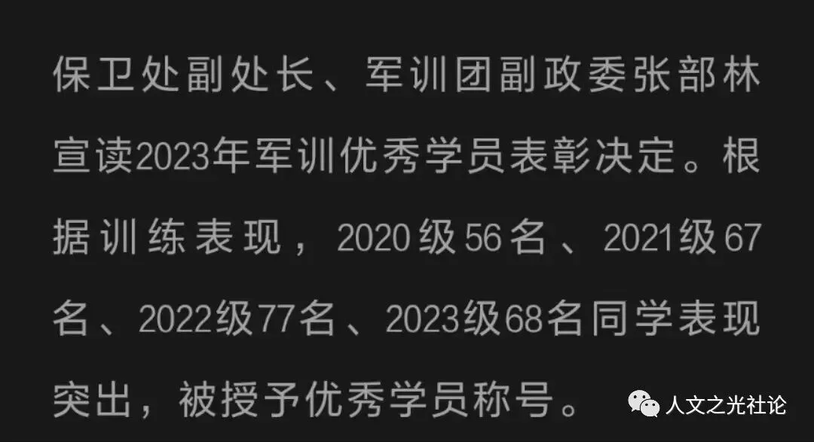

请学校部门及时关注并跟进问题。

## 1 后勤处回复

“关于食堂供菜秩序混乱、热水水费计量的问题意见回复，后勤处已在校园门户网站意见反馈栏目中回复，请大家关注。谢谢！”

“关于3号楼使用吹风机排队和增设插座问题回复，后勤处已在校园门户网站意见反馈栏目中回复，请大家关注。谢谢！”

## 2 门禁

> “校园门口的门禁没必要大家一起进来非把我们叫过去重新刷脸，在门口邮个快递，或者出去买个东西，大家一起进，非要一个个刷脸，真的没必要，校园本就是应该全面开放的地方，况且现在疫情也结束了，真的没必要没必要！！！！！！”

> “投稿望京宿舍楼门禁，这学期开始不知道为什么又开始滴滴地响了，很影响休息。明明上学期已经在反映过之后去掉这个滴滴声了，这学期又偷偷摸摸开始了，感觉舍管在对学生进行服从性测试，赌的就是慢慢适应。现在是晚上十一点四十，被门禁声吵醒的我一脑袋怨气。十一点之后上楼梯吵，洗澡吵，门禁也吵，睡不着，根本睡不着。不敢想象十一点之后能安稳睡觉的我会多么开朗活泼”

> “投稿：半月谈评学校还是封闭管理。望京最近不仅刷卡更严格了还非得一人一卡进。我们虽然也希望能保障自己的安全，但我们不希望学校仅将安全的“闸门”设置在校门口。宿舍楼的闸门一直都形同虚设，我们建议学校在学校安保其他方面加以改进。”

## 3 财务系统

“学校能不能花点钱建设一下这个财务系统啊，辛辛苦苦半小时填个单子保存不了直接卡住了，真就无语$&$@“\*^%%#^^”

## 4 食堂

## “望京校区 食堂的番茄炒蛋甜口不是挺好的吗，怎么又改走了”

> “投稿：望京食堂给的饭量越来越少了，和上学期相比少的离谱。以前两个菜就够吃的，现在大家普遍反映需要打三个菜才够吃。这是今天的晚饭实图，豆角炒肉一共五六块肉吧，其他都是豆角。学校后勤或者食堂负责人能不能给出合理解释？”

## “小小的建议一下：

食堂门口或者食堂空闲的地方墙上可以安个黑板或者白板，以便大家反映食堂饮食问题，这样食堂工作人员也可以及时看到，及时反应整改，感觉可能比在校园墙说能解决的快一些，也有效一些”

## 5 热水计费方式

> “回复一下反对宿舍热水个人分开计费的那位同学。首先，如你所说内部商量，可是请你试想一下内部怎么商量呢？每个人洗澡的时候其他人在外面掐着秒表计时，最后按时长占比来分摊水费？“洗的多的人多交”这一操作听起来十分容易，执行起来的具体细节占比测量可操作性却微乎其微，每个人应该分担的占比实在不能简单的用想象、估计的大概来执行，可能对您来说多付少付几十块钱无伤大雅，可是对我来说确实是不少的账目。其次，用“刷卡洗澡是公共浴室的配置”来作为论据也颇欠合理性，南方大学都是独立浴室，刷卡计费的方式也不在少数，您可以多去了解一下。只需要在厕所内部安装一个刷卡的热水阀门就能解决这个问题我不知道您带卡进厕所抬抬手刷卡究竟有多不方便，就算是厕所不方便装，在宿舍外的管道处刷卡，也不过两步路的事情，到底能消耗你多少卡路里。最后，您居然还给我扣上一顶类似“公报私仇”的大帽子，还用您一个人“想象”中的不方便来代表全校同学的意志，一面反对你所谓我的“公报私仇”，一面又试图为自己披上“执行公权力、代表大多数”的外衣，未免有点自相矛盾，就事论事没必要使用攻击性语言。”

(见《[【读者投稿】教务与宿舍问题引关注](https://mp.weixin.qq.com/s?__biz=Mzg2MjcwNzQ1Mw==&mid=2247485984&idx=1&sn=84026a8909865c22cc7010f178a9ff3f&chksm=ce0281b2f97508a401d1a9c6c007135a36c51c0f73206421ec4b33942d2fc67368b1196e90e7&scene=21#wechat_redirect) 》第2条)

## 6 望京理发店

“请问哪位知道 望京校园理发店为什么不开. 我们头发长了. 而且我这还有办的卡. 难道不干了吗”

## 7 宿舍

> “最近得知有些延毕的同学现在还没搬离原宿舍，还享受着二人间。凭什么呀？大家延毕了都自觉地搬去住四人间了。后勤老师也不管，那对于我们这些乖乖按学校规章制度搬离的同学太不公平了。这样子的话，劝大家以后如果不幸延毕了（呸呸呸…各位都不会延毕）都不搬，看学校怎么办，反正有很多不守规矩的先例了。”

“望学校可不可以不要在大中午的午休时间，用割草机在宿舍区域除草？？？噪音太大，无法午休！！！

做事照顾一下大家的状态，可否？”

## 8 望京校园网

“说的怪好听，但是能不能有点实际成果，看视频听网课跟幻灯片一样，老师上课放视频也放不出来。已经严重影响到日常学习、生活、授课了！是严重影响！我就想听个直播课一晚上都没听成………

## 9 图书馆

“关于图书馆读书区：图书馆一楼两侧对窗的座位其实是读书区和讨论区，桌上还放着告示，坐在这里是可以讨论或者说话的，只不过都被自习的同学占了，现在默认是自习区。要想改变现状，需要以图书馆的名义向全校学生公告，强调讨论区/朗读区的设置必要性。

## 10 望京乒乓球教室

## “望京

1.请问学校还能再划出一间空教室放置乒乓球台吗，现在就一张，大家都要排队等 2.能在乒乓球的教室铺专用的乒乓球防滑地胶吗，现在都是瓷砖非常滑，我们打球经常滑倒出现肌肉拉伤”

## 11 自习

> “想投稿一下良乡校区党校楼的自习室/教室。仿佛上次带锅事件当事人避而不谈一句这是私人物品轻轻带过后，有些人就默认教室是自家了，觉着什么东西带进教室都是合乎情理了。整得如今，沙滩椅加湿器接连搬进自习室，私自挪动他人座位，一个人的座位硬是整出两倍前后间距，还时常搬进搬出，非要在一教室的人都在学习时搞工位装修，合着诚心下想把马尔代夫搬进了自习室吗？保护其他同学的个人及物品隐私就不拍照了，只想提醒个别人可否稍微践行一下人文之光应有的操守德行？”

> “教学楼三楼，白天是mpa上课，到了晚上不上课的时候教室里同学非常少，有同学进教室正常自习，但是为什么有些mpa的同学能做到在别的同学还在教室正常自习的时候，他们三两成群的在教室里穿梭并笑声不断，小声讲话，讲真的，教室里太安静了，小声说话几分钟差不多了吧，也没人说你，但是几个人在教室里直接聊个没完是几个意思？这教室成你们专属的了吗？白天上课，晚上聊天？不让别的人学习？还是说你们觉得你们在教室里小声聊天不会影响别人？知不知道什么叫自习室？”

## 12 军训

## “想问一下相关部门，军训优秀学员名单哪里看一看”

