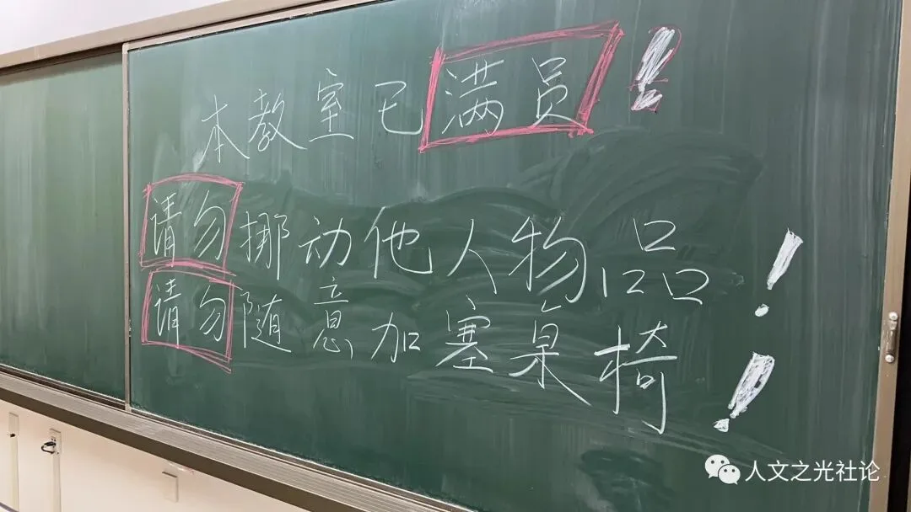
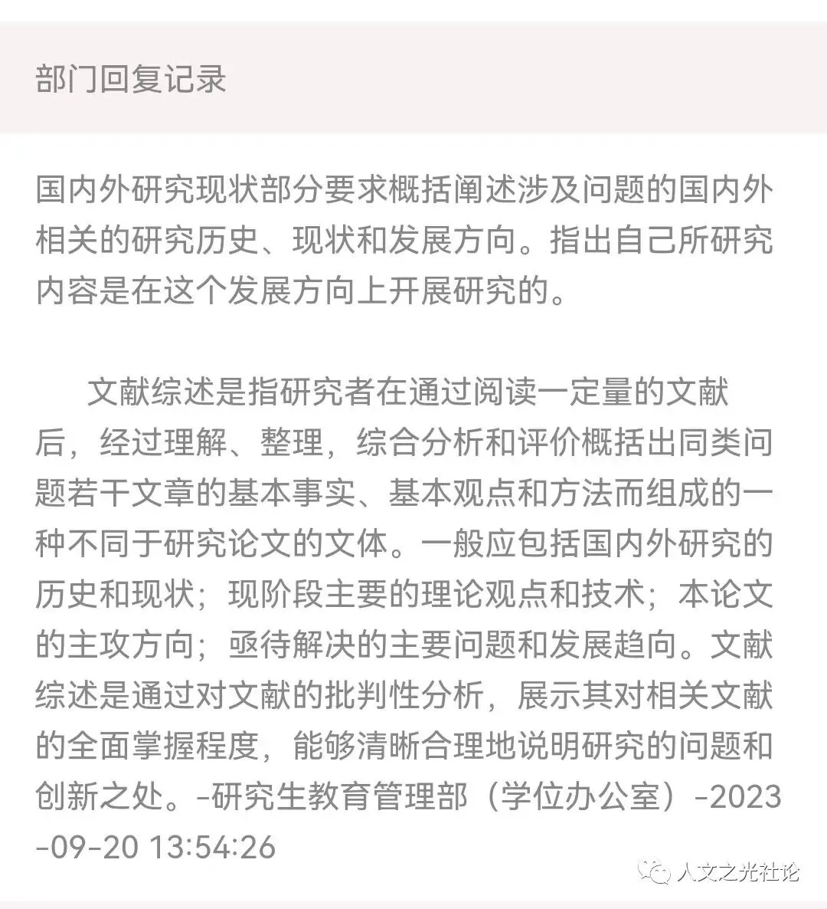

请学校相关部门及时关注并跟进问题。

## 1 军训

“同学你好，针对军训优秀学员名单和新生奖学金问题，答复如下：“军训优秀学员证书目前正在制作中，需要查询的同学可于工作时间前往行政楼115查询”本次获得军训优秀学员的名单会同步发给各个学院。

研究生新生奖学金，申请人应具有我校正式学籍的全日制非定向在校学术型学位研究生（是否在职以个人档案在学校规定的时间内转入学校与否判断标准）。每年于档案部门审核新生档案无误后开始组织发放工作。

博士研究生奖励金额为每生10000元；硕士研究生奖励金额为每生8000元。！”

(注:此为部门回应)

## 2 宿舍

## “关于延期毕业同学宿舍调整的问题回复:

后勤处公寓管理办公室和学生工作部，上学期期末已经按照学校的要求启动了延期毕业同学的宿舍调整工作，目前的确还有个别同学的宿舍未按要求调整到位。后勤处和学工部会持续跟进调整情况，在学院的配合下尽快完成宿舍调整工作，感谢大家的理解和支持！”

(注:此为部门回应)

> “望京校区最近的洗澡水太凉了，晚上10点多去洗澡，水都是不热的，现在天气逐渐凉了，洗凉水澡着实受不了。和宿舍阿姨反映水不热的问题，宿管却让我们早点去洗澡，也不向上反映情况（上学期可是会帮我们积极反映问题的）拜托望京这边的有关负责人关注一下吧。”

## “1 望京校区女生宿舍每层楼的铁门噪音问题

宿舍每层楼的铁门关闭时的声音实在是太吵了，每天到了晚上11点之后还特别吵闹，期待每个同学进门的时候扶一把来减少噪音根本不可能。宿舍的走廊隔音差，哪怕不是靠门的宿舍也能频繁听到“咚”“咚”的声音。学校能不能给铁门装一个“关门缓冲静音条”？淘宝一搜大把都是，希望学校重视这个问题。

2 望京校区女生宿舍洗手池台面积水问题

宿舍的洗手池每次有人使用过后都会有很多积水，接下来再用的人一不小心就会让衣服打湿，水滴下来在地面也特别脏乱。阿姨本就辛苦，也不可能24小时待机上班。希望学校给洗手池台面装挡水条或者放一个公用的刮水板，有同学看到了都可以自己刮刮水。”

## 3 食堂

“最近望京食堂又开始捞了吗？鸡蛋都开始买mini版了，最牛的是肉夹馍都mini版了，望京食堂又想挣钱了，减量不加价哦”

## “望京食堂的空窗口能开起来吗，每次下课都一堆人排队，根本吃不上饭？”

> “ 你好，最近一段时间预制菜和半成品菜吵的沸沸扬扬，想问一下一食堂里酸菜鱼，蒸饺，红糖馒头，鸡蛋灌饼，非手工水饺，大麻花，还有一些包子，炸牛奶等，这些好像都是那种直接加热一下就成了，属于这种吗？”

> “投稿:既然一食堂有电子菜单，建议部分人提前抬头看看想吃什么，瞬时记忆记住两三道菜的名字应该不是难事。不要等到工作人员打菜回来，又作恍然大悟状要加某某菜，工作人员去而复返后又经典再现，如是者三四。人多的时候真的很耽搁大家的时间。”

## 4 自习

> “想向望京校区的管理部门反映一个教室占位的问题，教室本来是公共资源，占座占的也太理直气壮了些吧，要么一天一清、要么一周一清，不要长时间占座，像是祖祖辈辈代代相传的地方一样。如图所示，望京校区教学楼204。”

## “望京 上下课的闹铃稍微小点声，突然一下真的很吓人…”

> “图书馆和自习室不是吃东西的地方要说多少遍某些人才能懂啊？望京图书馆三楼给你设了休闲区还在自习区吃啊？如果你饿了，图书馆阳台给你放了桌子放了椅子；如果你累了，图书馆三楼给你放了沙发放了电视，还不够仁至义尽吗？如果你就是喜欢边吃边自习的话那我建议你以后去食堂学习，皆大欢喜。希望喜欢在图书馆和自习室吃东西的人了解这样一件本不应该在这个年龄段强调给你的事:你能有一块儿和大家坐在一起供你自习的区域，除了学校提供场地，背后还有大家对自习环境的共同维护。而你，享受了这种环境，却又堂而皇之地将其破坏，这实在不应该是一名研究生应有的素质。（尝试过当面提醒，尝试过向图书馆老师反映，老师态度很好，但因为不是个别现象，管理人员也没法一直巡查，所以不得已发在社论上，希望看到的同学赶紧改正！不然下一次我是真的会在你的面前发疯！！！）”

## 5 教务问题

“ 学校开题报告要求将“国内外研究现状”和“文献综述”分开写，这里是学位办的回复。

学位办要不要看看自己在说什么，既然如学位办的回复，那请问为何“国内外研究现状”要和“文献综述”分开来写？

把模板中不合理的部分改掉那么难吗？"

## 6 就业

## “学校能否给应届毕业生提供一部分能线上笔面试的单间，开放时段预约？”
