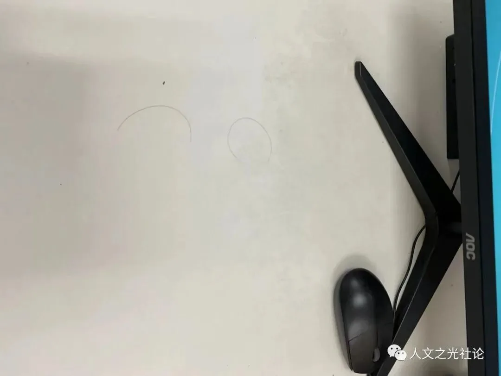
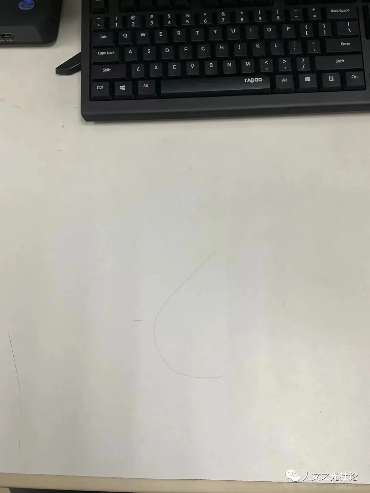

请相关部门及时关注并跟进问题。

## 1 博士考勤

## “关于昨日第一条“博士考勤”问题的回复如下：

课堂考勤必须严格执行，因特殊情况不能上课的，可以按规定向任课教师和开课学院请假备案。

(见《[【读者投稿】补助门禁有回复，其他问题仍多多](https://mp.weixin.qq.com/s?__biz=Mzg2MjcwNzQ1Mw==&mid=2247486049&idx=1&sn=23eb5be40ed14623990b0dac49504532&chksm=ce0281f3f97508e50a1c21afb7dcc4eb57bcfe999228389b54c07ead89eed5f979f9441d6052&scene=21#wechat_redirect) 》第1条)

## 2 奖学金、费用和补助

## “投稿:想问下学校勤工助学岗补贴一般是什么时候发呢？”

## “博士的奖助学金真的太低了，助学金是国家最低标准。

奖学金，博士人数本来也不多，55%的三等奖学8000连学费都覆盖不了，没听过博士还要自己交学费的

几个改善思路：

1.提高博士一二等奖学金比例

2.取消三等，只设一等15000和二等 12000

3.三等提高到10000,至少覆盖下学费”

> “补助/研一奖学金投稿：为什么不能像别的学校一样按保研和考研名次分级评选？所有人都一样8000能起到什么激励作用吗？大家也是凭本事保研来的，或者高分考进来的，让第一名和刚过线的拿一样的奖学金，高分学生还愿意来社科大吗？保研学生努力三年和刚过线的考研同学也一个奖励标准，心里真的很不舒服（笑）”

> “尊敬的社科大领导，我们马骨干2021和2022这两年收的学费和住宿费啥时候退给我们？之前一直没收过，今年又开始免费了，咋就我们这两年收了？还是退给我们吧，我们相信社科大不缺那些钱，并不是每个学生都富裕，请领导别拖了，期待回复告知”

“中宣部说大力支持我们马骨干培养，给学校拨的有经费，2021和2022这两年学校收我们的学费住宿费是不合适的。本来曾经我们马骨干有很高的补助的，现在也没了。”

## 3 望京发电车

## “感谢望京校区为了不打扰我们学习操的心”

> “望京校区的低噪音发电车保障我们正常学习办公很好，也非常感谢学校的良苦用心，但请不要夹带私货好吧。这个菠菜网站是怎么回事，宣传菠菜网站？帮缅北提供新鲜的腰子吗？”

(注:原稿件有打开该发电车网址的图片，为营造清朗的网络环境，此处不再释出。社论菌对诈骗网站已进行打码处理，也提醒各位读者朋友、尤其是身在望京的朋友们，提升防范意识，仔细甄别情况，谨防上当受骗。)

## 4 望京大报告厅

> “望京校区：我真的不懂大报告厅一会儿又装修一会儿又装修，装了个寂寞啊？？？到底懂不懂报告厅是给人听课办讲座用的，音响效果至关重要。就前面两个音响效果极差怎么听？？？谁能听见？？这个问题不是一天两天了大家都有意见，这么大的厅为什么后面没有音响，正常来说是四个音响才对吧，音质也奇差，让别人唱歌表演也尴尬。搞点真正有用的装修吧我求求了，真的是无语。”

## 5 摆渡车

## “强烈建议良乡校区开通直达建国门的路线！！！”

## 6 自习

> “良乡校区 教室 对于考研的同学来说，真的找不到一个安静学习的课桌。想要固定的教学楼自习室这个要求并不过分，但是学校以退改选为由一拖再拖，永远不给准话。宿舍楼自习室环境恶劣，蚊虫聚集，不通光通风，反映了很久也没有进一步处理。”

## 7 食堂

“良乡二食堂问题：每次来这个小碗菜的窗口，菜都是凉的！！装狮子头的碗里的猪油都凝固了！！！下面明明有热菜的装置却不开，就要扣这点钱吗？？？每天吃冷菜是怎么回事！！！！！

“

望京食堂的餐盘可以深一点吗 打的菜溢出来很多”

## 8 图书馆

“图书馆自从网站升级之后各种不好用，网页跳转很慢，动不动就打不开。座位预约页面也没以前方便。”

> “坐标良乡校区图书馆一楼电子阅览室，今日（9.23）上午闭门打扫卫生。下午一点进去，打扫了比不打扫更脏。电脑前随处可见的长头发丝，换了一个座位，前面还是头发丝。如此循环了四个位置，本人最终无奈，自己去厕所拿纸巾擦了一遍方可坐下。想说这个电子阅览室要么别打扫，我们一个星期都坐在这，不会有什么灰尘（原因没有多余的复习备考地点）。如果打扫，请用点心，不要随处可见的头发丝打扰学习的心情。”

“

究竟是匿名会放大人心丑恶，还是说望京小公主小少爷太多了？

那位要求望京图书馆严格遵循预约座位制度的，你没事吧？望京校区图书馆的显著特点是，无论是不是期末自习高峰期，望京图书馆的座位都是比人多的。因此望京校区图书馆从来不会出现没座位的情况。为了你的方便，就要让所有望京校区学生每天预约、签到、暂停、签退？然后一不留神忘记再扣分？？？你咋事情这么多？”

(见《

【读者投稿】望京与良乡，生活问题多

》第5条)

“

小编好：我想问一下有没有人像我一样怀念以前的图书馆页面，挺好用的，是吗？不知图书馆或者写什么调查报告的同学是否可以做一项调查，看看大家的使用感受。我自己的感受就现在用起来很麻烦，最主要是它不流畅、不清晰。”
