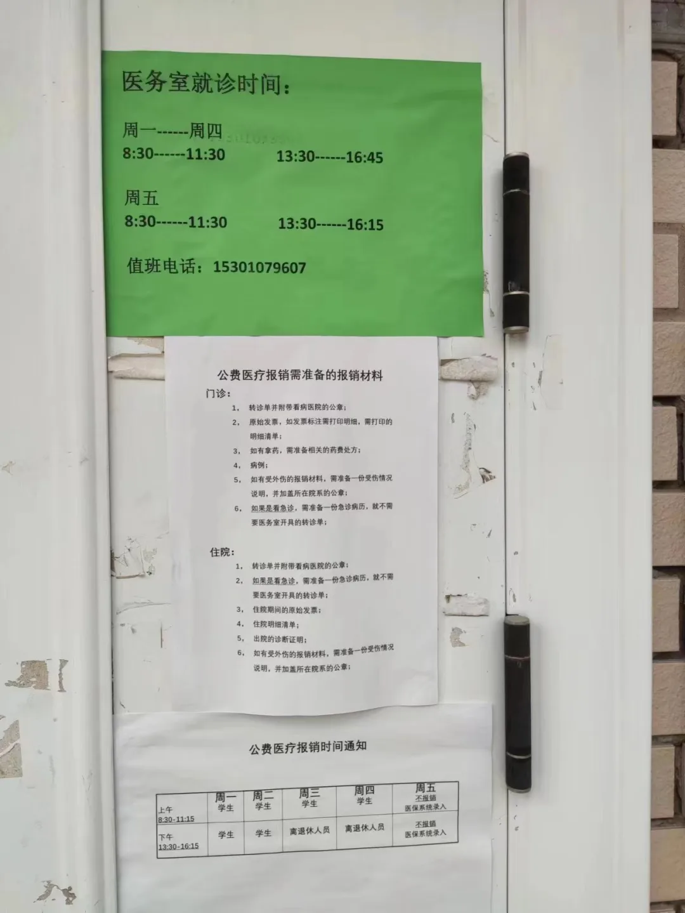
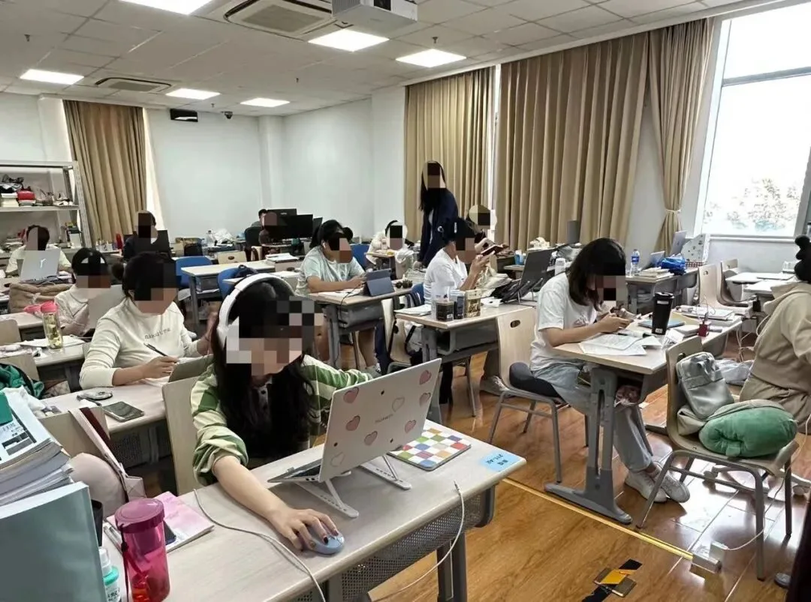
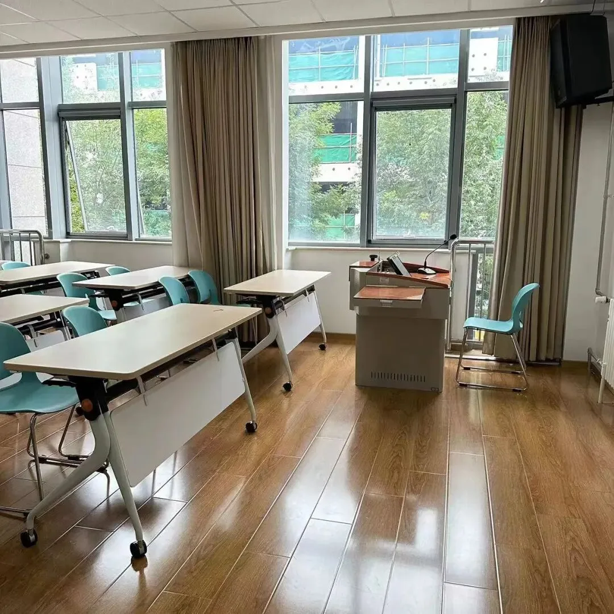

请相关部门及时关注并跟进问题。

## 1 校友卡

> “投稿：时至今日，校友卡依然不能进校，问保安就是完全没听说过这回事。从来没听说过北京任何一个高校校友不能进校的。不过作为已经毕业的人早已经习惯了社科大这种非要公开批评才能有推进的风格，望有关部门好自为之。”

## 2 奖学金和补助等

## “针对要求按分数发放新生奖学金说一说：

第一，考研成绩并不能把同学们分手三六九等，能获得保研资格确实是你的实力，但是考上来的同学也不一定差；第二，学硕每个学院每个方向只有一个人，方向不同考试内容不同，题目难度不一，没法通过考研成绩比较，唯一能比的怕是公共课了；第三，保研之前建议先了解一下学校奖助体系，你有机会选择有你更满意的奖助体系的学校。”

“乐死了，昨天说保研的人刚过线考研的奖学金都8000那位大哥/大姐，你咋不让国家给你单开个大学呢，你想奖学金多少给你批多少那种，真逗”

(见《[【读者投稿】教务有了新回应 奖助费补仍缺位](https://mp.weixin.qq.com/s?__biz=Mzg2MjcwNzQ1Mw==&mid=2247486128&idx=1&sn=483e42162751a8270a41b63fccce8f06&chksm=ce028122f97508347eaa0ba21618f16bcd646f94dfeeabde742920fc9764c647605b6c0c6c93&scene=21#wechat_redirect) 》第2条)

## “投稿！

博士补助

三等奖学金：八千块！（覆盖率最高）

同时：

一万块学费

1200住宿费

每个月1250补助钱

真心希望三等奖学金提高到一万块，起码在努力过温饱生活的同时，能交的起学费！”

## “学校领导别拖了，把我们马骨干去年收的学费住宿费退给我们。”

## 3 望京医务室

“请问校领导：望京校区医务室是觉得学生周六、周日都不生病？还是觉得学生周一到周五都不上课？”

## 4 网络

“网络问题：网络明明还有余额六块多，就是显示上不了网，硬要充值才能上网。另外网费真的用的很快，每月网费都要大几十，请学校给出套餐好不，真的用不起，谢谢社”

## “学校网络中心什么时候才能把网弄好？一个月收25块钱，整这破网？”

## 5 自习室

> “自习室：学校自习室资源开放后人员满满当当，以党校楼221为例，绝大部分是本科考研学生，自习室挤的全是人，有时候腿都没法伸进座位去坐。旁边教室220新添置桌椅，保洁阿姨说是会议室。希望能作为自习室开放。 学校没有博士固定工位，和本科生一起抢自习室也很难受，原本写博士毕业论文很压抑，坐在满满当当的自习室，香水等各种味道混杂，更让人抑郁焦虑。”

221VS220

