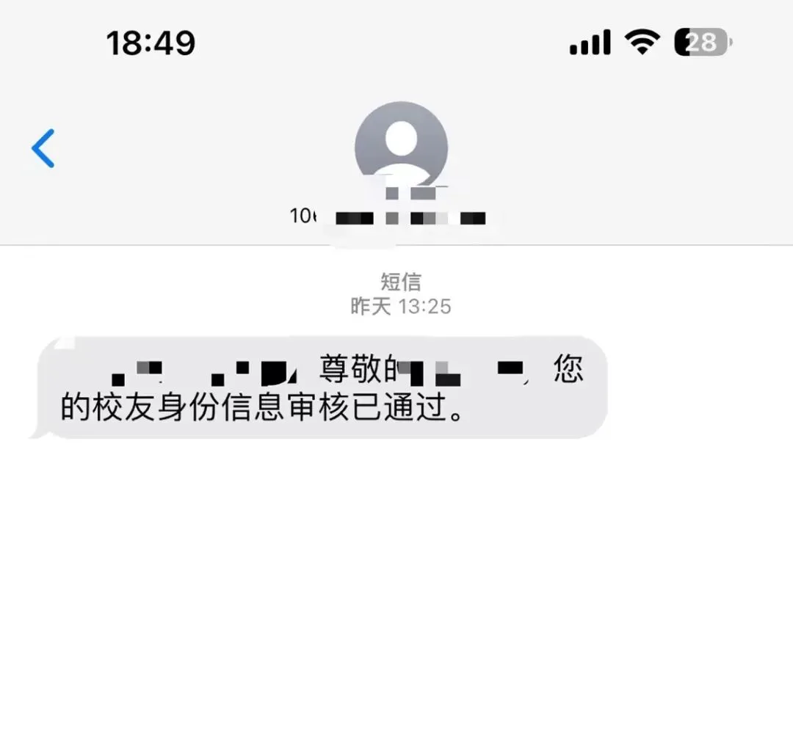
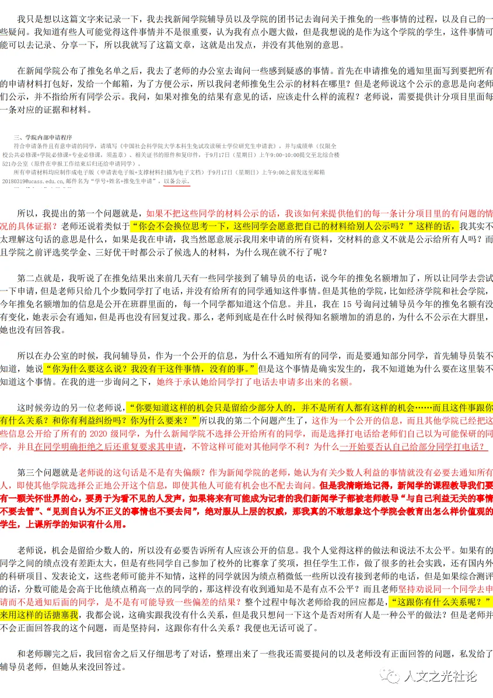

请相关部门及时关注并跟进问题。

## 1 校友注册

“彦祖晚上好，这是小木以前读书的双非学校，校友注册秒通过。这里请问尊贵的skd官老爷，我们的校友什么时候能搞好？非得什么事都要逆推才能干是吗？”

## 2 新生奖学金

## “想问一下今年的博士新生还有新生奖学金吗，有的话有多少，大概什么时候发呢？”

“奖学金：今年某些学校专硕的新生奖学金是又没有了吗？既然都没有建议把官网上的奖学金文件删除，省得之后的新生误会了。。。”

## 3 食堂

“第一食堂二楼的汤可以换下花样吗，这几天一直是茶水，在吃饭的时候喝不太健康，夏天已经过去了，可以喝点鸡蛋汤吗”

> “第一食堂打饭人员的问题是没人负责吗？我记得很久以前就有人说过他们怠工，态度恶劣。以为早就整改了，今天下午打饭时，我提前说了自己打包带走，对方置之未理，仍用餐盘盛菜。在我再次强调后，对方竟火冒三丈，吼道“为何不早说？”我不知道前去打饭的学生在他们眼里到底是什么？他们如何看待自己的工作，以及在学校扮演的角色？”

## 4 马骨干

“投稿：马骨干的同学可以想想，万一是中宣部就没给你们这两届批钱呢，本来疫情期间，哪个部门的钱都不富裕……”

“领导出来回复一下，啥时候退给我们马骨干去年收的学费住宿费？不能躲起来逃避。别忘了我们是免费培养的”

（见《[【读者投稿】教务有了新回应 奖助费补仍缺位](https://mp.weixin.qq.com/s?__biz=Mzg2MjcwNzQ1Mw==&mid=2247486128&idx=1&sn=483e42162751a8270a41b63fccce8f06&scene=21#wechat_redirect)》第2条）

## 5 研究生补助

> “ 投稿:你好，我想就研究生补助问题向学校提出建议。 我硕士、博士均在社科大就读，学校的助学金执行的是部委高校的最低标准，因为是纯人文社科学校，倒也可以理解。 问题在于，我校硕博生绝大多数是研究所的学生，授课、见导师都要返所，每周两次的话，每次支出的路费和校外饮食比日常多50元左右，每月就是400。注意，这是我校独有！！ 我建议，学校应该考虑提升补助标准，每人每年可多支出4000元。如果学校财政紧张，校领导可以和社科院领导申请、汇报，由各研究所发放，招生多的研究所，一年也就小几十万，我相信这是可以负担的。”

## 6 新传推免

“我只是想以这篇文字来记录一下，我去找新闻学院辅导员以及学院的团书记去询问关于推免的一些事情的过程，以及自己的一些疑问。我知道有些人可能觉得这件事情并不是很重要，认为我有点小题大做，但是我想说的是作为这个学院的学生，这件事情可能可以去记录、分享一下，所以我就写了这篇文章，这就是出发点，并没有其他别的意思。

在新闻学院公布了推免名单之后，我去了老师的办公室去询问一些感到疑惑的事情。首先在申请推免的通知里面写到要把所有的申请材料打包好，发给一个邮箱，为了方便公示，所以我问老师推免生公示的材料在哪里？但是老师说这个公示的意思是向老师们公示，并不指给所有同学公示。我问，如果对推免的结果有意见的话，应该走什么样的流程？老师说，需要提供计分项目里面每一条对应的证据和材料。

所以，我提出的第一个问题就是，如果不把这些同学的材料公示的话，我该如何来提供他们的每一条计分项目里的有问题的情况的具体证据？老师还说着类似于“ 你会不会换位思考一下，这些同学会愿意把自己的材料给别人公示吗？”这样的话，我其实不太理解这句话的意思是什么，如果是我在申请，我当然愿意展示我用来申请的所有资料，交材料的意义不就是公示给所有人吗？而且学院之前评选奖学金、三好优干时都公示了候选人的材料，为什么现在就不行了呢？

第二点就是，我听说了在推免结果出来前几天有一些同学接到了辅导员的电话，说今年的推免名额增加了，所以让同学去尝试一下申请，但是老师只给几个少数同学打了电话，并没有给所有的同学通知这件事情。但是其他的学院，比如经济学院和社会学院，今年推免名额增加的信息是公开在班群里面的，每一个同学都知道这个信息。并且，我在 15 号询问过辅导员今年的推免名额有没有变化，她表示会有通知，但是再也没有回复过我。那么，老师到底是在什么时候得知名额增加的消息的，为什么不公示在大群里，她也没有回答我。所以在办公室的时候，我问辅导员，作为一个公开的信息，为什么不通知所有的同学，而是要通知部分同学，首先辅导员装不

知道，她说 你为什么要这么说？我没有干这件事情，没有的事。”但是这个事情是确实发生的，我不知道她为什么要在这里装不知道这个事情。在我的进一步询问之下，她终于承认她给同学打了电话去申请多出来的名额。

这时候旁边的另一位老师说， 你要知道这样的机会只是留给少部分人的，并不是所有人都有这样的机会……而且这件事跟你有什么关系？和你有利益纠纷吗？你为什么要来？”所以我的第二个问题产生了，这作为一个公开的信息，而且其他学院已经把这些信息公开给了所有的 2020 级同学，为什么新闻学院不选择公开给所有的同学，而是选择打电话给老师们自己以为可能保研的同学，并且在同学明确拒绝之后还重复要求其申请，不管这样可能对其他同学不利？为什么一开始要否认自己给部分同学打电话？

第三个问题就是老师说的这句话是不是有失偏颇？作为新闻学院的老师，她认为有关少数人利益的事情就没有必要去通知所有人，即使其他学院选择公正地公开这个信息，即使其他人可能有机会也不配去询问。但是我清晰地记得，新闻学的课程教导我们要有一颗关怀世界的心，要勇于为看不见的人发声，如果将来有可能成为记者的我们新闻学子都被老师教导 与自己利益无关的事情不要去管”、 见到自认为不正义的事情也不要去问”，绝对服从上层的权威，那我真的不敢想象这个学院会教育出怎么样价值观的学生，上课所学的知识有什么用。

老师说，机会是留给少数人的，所以没有必要告诉所有人应该公开的信息。我个人觉得这样的做法和说法不太公平。如果有的同学之间的绩点没有差距太大，但是有些同学自己参加了校外的比赛拿了奖项，担任学生工作，做了很多的社会实践，还有国内外的科研项目、发表论文，这些老师可能并不知情，这样的同学就因为绩点稍微低一些所以没有接到老师的电话，但是如果综合测评的话，分数可能是会高于比他绩点稍高一点的同学的，那这样没有收到通知是不是有点不公平？而且老师坚持劝说同一个同学去申

请而不是通知后面的同学，是不是有可能导致一些偏差的结果？整个过程中每次老师给我的回应都是， 这跟你有什么关系呢？”来用这样的话搪塞我，我都会说，这确实跟我没有什么关系，但是我只想问一下这个是否对所有人是一种公平的做法？但是老师并不会正面回答我的这个问题，而是坚持问，这跟你有什么关系？我便也无话可说了。

和老师聊完之后，我回宿舍之后又仔细思考了对话，整理出来了一些我还需要提问的以及老师没有正面回答的问题，私发给了辅导员老师，但她从来没回答过。

## 7 望京教室

“望京投稿 教学楼可以维修或者更换一下教室灯管吗 好几个教室灯管坏了一半教室里特别昏暗😵‍💫😵‍💫十分感谢”

## “望京投稿 最近望京校区出现了好多小白飞虫希望管理的老师打一下药 十分感谢🙏🏻”

## 8 宿舍

> “为什么7号楼公共厕所一直往下滴水的问题还没有解决呢？已经上报了有一周半了，每次上厕所滴在身上真的很恶心！据我所知，7号楼1-4层都在漏水，快点解决吧，不要再拖下去了！”

## 9 UBA回应

> “你好，篮球协会回复一下上周望京同学关于UBA的问题。做为本次比赛的主办单位之一，我们向同学们保证，所有主办单位不会有孤立望京校区的想法和行为。同学们可以仔细阅读比赛通知，咱们的UBA 篮球赛是面向全校的，也就是良乡校区、望京校区的所有师生。除了2022年，其他几届UBA的比赛场地全都是设立在良乡校区的体育馆内，原因是一方面促进两校区师生之间、学生之间的来往、交流；二是考虑到学生们的身体健康，良乡校区有室内篮球场，同学们在对抗性运动中受伤的几率更小；三是因为工作人员、裁判人员全在良乡校区，便于工作人员进行工作。2022年，因为北京市、房山高教园区以及学校的疫情防控要求，无法进行两校区间的比赛交流，我们又想让望京的同学们参与篮球赛，丰富学生们的校园生活，所以设计了望京赛区，也因此在今年引起了一部分同学对比赛设置的误会，在这里我们表示抱歉。欢迎各位同学持续关注本届UBA篮球赛，也欢迎同学们对我们的工作提出批评和建议，校学生会、研究生会、篮球协会一定会在后续的活动工作中完善相关设置。”

（见《【[读者投稿】望京与良乡，生活问题多》第6条](https://mp.weixin.qq.com/s?__biz=Mzg2MjcwNzQ1Mw==&mid=2247486045&idx=1&sn=0d805e91dc1130f28c0cb6204808daf3&scene=21#wechat_redirect)）
