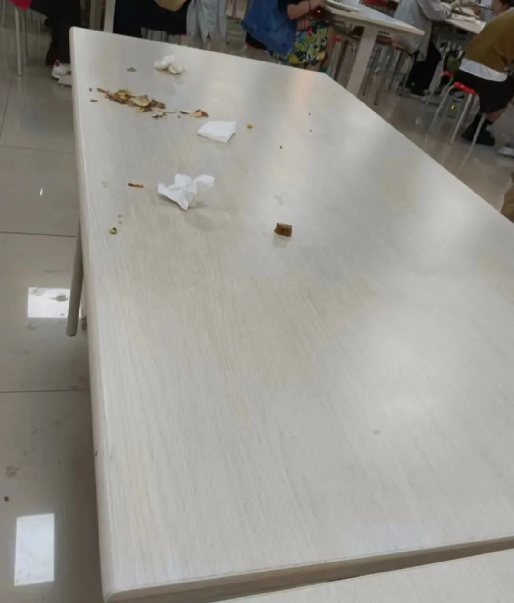
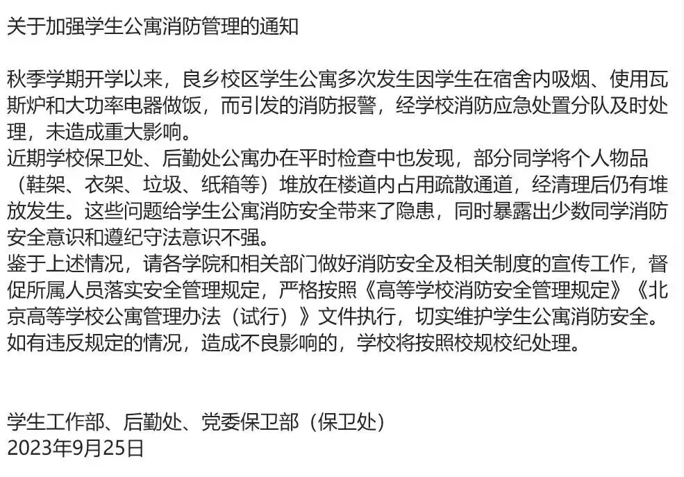

请相关部门及时关注并跟进问题。

## 1课程成绩

> “望京校区，法律（非法学）专业，研一下学期课程要求短时间写七八篇论文忍了，但是能不能快点出成绩呢？研二上学期的课程都快上到一半了，研一下学期的课程成绩一点点都没出来呢，从交论文都要三个月，拖也不能这么拖吧。。。，询问行政也没有回复，咱也不知道为什么这么忙，还是说故意不告诉，偷偷隐瞒些什么呢”

## 2 食堂

> “9月25日晚看到社论有同学投稿说一食堂师傅的事，当时在现场，同学说的是属实的，可能当时师傅有点急事吧。最近切实感觉到食堂菜品增多，打餐的师傅态度也转变很多，遇到好多次打餐的师傅和大姐态度特别好，不想因为一位师傅的一时情绪影响整体食堂师傅们的努力。在这里，也想建议食堂让师傅们带个身份牌（几号）在窗口工作，定期搞评比，同学们对态度好的师傅选举出来让后勤和食堂奖励，对不太好的进行勉励，不会因为一个人而影响集体的努力。还有也想投稿说大家在食堂吃完后把自己的餐盘和垃圾收拾好，把使用过的凳子放回原处，吃饭的时候就看到有同学把用过的纸巾和残渣留在了餐桌上（有图为证，拍摄地点在良乡食堂二楼），几乎每天每餐都会在残渣处看到有纸巾和塑料等被丢进去了，旁边明明贴的有提示不让丢进去，食堂在努力变好为我们服务的同时，我们也尽可能尊重他们的工作，做点自己力所能及的事。看到这里有不认同的，有的想骂我的我先帮你骂了，我就是事多多嘴道德绑架，略略略~啦啦啦~说完了。”

（见《[【读者投稿】补助奖金争议多，推免公开性有疑问](https://mp.weixin.qq.com/s?__biz=Mzg2MjcwNzQ1Mw==&mid=2247486147&idx=1&sn=a6dcc7d0179701f67c895a6a8a5c9e09&scene=21#wechat_redirect)》第3条）

> “您好，投稿：望京的食堂为什么越来越难吃了，用的油和肉感觉都很不新鲜，很多次吃完都吐了，身边同学也有吐的。很多时候也是能吃出来是剩菜，希望食堂不用多么美味，最起码新鲜干净不难吃吧！！！”

“ 良乡校区早晨一食堂四窗口左侧男师傅打菜算错价格，被女同学指正后后改正，假设没有被指正呢，多少人是不算价格的，还有多少起这样的事在校园里发生？”

## 3 宿舍

“所以这是楼道连把伞都不让放的理由？楼道比领导口都干净可以了吧，到底是闸机阻碍逃生还是楼道的伞？？？以后下雨伞拿不进屋里，我们是不是就直接挂后勤部领导口口上？”

(注:该稿有些用语过分激烈，编辑部经讨论后决定以“口”代替并刊发。)

“【学校的蚊虫】学校不仅有蚊子，还有蠓，随便走走，身上一身包。这个密度太大了，学校是不是应该消杀一下？”

## 4 马骨干

> “领导要退给我们马骨干的学费，不能赖账！！！什么叫要万一中宣布就没给你这两届批钱！！？？没批钱就别招生呀，国家的政策不能说变就变。不要处处拿疫情说事搪塞，别拖了，什么哪个部门不富裕？我们学生比哪个部门都穷。”

## 5 自习

“ 望京投稿 希望望京校区负责人对教学楼自习教室的安排能够合理配置一下 有的自习教室没有复试安排 有的自习教室能占一周真的安排米米哒”

## 6 图书馆

“ 用社科大校外vpn访问图书馆，无法查询校内图书。建议让图书馆信息化建设的中标公司按合同履行运维义务。”

## 7 新生奖学金与补助

## “ 咱们新生奖学金和补助什么时候到账呀一般”
