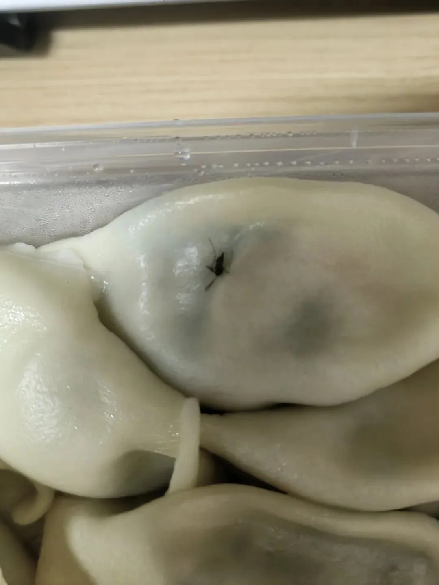

请相关部门及时关注并跟进问题。

## 1 成绩公布问题回应

> “关于望京校区法律（非法学）上学期成绩公布问题：学校要求本学期的课程成绩由开课单位在下一学期开学后一个月内提交，即暑假后9月30日前，寒假后3月31日前，目前尚未截止。经与法硕老师沟通， 院系8月底完成所有课程论文收集，目前正在加紧进行阅卷和录入工作中，能在规定时间内完成。假期原因，预计节后报送至研究生教育管理部，研究生教育管理部会在报送当天完成审核，公布成绩。”

## 2 医务室

> “来社我要投稿，社科大良乡校区的报销政策和医务室的药的库存问题。报销政策一次性不说清楚，来一次挤一点牙膏，已经跑了两趟医院了还没有报销成功，每次都在细微处做文章，又是什么自费改成公费，又是什么补打处方笺，一共账单上多少钱看不出来吗？这就是为人民服务和只跑一次的效率吗？还有医务室的药能不能多一些，全一些，连莲花清瘟颗粒、苦柑颗粒这种一般的感冒药都没有，还要去良乡医院跑，能不能体谅一下学生？我们也是有事的好吧？建议出一下文件和细则，然后补充一下校医院的药的种类。”

## 3 食堂

> “一食堂二楼中间打饭窗口（具体是几号忘了）某位大叔打饭从来没给过好脸色。看到这两天有同学反映食堂服务态度问题，本人也有类似遭遇，无故被吼被斥责，想借此机会，一并发声，希望能引起食堂相关负责人的重视，进行整改。理解食堂二楼生意更好，每天服务的学生更多，工作量更大。但工作压力或者个人原因造成的情绪问题，不应该让学生买单。更何况，呆了这么多年，还是这学期第一次遇到这样莫名其妙的事情。其他打饭的小哥大叔阿姨怎么就没有吼过学生？再次呼吁食堂负责人对此问题进行重视并整改。”

> “好绝望，上完课饿到面无人色，去食堂拥挤的人群里买到我最心爱的三鲜饺子，千里迢迢（？）拎回宿舍后发现上面死着一只蚊子，老天为什么这样惩罚我。（风味食堂的饺子窗口，图片可能看不出来但那只蚊子是紧紧粘在饺子皮上的，所以不会是我后面打开盒子的时候掉进去的只能是打包前）”

## 4 校园网

> “想问一下因为咱们是人文社科类院校就理所当然、理直气壮的网络技术差劲吗？如果网络修理能够有效果的话，那我们学校的网络速度一定北京高校第一名，但是现在是什么样子？一个学校网络差仅仅影响的是在校生吗？深挖一下，希望学校相关方能够重视”

## 5 查寝

“ 良乡校区公寓办必须道歉！ 今天在我们宿舍没有人的情况下，有人私自进入宿舍进行了搜查。他们打开了我们宿舍每一个置物架的格子，甚至还打开了衣柜，将东西一通乱翻。查完之后，甚至没有将东西归位，我们回宿舍后看到一片狼藉！ 学校对学生基本权利还有尊重和保护吗！我们作为学生，也是学校的一部分，应该受到尊重和关怀！对待学生，尤其是在我们不在场的情况下，应该更加谨慎和尊重！ 即使是在监狱里对待犯人都应该给予一定的尊重和隐私，可是我现在在这个学校感受不到一点尊严！ 我要求良乡校区公寓办就此事件道歉，认真对待这一事件，并保证类似的事件不再发生，保护我们的隐私和尊严！ 中国社会科学院大学自诩为“人文之光”，若对“人”的精神的探索为一个学校的目标，那么这件事情就是对社科大若干师生的努力的最大嘲笑和讽刺。如果一个学生回到宿舍，面对的境况是自身被以安全之名赤身裸体地审视的话，那么ta会知道，自己在教室里面听到的所有关于这个学校的宏大叙事皆为笑话。 每个人都享有法律赋予的基本权利，包括隐私权。如果良乡校区公寓办视而不见或拒绝道歉，我有权采取法律手段，保护我的合法权益和隐私。"

## “投稿：非常不理解宿管查宿舍在同学不在场的情况下翻别人东西的行为？”

## 6 蚊虫

> “【学校的蚊虫】学校不仅有蚊子，还有蠓，随便走走，身上一身包。蚊虫密度太大了，学校是不是应该消杀一下？秋天的蚊虫最狠，这样一来，不仅学生遭罪，一些来学校上课的知名专家、教授，尤其是年龄大的，也深受其害。”

## 7 望京教室管理

> “您好，想请问一下望京校区的行政人员和物业，教室问题就这样摆烂了吗？教室管理一团槽，每天上课也不按照课表，明明写着没课的教室，会不断有人进来说有课有讲座要清人。教室如果没有能力管理好的话，好歹把课表写清楚吧。昨天一天被赶走了三回，反反复复看着门口电子屏显示的课表思考问题出在哪里。原来问题出在不管学生死活高高挂起的行政人员呀”

## 8 课间

> “上下课时间的安排，似乎不太合理…6-8节是4点20下课，9-10节是4点25上课，只有5分钟，要从行政楼跑到研教楼，一般还要接水、上厕所，并且厕所排队的人超级多，几乎每次都迟到”

## 9 图书馆

> “望京校区图书馆的洗手间门能不能加一个挡板呀，蹲坑的时候，如果外面的门开着，是可以站在楼道从缝里看到屁屁的！很清晰！而且洗手间真的很臭，能不能多想想办法去去味道！”

> “社论君你好，坐标望京校区，有一事好奇，万盼解答： 图书馆创客空间的研讨室，功能是什么？ 起因是研讨室每日嘻谈笑骂、尖叫跺脚之声不绝于耳，不由让人好奇： 1.如果研讨室允许大声笑谈，学校是否应该强化隔音功能，或者另辟他处？ 2.如果研讨室不允许大声吵闹，那是否有相应的规章制度，或者保障措施，如管理老师巡检?”

## 10 博士二外

## “来社科大读博二外千万不要选法语。”

## 11 双选会

“投稿，社科大是荣升大专了吗，双选会来的什么勾八单位，信用卡电话销售都能放进来，真大开眼界”
