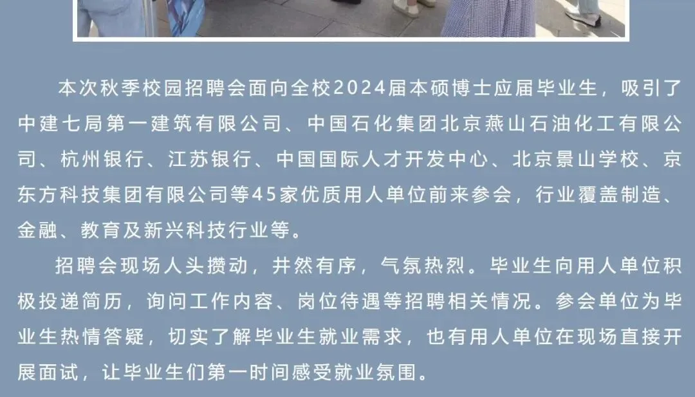
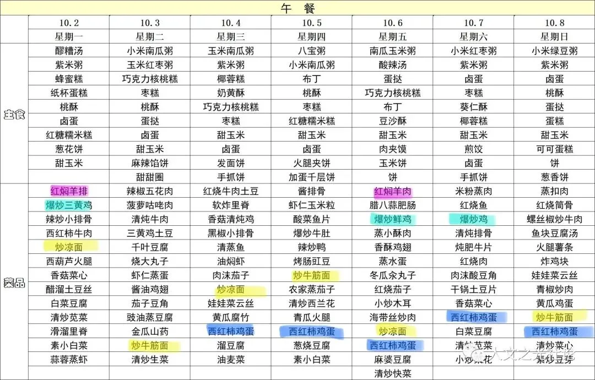
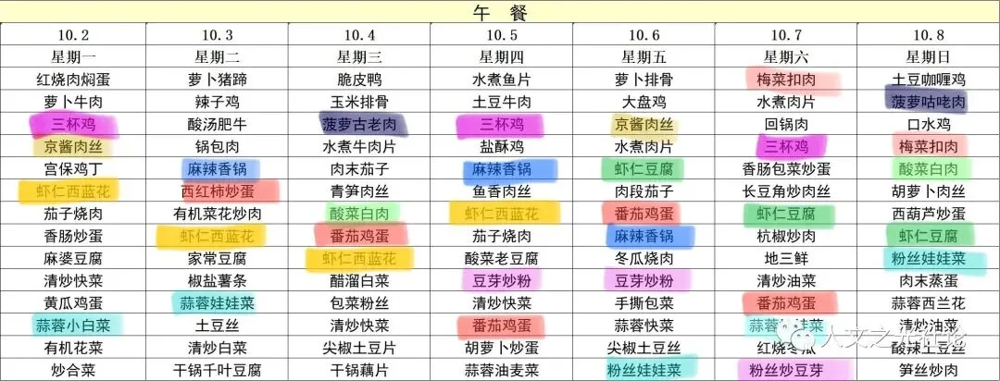
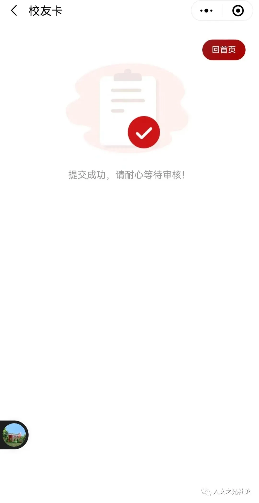
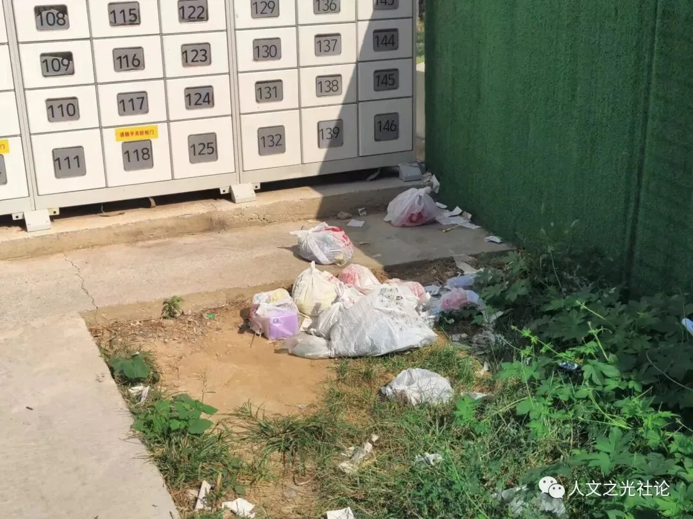
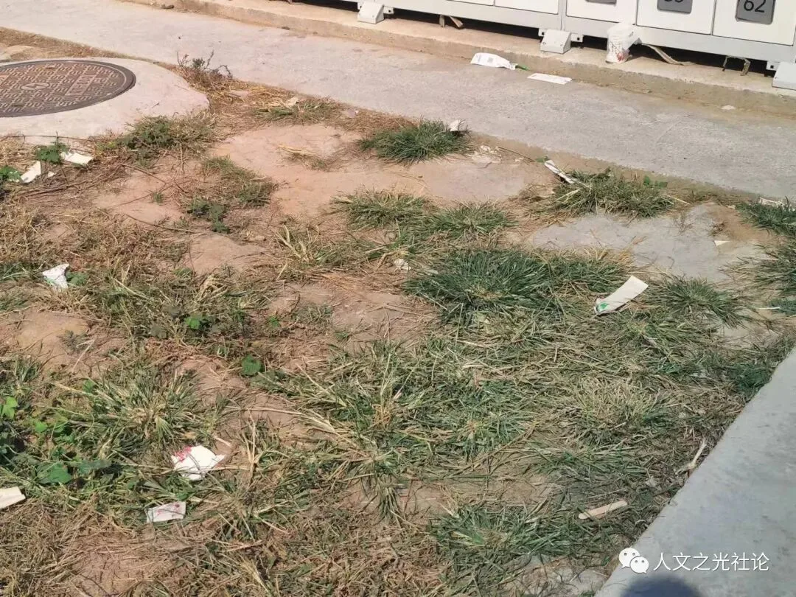

请相关部门及时关注并跟进问题。

## 1 双选会

> “投稿双选会 什么叫优质单位？中建七局-只招工地打灰财务；燕山石化-只要北京生源；杭州银行-税前一年就16w所有银行北分最拉的一档；江苏银行-截至双选会结束前一个小时那个展位还是空的；中国国际人才中心-招聘要求”高职/大专“……怎么说大家高考也是六百多分的人，罪不至此吧”

## 2 博士法语

> “针对9月28日，法语二外有关的社论，我也想简单说两句。 在2022级法语1班考试前的最后一节课，课间的时候有一位女同学趁着老师不在，拷贝了试卷与真题，属于严重作弊行为。如果是这位同学以及她的同伙成绩被打了低分，请千万不要贼喊捉贼。这位作弊的同学不是人文之光，而是人文之耻。建议教务处彻查到底。”

> “投稿：关于博士选修法语第七条：同情且理解选修法语同学的困境，不过对于其中建议的解决方式不能苟同。比如“移除二外成绩不作为奖学金评定标准”，这不也是对其他在二外中获得理想成绩同学努力的抹杀吗？”

## 3 博士奖助学金

> “投稿：希望相关部门回复一下，博士生（非新生）每年学业奖学金是如何评定的，评定的细则请公布一下，（已查阅官网，并没有）。如果没有学校统一标准而是每个班级自己评定，那就过于好笑了。并且，貌似博士生的三等奖学金并不覆盖学费？试问北京学校哪个敢这么低呀？【我只是合理提出自己的疑问，请有关部门详细回复】”

“投稿：博士新生补助问题。 学校之前发通知说补助到账了，然后并没有收到钱，还有新生奖学金也遥遥无期。”

## 4 校园网

> “投稿，今天中午和晚上出现了异常的流量消耗，账单显示我的手机在1分钟甚至0秒内消耗了好几个G的流量，但是我中午并不在校，手机根本不可能联网；晚上也并没有使用什么软件，却依然出现了短时间内大量不明原因的流量消耗。希望学校及时排查异常原因，尽快清除隐患。”

## 5 蚊虫

“投稿：合理怀疑学校内咽痛发烧的流行跟学校里的蚊子有一定的关系，希望有关部门可以灭灭蚊，这个中秋过的真是痛苦"

## 6 节日快乐

> “学校主页图片不会实时更换嘛？是宣传部没人 还是懒政 而且过节过年校门口都不带挂灯笼的 学校日子让你们过成这样冷清也真是没谁了 我想领导你家过节也是这么冷清寡淡么？”

## 7 宿舍

> “望京校区:想请问一下宿舍吹风机能不能延长时间？图书馆10点闭馆，吹头发只能到10点半？洗澡可以到12点，吹头发只能到10点半？这是谁想出来的制度？起码延长到11点总可以吧，11点也不算太晚，如果学校对吹风机限制的时间不能满足学生需求，起码做一下问卷调查也行啊，问问多少人10点半就睡觉的？大多数人还是在11点以后的吧，真心希望吹风机延长时间！谢谢！”

“请问学校，1、4号楼洗衣房配备烘干机，为什么其他没有烘干机的宿舍楼的学生不能进入呢？谢谢。”

“请问学校有没有人能处理一下每天深夜都在七八号楼之外嗷嗷叫的流浪狗？快神经衰弱了”

## “有同学有早上洗澡、洗头的需求呀，希望早上也有热水提供，谢谢!”

## 8 食堂

> “投稿：望京的食堂最近味道太差且重复菜品太多，今天中午11点15分打饭，排队5分钟，拍到的时候发现水煮鱼片的容器已经快见底了，土豆牛肉的还剩四分之一，其他菜品卖的很少，黑乎乎的酱油放多了的貌似是叫三杯鸡的菜一动未动。可以从一个侧面体现出并不是每道菜都有很多人爱吃。本人对食物的欲望一般，已来投稿说明忍无可忍，求学三年，每年新生开学食堂都会充分表现，大力改变，但今年反而是感觉最难吃且最不求上进的一年。望京食堂的安排是四天西兰花，三天虾仁豆腐对吧，并且紧紧挨在一起，晚上还会把中午的西兰花再次翻炒。如下图所示，对比良乡和望京菜单，可见望京重复菜品太多了，这还是没算晚饭的粗略统计。不要求满汉全席，八大菜系，厨师既然是专业的，所做的菜就应该比普通人种类多，味道好。麻烦相关负责人用点心编制菜单，再用点心选拔厨师。（勺子清洗不干净的状况持续近一个月没有改观，直接找了负责人才变好，如今左侧的自动取勺器坏了也有半个多月了，没有人修，只靠学生反映才能变好吗 关键是得有那颗想要变好的心。）”

## “望京食堂是换厨师了吗？菜好辣，不吃辣的人不配在食堂吃饭了吗？”

“望京食堂本身就比良乡那边贵很多，为什么趁着假期偷偷涨价了！为什么偷偷涨价！！！”

## “望京食堂学生卡现金充值机器无法正常使用。”

## 9 图书馆

## “关于良乡校区图书馆的暂离系统

10月份刚开始就因为暂离返回忘记签到，违约了两次。因为之前硕士也在北京读的，那边学校图书馆的系统很人性化，只要在闸机刷卡出入图书馆时，系统就会自动给签到或暂离，避免学生返回座位或短暂离开时忘记扫码。想说现在社科大图书馆的签到真的麻烦得有些离谱了，如果一天都泡在图书馆，算上中午晚上去食堂吃饭，那一天至少也要在系统里操作四次，而且如果因为忘记扫码违约到三次当月就不能再进图书馆了，就真的挺无奈的。”

## 10 校友卡

“投稿：为什么电子校友卡申请了十几天还没审核通过？已经毕业学子想回母校看看都这么麻烦，给我们正当进校设置重重障碍，令人寒心。请校友办速速解决。”

## 11 校园卫生

“投稿~请学校有关部门关注一下外卖柜附近的卫生问题，一些废弃外卖（or 垃圾）随意丢弃，非常不雅。”

## 12 摆渡车

> “光光好，想就班车运行时间提建议，现在是北京时间23:24，上一辆广阳城地铁到达时间是23:14，摆渡车发车时间是23:15，我和其他三位回校的同学经过“嗷嗷嗷啊啊啊”的奔跑和“呜呜呜啊啊啊啊”的悲呼后，发现一分钟内是不可能实现从地铁站到摆渡车的瞬移式跨越的，据我所知不止这一趟是这种情况，希望学校调整运营时间。（附：如有“那你再等一趟呗”“学校又没有这个义务”“据调查大部分学生还是赶上了的，只有你自己呀”“别的学校还没有这个服务呀”之类的言论，我的回应是“biu biu biu 反弹反弹弹弹”。”
