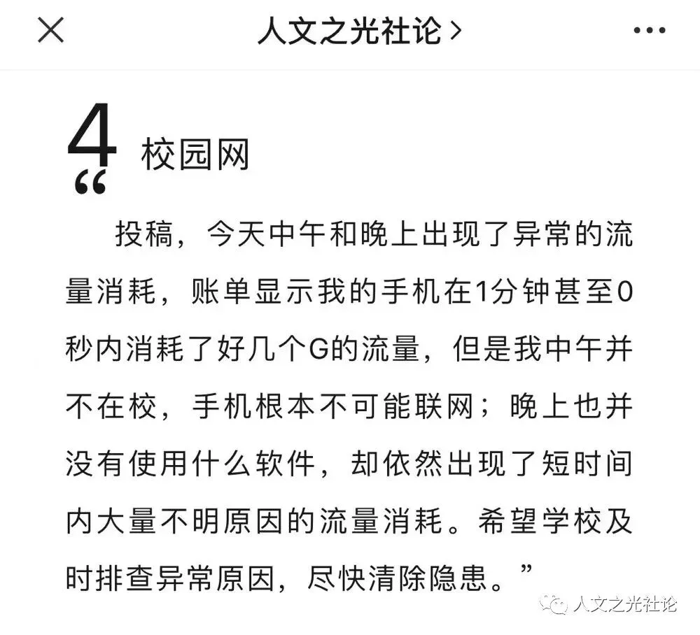
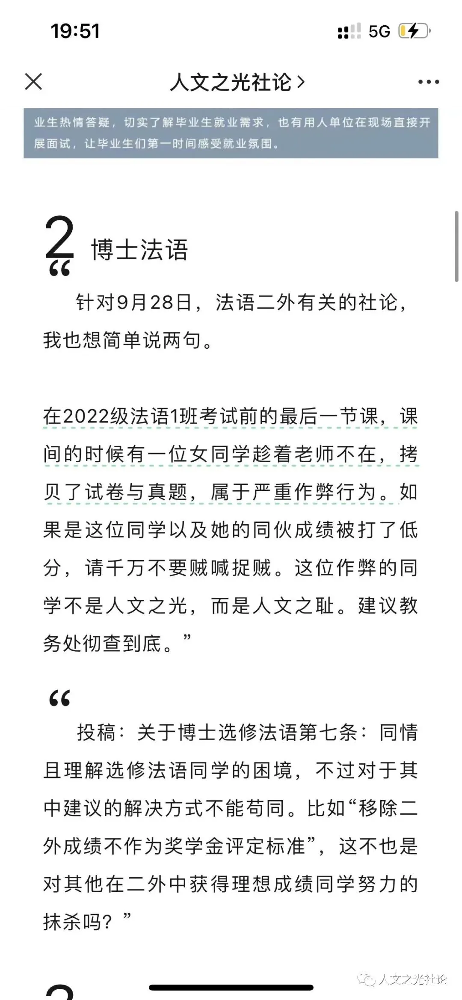
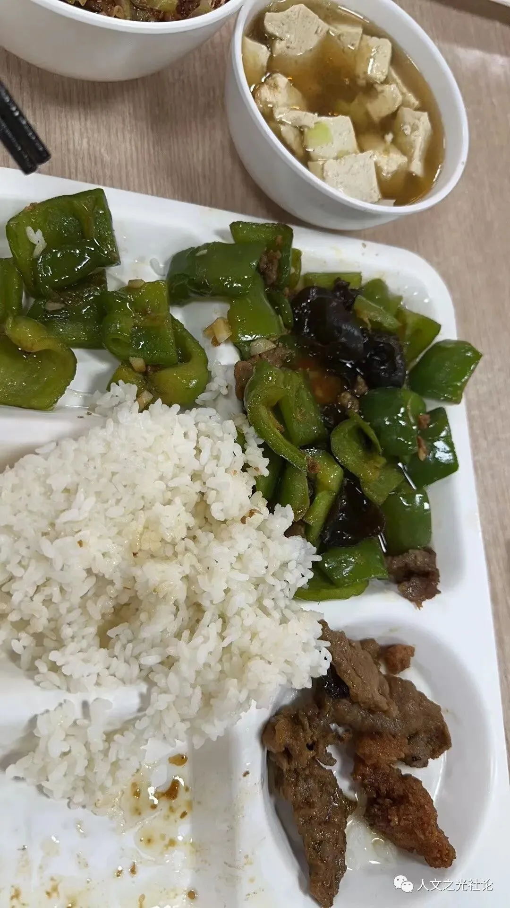

请相关部门及时关注并跟进问题。

## 1 校园网

“您好，关于这个反馈，网络中心通过描述无法确定问题具体时间点，可以请反馈问题的同学直接联系网络中心排查解决问题”

（见《[望京设施有改进空间，食堂宿舍现新旧问题](https://mp.weixin.qq.com/s?__biz=Mzg2MjcwNzQ1Mw==&mid=2247486159&idx=1&sn=4c34b1489670a6f5537c0d7d9db7bdeb&chksm=ce02815df975084b07068e17e596a194f3f3b85b2e609f15344f0e7664bdf138957590c27cf7&scene=21#wechat_redirect)》第1条）

## 2 教务问题

“投稿：法硕9月27日关于上学期成绩的回复是否有些太糊弄人了。把大家都当傻子？“于八月底完成作业收集，预计国庆节后发布成绩”

大家吐槽的难道不是每次都疯狂催促收作业，收了后改作业却要接近三个月这事吗？上学期作业可是七月中旬就全部提交了（甚至六月就交了一批），您光是整理收上来的作业就整理了一个半月，要到八月底才能转给各研究室老师是吧？这是什么效率？跟学生一起放暑假了？如果要跟学生一起放暑假那就麻烦下次等寒假回来再收作业！不要和去年一样大年初几前交作业，却等到差不多学期中期才出成绩！”

（见《[【读者投稿】双选余波未平，二外争议又起](https://mp.weixin.qq.com/s?__biz=Mzg2MjcwNzQ1Mw==&mid=2247486208&idx=1&sn=9f84ee5710cb63165a5a8cb92f8d3a4d&chksm=ce028092f9750984aaab59e953e54499aa83283f750efbfebb5593ad15690cfa2d6228b55d4e&scene=21#wechat_redirect)》第4条）

## 3 博士二外

## “人文之光社论您好！我想就今天刊发的法语二外问题，发表一下言论。

这句话中，是没有证据的。没有拷贝，没有真题。也没有作弊。我希望有管理人员联系下我，我们班同学可以作证，u盘中没有考试真题，也没有拷贝。何来的人文之耻？如果仅凭一个人的话，就发在公众号公之于众，有损形象，更不符合我们人文之光社论的投稿理念。”

(社论菌回复:同学你好。十分抱歉，碍于各种原因，我们没有办法对稿件进行完美的事实核查；根据我们的投稿理念，也并不认为刊发此稿有不妥之处。

如果同学认为稿件反映内容不实，可以籍投稿澄清事实，感谢同学对我们工作的理解！)

## “既然法语1班存在偷题泄题现象，建议教务处彻查！

难度极大的卷子突然出现几名完美答卷，是否会影响老师对试卷难度的判断？是否会影响老师对两个班学习状况的评价？是否进而导致了法语2班的成绩普遍偏低？

希望这位知情的同学，把来龙去脉特别是后续讲清楚！就像你自己说的，不要做人文之耻，要做人文之光？”

## “震惊！法语考试竟然出现泄题的情况，建议彻查。

另外，还请同学不要随意乱贴标签，作为一个花了大量时间辛苦备考法语的学生连argue的权利都没有了吗？

尊重每一位法语一二班为考试付出努力的同学，但是班级之间分数差距大，老师平时分的给分标准究竟是什么，是否被其他因素干扰？?”

“想问下博士法语二外的分数两个班平均分差的多的原因，是因为有考题泄漏导致的吗？想必如果出现这种情况对哪位学生都是不公平的。 ”

“既然有同学把讨论低分情况和作弊混为一谈，二班本来就低分多，还要被剥夺讨论此事的窗口，那申请学校彻查此事。”

## “投稿法语二外：

关于法语二外，我也想说两句。希望各位同学先不要阴谋论。那天说自己没考好的，一看就是经济学院的学生，而投屏考试题目的女生，肯定不是经济学院的。更何况老师不知道这个事，更没有可能故意给她打低分了。从另一个方面讲，投屏的题目是19年的，也不是今年的题目，即便有几道重合，其实也无伤大雅。另外，法语考试题目并不难，我考前感觉学得不扎实，但是考出来还不是90+。都博士生了，遇事多反思反思自己，这些天有认真学习吗？至于说三高难的，这不应该是你硕士期间就学差不多的内容吗？如果你是直博生，还情有可原，如果读过了硕士还这样，那应该找一找自己的问题了。”

（见《[【读者投稿】双选余波未平，二外争议又起](https://mp.weixin.qq.com/s?__biz=Mzg2MjcwNzQ1Mw==&mid=2247486208&idx=1&sn=9f84ee5710cb63165a5a8cb92f8d3a4d&chksm=ce028092f9750984aaab59e953e54499aa83283f750efbfebb5593ad15690cfa2d6228b55d4e&scene=21#wechat_redirect)》第2条）

## 4 摆渡车

> “附议摆渡车那条，23:14下了地铁根本赶不上23:15出发的摆渡车；以前师傅是会等这一趟的同学上车再走的，现在是过于“准时”了，希望更人性化一点，多等一两分钟就差不多了。”

（见《[【读者投稿】双选余波未平，二外争议又起](https://mp.weixin.qq.com/s?__biz=Mzg2MjcwNzQ1Mw==&mid=2247486208&idx=1&sn=9f84ee5710cb63165a5a8cb92f8d3a4d&chksm=ce028092f9750984aaab59e953e54499aa83283f750efbfebb5593ad15690cfa2d6228b55d4e&scene=21#wechat_redirect)》第12条）

## 5 食堂

> “望京食堂：银耳汤正准备喝第一口的时候发现有一根毛发，本来以为是头发，想着这种情况可能难以完全避免，可是细看发现这不是头部的毛发啊！！！这弯曲状！根部毛囊都能看见！这可是...！啊不想说了！瞬间就被恶心坏了，当时没看见负责人，望京食堂给个说法！。”

“望京校区食堂早餐的咸菜基本上都吃不到，希望窗口可以增加收费的咸菜，味道做好一点！”

> “食堂(注:望京校区食堂)的饭菜太油了，而且有点重复，只有几个菜比较好吃，希望增加一点自选麻辣烫或者减脂餐清淡点，不是还有很多窗口？面那里价格太贵能不能份量减半价格减半。”

> “良乡校区：食堂排队是个老大难问题，如果增设食堂窗口、丰富菜品样式不好处理的话，可否让食堂工作人员加快打饭速度。很多人发现食堂打饭师傅在打饭过程中行动非常缓慢，拖延时间，说话谈笑，打一个人的饭要等三四分钟，导致排队越来越长。”

“学校今天一食堂一楼有一个大椒炒肉，问题是这个菜里有两种肉，一个是炸的，一个是炒的，不知道这是学校特色还是他把剩菜再利用了。”

## 6 图书馆

“投稿望京校区图书馆内女厕所的问题：望京校区图书馆总共有四层，原本每一层都有厕所。但是，现在二楼被改成了开水间，一楼的厕所仅限工作人员使用。于是三楼为男厕，四楼为女厕。本身女生上厕所就会比较慢，所以厕所门前经常大排长队，对女同学们造成很多不便。

就此本人有两点疑问：1. 为什么一楼的厕所仅限工作人员使用，而且还得用钥匙打开，请问是工作人员比较特别不能和学生用一个厕所吗？！几百个学生能爬三层为了上个厕所排十分钟队，但工作人员就十位数也需要单独设立一个厕所使用吗？2. 开水房内的饮水机是否可以考虑更换位置？不要挤占原本就不够的厕所资源。

对于以上问题本人两点建议：1. 开放一楼厕所供学生使用。2. 更换饮水机的位置，考虑设立在三楼咖啡机旁，将二楼厕所还原。"

## “谁能告诉我望京图书馆的位置预约有没有用，预约系统上全是空位，到了一看全是人。”

## 7 宿舍

“其他楼要进四号楼用烘干机的给我整笑了，既要又要什么都是你们的？住好宿舍你就偷着乐吧，想用烘干机你搬过来住二改四上下铺呗。”

> “关于夜间流浪狗扰民问题已在校园门户意见反馈平台回复https://info.ucass.edu.cn/site/bmfw/noticedetails?type=bmfw&id=bmfwpreviev\_15915ef8c3fa3cfc46a1e5fa2484e69a”

（见《[【读者投稿】双选余波未平，二外争议又起](https://mp.weixin.qq.com/s?__biz=Mzg2MjcwNzQ1Mw==&mid=2247486208&idx=1&sn=9f84ee5710cb63165a5a8cb92f8d3a4d&chksm=ce028092f9750984aaab59e953e54499aa83283f750efbfebb5593ad15690cfa2d6228b55d4e&scene=21#wechat_redirect)》第7条）
