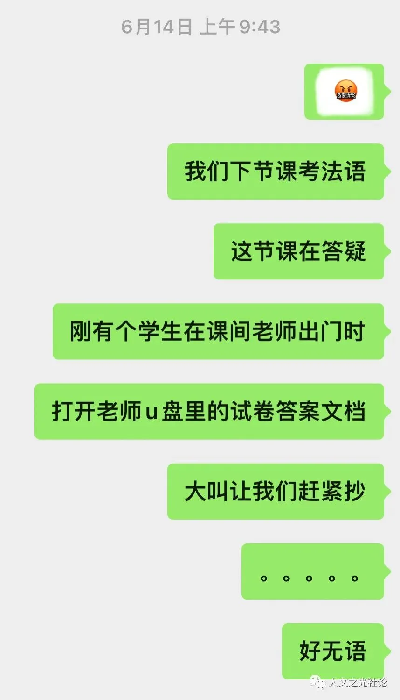
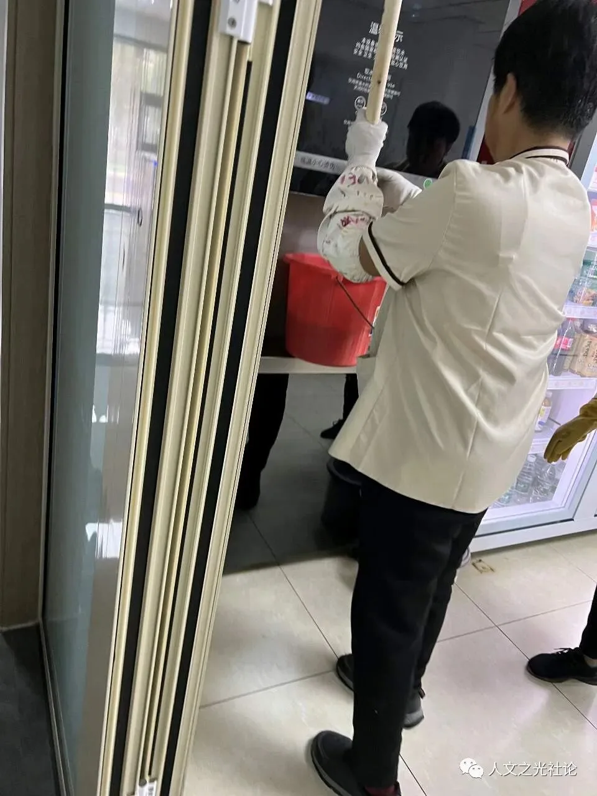
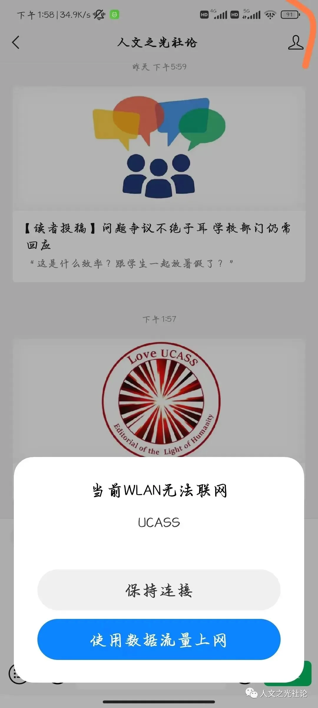
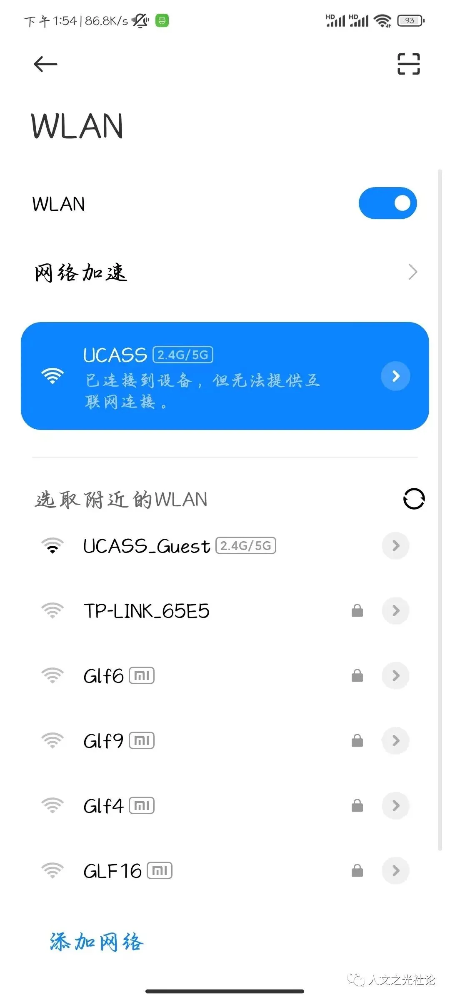
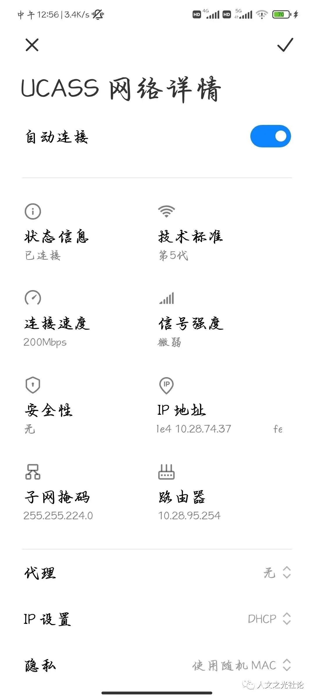
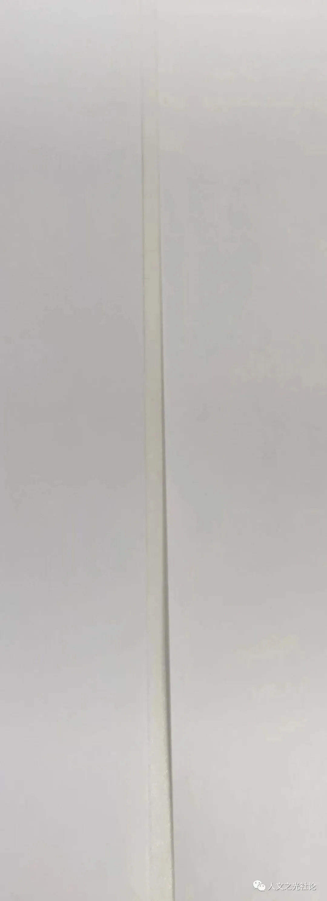

请相关部门及时关注并跟进问题。

## 1 博士二外

## “关于此前有人反映的法语二外1班泄题事件，我想补充几点细节：

1. 泄题事件发生在2023年6月14日上午9:30-9:40左右（见下图）;

2. 泄题者当时没有拷贝试题和答案，但该同学确实在老师离场的情况下，翻查了老师的u盘，并目标明确地打开并观看了一份标题为“xx法语1班试题xx”的文档（该文档同时包含题目与答案）；3. 我猜测该同学当时并不知道u盘中的试题并非当年试题（“被泄试题非当年试题”这一说法源自上期社论，未经核实，暂且当真），但我认为其主观上确有作弊倾向；

4. 该同学在打开文档后扬言：“大家赶紧抄”“我看谁敢把我抖出去”“谁去门口站一下岗”，在关上文档后说：“谁拍好照的给我发一下”。

综上，我认为泄题事件同时损害了“独立备考的同学”和“未涉事但可能因此而被打低分的同学”的权益，因此我既支持教务处查明并妥善处理泄题事件，也支持未涉事的同学合理质疑并复核分数。”

> “ 投稿：我全程目击了所谓的“作弊”过程。没有拷贝试卷材料，是打开文件在电脑上展示了一下。而且，更为关键的是，该问卷标题和内容，都是前几年（并非去年）的题目。根据该题目，只能看到考试题目类型，对今年试卷取得高分帮助甚微。”

“ 关于二外想说的是，法语1班和2班分数差别是否很大还需要官方公布成绩均值等数据，作为1班学生，自己的分数也很低。法语是否和其他二外语种相比分数偏低很多，外国语学院对二外试题难度和阅卷是否有统一标准。

另外，博士二外必修本来就存在争议，博士生的任务是科研，很多人是被迫学习二外，如果因为一门不公平的法语成绩导致奖学金评定低一个等级或者没有奖学金是不合理的，众所周知，我们的补助本来就很低…！”

> “都是博士生了，考不好难道不应该从自身找原因吗？每道题都会，难道老师非要给低分或者不及格？法语试卷是一个空一分，清清楚楚的，对就是对，不对就是不对。名校的期末考试不都是公平公正吗？难得非要按照很多很水的学校的那种标准(期末画重点，写了都给高分甚至满分)？早知今日何必当初呢？哪个博士生的课程任务和压力不重呢？自己不好好学习也请不要抹杀别人的努力，二外每个人选择的都不一样，不同科目之间，由于试卷难度、老师等各种原因，没有可比性。扪心自问一下，法语试卷难吗？也有好多人是提前交卷的，甚至30分钟就交卷了的。也算是给自己的一个教训吧。脚踏实地，真才实学的人，方能走得更远！”

> “投稿上学期日语二外w姓老师违规为学生画重点。日语课共两位老师，L姓老师在课堂上明确说过学校严令不许任何老师在课堂上为学生画重点，任何关于考点的叙述都很谨慎，但是w老师在期末最后一节日语课时和学生明确提出“接下来我说的话都很重要”画了重点单词，甚至连选择题怎么考，翻译题怎么出题都逐一细心讲解。同一套试卷，两个老师，不同标准，学生竟成最大受害者，社科大你没有心。”

> “关于二外我想说的是，面对如此大的争议性事件，学校相关教务部门能做的就只有熟视无睹吗？相信如果有些部门如果尽早借合理手段走调查程序公布调查结果，不难还学生与考试一个清白与公道。正是某些人的不作为，让师生为这件本不应有的争议劳心费神，令人汗颜。”

## 2 自习

> “光好，希望学校考虑一下把核酸亭改成自习室（尤其是可出声自习室）的合理性、可能性和迫切性，这样老师们不用天天看墙上因为自习问题扯头花而烦恼，同学们有暖和的读书的地方，至于医务室的杂物，我相信医务室的智慧。希望光你方便的话加一个投票环节？”

## 3 校园卫生

> “救命想投诉!投稿一下保洁阿姨们洗拖把消毒的操作…怎么直接在饮水机上呢?早上在八号楼真的有点被震惊和恶心到！！！注意下大家的饮水安全ok吗！不知道操作多久了但是宿管阿姨也熟视无睹……救命🆘！”

## 4 饭卡退费

## “我想询问一下，毕业生饭卡的钱退费了吗？一直没有收到……”

## 5 共享单车

“学校里面共享单车能不能放一点。。。。。。。。。。。常常走遍整个校园地找共享单车都找不到。。。。。有时候看见保卫处放自行车了，然后过一两天就没了。。。。。"

## 6 校园网

## “网络运行部老师好，

入住新楼以来发现室内校园网总是出现信号微弱的情况，我应该调整室内的网络设备吗?

以及在室内室外经常出现WiFi无法上网的情况了。”

## 7 医务室

## “校医院的报销什么时候可以到账 感觉每次都要等到天荒地老”

## 8 体育馆

“三您好！想向学校体育部及气膜体育馆管理部门提一个小建议。馆内排球场与羽毛球场之间，因无必要隔离物，导致排球击出后经常飞入羽毛球场，存在踩球崴脚风险，也对羽毛球正常活动造成干扰。

建议学校采购软质隔离网，悬挂于排球与羽毛球场地之间，成本不高且能够有效防范相关风险。希望有关部门收到建议后给予回复，谢谢~”

## 9 望京打印店

## “你好，给【望京】同学们避个坑/或者学校相关部门能不能协商改善一下：

望京校区【楼下打印店】纸张明显偏黄、偏薄，这个是对比图，左手边的是【图书馆】自助打印的文件，右手边是【楼下打印店文件】。

我手机的像素不是很高，拍出来的对比效果不明显，但是肉眼绝对能看出来区别。

因为图书馆自助打印没有办法调节纸张方向（比如：本想横向打印铺满整张屏幕，但是打印出来是纵向靠上的效果），所以去楼下打印店打印了，结果发现这个问题。最可气的是老板说是一样的，没有区别，是不同纸包的纸，完全睁着眼睛说瞎话。

希望学校相关部门能够协调一下：①增加可以在电脑上操作的自助打印设备；或者②和打印店老板协商一下更换成70g正常合格纸张”
