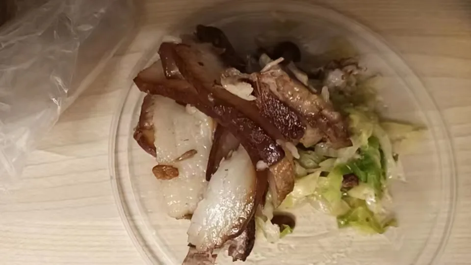

请相关部门及时关注并跟进问题。

## 1 劳动实践教育

## “投稿：

为什么一个所谓的“劳动实践”事前没有任何的意见征集，如此忙碌的大三为何要折腾我们坐大巴去涿州？还浪费一个周末？

领导是觉得我们都很闲吗？是觉得来来回回把21级没折腾够吗？一天天凭什么要强制我们去涿州，毫无提前准备。

浪费大家时间形式主义什么时候才能消停？不要给外人作秀让学生搭进去！

多说一句，你社科大不要感觉自己在劳动教育上“一流”就能“双一流”，何况你也不“一流”。不折腾人、不要折腾大三学生才有点人性和道德。”

> “英明神武的张树辉副校长又开始施展宏图大略了？听说先生上周刚去完涿州这周就突然拍脑袋决定让大家去涿州锻造自我。试问学校除了前两天那篇信息量约等于零全是废话的推送外，在决策前是否和学生通知、沟通？更不要提对实践场地的住宿餐饮条件尽数隐瞒，要不尊敬的张树辉副校长与诸位分管学生劳动实践的领导们与我们一起住32人一间大通铺，一块挤挤澡堂？一流大学的一流大脑的决策方式和工作安排没首没尾，只关心怎样把工作的面子工程做得漂亮——况且也不漂亮，丑态百出，着实可笑可耻！”

“惊悉学校对劳动实践的安排，属实令人错愕不已。学校明明可以有两全其美的办法，改换、缩短甚至取消集体劳动的安排，却选择了最折腾学生、最不近人情的方式。周末我们饱食终日的领导与行政人员是无事可做了，但同学们难道就没有别的事情了吗？凭什么一个不经调研的仓促决定就能打乱大三同学们学期中一个宝贵周末的安排?学生们学期中为自己前途准备的时间的就不是时间，就一定是庸肆官僚彰显自己“英明决策”的祭品吗？

并且，集体实践的详细内容，如同学们的住宿条件、行程安排等也并不明确，可能是要大睡通铺，明摆着就是折腾同学。

某些人口口声声说请同学们理解，但他们又何曾理解过学生?难道戏耍学生就是我们学校行政人员的工作宗旨吗？想必事情过后，领导们又要出来得意洋洋地表彰自己“高校劳动实践的勇毅书写”了吧。”

## 2 保研安排

“我要吐槽下国际政治经济学院推免录取工作，在全国大部分知名高校已经完成推免工作之际，10月8日姗姗来迟才在官网公布了推免名单。果不其然，只有一人报名。

总共推免只有一个直博来面试，总共十几个推免名额，连人都没法招满，我简直为国政经感到羞耻。

全国大部分高校提前进行夏令营，早早开始抢人才，国政经夏令营也没有，推免工作开始之缓慢令人震惊，这样怎么吸引优秀的保研同学来？

国政经负责推免的老师不应该感到羞愧吗？连续几年推免都没招够人了，不应该反思下自己吗？”

## 3 洗衣机回复

## “尊敬的各位同学：

大家好！以下是对同学们反馈的洗衣机支付步骤增多，需使用通用小票支付的情况回复：

为了满足同学们多方面洗衣需求，在暑假时，我公司在学生公寓洗衣房内增加了一人一桶洗衣设备，预计10月中旬正式启用。2023年10月8日，在对一人一桶洗衣模式进行APP线上测试时，由于工作人员操作失误，误将程序设置为必须充值300元才能使用。经反映发现问题后，我司立即联系技术人员调整了后台设置。

在此公司对没有提前通知同学们就进行测试、因操作失误和考虑不周全为同学们带来不便深感抱歉，并向同学们致以最真挚的歉意。

同时，我公司承诺，在测试期间有充值、多支付费用或洗衣机故障的情况，均可联系洗衣机厂家：4001833898（24小时）或现场维护人员：15801031585（早8点至晚8点），我们将无理由全额退款并免费赠送洗衣1次。”

## 4 食堂

“俺要投稿！二食堂麻辣拌旁边的那家米饭套餐有一个猪脚饭17元。肉巨多！但都是肥肉没法吃给大家排雷。

这是我挑出来肥肉。仅是部分肥肉，我自己还吃了很多，吃的我恶心了已经。”

“望京校区食堂肥肠面针不戳，好吃了很多。打饭阿姨也炒鸡好，主动问我要不要加点面（也可能是因为之前我没吃饱又下阿姨煮了半份面）”

## 5 宿舍

“ 坐标望京校区，3号楼男寝6楼一侧的洗衣机从上学期放假前就坏了，到现在将近小半年过去了仍旧没有修好。上学期催过宿管，答复是修洗衣机配件要发货过来，一时半会修不了（咱也不知道什么高科技的配件）。

一个假期过去了，现在是干脆贴个“维修中”就不管了，问就是尽快。每次洗个衣服要排很久，希望早日修好，恢复正常。”

## 6 校园绿植

> “望京最近很多同学在拿杆子打树上的柿子，学校能不能贴一个告示在望京的柿子树下，请大家不要在柿子没熟的时候拿杆子往下打，柿子现在还没熟，而且打下来掉在地上全都摔烂了，根本就不能吃，都浪费了。希望学校先贴一个告示，并且之后组织统一采摘。”

## 7 面试

> “想问问学校这边可不可以开辟可约的一些单人会议室 （如行政楼的空办公室等等）给需要面试的同学提供空间 图书馆的研讨室需要2人以上 而且隔音也不太好 活动室这学期也锁着门 申请了也锁着 希望学校为毕业年级考虑一下。”

## 8 博士体检

> “学校能给博士生安排每年的体检吗？博士生年纪也不小了，精神压力也大，写论文累，身体容易出问题，体检又很贵，学校补助又那么低，既然不能给涨补助，能不能给点实际的福利呢？”

## 9 优秀营员

> “请问一下学校有关部门新生军训优秀学员到底什么时候能知道，记得20多天前的人文之光社论里就有人问这个事，当时回复的说是有关证书正在制作中，但是都多长时间了还没有结果，这就是所谓的行政效率低下吗？”
