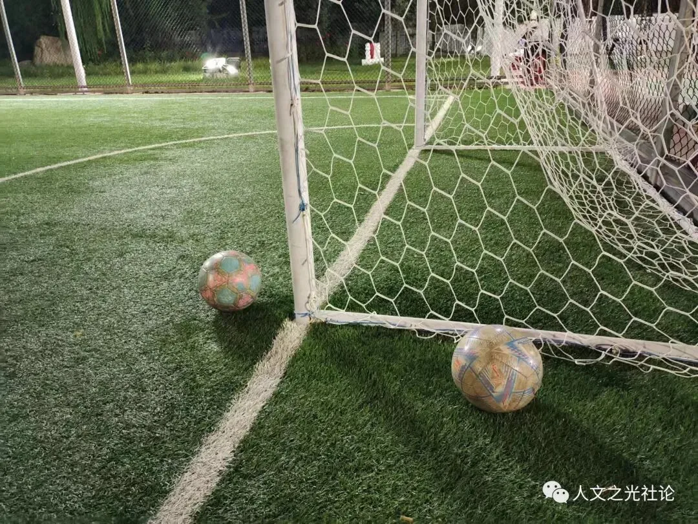
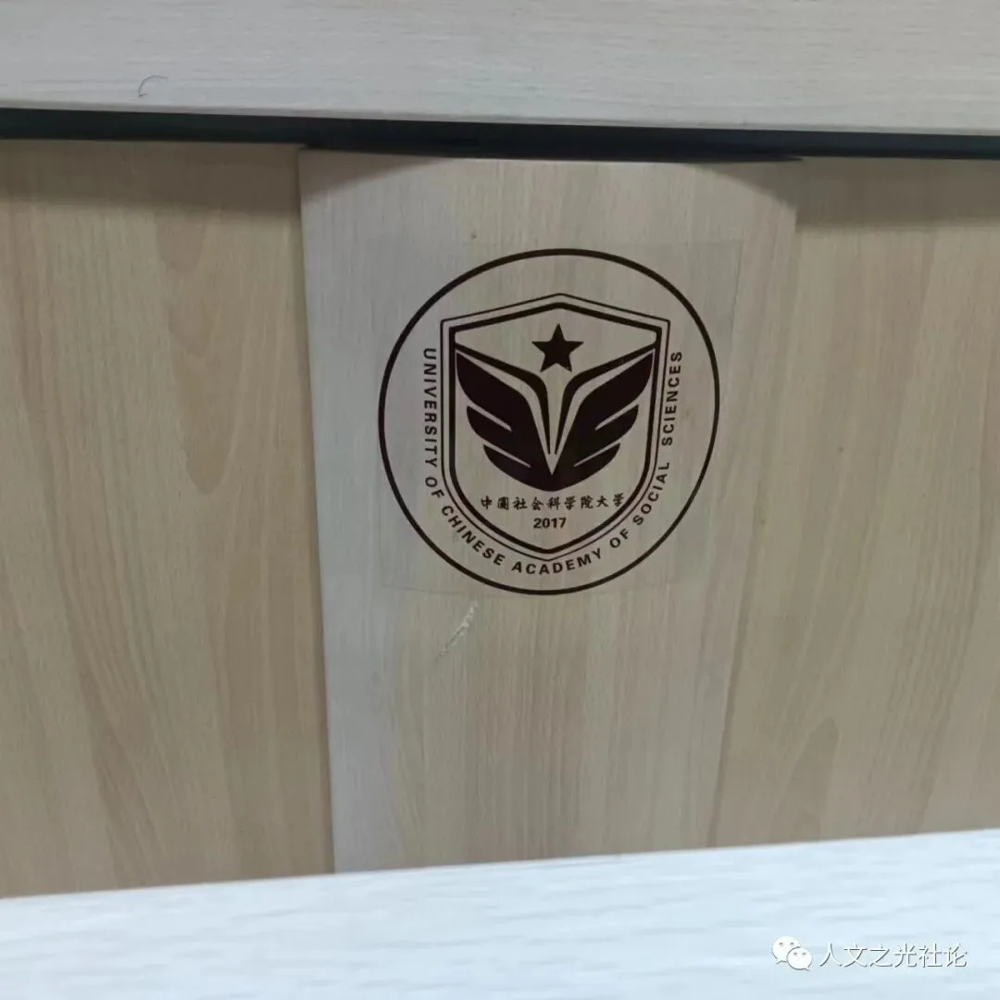
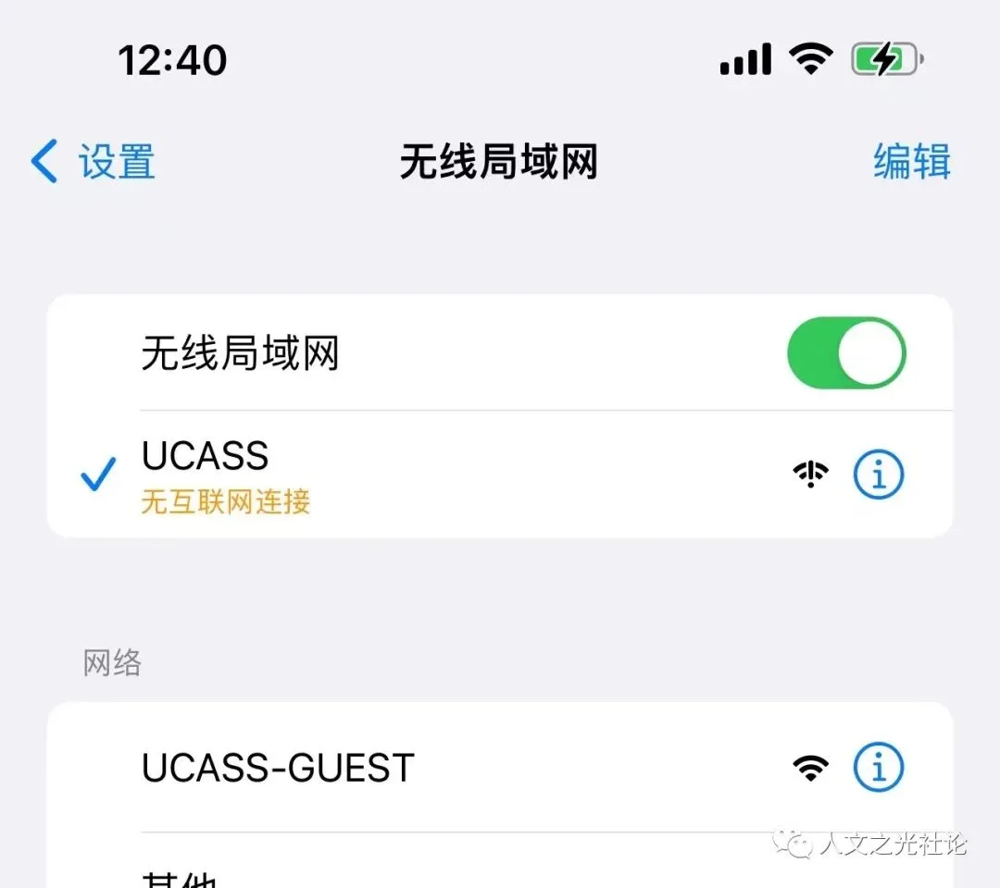

请相关部门及时关注并跟进问题。

## 1 劳动实践教育

## “投稿：

为什么关于劳动实践，学校要一意孤行不顾民意强行占用周末的宝贵时间来干所谓的“劳动教育”。

这种不听取意见的、粗暴的行为是一种对学生意见的践踏。要让学生尊重你得尊重学生。

周内课程满满的，周末还要干这个，学生的时间难道不是时间？学生的精力难道就该让你们折腾？

从军训变卦到劳动教育，多少次了，你看看社科大这个样子，还好意思说“高校责任”、“人文之光”，简直粗暴无理、贻笑大方！

做出这个决策的领导，动动你的大脑，用用那点所剩不多的道德，可怜一下周一到周五上课的同学，凭什么还要周末继续劳累，完了毫无休息的再来一周？

一个人，首先要有同情，然后要有点怜悯，此之为人，然后再说当领导。”

## “投稿：

回昨天1.1。这位同学不妨思考一下大家究竟在抨击什么 。大家批评的是行政人员不合理无人性的劳教方案，而非某个具体个人的人身;抨击是作为一个机构、一种不合理的决策方式代表的校领导，而不是某个校领导个人。如果你口中的这个“长者”不是校领导的代表，一个在劳教决策中起到关键作用的机构，谁会对批评这样的人感兴趣。

我不知道这个机构是如何具身化成你的父母的，但拜托你去了解一下21级面对这样不合理劳教方案的实际情况再去站着说话不腰疼。

在这个怪物机构里，完美尊重了除21级活生生同学以外的一切因素。如果共情的话，值得共情的难道不是被忽视的21级同学吗？将一个不考虑被决策者的决策强加在被决策者的身上，是不是反而是对被决策者的人身攻击?”

（见《[【读者投稿】高校恩情的勇毅书写](https://mp.weixin.qq.com/s?__biz=Mzg2MjcwNzQ1Mw==&mid=2247486337&idx=1&sn=6226154bfd13227f6d6a4d33e0588b5f&chksm=ce028013f9750905f0b577df2ceb825fabad357f6bb7c1b85d21a9e63fc2f92c8aa8317c15f9&scene=21#wechat_redirect)》第1条）

## 2 自习室

“自习室问题投稿，新的自习室群和清理规则可以理解，但是请社科大考虑一下硕博，尤其是博士的自习问题，

1. 目前社科大自习室的桌子很小座位之间也比较挤，放个电脑桌面位置就很紧张了，更别说有的同学需要保护颈椎和眼睛想外接个显示器还可能会挤占额外的空间，桌子能不能换大一点。

2. 硕博有跟着导师调研和参加学术会议的需求，经常一去就是一周，新的自习规则要求两天不在就清理位置，这对硕博真的太苛刻了，我们不想占着位置不学习，但是出差回来以后就没地方待真的不合理。

求社科大去打听打听别的学校硕博自习是怎么解决的，人家都是在导师的办公室里自习学习，不然也会安排专门的硕博自习室。我们社科大的见不到导师就算了，连个安定点的自习位置都没有，跟其他学校的博士生聊天说起这个真的会谢。”

## 3 接办投诉平台

“社会确实正在经历大的变革，媒体平台上的舆论发言日渐随性。在困难的爬坡阶段，我们需要的是团结一心和同舟共渡，共同想办法，找出路，而不是推脱指责和谩骂。

我们的社会需要理性公民！这不正是我们作为人文社科院校需要研究和做表率的吗？让我们学校因为社科人的理性和高水准评论多一张名片吧。

不要让抱薪者寒心，多一些包容和鼓励，那些愿意做事的老师同学和工作人员才能继续有力量付出。

点赞学校的“接诉即办”平台，让我看到学校想听大家声音而摆出的态度。社科大加油！”

“社论君你好可以呼吁一下大家使用学校新的接待投诉平台吗，https://resp.ucass.edu.cn/web/就是这个。”

“hi社论君！我要给学校新上线的投诉即办平台点赞！今天晚上找后勤处处理一个自习室窗户问题，从求助到回复到解决15分钟！学校真的有在为学生办实事！推荐大家可以试一下～

有了这个平台，我在学校的戾气至少减少一半～”

## 4 博士生体检

> “狠狠点了之前那个说体检的！学生的身心健康真的很需要被关注啊！尤其博士！说起来年纪都老大不小了，拿那点儿补助养活自己都很难了，哪能再额外关注这些呢。公费医疗又不能报销查体、体检相关的费用，如果学校能安排每年体检的话，早发现早治疗，有什么不好呢”

## 5 食堂

> “【食堂】社科大食堂总吃出虫子，能看出没洗菜。反映出生产环节标准不规范，餐饮管理标准化和检验机制不健全，有发生食品安全事件的风险。诺如病毒、大肠杆菌感染不是闹着玩的。学校一定要防患于未然，这是严重的生产安全责任。”

## “一食堂晚上六点后可不可以能有点菜!孩子吃不上肉菜算了，连肉包子都吃不上”

“社论君，夸夸望京食堂10月8号的排骨和辣子鸡，味道很好！最近食堂的变化很可观！”

## 6 操场卫生

## “坐标望京校区足球场：

哪位同学在足球场丢的烟头？个人素质影响正常踢球的同学事小，乱丢易燃物造成安全隐患事大。还望早日提升素质，自觉收拾垃圾。

用毕运动器材烦请及时回归器材柜，谢谢！”

“关于我看到有人说悦动空间的垫子，要学校买很不合理呀！你练舞你自己买呀，放了你之后收回去呀，一直放在那的话很占地方，其他人也是要运动的呀”

（见《[【读者投稿】高校恩情的勇毅书写](https://mp.weixin.qq.com/s?__biz=Mzg2MjcwNzQ1Mw==&mid=2247486337&idx=1&sn=6226154bfd13227f6d6a4d33e0588b5f&chksm=ce028013f9750905f0b577df2ceb825fabad357f6bb7c1b85d21a9e63fc2f92c8aa8317c15f9&scene=21#wechat_redirect)》第5条）

## 7校园建设

## “研教楼的学校徽标能不能更换一下呀，怎么还是2017”

## 8 校园网

“望京校区网络还能再烂一点吗，要么连不到wifi，要么连上了上不了网，下论文那网速还不如我手抄”

