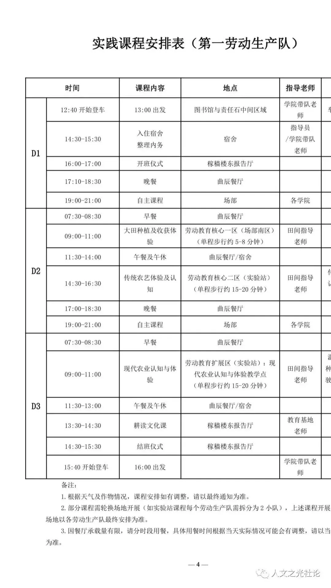

请相关部门及时关注并跟进问题。

## 1 劳动实践教育

## “投稿：这是哪个聪明蛋安排的时间，为什么不能只保留周六那天的？”

## 2 自习

“博士真的需要办公室和工位，给大家安排一下吧，毕竟现在学校里面硕博还是占大多数，是除导师以外论文的主要产出者，而且学科评估的指标里面科研成果比重也很大呀。

其他学校没听过博士连个办公室和工位都没有的。”

> “关于自习室：两天不在就清理东西很苛刻？占一个星期的座位都不用难道对别的想找位置学习的同学来说就不苛刻了？别太离谱。 暑假的时候留校，想找教室座位学习，除了装修的教室就几乎没有那个教室里没有一直放着东西占座但无主的东西。真的很过分。有的时候在教室学了一天了，教室有的被占的座座位不仅一个上午没人来，下午也没人来……别太荒谬。 又不是小初生了，什么年头还要分配个“自己的座位”，又不固定上课，想在导边上学就去和导商量啊。 大家都要学习，理解有的同学对于座位的诉求，但是我们很多同学都是不占座的，占座那么久也不使用未免对别的同学也太不公平了。”

## 3 博士补贴

> “关于博士补贴：本校的博士补贴始终保持每月1250，对于大部分博士生来说，凭这个固定补贴与其他零星的奖学金基本无法过一个博士生的充足线生活。本校大部分学科并不像工科那样需要“打工人”，没有学校补贴之外的主要劳动收入。此外，博士生无法长期在良乡校区而不与院所联系，这些联系和研究所产生的必要开支是所有博士生都需要承担的。校领导固然可以认为博士维持贫困线也可以生活（实际上，不从月补贴之外获取其他收入，几乎是不可能的），但校领导也需要考虑生源问题。现在的社科大还没有强大到跟十几年前几十年前的研院那样，大家争先恐后报考本校，如果有跟社科大相近的选项，更多优秀学子会选择物质条件更好的院校；哪怕是家境较差的同学，申请国家留基委出国留学所拿的补贴，再扣除必要支出后也远远高于本校的水平。希望学校领导早日重视这个问题。”

## 4 食堂

## “一食堂今天(注：10月12日)晚上的炸鸡腿真的太香了！。”

## 5 图书馆

“望京校区足球场投稿：望京校区的图书馆洗手间是否可以点上蚊香？每次去洗手间都有不少蚊子，希望能解决这一问题。”

## 6 接诉即办平台

“为什么接诉即办平台平台上大部分公开的诉求只能那么一两个部门的啊，想看看其他部门的回应。

而且平台内容公开居然不是投诉人选择公开就可以公开的，还需要所谓的管理员通过，真的令人费解。”

> “现在如果在接诉即办平台如上提出诉求之后，想要就部门回复发表评论或进行进一步的互动就只能选择问题已解决并打分评论，可是我还想和部门继续沟通啊，不是部门回复之后问题就算解决的。希望学校继续完善这个平台，早日推出追评机制，方便大家的沟通跟进。”
