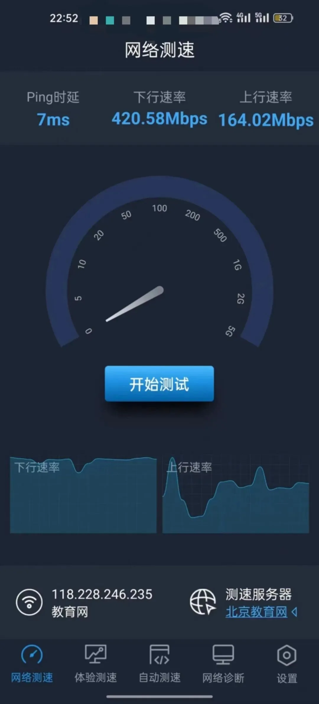
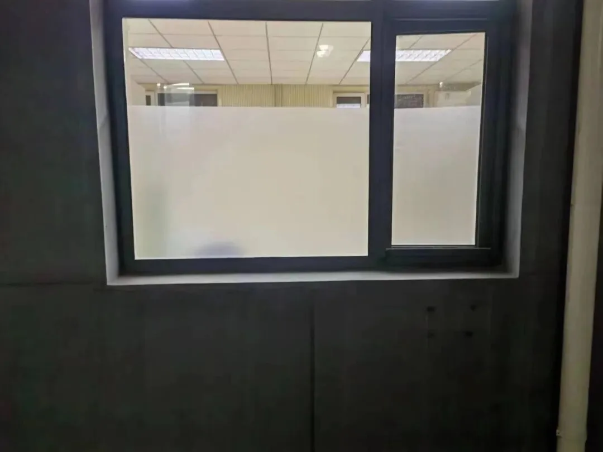

请相关部门及时关注并跟进问题。

## 1食堂

## “想说一下望京食堂。

1.积极响应：之前反馈的菜品种类、菜油大的问题，现在很明显的改善，基本是之前觉得油、味道浓的菜现在好很多很多了

2.品种丰富：这两天有了烤肠、红薯、炒饭，相应很及时，面的窗口也多了番茄面，能看出来望京食堂是很用心的

3.细节把控：其实最打动我的还是望京食堂的汤，汤本来就是免费给大家喝的，但是最近连着几天能尝到味道好、干货满满的热汤，真的在这个降温很快的北京感觉很温暖，是很用心把握细节了。

望京食堂最近我看也有同学们预定盒饭，再过来拿，很好的避免了排队或者时间不合适的情况，挺不错的，望京食堂一直在听取大家意见，在变好，很开心^\_^”

> “投稿良乡食堂。晚上六点一下课直奔一食堂一楼，去了以后一连问三个菜得到的回答都是没有，没有，没有。难道一食堂电子屏的菜单是不服务六点下课的同学的吗?去接诉平台上反映食堂相关问题，要不就是“菜品供应质量没有下降”，要不就是“目前没有办法解决希望理解”，要不就是“建议很好目前还在协调”，好像食堂问题从来都不是一个问题一样，真的无语。”

## 2 校园网

> “到底是谁在夸望京校区的网速好，怎么可能好！烂得不能再烂！最近特别明显，很多时候秋招投简历根本打不开网页，看论文连知网都打不开，要自己开热点才行。我今天测了一下网速最好的时候也才50，怎么就到300了？这个网速真的好耽误事啊，特别是对毕业生投简历来说简直是一种折磨。”

“您好，我回复下那个说让我发截图同学，有没是咱们手机的问题，我今天新买的华为mate60Pro测速结果发出来，真实跑速，就在望京校区二号楼”

（见《[【读者投稿】望京校区有喜有忧，接诉答辩安排成谜](https://mp.weixin.qq.com/s?__biz=Mzg2MjcwNzQ1Mw==&mid=2247486370&idx=1&sn=af6e46c4b6e1ca265369ffd43a0008da&chksm=ce028030f97509264ec20303850c038585265a13b52638c38b471464fd26e2686fe2e70357e2&scene=21#wechat_redirect)》第2条）

## 3 答辩安排

> “讲真，这会开题已经很晚了~正常高校硕士在在研二上学期或下学期，博士在博二下学期就开了，而且根本不会时间调来调去，都是固定的，没写完就下次自费开或延期，这会还没开题只能说社科大不完善的制度导致。早开题早吸收老师意见，晚开题真是纯纯的形式了。”

## 4 健身房防窥膜

## “麻烦望京校区健身房也加上防窥膜，谢谢！”

## 5 研究生补助

“我想投稿问一下，学校这个月还会补发一下研究生补助吗？学费月初已经交了，9、10两个月的补助现在还没发呢。”
