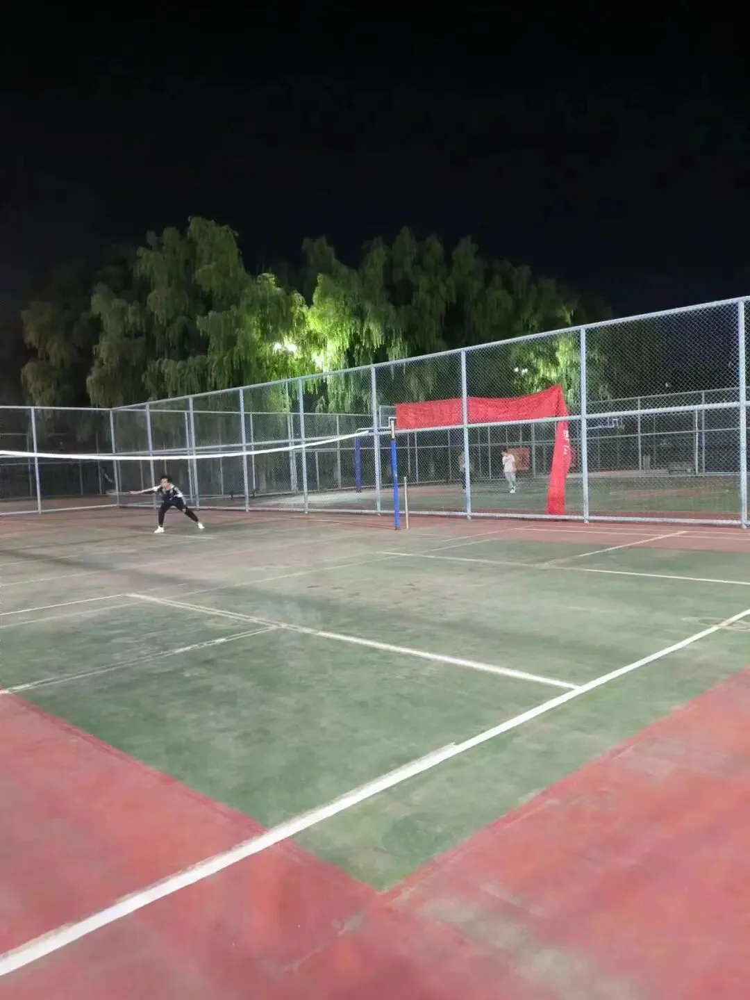
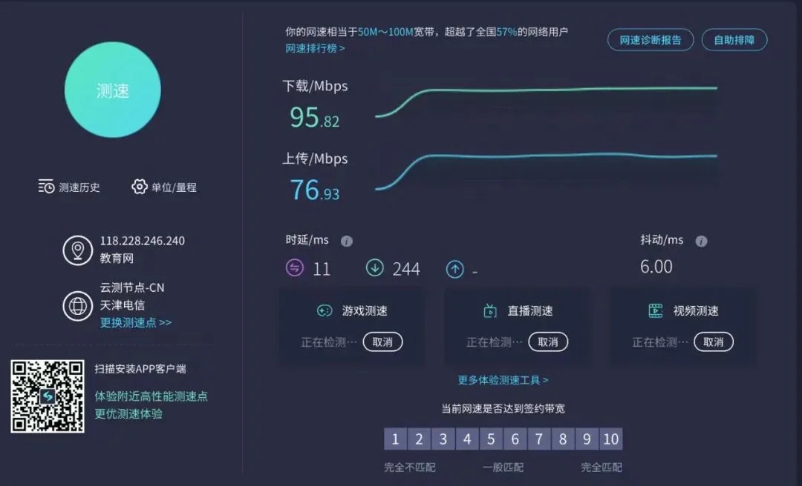
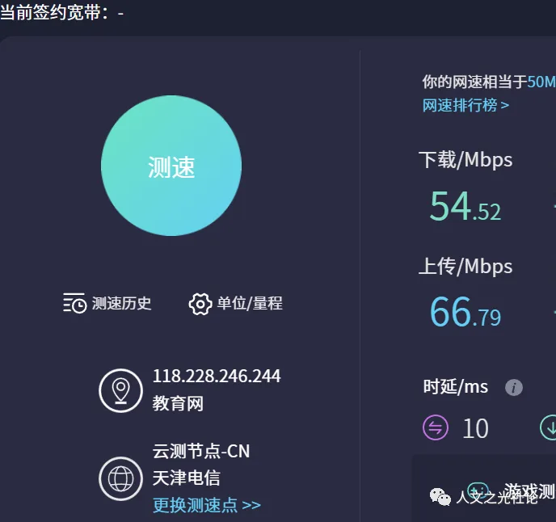
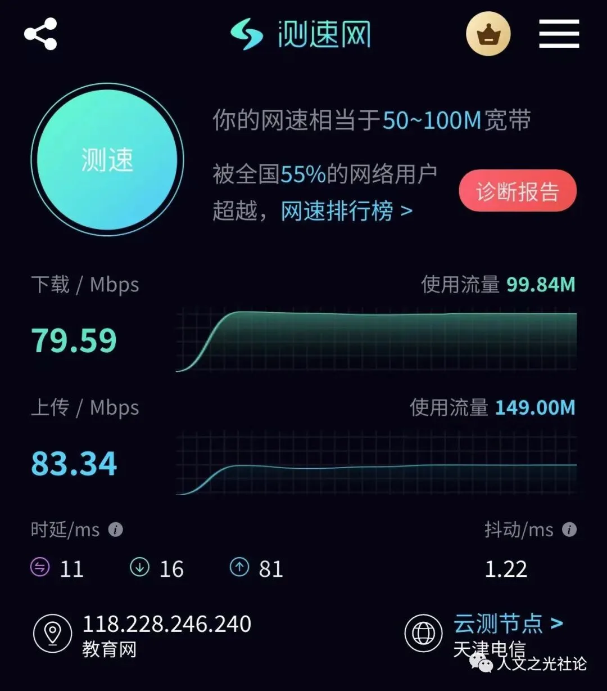
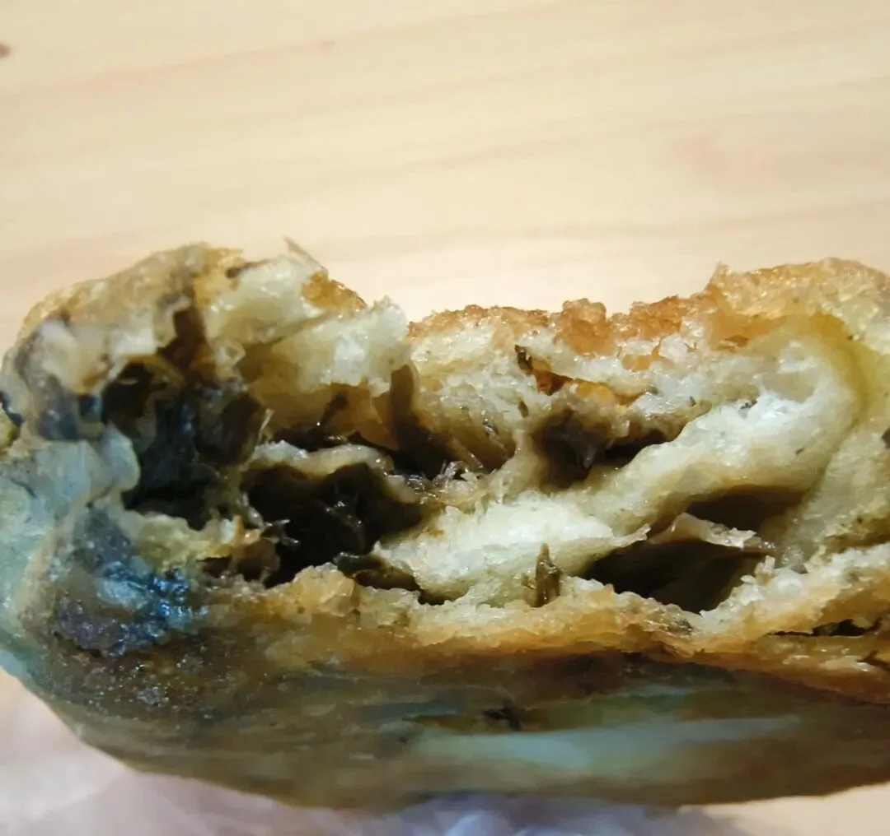

请相关部门及时关注并跟进问题。

## 1 答辩安排

## “法学院对《接诉答辩日期成谜》投稿6的回复：

“法学院对于法学专业本科生同学们的学业规划和深造计划历来非常关心，也一直采取积极行动帮助同学们制订和努力实现学业规划和深造计划；

今年我们按照校教务处通知要求，制定了学院的工作时间表；

10月底完成开题答辩，可以增加同学们毕业论文的构思和写作时间；

同时，作为毕业论文写作的启动环节，尚未进入实质写作阶段，开题的整体工作量相对不大，对于考研复习的影响较小。

请同学们结合自身实际情况，做好时间规划。”

> “回复这一条：明明上一条关于开题时间的说的是本科生。人家说的“考公考研”你这扯什么硕士博士的意义在…..而且skd经院、商学院、国政经都是12月下旬考研初试完才开题（就我已知的，可能还有其他学院），您隔这儿看都没看清楚和稀泥干啥呢！！”

“这一篇中的“答辩安排”是回应昨天的文章吗？如果是的话，昨天文章里的开题答辩说的是本科毕业生论文开题答辩啊，难不成研究生也要“考公考研”？”

（见《[【读者投稿】望京食堂进步喜人，良乡何日迎头赶上](https://mp.weixin.qq.com/s?__biz=Mzg2MjcwNzQ1Mw==&mid=2247486388&idx=1&sn=196e06c136fd6aa1874d0c6772c4e7bc&chksm=ce028026f9750930ca6749f683b99c7a79dc79d52b5ce332a64cb2492bea3b78a95e6a16a8cf&scene=21#wechat_redirect)》第3条）

## 2 羽毛球网

“上次说了一下羽毛球网的破旧问题，第二天学校就全部拿走了？是维修吗？维修的话一个网子需要换这么久吗？学校相关部门能不能解释一下。”

（见《[【读者投稿】恐宿舍电梯令人心悸，仅望京食堂再被人夸](https://mp.weixin.qq.com/s?__biz=Mzg2MjcwNzQ1Mw==&mid=2247486294&idx=1&sn=386b6269523132666957f741574c1bd4&chksm=ce0280c4f97509d2c4dcbaad5f9efeecfd69d5cea9dc6c3571a1134fc5475ee2ee883602461f&scene=21#wechat_redirect)》第6条）

## 3 校园网

> “望京校区网速投稿 那个吐槽别人手机不行，不如华为mate60Pro的算盘珠子都打到别人脸上了 我手机电脑还有平板都显示网速不行 用电脑看B站视频特别卡顿，周围好多人都吐槽网速不行很卡，你自己手机网速好不代表其他人哈”

> “编编，还是要吐槽一下望京校区的校园网，真的网速奇差无比！！！中午本来想看个剧，结果饭都吃完了，还没加载出来！啊啊啊啊！这种痛苦！！！而且16号就显示这月网费没了，真的不知道咋用的这么快。补充一句，16号没了以后充钱了哈，不是因为没网费了加载不出来。”

“望京最近的网速已经有了极大改善啦，这是10月17日18:30在教学楼用iPad测的速度。供参考。”

## “只有我望京网络测速这么慢吗”

## “这网速也不能叫快吧”

（见《[【读者投稿】望京食堂进步喜人，良乡何日迎头赶上](https://mp.weixin.qq.com/s?__biz=Mzg2MjcwNzQ1Mw==&mid=2247486388&idx=1&sn=196e06c136fd6aa1874d0c6772c4e7bc&chksm=ce028026f9750930ca6749f683b99c7a79dc79d52b5ce332a64cb2492bea3b78a95e6a16a8cf&scene=21#wechat_redirect)》第2条）

## 4 博士生补助

## “关于博士补贴:

咱们学校博士生补贴还能再低点嘛？应该是全国最低了吧，不说和其他985/211相比，连普通本科学校的博士生的补助都比不上。每月这么点钱，除了每天在一食堂能解决吃饭问题外，连买套书的钱都不够，更别说让学生静下心来去进行学术研究和学术交流了。

全国各个学校都在提高博士生补助了，不知道领导们打算何时“体恤下民情”？”

## 5 接诉即办平台

## “墙你好，表扬一下学校那个接诉平台，真的不错，事事有回应，辛苦后勤的老师们了”

## 6 食堂

## “看到望京食堂夸夸的帖子也来+1 周一吃的橄榄菜烧饼脆脆香香😋”

> “社论君你好！一定要夸一夸望京食堂啦！最近的饭越来越好吃，新增了很多种类的面和零食。经理和各位工作人员真的都超级棒！有一次因为菜的油很多，我的碗里剩了饭，经理巡查时很细心地就发现了，表示之后会改进，最近食堂的菜就真的不油啦！感谢各位的付出！”

## 7 吸烟问题

“在北综二楼厕所抽烟的觉得自己很忧郁很帅气很有疏离感很有支离破碎的美吗？学校那么多带着垃圾桶户外公共吸烟点，为何偏偏要课间跑到厕所污染空气？

尊重个人的习惯和需要，但麻烦这种在厕所和电梯抽烟的人有点公德心，自己耐熏不代表大家愿意抽你的二手烟。

各个教学楼、图书馆乃至食堂的厕所总是抽烟重灾区。这种密闭空间内抽烟，二手烟味散不掉，对不吸烟群体的伤害更大。拜托学校采取一些体现管理智慧的措施，负起一些管理的责任吧。”
