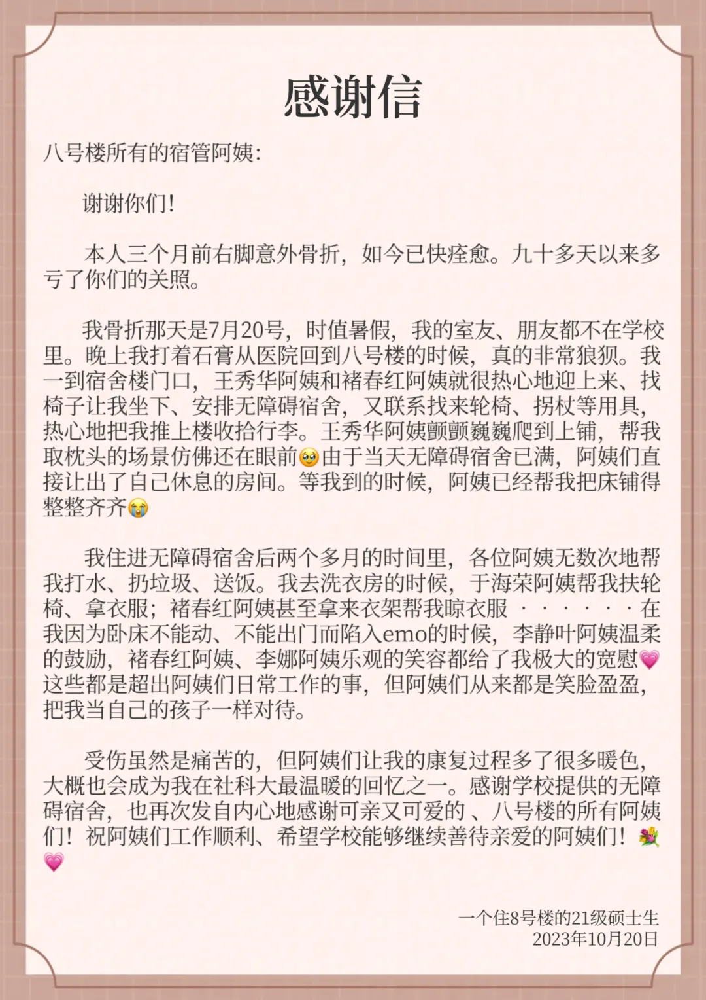

请相关部门及时关注并跟进问题。

## 1 食堂

> “现在望京食堂的菜越来越棒了，今天吃的酸菜鱼和豆角都很好吃！烤红薯真的，软糯甜甜的，吃一口超幸福，还有烤玉米烤梨天呐。谢谢大海经理为食堂所做的改善和努力！经理人真的超好，为同学们服务做得很到位，感恩！”

“银耳炒鸡蛋？良乡食堂你还能做出什么，太黑暗了吧!学生会生活部的同学们是真的不知道食堂做什么菜么，就是说不求特别好吃吧，但是你别玩恶心的啊。”

“礼貌投稿:一食堂二楼的鱼香肉丝里面肥肉多而且比瘦肉还大，如图

二食堂的同样菜品还好，希望整改一下谢谢啦”

“回7套坐垫：是学校给的劳动实践课的实践活动，不是食堂员工自己套的，这边的建议是可以多关心一下校园网通知🌹”

“回复这条:套保暖套是我们21级学生套的，没有增加食堂工作人员的工作量。”

（见《[【读者投稿】紧锁的大门未解的题](https://mp.weixin.qq.com/s?__biz=Mzg2MjcwNzQ1Mw==&mid=2247486447&idx=1&sn=39bb9dbee2543e488232840e1d1cb770&chksm=ce02807df975096b9330391f5b4cf009799feb2d107bf1c9cbb54d28acadb0ec2e6256fdd387&scene=21#wechat_redirect)》第7条）

## 2 望京羽毛球场噪音

> “能理解望京校区地方不大，羽毛球场地只能建在图书馆旁边，但是这个场地本来就已经离图书馆很近很近了，有些打羽毛球的同学能不能不要老大喊大叫的，尤其是这周五晚上在天井打羽毛球的几个人，真的太吵了，跟开轰趴似的，你们是用嘴打羽毛球的吗？靠天井的图书馆听得特别清楚，素质真的需要提高一下，之前有看到别的同学打安安静静的，也没有这么吵……”

## 3 回应合唱比赛问题

## “投稿：我校有合唱比赛，但是在下半年”

（见《[【读者投稿】紧锁的大门未解的题](https://mp.weixin.qq.com/s?__biz=Mzg2MjcwNzQ1Mw==&mid=2247486447&idx=1&sn=39bb9dbee2543e488232840e1d1cb770&chksm=ce02807df975096b9330391f5b4cf009799feb2d107bf1c9cbb54d28acadb0ec2e6256fdd387&scene=21#wechat_redirect)》第3条）

## 4 良乡捉狗

“希望学校处理流浪狗秉持人性的选择，最近因为罗纳威的事情引起来的各地处理流浪狗太过极端，流浪的狗也是生命，温柔对待他们吧

学校里的狗是流浪狗，猫是不是流浪猫？为什么不处理猫？学校里的猫已经挠过多位同学了，只是因为猫深夜不吵到同学休息还是因为它有一个同学们为它搭建的家？为什么不能给流浪狗一个家？希望学校处理流浪狗秉持人性的原则，最近因为罗纳威的事情引起来的各地处理流浪狗太过极端，流浪的狗也是生命，温柔对待他们吧”

## 5 校园网

## “究竟是谁在说望京校园网好啊！！！我真的要生气了！！！！”

> “投稿，望京的网速真的不行，我包月就是为了看网课和查学习资料啊！今天休息时上微博看某教育博主发了一道习题想看看来着，结果点进去，空白（加载）了很久。这会儿不少专业也都结课了，很多人都回家了不在学校，这网速学校真的不是收钱不办事吗？”

## “望京校区这个网速是要下载到天荒地老”

## 6 劳动实践教育

“回复关于劳动实践的问题。看了两期的劳动实践本来不想发声，认为作为一名大学生会有基本的认知，不会以学校政策上升到人身攻击到执行老师、校领导。结果发现现在已经发展到无脑的发泄。我先申明一下立场，我之前是在高校工作的教师，目前是社科大的研究生。看到上升到对于“教师”这个职业的攻击我必须要投稿。首先，对于“劳动实践”这个事不是社科大这所学校，或者是社科大的某个领导或某个部门一句话能决定的。这是教育部门对于高校教育培养方案决策的问题，在我之前的工作高校，劳动实践是有学分的。所以请不要无脑的喷某天某个领导心血来潮的让你们整年级的学生拉去某地进行劳动实践。就单出去这一趟学校层面要保障学生的安全问题不是一两个人能承担和决定的。更不用说经费问题。在这个过程中，或许会有安排不当的地方，那么就事说事，哪一个环节不合适，提出来，这些都是可以沟通的。毕竟大家都没经验，以后避免就行。结果直接上升是校领导的攻击，可以不理解，但请不要伤害。第二，看到今天的投稿，突然感概原来断章取义也会发生在大学生群体里，原来这真的是个断章取义的时代，至于某个校长或者某个处长说了什么，这一定是在当时的语境下说出的某些话，而作为一个大学生，竟然取意一个老师的某句话来投稿。想必这位投稿的学生当时听到某处长说这句话的时候心里肯定特别开心吧，终于抓到“把柄”了吧？我们在看文献的时候都明白对于某个理论某个范式的理解要结合理论的上下文语境来理解，更何况是对于某件事的回答。想问一下这个投稿的学生导师是谁？作业做完了吗？书看完了吗？看明白了吗？最后想说的是教师这个职业是个良心活，对于年长我们的老师，他们作为长者，既然能坚持到现在依然在教师这个岗位上，那必然是对这个职业有梦想和情怀的，所以我们作为学生，恳请给教师这个职业一个肯定一个赞许，一些包容一些理解。这样我们的教育环境才会越来越好，教师们才敢教书育人，而不是一个冷冰冰的教书匠。社科大还很年轻，它需要我们每个学子呵护。所以发声之前，请先有逻辑和基本认知。也希望在自媒体这个人人都能发声的年代，珍惜最为发言人的声誉，而不是无脑的“骂街”。也请珍重自己是“大学生”“知识分子”这些称谓。

恳请放出投稿，作为曾经的“教师”看到同学不明所以然的谩骂，的确很心寒。之前是高校教师时，经常感慨教书不育人，自嘲自己只是一个教书匠。不是不想教，而是不敢”

（见《[【读者投稿】紧锁的大门未解的题](https://mp.weixin.qq.com/s?__biz=Mzg2MjcwNzQ1Mw==&mid=2247486447&idx=1&sn=39bb9dbee2543e488232840e1d1cb770&chksm=ce02807df975096b9330391f5b4cf009799feb2d107bf1c9cbb54d28acadb0ec2e6256fdd387&scene=21#wechat_redirect)》第6条）

## 7 感谢信：

8 摆放自行车

> “致辛苦摆放自行车的工作人员，我也不到您是谁，我也不到您啥时候摆的，您可能觉得将自行车摆放整齐赏心悦目。但是结果是，我还得费劲巴力的把自己的自行车搞出来，还得小心碰翻了他人的自行车，而且您似乎认为电动车是不碍事的，电动车您不动，自行车则要塞进那个小空里，甚至有一次我把自行车和电动车拍成一排，结果出来后发现自己的车子在一排自行车的最里面。这行为或许是产生了秩序，但是您的行为是未告知本人的，是冒犯的，您不妨里一个牌子，告诉大家摆放自行车，这样至少我能一打眼找到我的车子。致谢”
