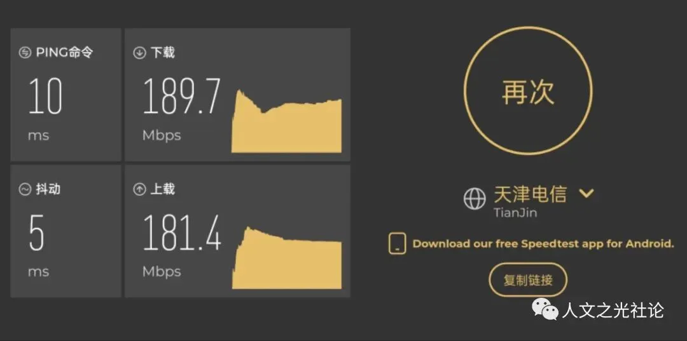
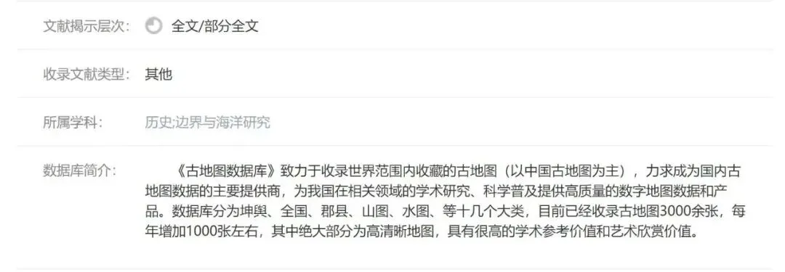

请相关部门及时关注并跟进问题。

## 1 食堂

“小编好：今天看到评论说良乡一食堂板凳的坐垫是学生套的，感谢21级的学生。对于自己没有详细了解情况，发泄情绪错怪相关部门，在此感到抱歉，说一声对不起。”

（见《[【读者投稿】望京网速急需提升，劳动实践引发讨论](https://mp.weixin.qq.com/s?__biz=Mzg2MjcwNzQ1Mw==&mid=2247486499&idx=1&sn=c7c575ae35dd1757e84641ce924ef4a8&chksm=ce0287b1f9750ea7b4234be9856b5dfba179ce3d909ffae10e72edb24fcdc4de79ec82c54beb&scene=21#wechat_redirect)》第1条）

## 2 合唱比赛

“回应3，我要的是1、大家都参与的、2、一二•九大合唱的比赛，不是别的什么随便的合唱”

（见《[【读者投稿】望京网速急需提升，劳动实践引发讨论](https://mp.weixin.qq.com/s?__biz=Mzg2MjcwNzQ1Mw==&mid=2247486499&idx=1&sn=c7c575ae35dd1757e84641ce924ef4a8&chksm=ce0287b1f9750ea7b4234be9856b5dfba179ce3d909ffae10e72edb24fcdc4de79ec82c54beb&scene=21#wechat_redirect)》第3条）

## 3 劳动教育实践

> “每次小院出现了一些事，总会有人很“积极”“热心”的出来洗地，这些人是谁大家心里有数。一般套路是先替某些人辩护，然后避重就轻把水搅浑，再然后攻击一下提出问题的人，最后不了了之。基本上每次都不是直面问题和解决问题。拿硕博助学金来说，基本上每届学生都喊了不下八百遍，涨了没有？再拿教师这个头衔来说，神圣的是教师这个职业，而不是教师群体中的每个个体。师德师风出问题的教师也不是没有，也不在少数。职业、权力不是衡量道德的唯二标准，人格才是。是不是什么人有了什么头衔，学生就必须尊重呢？呵呵，大家都是成年人了，尊重是相互的，教师可以尊重学生，学生也可以爱护老师，关键还是看这个人干了什么事。对了，国外的行政是不能以老师来称呼的，每次学生叫一声老师的时候，摸摸自己的良心，干了多少为学生谋福利的好事、实事，配不配得上这个崇高的名词。”

## “投稿:回稿6.1。这个稿多少让人有点摸不着头脑。

首先可以排除这位朋友是科学的授业者，因为他显然缺乏逻辑。认为教务处工作方式方式不当就是对教师这个群体里每一个人的人生攻击，这就好比认为批判无良药商给医生提供的药品质量有问题就是对医生这个职业的不尊重一样。

教务处工作人员在这件事上的角色既不是老师，其工作内容也不是一线实施劳动教育而是根据学校上级精神去具体管理劳动教育的细节。如果一个工作人员可以公然说出学校上级领导不负责这个事，那么究竟是谁在负责，还是集体不负责?这所大学还有没有人敢于承担自己应该承担的责任?

而且纵观之前的读者投稿，已经有非常多的朋友在较为系统性地论证这个方案的不合理之处，建议这位朋友就算要着急洗地也要有理有据一点，去搞一种上纲上线而缺乏逻辑的叫嚣只能让人齿冷。

其次想来也可以排除这位朋友是人文的园丁，因为人文类学科还需要人性与关怀，这位朋友好像也没有。很好奇一个自称是研究生的朋友为何对21级的同学如此颐指气使。如果每一条关乎自己的决策都可以被不加征求意见就在“仓促”(这是教务处原词)间推行，如果一所高校的行政人员可以忽视老师和学生的建议而任意地对着他们伸张自己的权力，干扰老师的正常教学安排与师生生活安排，比如平白无故搞起羞辱老师的教学大检查，强占学生三天时间搞本可以不这样搞的劳动教育……那想必心寒的才会是这所学校的师生吧。这样高校只能是这样的“双一流”:师生一流寒心，权力一流本位。

这位朋友为何对学校里的师生都缺乏人文关怀，而单单去给教务处行政人员送温暖?我唯一想到的合理解释就是这位朋友只把学校掌握权力的行政人员当人看，其他人只是应该被教育、被施加权力的对象或非主体。被不合理教学检查羞辱的老师、被仓促决策消耗时间的21级的学生是应该不被放在眼里的对象;教务处的领导则是因其权力而必须要重视的人，不论他们遭受了什么或做出了什么。让这样的人去做别人灵魂的工程师，会培养出什么样的人?我不由得脊背发凉了。

因此我也希望这位朋友能在社科大学习的期间好好利用这所人文社科的最高殿堂，真正塑造自己的美好灵魂，如此则善莫大焉。”

（见《[【读者投稿】望京网速急需提升，劳动实践引发讨论](https://mp.weixin.qq.com/s?__biz=Mzg2MjcwNzQ1Mw==&mid=2247486499&idx=1&sn=c7c575ae35dd1757e84641ce924ef4a8&chksm=ce0287b1f9750ea7b4234be9856b5dfba179ce3d909ffae10e72edb24fcdc4de79ec82c54beb&scene=21#wechat_redirect)》第6条）

## 4 良乡捉狗

“投稿：希望学校在解决同学们的困扰时可以善待流浪动物。虽然有困难，但是真的希望学校想办法善待无辜的生命。”

> “社论好，想回应一下那个捉狗不捉猫的，我记得学校是有发通知说狗送去了收容所，请问这个怎么缺少人文关怀了？其次，猫挠人不假，但都是因为人去逗猫才被挠的，有人被猫追着挠了吗我请问？猫没有让同学们的正常生活受到困扰，那位同学是对猫有什么不满？”

（见《[【读者投稿】望京网速急需提升，劳动实践引发讨论](https://mp.weixin.qq.com/s?__biz=Mzg2MjcwNzQ1Mw==&mid=2247486499&idx=1&sn=c7c575ae35dd1757e84641ce924ef4a8&chksm=ce0287b1f9750ea7b4234be9856b5dfba179ce3d909ffae10e72edb24fcdc4de79ec82c54beb&scene=21#wechat_redirect)》第4条）

## 5 校园网

> “我就不明白了，一个破校园网有啥可吐槽的，校园网啥样网络中心的人心里没点数吗？李佳琦的话说得好，网络哪里差了，不要睁着眼睛乱说，要不咱们自己拉个宽带吧，把我们的网费退给我们，每个月补助的流量按市场价折合成现金给我们，让我们自己决定用不用这烂校园网。”

## 6 图书馆

“发现我们学校没有这个数据库，本科学校有，这个古地图数据库真的非常好用而且很有趣，平时不读史料的时候随便看看也很快乐！希望图书馆可以早点购买！！”

## 7 宿舍

> “投稿：反映六号楼某宿管对待学生态度恶劣。 10月21晚，几位宿管上四楼与一学生吵架，吵啥没听清楚，但是在旁边寝室的我是真的很烦，因为一听就知道其中一个嗓门很大说话很难听，听起来盛气凌人，咄咄逼人，趾高气昂的，左一个要反应领导，右一个叭叭叭的宿管，我对她也有印象，因为平时她的态度就很不好，忘记带卡了，出入忙了，跟她门说开个门，我走进去，她又大嗓门的跑过来查你户口，气焰嚣张，特别容易激发起你的怒气，不给你添点麻烦不罢休，只要和她吵起来她就开心，为了显示她的权威和一点小权利，拿着鸡毛当令箭，这不是一次两次了，六号楼的闸机本来时不时的不灵敏，我老实的遵守这形式主义毫无作用的闸机，而这个宿管拿它当菜市场可以吵架的用具。所以，这回我不是就今晚四楼事件的原因说她问题，而是说她的态度，她是什么高层领导吗，这么嚣张，再这样，我下回非得大学生发疯，脸都不要了，就跟她在学校六号楼这个菜市场吵一天，让学校看看这个热闹。”

> “想问一下学校，现在社科大已经允许男女混住了吗？目前2号楼2层某宿舍自开学以来长期有女生出入，全天不离，甚至同宿（我们发现至少昨晚如此），各种吵闹声已经严重影响到周围同学了！！！如果学校监控摄像头没有坏，希望宿管能够妥善处理，给大家一个健康环境，谢谢！宿管一查监控就长期逗留不走的人就出来了，周围宿舍大家都知道，只是碍于面子不敲门，但也不见他们收敛！大家没有证据不胡说。”

## 8 校外快递驿站

“圆通几家快递，将快递点设在北门外小区不送货入校，不仅涉嫌违规，也是对我校广大师生权益的损害，每天大量学生取件穿行马路，存在交通安全隐患，希望学校重视并代表交涉。

（1）法规：国务院2018年3月2日颁布《快递暂行条例》，第25条规定：

“经营快递业务的企业应当将快件投递到约定的收件地址、收件人或者收件人指定的代收人，并告知收件人或者代收人当面验收。收件人或者代收人有权当面验收。”

（2）情理：快递站点设置的初衷，是集聚快递、分发派送的起点。但现实情况是，本来收件人应该在家里当面签收的快递，被莫名其妙投到站点了事，自己反而要上门去取。物流时间被无形延长，收件人还要付出额外的时间精力做本来应该是快递公司的活，让人体验感极差，怨声载道！

（3）风险：我校北门外就是丁字路口，路窄车多，每天取快递的学生往来如织，容易造成安全事故。10月7日晚上，北门路口西侧就发生了一起严重交通事故，电动车撞飞自行车，脑袋着地人当时就没了，从8号楼上可以清楚看到停在路过的120和殡仪车。

据悉，该快递网点原为北门小区内的驿站，后兼做起我校生意，易名为“社科大” 网点，实属挂羊头卖狗肉。为维护广大师生权益，也为学生安全考虑，希望学校能出面约谈几家快递公司，协商处理“最后一公里”问题。也希望同学们在购物时，尽量选择送货入校的快递公司。天冷、路远、件重，去校外真的不方便。”
