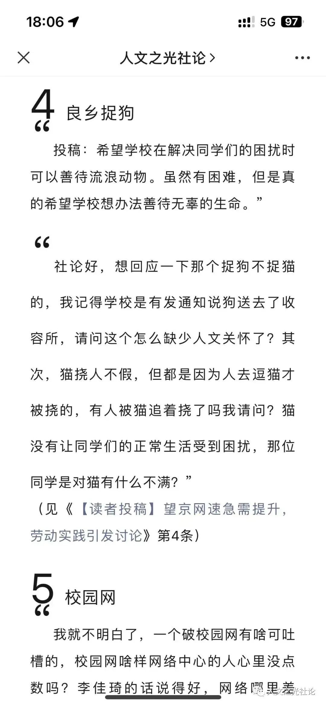

请相关部门及时关注并跟进问题。

## 1 食堂

> “一食堂开发了一种相较于之前更麻烦的买饭模式。虽然这种探索新模式的想法与做法值得肯定，但是还是建议学校或者食堂经理去石景山区京属本科兄弟院校的第一食堂学习一下食堂经营模式。”

## “食堂分开打菜不合理，

1窗口贴几个菜，想吃别的菜就得多排几次，完全不合理

2窗口前面牌子贴的不合理，显示屏显示菜但不显示窗口在哪里，贴的纸牌又太低，这样同学们对照显示屏先找想吃的菜，然后对照纸牌找对应的窗口费时费力，一旦人多起来，根本没时间慢慢找，更浪费时间

3看似节省师傅打饭时间，实则增加学生打饭时间（实测阿姨只能打一个窗口的菜，打粥得另排一队）

改进建议：1恢复原来的打饭方式2更改显示屏显示方式，直接显示每个窗口的菜品价格”

> “强烈建议良乡一食堂改回原来的打饭模式，现在这样分窗口限制餐品种类严重降低了学生用餐满意度，想打其他菜还得去其他窗口重新排队，到底该项举措是在为学生还是在为打饭师傅方便？”

## “投稿:

【良乡校区】最近一食堂改成固定窗口固定菜色了，感觉这样同学们的选择好像又少了一点。想建议下: 能不能做个同学们最喜欢的菜评选，然后固定每天都有至少一两个大家都喜欢的菜？比如米粉蒸排骨、软炸里脊、蒜香排骨之类的。这样每天都可以有期待。还想再强调一遍，真的超超超超喜欢米粉蒸排骨、米粉蒸肉啊啊！”

“

举手投稿！本人真的很反对分菜分队打饭改革！真的很麻烦”

“

很好奇后勤处是如何做出一食堂这个方案的决定的，有关负责人在出台方案前真的有过管理食堂的经验，甚至吃过食堂吗？这种随意的“试验方案”只能让人感觉到后勤处对大家建议的敷衍塞责。你说食堂工作人员工作不足，我就变相把压力转移到基层工作人员身上去，而不去思考通过加薪轮班等方式提升工作人员的士气;你说食堂排队缺菜问题严峻，我就随意出台一个更加不可靠的实验去让你感恩之前的食堂工作方式，后勤处真是有点东西在的。建议有关负责人亲眼来看看自己所谓的实验成效，再思考要不要这样实践。”

2

宿舍

“

对人

文之光公众号10月22日晚的投稿中，吐槽六号楼宿管同学的内容补充：

我们也是六号楼四层的住户，21日晚也听到了争执声，受到了影响。可能由于耳力比较好，听到了宿管与同学争执的大致全貌。就21日晚的事来说，的确情况特殊，宿管阿姨们激动是有原因的，或许并非像这位同学所说得如此不堪。本人投稿以期尽量还原21日晚事件全貌，向包括这位同学在内，以及其他受打扰的同学们简单分享一下所听内容。

21日晚十点左右，六号楼四层某寝室有男生带一位女生回寝，宿管阿姨上门并要求该女生离开，继而双方发生了冲突。男生表示，宿管在劝导过程中态度不好并产生了肢体接触，且自己周末带同学来寝室喝个小酒聊聊天是很正常的事，宿管无权管辖其个人自由，因此拒不放人。宿管则表示，一方面男生寝室禁止女生进入，要求女生离开是其职责范围内的工作；另一方面，男生深夜带女生回寝实属不妥。并表示该男生此前已多次带女生进寝且不听劝阻，宿管方面也多次接到有关该男生宿舍的投诉，如今被抓正着应该接受宿舍管理。

双方争执不下，都很激动。男生扬言，自己即将毕业，不怕事，等毕业了迟早要neng死宿管阿姨。自己上边有人，有更大的领导压着，因此可以住单人寝还没人能管得了他。并再次放话一会儿还有同学要来他寝室里，宿管属于多管闲事不怕死。宿管阿姨也很激动，说怎么可能neng死她，此事必定反应领导，同时打电话通知了自己的值班同事。

随后男生让女生先去食堂等他，女生遂从男生寝室离开。冲突根源消失后，双方在情绪影响下继续争吵了许久，直到值班同事前来进行调解，争吵才逐渐缓和。在此期间，男生态度依旧恶劣，重复威胁宿管的言论，令人心惊。

双方深夜高声喧哗确实扰民，给周围同学带来了困扰，但事出有因，也可理解。在知道全貌后只要稍加思考便可知道谁是谁非。宿管履行职责，无可非议；而男生深夜带女生回寝破坏规章制度于理不合。希望大家都能遵守集体宿舍的规章制度，避免给宿管工作带来困难，为自己和他人徒增烦恼。”

“

回应一下男女混宿问题，本科和硕士不知道，博士生确实是有男女混宿的问题。之前4号楼4层默认是女生楼层，但其中有安排男生寝室。之前以为是个别男生不自觉经常往女生楼层跑，后来发现公寓办就是把一个男生寝室安排进了一层的女生寝室中。真的非常非常不合理，男女生的生活习惯差异大，有很多不方便的地方，希望公寓办慎重考虑。”

（

见《【读者投稿】问题众多，讨论热烈》

第7条

）

3

实习

“

请问法硕今年实习要求什么时候发布呢，实习都要结束了，还没看到要求”

4

档案

“

已经毕业的人想要问一下skd政管的入党档案情况。目前已经有好几个升学外校的同学被告知档案袋里没有入党档案，需要重新入党。一个可能是交接问题，人数大于1是不是要考虑一下到底是不是skd的工作出现了问题？所以在skd政管四年，归来仍然是团员。希望能给一个解释，到底档案去哪里了？”

5

快递

“

昨天看见有同学终于说到快递问题了。开学以来其实偶尔可以看到圆通他们的快递小哥进学校投件，当时还感觉特别奇怪，如果可以投进学校为什么还需要去驿站拿？

上次因为家里人给寄了衣服特别重，就去驿站问了能不能帮忙送进学校。结果驿站张嘴就是不行，后面又说可以给放北门门口，再后来我说有看见过快递小哥进校在快递柜投放。驿站工作人员又说那是每天固定给十几个爱投诉的同学放件。这就让我深感疑惑了，这是驿站在看人下菜碟吗？？？老实本分不配拥有上门服务？？希望学校能够和驿站交涉，既然他可以进学校，那就让他进来摆摊也好，投快递柜也好，学生的善良绝不能成为他们违规的底气！！”

6

小动物保护

“

回应这条评论：哪条通知说明流浪狗被送到收容所？是你凭空想象的吗？你这么理解我的话，学校里的狗追着同学咬了才被保卫处请出校园?”

“

关于良乡校区流浪狗问题已在意见反馈平台回复https://info.ucass.edu.cn/site/bmfw/noticedetailstype=bmfw&id=bmfwpreviev\_cd31cb82ecd5bf325a402e0c530638c1”

（见《

【读者投稿】问题众多，讨论热烈

》第4条 ）

“

望京校区有两只小猫，在学校生活了很久，和同学们相处得很好。最近天冷了，同学们在靠近走廊的草坪上放了三只猫我，小猫就在猫窝里过冬天。不知道为什么望京校区的物业在没有通知任何人的情况下，把三个猫窝全都扔了？猫窝造成什么不好的影响了，请问？而且放猫窝的那块地方，因为是在树下，照不到太阳，常年都不长草，光秃秃的，猫窝是绿色的，与草坪很协调。希望望京校区的物业不要在动猫窝，不要再搞形式主义。希望在做任何决定前都人性化一点。”

7

延期博士

“

问问延期博士何时搬离？哪个部门在装傻？”
