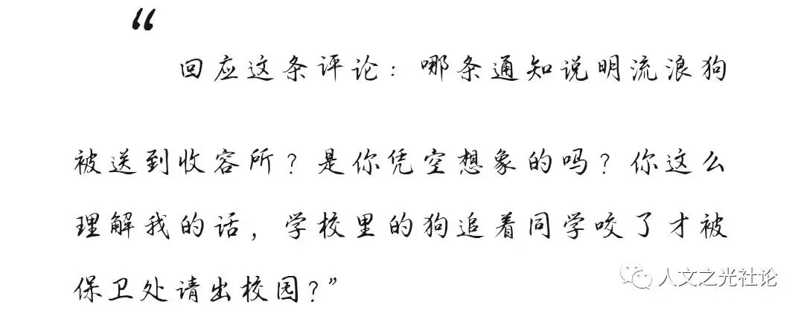
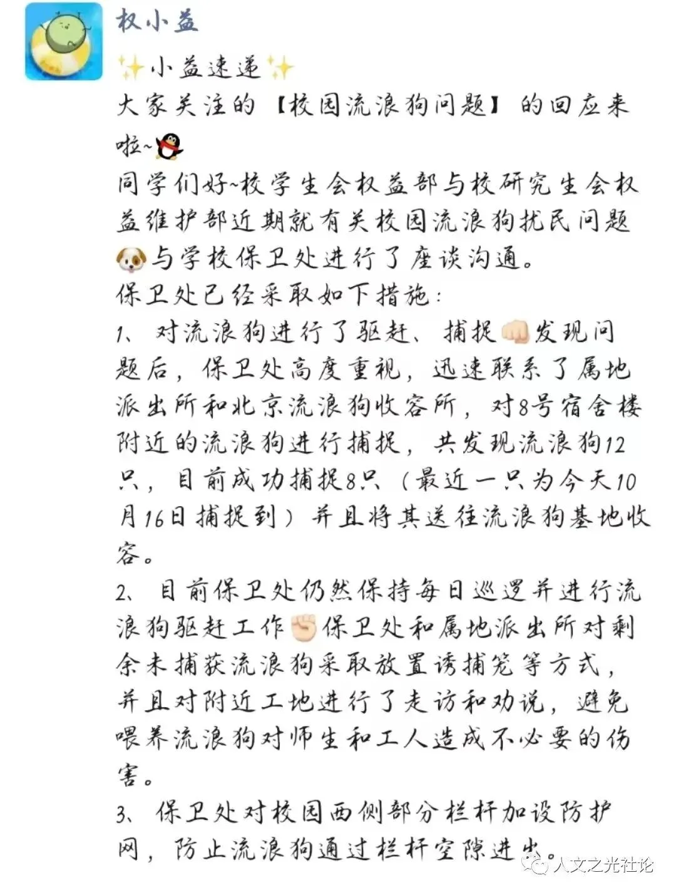

请相关部门及时关注并跟进问题。

## 1 食堂

“一食堂和二食堂可以管一下打包盒收费吗，一块钱一个是不是有点太过分了啊，可以赶得上外卖了 ，强烈建议降价，打包盒收费很不合理。”

## “食堂窗口

除了应把面食单独出来另立一个窗口外，其它窗口分开卖菜无意义。我打两个菜，一个菜在A窗口，另一个菜在B窗口，我在A窗口排队打完，然后又得去B窗口排一遍队打另一个菜，这样做打菜师傅是省事了，学生却被折腾两遍，请问食堂是为谁服务的，这样做的意义是\_\_\_\_？”

“投稿： 一食堂是不想干了吗？最近做饭做得焚书坑儒一般。米饭做得水淌的，根本难以下咽好吧😅真的很需要上学期期末那段时间的一食堂。求求用点心吧！”

## “个人认为解决skd食堂问题的根本是增加食堂数量（实在不行增加窗口数量也行）”

> “良乡投稿：感谢后勤处老师的努力和食堂工作人员的配合，担心这次恢复会抵触以后的改进，所以投稿说，这次让我们学生看到了校方对学生群体的重视，我仅代表我个人对这次改变表示真诚的感谢。还有几句话想说。1、让子弹飞一会儿。任何改变都会引起不适，有的变化持续几天看看效果再决定是优化还是否定，就算最后被否定也不气馁，至少排除了一种方案。2、渐进式变化最好。我们的政策都是先试点，总结经验后再逐步推广，下次有了方案可以先拿食堂某层试点，另外一层保持原来，对比看看效果，好了再推广，不合适了再恢复。3、现有资源不够就只能找新的资源。看到平台有同学提及教师食堂分一些窗口给学生，觉得同学说得有理，后勤处作为校内部门，不好跟领导提出来，那我们学生来提出来，让校领导考虑一下这种方案。”

## 2 校外快递

> “因为圆通几家快递拒绝入校送货，平时网购，已经极力在避免这几家快递公司了。但还是防不胜防，前几天趁当当搞活动，买了两箱书，结果快递被直接投到了校外。只能借了辆平板车自己去拉回来。以前它们是送件到学校的啊，和学校发生了矛盾吗？强烈请求学校出面交涉，以保障师生权益。天气逐渐冷了，去校外取快递又冷又远，也不安全！”

> “您好，关于这个校外快递驿站的问题，建校内驿站的时候就已经有过争议，我给不知道的同学讲一下。 校内驿站最初是由顺丰公司出钱建立和管理的，按照校外快递驿站人员的说法，他们被学校“摆了一道”，已经租好了店面用于快递驿站但是学校又弄了校内驿站，而且在校内驿站放件要额外按件收费并且学校存在不让他们进校的行为。学校驳斥了相关言论，并且说任何快递进校门放在校内驿站或者快递柜都没有阻挠和所谓的“许可证”要求（当时是疫情期间）。学校也有透露校外驿站最后答应放在校内，但是不放在校内驿站，他们也不管，丢了也不负责。学校拒绝了，双方就僵在这里变成了现在这样。 至于沟通问题，学校也和校外驿站沟通过。据说校外驿站态度十分强硬，就是不进校门，并且学校也说冠以“社科大”之名不符合实际，要他们整改，也没整改。”

## 3 宿舍

> “公寓办宿舍管理公寓办是skd最低效、无能的部门。每天墙上那么多租宿舍的信息，你们zx看不见吗？有多少校外人员就在学校住，你们知道吗？是不是你们不知道，就代表没有？不去查校外人员借宿，成天折腾延期生，真是吃饱了撑的没事干。指责别人不遵守宿舍管理规定前，先问问你们自己，宿舍管理规定规定的工作内容，你们做了几件！”

> “对于2，需要加强学生教育与学生宿舍管理，留宿问题需要学校加强管理，对于该宿舍有领导罩着能住单人寝问题请学校予以查实，有无权力滥用，严格按照学生宿舍安排规范进行安排，扬言弄死谁？我校有法学院，宿管阿姨需要时可以联系法学院同学寻求法律援助。建议社科大所有师生员工遵纪守法。扬言已经产生犯罪意图，如果阿姨发生意外，犯罪嫌疑人可以锁定。”

（见《

【读者投稿】食堂改革引争议，其他问题多多

》第2条)

## “针对良乡洗澡热水提点建议：

1.热水卡充钱能不能搞个小程序之类的，方便一些，可以随时随地充钱，有时候忘记充钱洗一半没水了……

2.同意之前大家发的，热水确实还蛮贵的，以及限制时间放热水的问题，以及一个宿舍一张卡钱分摊不均的问题等。希望针对这些各种问题全面升级下系统，感觉老楼里面的热水系统确实很破旧了

(以上个人观点，不喜勿喷)”

## 4 小动物保护

## “社论好，回应一下这条:

请他道歉。且，上次的回答在于回答他的问题“为什么处理狗不处理猫”。再解释一遍，处理狗是因为有同学反映狗扰民严重，不处理猫是因为猫没有扰民。

> “回6 您不关注学校权益问题不代表学校没有通知没有解决，这条通知不仅权益部的微信号发了，也发到了班长群里，至于您为什么不知道：① 您班级班长没有尽到转发责任 ② 您不是本科生”

（见《[【读者投稿】食堂改革引争议，其他问题多多](https://mp.weixin.qq.com/s?__biz=Mzg2MjcwNzQ1Mw==&mid=2247486520&idx=1&sn=427291901c644b48da8d0ce0750e847b&chksm=ce0287aaf9750ebcb2a7f57fb66fbcff9aa513c45b0e3aab5ef51e78cf5e55f31d38d00f6f5e&scene=21#wechat_redirect)》第6条）

## 5 校园空间

## “望京的乒乓球厅本来就小，是用来打球的，不是用来面试、开会、聚餐、玩游戏的。”

## 6 延期博士

> “针对第七条延期博士的投稿，延期博士又是碍了哪个部门，或者哪位同学的眼？大家毕业压力很大，现在也不存在宿舍不足，无法提供给新生，是谁在学期中还要闹事？还要搞延毕生的心态？非要把已经平稳落地的事再次闹大，某些人才甘心吗？！”

（见《

【读者投稿】食堂改革引争议，其他问题多多

》第7条）
