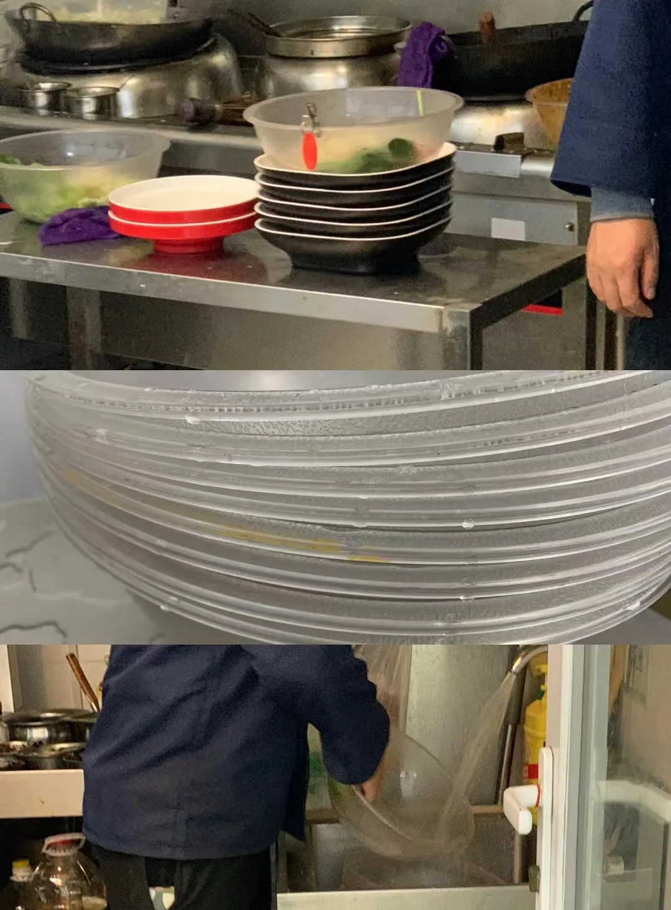
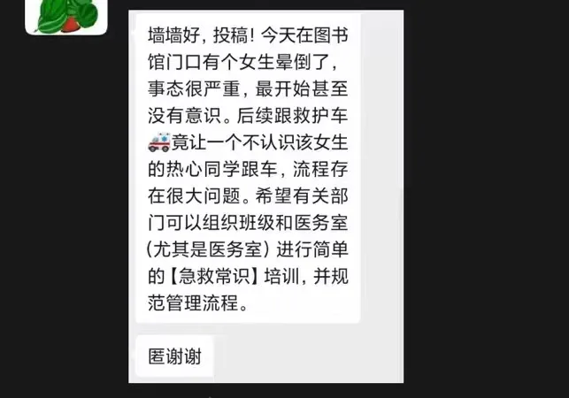
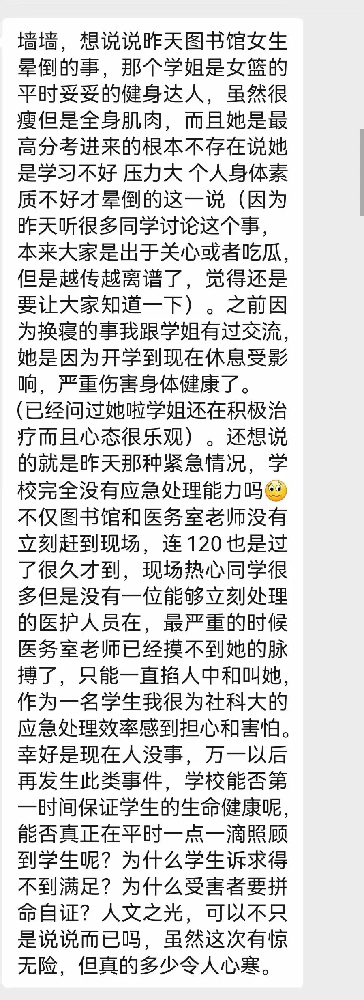

请相关部门及时关注并跟进问题。

## 1 食堂

> “说别人打包慢的是什么自私发言我请问呢？什么叫觉得打包费贵就别打包，那要这么说你在这建议什么劲呢？那我也可以说你要是觉得食堂不好吃你可以不吃啊？你要是觉得食堂不好你别进食堂吃饭，你要是觉得别的学校食堂好你去别的学校啊，觉得食堂做的不好吃可以自己做。别在这用法律要求自己 用道德约束别人好吧？凭什么打包慢就不让别人打包，你凭什么要求别人和你一样非要在食堂吃，还有贵不贵和我打不打包有什么关系，我就是不打包这个定价也是贵，你有点逻辑吗行吗。最后，别在这模糊重点，食堂打饭慢终归是食堂的问题啊，就现在这个速度不打包能快到哪去去？”

## “天呐，都大学生了换位思考都不会，希望有的同学一辈子都不需要打包。”

（见《[【读者投稿】争议问题讨论持续](https://mp.weixin.qq.com/s?__biz=Mzg2MjcwNzQ1Mw==&mid=2247486541&idx=1&sn=4b839c568d244d3ea0bb0a4b11ac28c3&chksm=ce0287dff9750ec9be92d75f8facee0f9c52431419d63e6bc029c78624d1f92b042a58676fc1&scene=21#wechat_redirect)》第1条)

“【良乡校区-风味餐厅投诉】麻辣情怀档口的工作人员，没有合理规划操作空间，经常将透明选菜盆，直接压在麻辣香锅的餐盘上。这种操作流程会导致食堂统一清洗消毒过的餐具被二次污染。

该档口的选菜盆只会冲一冲，不会经过彻底清洁，叠放和过秤都会污染盆底。因此菜盆无论如何都不应该和餐具叠放在一起。我曾直接向该档口经营者投诉过此事，但之后依然看见他们随手就把菜盆压在即将要使用的餐盘上，可见该问题并为引起他们的重视。目前正值秋冬季节，希望风味餐厅管理人员关注食堂卫生安全，及时处理此事。

## “一食堂既然都摆烂了，能恢复波哥小炒吗？

“良乡一食堂早餐打饭大爷脾气太冲，之前到他那打饭，跟他说六个蒸饺两个烧麦两碗甜豆浆，他刚夹完烧麦和蒸饺，就过来问我，几个蒸饺？我说六个，他一看就打了五个，夹完又回来问我几个豆浆，我寻思着他应该是年纪大了耳朵听不清或者记性不好，再到他那的时候，打饭的人很少，后面没人排着，我就分开说我想要什么，一次说两种，怕他记不住，结果人家来了句，你不能一次性说完吗，打点你说点。

学生体谅大爷，大爷攻击学生，打菜打出优越感，就觉得学生好欺负随便说？

> “投稿望京食堂：每次换一批阿姨，就给菜给的很少，说了也不听，象征性给加两块肉，脸色也很不好，为什么食堂非得一次次的提意见才能好一点，就不能上岗前培训一下，服务性行业能干就干，不想干走啊”

十分赞同这个稿件！已经遇到好多次了，而且打饭时跟他们说，他们态度还很差！！！

“良乡一食堂的菜越来越辣了，二楼荤菜里面挑不出几个不辣的。放一点辣椒可以理解，但是最近放的都是很辣的干辣椒的细筒子辣椒。希望可以多一两个荤菜不要做这么辣，换着来。谢谢食堂工作人员"

## 2 宿舍

“社论君好，回复一下建议重新考虑分寝规则的同学，可能同学有所不知，学校在入学前就为我们23级新生在迎新系统统计了生活习惯（且是必填项），我就是这样遇到了不同学院但同样晚睡晚起的室友，相处非常愉快。

## 3 图书馆

> “学校能不能经常让社会科学文献出版社卖书的来图书馆卖书呀！五折好划算，而且书都很精美还有意思，卖书小哥也很懂这些书，还给我安利。今天买了三后本才花了100多！本爱读书爱买书人疯狂期待下次。但是小哥说得等明年了。我们学校图书馆书少，附近卖书地方少也贵。这种卖书活动真的太喜欢了。希望学校能够经常邀请他们来卖不同类型的书！”

4

校园空间

## “望京校区可以提供一架钢琴吗”

## “良乡都组织摘柿子了，望京怎么还不组织，怎么不跟上！效率！”

5

教务问题

“望京校区上午十二点下课，下午一点半上课中间休息好短，领导们可不可以考虑一下延长到两点or两点半上课，不然上课也要困死了啊！”

## 6 身心健康不保

“

宿舍问题为什么天天都有同学反映？入学前明明填写了作息时间和卫生习惯，可是宿舍分配并没有落实。流于形式的调查有什么意义？做给谁看？硕博科研压力很大，如果得不到好的休息身体和精神都会出问题。这就要说到学校的心理普查真的做到位了吗？体检只靠入学那一次就够了吗？学校有关注过多少人都有精神疾病和心理问题吗？有多少是因为来了这个学校才患病的？新生奖学金不分级，补助长期不到位，食堂和宿舍和自习室问题永远不断，为什么要逼文明人采用野蛮的手段才给办事？难道一定要发生点恶性事件学校才能看到问题吗？一定要学生发疯把事情闹大才重视解决吗？毫无人文关怀的行政制度，僵化的管理体系，只会让学生理解学校的难处，可是学校有真正将学生诉求放在心上重视解决吗？硕博们来到这里希望在人文殿堂有收获成就，而不是好好的人来这里身心健康不保！”
