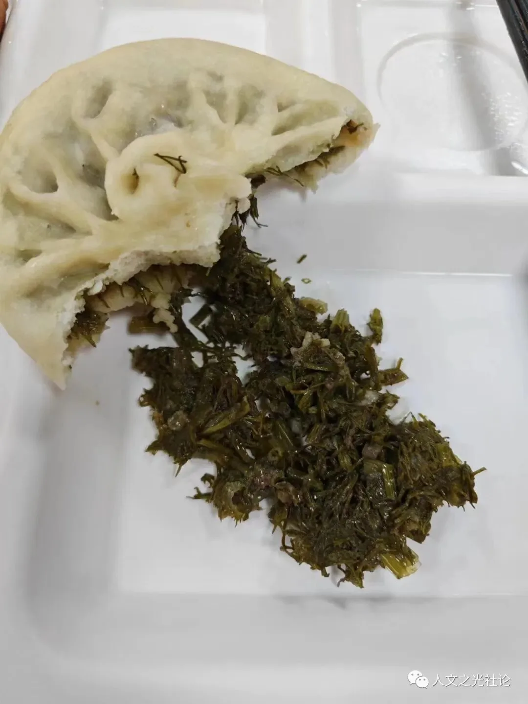
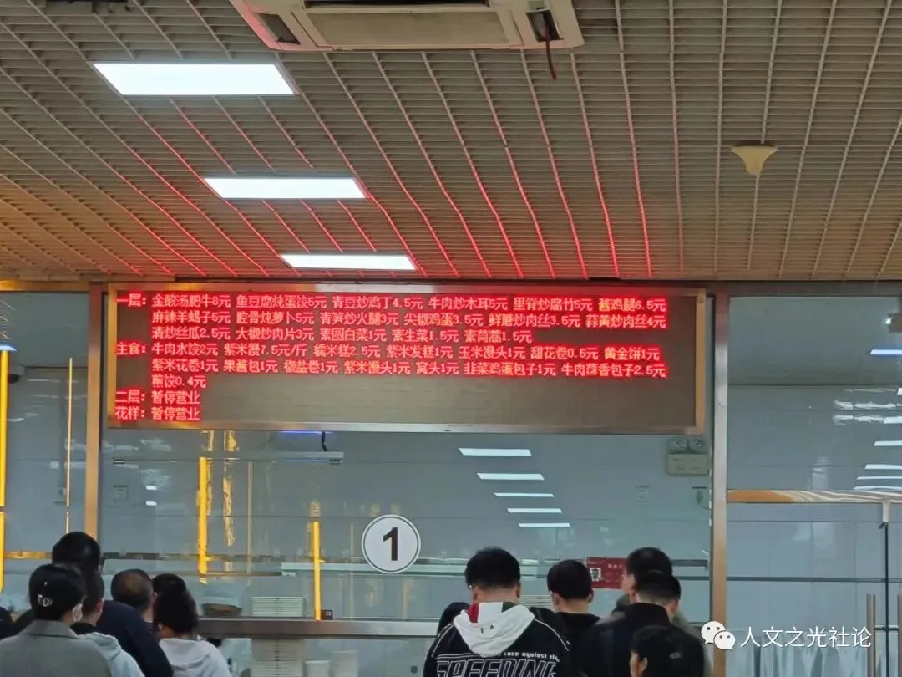

### 请相关部门及时关注并跟进问题

## 1 教学

## “10月27日有位同学的投稿，本人非常赞同，主要是这两点：

1 硕博课程及部分本科课程的大拼盘现象：

不是反对多人授课，每个老师讲自己最熟悉的领域这很正常，发挥好了能提升教学质量，但反对毫无系统组织，流于形式的拼盘授课，课程名字吓死人，但每个老师都是过来水课的，毫无价值，硕博课程尤甚。

2 校内（不是各所）学术讲座整体量过少，学科覆盖范围及其有限，有些学院难得见一次讲座。”

“投稿：看到教务处最近在组织期中教学检查，这对教学来说也是必要的。每次发这个通知教务处都会带一条说建议各学院召开学生座谈会听取意见，但问题是目前这个制度具有随意性，各学院执行情况参差不齐，也不利于日常教学建议的反馈。根据教学进度的相关情况，建议教务处和学院统一在9-11周组织一下期中教学座谈会。

经过前面8周的学习，大家已经对这学期的课程有了基本的了解和判断，这样提出的意见更为精准可靠。11周以后大家要面临结课和期末考试，来参与座谈会的同学会大为减少，而且据下学期开课也太近，很多意见无法具体落实。

所以还是建议教务处组织（至少是建议）各学院在9、10、11周开一下学生座谈会，尽可能听取学生有关教学的意见，以便更好地组织教学工作和迎接本科合格评估，很多问题也能得到更好地化解。

谢谢！”

> “社论君投稿~对昨天的帖子非常有感触。 1.22级博士必修二外，法语等科目难度过大，挂科人数不少。23级博士已经不再必修。 2.当时二外是成选修课形式，完全根据个人喜好或擅长选择语种，而且二外老师评判标准完全不一致，比如法语等，学习和考试都非常严苛。而且作为一门最最微不足道的课程，如果作为必修课纳入统一考核指标，对同一专业非常不公平，如果因为二外而连学业奖学金都拿不到，那干脆让每个专业人人都去学习二外得了！非常不公平，而且无厘头。”

## 2 食堂

“投稿，食堂打包问题，可以开设单独的打包窗口，想打包的就单独去排队，这样也更好地集中人流，可以减少浪费。如果不确定打包人数，可以先开两条队伍。”

> “支持开设打包专用窗口，今天中午7个人的队，排了20分钟，前面有四个都是打包的，还有给别人带饭打包，打了四盒的，师傅算账都算不清楚了，又多堵了一分钟。这感觉太酸爽辣！！！”

## “投稿：望京食堂面窗口真的很好！！给我们了一个家！

今天中午还有羊肉泡馍，我哭了。一直有在做新品！（米饭窗口就。。。）

另外，望京食堂有两个姐姐真的特别好。一个是5号窗口刷卡姐姐，一个是3号窗口的姐姐（都是28号中午）

两个姐姐特别亲切，耐心，热情，真正为学生着想，干活也很麻利，有效率！不止我一个人喜欢她俩，身边小伙伴都很喜欢！”

“2023年10月28日下午一食堂一楼，牛肉茴香，牛肉呢?不会是包包子的师傅叫“牛肉”吧!＂

## 3 研讨室

“建议研讨室制定讨论一下规则，可以讨论请不要在里面谈笑，以及装修一下研讨室隔音”

## 4 宿舍

## “昨天京籍四人间那个，说得太对了…这到底是谁想出来的逆天政策“

## “不知道为什么现在调宿舍不允许不同级别的学生住一起，其他学校有这样的规定吗？

如果是担心宿舍不能按期修缮，那为什么不能到期再重新让学生调换宿舍，可以在调宿前说明情况。宿舍安排不合理就算了，连调宿都不能满足。宿舍如果紧张，那为什么依然还有很多一个人住的宿舍？”

（良乡，1-4号楼）

## 5 体育馆

“体育馆场地预约，如果要取消的话，必须要提前两个小时。不然就退不了，被关小黑屋一周！有时候真是临时有事！能不能改一改！”
