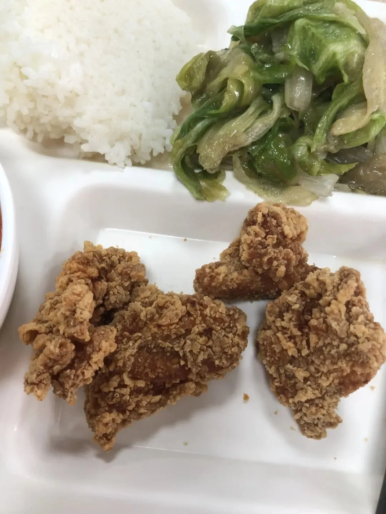
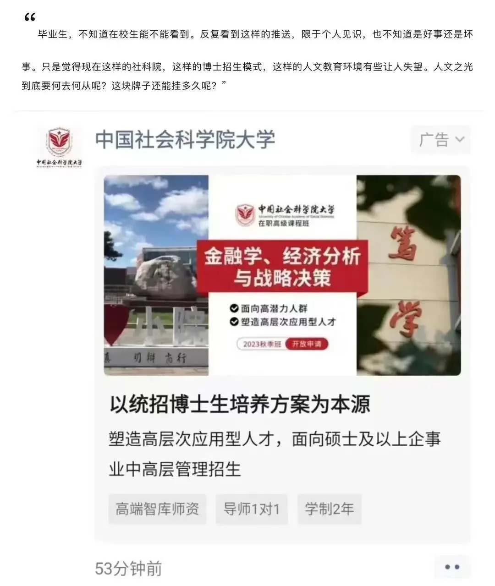

请相关部门及时关注并跟进问题。

## 1 食堂

“匿名肯定一下食堂吧 目前维持的还不错 咱这食堂也算是便宜了 打饭的叔叔阿姨态度也不错👍”

## “投稿，今天一食堂又有最爱的炸鸡！这个真的不错还便宜！希望以后多多有！

而且从宿舍去快递点的那个拐弯处的小路学校也给铺好了，看到了学校一点点的改变！夸夸～

?”

## 2 招生广告

## “投稿

看到有同学吐槽学校的在职高级课程班招生广告，说对人文之光感到失望。

我想说学校也是需要收入来维持的，不挣钱怎么给同学们提供更好的学习环境、改善生活？如果实在看不惯这种现象可以拿出真金白银来支持学校的建设。”

“回应一下这条:这个是继续教育，只是个搞钱的项目，不是学历教育，和博士招生无关哈”

（相关问题参见[《【读者投稿】 两校区问题不断》3.1](https://mp.weixin.qq.com/s?__biz=Mzg2MjcwNzQ1Mw==&mid=2247486598&idx=1&sn=524f9d14adeafcc75e1c20eebc981518&scene=21#wechat_redirect) ）

## 3 望京校区生活问题

## “吐槽下

望京校区图书馆的打印机

感觉是上个世纪的产物

没见过这么笨的打印机

打印个东西老长时间

补一句 机器可能比我年纪都大！”

> “回复昨天1要求望京校区新增晾衣杆和定期清理长期未拿衣服的评论。请问该同学，对于长期未拿衣服的时间是如何评议的，多长时间属于长期未拿？且如何确定哪些衣服属于长期未拿？且将长期未拿的衣服处理到哪里去呢？秋天日照正常的情况，白天洗晚上几乎能干，晚上洗第二天晒一天能干，现在的情况是天气不好，霾多雾多，空气湿度大，衣服晒个两三天都干不了，如果衣服干了不拿回去确实不道德，但是最近几天有特殊的天气情况，大家洗的衣服干不了，自然就无法拿回去。前段时间除开学的时候晾衣杆紧缺，没有地方晒衣服，最近都没有出现一点地都没有的情况，学校新增的晾衣杆在水房旁边，也没有全都晒满的情况。晒不了衣服固然心烦，同学们的心情都差不多，但也希望能多理解。另呼吁大家，晒衣服的时候不要光顾着自己的衣服有地方，把别人的衣服推到一块去，导致衣服晒不干，谢谢。”

（相关问题参见[《【读者投稿】 两校区问题不断》1.3](https://mp.weixin.qq.com/s?__biz=Mzg2MjcwNzQ1Mw==&mid=2247486598&idx=1&sn=524f9d14adeafcc75e1c20eebc981518&scene=21#wechat_redirect)）

## 4 校友vpn问题

> “p5，vpn问题不要寄希望太高。清理离校用户vpn权限并非个例，很多985也是这么做的。主要是网络安全保障起见。二十大召开前学校集中清理了一次历届毕业生与已离职教职工社科院VPN账号，这也是大院里的部署。”

（相关问题参见[《【读者投稿】 两校区问题不断》第5条](https://mp.weixin.qq.com/s?__biz=Mzg2MjcwNzQ1Mw==&mid=2247486598&idx=1&sn=524f9d14adeafcc75e1c20eebc981518&scene=21#wechat_redirect)）

## 5 补助问题

“学校这个月可不可以早点发补助啊 上个月为了十一都早发了 这个月可是双十一啊哭哭。”

（相关问题参见[《【读者投稿】 两校区问题不断》2.2](https://mp.weixin.qq.com/s?__biz=Mzg2MjcwNzQ1Mw==&mid=2247486598&idx=1&sn=524f9d14adeafcc75e1c20eebc981518&scene=21#wechat_redirect)）

## 6 新生人脸识别

“请问23级新生啥时候可以实现人脸识别，报到就录入了人脸信息，到今天为止，都是只能刷卡进入，稍微刷慢了检索到面部信息，马上大声提示“非法闯入”…”
