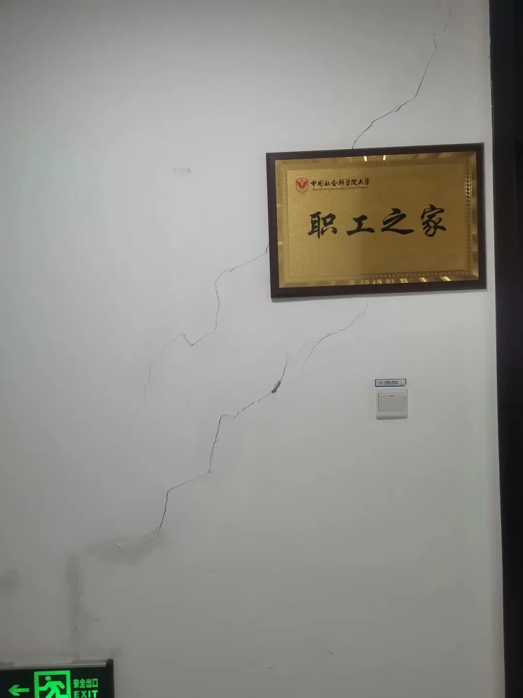
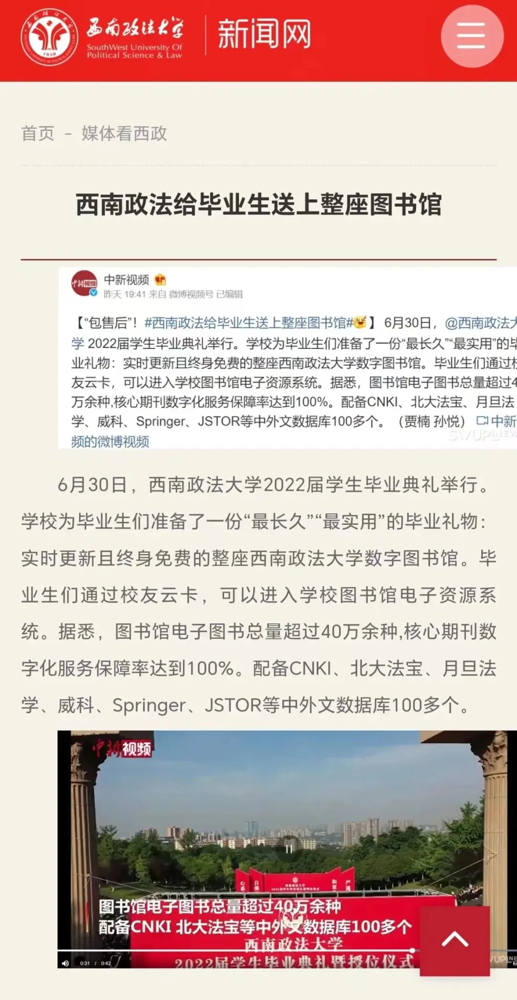

请相关部门及时关注并跟进问题。

## 1 课程问题

## “投稿

不好意思再吐槽一次拼盘课，今天这课上得真难受，老师讲的东西跟课程名字毫无关系，每个同学都不想听了，私下在群里疯狂吐槽。

真心建议没有条件的课还不如不开，这样老师和学生都不用浪费时间在这上面，经济学不是最讲究资源配置效率么。

入学到现在没有一门拼盘课是让我觉得有收获的，真难受，感觉学费白交了。”

“有关法语二外的争议从上学期课程结束到笔试，再到这一学期出分以来持续不断。其实真没什么好质疑的。法语二外判分非常公正、标准，一靠出勤率和平时课上表现，二靠闭卷考试，试卷答案固定且唯一，并不存在模棱两可的情况。法语老师教学认真，在部分人眼中或许是严厉的，但好好学确有收获。法语成绩的每一分都有其凭据，该多少分就多少分。若没有取得好成绩，有时需要反思自己的学习态度和时间分配，不太清楚某些同学口中法语挂科的人学习态度端正否？其他课程学习情况如何？我身边修法语的同学中并无挂科，大家都在80＋。

大部分在法语上取得不错成绩的博士生并没有在平台上发表意见，导致存在偏听现象。正如之前有同学表达的一样：此时取消二外成绩作为评奖的组成部分对于认真学习二外并取得好成绩的同学来说也是不公平的。教学规则（先不论其是好或坏）是先于课堂存在的，大家都是明确知道二外作为必修是要纳入评学业奖学金范畴的，既如此，没有认真对待导致成绩不好，现在发牢骚也是无意义的。大家少一些戾气，法语没有取得好成绩，或许是将时间用于其他课程和论文，并取得了不错的成绩，那也是有所进步的。”

## 2 设施和管理问题

“南综大楼有地基沉降。二楼会议室和教室墙壁上出现明显裂缝，楼道地板受压膨起松动，已经更换过好多块，大楼外墙也有裂痕。应该不至于危楼吧？”

> “夏天后勤处在北综和南综之间西侧的路上组织消防演练，消防栓恁大的高压水，怼着地砖就是一顿狂冲。几天下来，地砖下铺平的沙层就全被大水淘空冲走了。现在那片地面凹凸不平，车辆驶过，好多石板和砖块被辗断。雨天下课路过，行人更是得小心翼翼，不然不知踩到哪块，就冷不丁冒出一股泥水来，弄脏裤子和鞋子。请后勤处以后选个合适的地方演练。不要破坏是你们，维修也是你们，你们自产自销KPI是完成了，但买单的是学校经费，是国家税收拨款，是民脂民膏啊。再不改，就谁破坏谁负责吧！？”

## “1 白棚子什么时候拆

疫情期间，为了实现精细化、数字化管理，学校在校门口和宿舍楼加装了闸机。

闸机目前可通过刷卡、刷脸、扫码三种方式通过。

且不说三种方式同时使用，光一个二维码可以截图发给多少人使用，让其进校？

闸机的功效已然荡然无存矣！

鉴于已经没有疫情这个最大的前提，建议学校恢复常态管理，拆掉白棚子和校门口闸机，启用门禁。

其它理由：

闸机没有校园卡“一人一卡”刷门禁实在（二维码等方式现在反倒成了漏洞来源）

闸机一人一开合，人多时很容易排长队拥挤。

骑电动车出入，无论刷脸刷卡都很不方便，不及门禁方便快捷。

白棚子太丑了，很像村里的丧事棚子。

有同学反映，白棚子遮挡视线，出棚儿差点被外卖电动车撞到，有安全隐患。

2 宿管问题

目前校外人员在学校借宿的人一大堆，宿管一个都没查到。

这说明闸机+楼管的模式，除了增加学校经费开支外，没有任何正向作用。

因为：

（1）闸机验证作用失效失能，原因上边已经说了。然而不幸的是，宿舍楼原本崭新的门禁已被拆除，就只能继续使用闸机了。

（2）宿舍楼为筒子楼而非单元楼，即便有楼管她也不可能认识整个楼那么多的人，也无从鉴定谁是本楼人员。

敦促公寓办执行《公寓管理规定》。而不是把它只当作对付学生的武器，这里边规定的工作内容，你们都落实了吗？做到了几条？不要问别人哪个外校人员在借宿，你查不出来这很好笑，说明你们已经失职了好吧。

另外请问：

公寓办上班期间办公室打扑克、公寓办办公室使用电磁壶，算不算违反学校公寓管理规定？

公寓办工作人员住宿为什么或住单间或一人占俩宿舍？学校学生住宿不是很紧张吗？你们有啥特权？

公寓办人员是教工就该去教工餐厅，是后勤就该去后勤餐厅，怎么经常在学生食堂就餐？（超市热水打印店理发店似也吃学生食堂？）

公寓办办公室和他们所住的宿舍，用电应该没有每月50度的限制吧？那也不必现在这个天儿就24h开那么高空调吧？我在门口站一会儿都觉得燥热。请温度调低一点，全当是节能减排给地球作贡献吧。

宿舍坐椅是老式椅子，靠背是塑料的，有次伸懒腰靠裂了，找公寓办想维修或更换一下，某毕姓工作人员说换不了，“得”等新学期才给统一更换。无奈作罢。结果有次散步，发现池塘西边的空地，扔着一堆椅子，风吹雨打无人管，自己就搬了一个用了。

请问：

这些桌椅是报废的吗？如果已报废，我看这些桌椅都是好的啊，比我宿舍使用的都好，这就报废，学校对于公家财物的报废是依据什么标准和流程？如果没报废，只是暂存，就这么露天撂在荒地上，应该吗？

3 马骨干学费

马骨干是学校和中宣部以前签的一个人才培养协议，十年已到期了。明年还招生吗？如果协议是定向委托培养，就不该收学费啊。如果协议到期，就停办吧。一边打马骨干的名，一边又继续招生收人学费，似乎不妥。马骨干好多在职水学历，与我校办校遵旨不符。”

## 3 表扬望京校区工作人员

> “投稿：表扬望京校区周二晚报告厅给后排同学安排桌子的老师和工作人员。顺带望京校区周二晚环境法有感：晚六点上课，下午到教室就发现首排座位也寥寥无几。占座形式多样：有放一本书的，有放一个茶杯的，有放手串的，有放塑料制品小物件的。真正上课时候，仍有零散座位被书籍占据占座人仍未到的。学法学之前，认同法律人共同体，认同社科院是有着“斯文在兹”的品质。可是一年时间里，不冲厕所的，教室里吃喝当窝的，图书馆私占座位等现象，似乎在显现：学校建设不光在于学校的努力，学生的个人品质也是重要因素之一。犹记得莫所长曾说过的那句话—做一个知行合一的有心人，深入地思考问题，不做精致的利己主义者。诸君在实现自身法律梦想—日后成为大法学家，大法官，大检察官，大律师，卓越的法律人，优秀的政务工作者的同时也勿忘做学问其实也在于做人。！”

## 4 校友vpn问题

“回复今天的P4，事实上西南政法大学、中国农业大学、上海外国语大学、西北工业大学都为毕业生保留了VPN权限，参见如下链接。希望学校在这个问题上向先进看齐。

详见下图与链接:

https://m.sohu.com/a/353571274\_407297;

https://m.thepaper.cn/newsDetail\_forward\_21615055;

https://m.sohu.com/a/405624045\_654939?010004\_wapwxfzlj;

https://news.swupl.edu.cn/mtkxz/40b801c60f974e4dbaa45340902bac44.htm;。”

（相关问题参见

[【读者投稿】网络问题依然有，昨日讨论继续第4.1条](https://mp.weixin.qq.com/s?__biz=Mzg2MjcwNzQ1Mw==&mid=2247486602&idx=1&sn=d7e52f7482a0993e4bf035c077defa68&scene=21#wechat_redirect)

[【读者投稿】 两校区问题不断第5.1、5.2条](https://mp.weixin.qq.com/s?__biz=Mzg2MjcwNzQ1Mw==&mid=2247486598&idx=1&sn=524f9d14adeafcc75e1c20eebc981518&scene=21#wechat_redirect)）

## 5 奖学金问题

> “投稿：请快点开始研究生奖学金的评审，尽快发放。看了眼去年的发放流程，11月4号发通知，月底才开公示，黄花菜都凉了。双十一快到了，本来这学校给钱就少，再给得慢、给不到位，真没活路可言。”

“国家奖学金评选规定中，根据校长办公会审议通过的办法，及格线已经由75分改为60分。

1.那为什么还是只能有一门75分以下的成绩？这个规则为什么没有改动？

2.况且二外成绩本身争议就大，真要因为二外丧失参评资格了。

3.经济片高达300名的硕博生难度最大的三门经济学成绩去年变为六门，挂科率已经倍增了。

规则不变的话，很多同学学业奖学金都参评不了了！

之前有人也反映过意见，看来是没有采纳。”

> “奖学金评定倡议书： 回顾2022年11月8日人文之光社论奖学金黑幕吐槽各种稿子，如今2023年开始，不当马后炮等啥都结束了，被这群人坑蒙拐骗了再去吐槽，所以提前在这里发出倡议，要求各学院在奖学金评定中做到公平公正，尤其是公开！！！ 不要像去年一样，社论中的某些学院，直接点名应用经济学院，马克思学院等等，评定细则，评定过程，评定结果，不公开不透明，最后获奖的同学有什么东西乱加分，项目课题乱填报，证明材料不规范有缺损之后，在老师的纵容下，还能不断的找各种方法去补材料来加分，以及最后的结果不公开偷偷摸摸在办公室张贴不通知任何同学等等，这些都在社论中，有多数同学连续反映，至于其他的什么搞黑幕，暗箱操作，权利关系，这些都另论。如果像去年一样，连基本的公开透明都做不到，那么今年大家就一起打电话发函给教育部也好全部给投诉上去，连带着辅导员班主任，因为即便是不作为，不参与那也是对不公开不透明的纵容。我也就是提醒一下同为普通人的同学，大家反正也参与不了这种高端竞争，但是真要有哪些人破坏规矩的话，咱们一个电话一个举报，恶心恶心一下也是不错的。”

> “投稿：请问学工处研究生评奖学金期刊里的A、B类是哪些老师拍脑袋想出来的？为什么有现行的《中国社会科学院大学期刊分级办法（试行）》不用？而要用这么一份不知道谁写的神奇的名单？权威期刊不在名单，C扩和黑名单期刊却能出现在AB等级里？每年有学生利用这份名单买英文普刊把科研分刷爆的事还少吗？”

> “国家奖学金评奖期刊准则严重落伍。评国奖的期刊分类为ABCD四类，其中SSCI一律视为A类，学校是默认发个SSCI三四区的水刊和经济研究一个水平吗？另外B类期刊里甚至还有些C扩期刊，学校是认为这些期刊水平和发表难度是和权威期刊一样吗？（当初的时候也是C扩，实在不知道怎么选的这些期刊），分类都多少年没有更新了。希望学校能够重新组织科研处对期刊分类AB进行更新和更科学的分类。否则无法起到引导和激励学生科研的作用。”

## 6 回应人脸识别

“回复新生人脸识别那条，那个人脸识别是要你自己去小程序里录入的，就是有付款码的那个。

具体途径：社科大移动校园-A.一卡通移动端-照片采集”

> “社论君，我想回复一下10.31的第六条。新生如果想要刷脸进门禁的话，可以自己录入信息。步骤是：点开微信里的移动校园——点击”一卡通移动端“——再点击”照片采集“，录入之后就可以刷脸了”

## “新生人脸识别那条：刷脸识别早就可以了，我从开学就开始用刷脸了”

## “家人，人脸识别早就有了，要在企业微信里传一张照片了”

（参见[【读者投稿】网络问题依然有，昨日讨论继续第4.1条](https://mp.weixin.qq.com/s?__biz=Mzg2MjcwNzQ1Mw==&mid=2247486602&idx=1&sn=d7e52f7482a0993e4bf035c077defa68&scene=21#wechat_redirect)）
