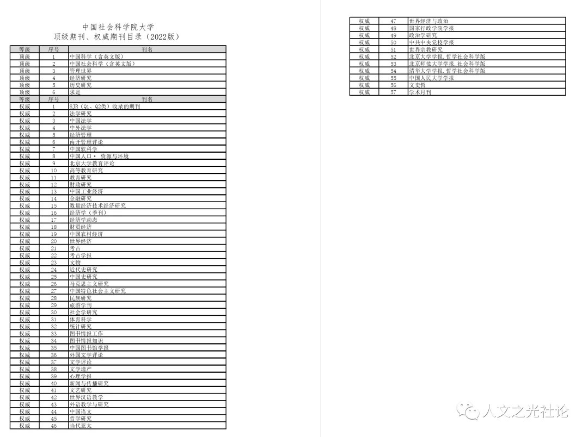
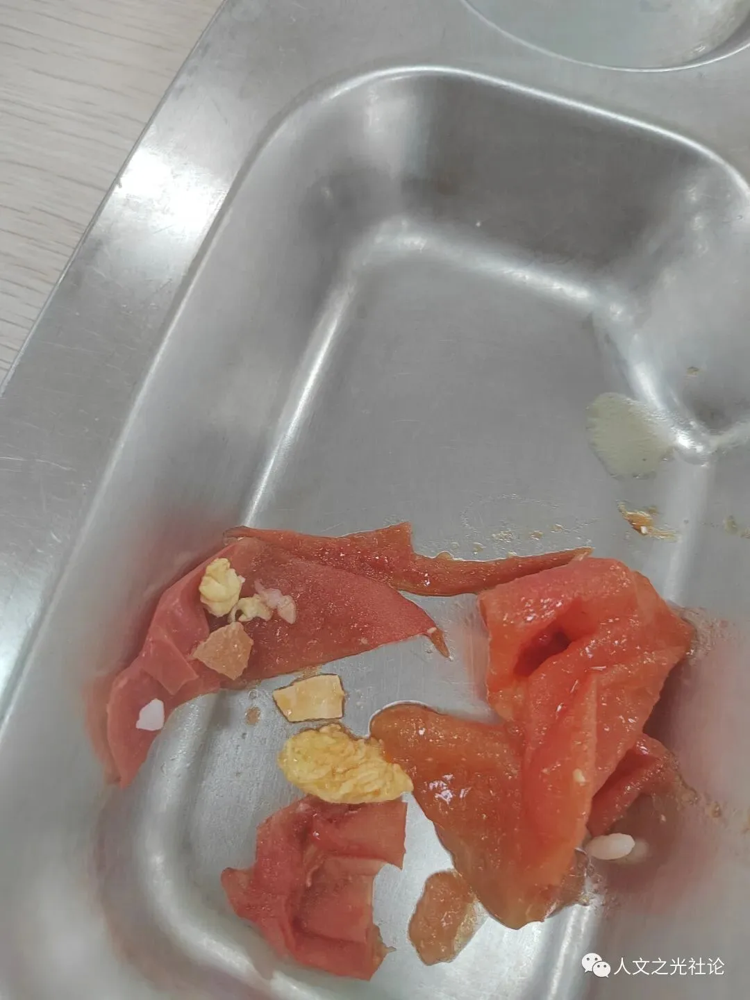
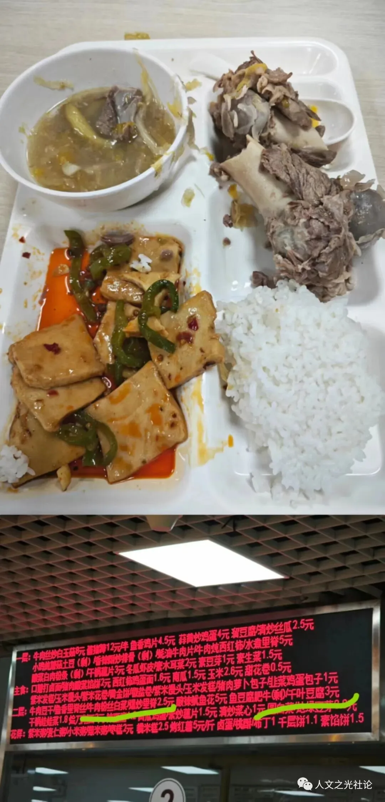

请相关部门及时关注并跟进问题。

## 1 评奖标准

> “投稿，期刊等级问题的确是个大问题，学校甚至没有对其进行基本的核查。b类期刊里的研究生院学报改名叫大学学报得一年半了。大家相信它的办刊质量胜过武大，浙大，中山，川大的哲社学报吗？《国外社会科学》改名叫《世界社会科学》也快一年了。此外花钱就能水的域外普刊依然在b类之列，这点也算是令人惊诧了”

“我校评奖标准重论文轻著作的力度之大、决心之坚令人称奇。合着在社科大学报上发篇二作论文加的分就跟自己写部专著加的分一样多呗？”

> “社论君你好： 想问国家奖学金评选中的C、D期刊包括哪些？目前只能看到A、B级期刊目录。以及法学院的评选细则什么时候公布？11月9日就要将名单提交给学校的话，时间也太紧了”

> “A类期刊和B类期刊是学生工作处哪个老师选的？C扩竟然也在内，自己发的CSSCI目录都不承认C扩，竟然放在了B类期刊里面？ ssci也分等级的，这点常识都没有吗？灌水的3区4区好多是中科院的黑名单和预警名单？这也算A类顶尖期刊？和经济研究、管理世界一个水平？这是在歧视这些顶尖期刊的质量还是歧视我社科院不懂学术？CSSCI无法区分等级，建议尽快修改，调整为社科院AMI顶级期刊为A类；权威期刊为B类，这个更好区分，也相对客观。英文期刊参照22版标准，SJR(Q1和Q2区)对应B类期刊，或者SJR1区对应A类；SJR2区对应B类。SJR和SSCI不一样！！”

## 2 博士二外

> “投稿：看到有同学提到博士法语二外成绩的问题，让我想起了日语二外成绩的争议。几个月前，已经有同学投稿了，其中两位教日语二外的老师中，有一位在考前为班级同学画重点，而且这些重点与最终考题高度一致。在这种情况下，那些认真学习二外但没有掌握这些重点的同学，日语二外成绩的公平性和公正性又在哪里呢？。”

## “对人文之光社论因法语二外成绩事宜指责学生的说法的回应。

我只想对这个人说一句:如果你分数低或者挂掉了想必你就不会这么说了，有些人站着说话不腰疼！这句话是你接下来看以下叙述的前提！！否则请闭眼或走开。

1.开始选课时，个人任选二外语种注定不是一门必修课的选课形式！！

2.我们没有建议取消二外的成绩基数，而是不将其作为评判门槛！！

3.是否有收获？你自己可以去调研问一下你们全班的同学，看看到底是支持的人多呢还是反对的人多。有数据再说话，别动不动拿别人当成挡箭牌！！

4.如果有收获，你可以在下学期或者下下学期或者下下下学期继续选择二外，强烈支持！！

5.虽然制度已出，但是这个不合理情况现实存在，不然为什么23届取消了呢？你来解释下？没有问题会取消吗？！！

6.你的意思是成绩低的同学没学习吗？你去问问，谁没学习再过来说话，你自己学过法语来指责别人，你有发言权？？！！

7.在此再重申一遍，如果我们选了其他语种，绝对是能考更好的分数，这是必然，不信咱们可以重新选择试试看！！

8.你现在的行为是攻击所有成绩不好或者没过的同学，你可以不替他们说话，但是你落井下石和指责的态度真的非常恶心人！！”

（见《[【读者投稿】奖学金大争议，校区内问题不断](https://mp.weixin.qq.com/s?__biz=Mzg2MjcwNzQ1Mw==&mid=2247486609&idx=1&sn=581dd7eb9672711d607a551982cdb185&chksm=ce028703f9750e15fbcaa021de8ea9523a915eee4cdc90be675420181134e719b2fa35a1faeb&scene=21#wechat_redirect)》第1条）

## 3 食堂

> “我真的要生气了 是不是别人不发火就把别人当傻子啊 望京食堂下课每次都要以800米冲刺的速度才能抢到我想吃的菜 不然的话每次去食堂永远吃不到我想吃的菜 永远都是卖完了…… 今天中午吃饭番茄炒蛋还有蛋壳 我要拥了！”

## “一食堂的一两饭分量是不是越来越少了?”

> “投稿:学校食堂二楼，打了两个菜，看显示屏应该是千叶豆腐3➕牛肉粉丝白菜2.5，外加一两饭，那么本应6块的饭菜，刷了我15块，这合理吗？是因为这两个骨头棒子加了9块吗？刷卡的时候疑惑二楼怎么有这么贵的菜，屏幕上也没有，食堂师傅也不说一声，因为分量随便更改价格，虽然几块钱，也挺不开心的，而且发现也不好吃。”

## 4 宿舍

> “啊这，里面的有个我觉得挺那啥，宿管大家都挺好，还会倾听大家烦恼，楼里也有洗衣机也有热水器，甚至还有微波炉，宿管房间和这个是一样的走线，宿管老师也不是一人一间，是轮流睡那个床位，因为晚上要执勤，宿管阿姨也有自己的生活，大家文科人为啥还要学资本主义剥削人，需要一直工作……日常娱乐很可以啊，大家也是成年人，宿管阿姨天天盯着也很难受啊”

## 5 理性投稿

> “投稿：看了人文之光这个号一段时间了，觉得运营者很厉害，很认真在做这件事，但是某些投稿同学不要太离谱，一点鸡毛蒜皮的小事就来这骂学校，导致本号每天都充满着各种戾气，让我怀疑咱们是不是在一所学校……试问在你自己家，你父母亲友能像你要求的一样做到100%吗？这只是个普普通通的双非学校而已，不是私人定制服务场所，感觉现在大部分投稿都这个公众号的初衷越走越远。”
