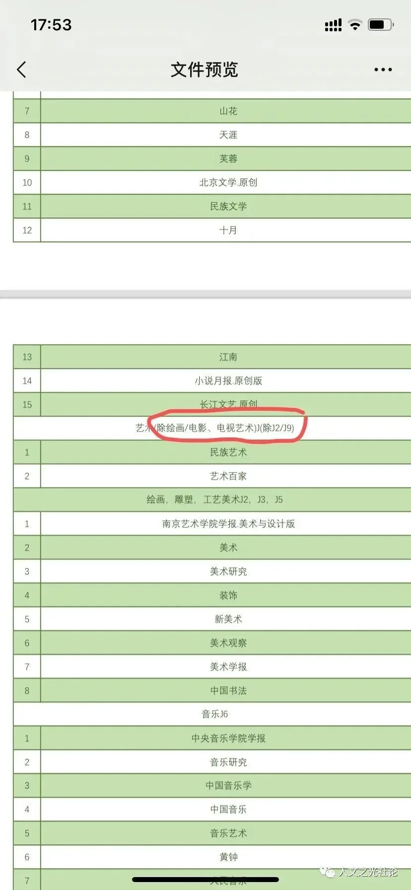
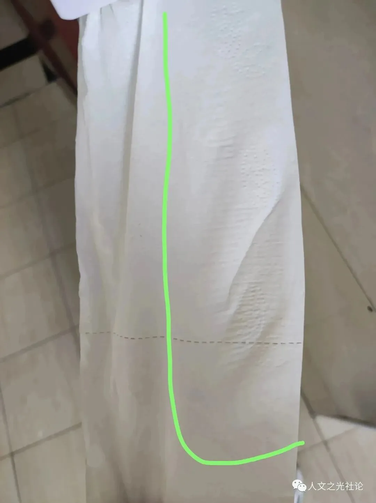
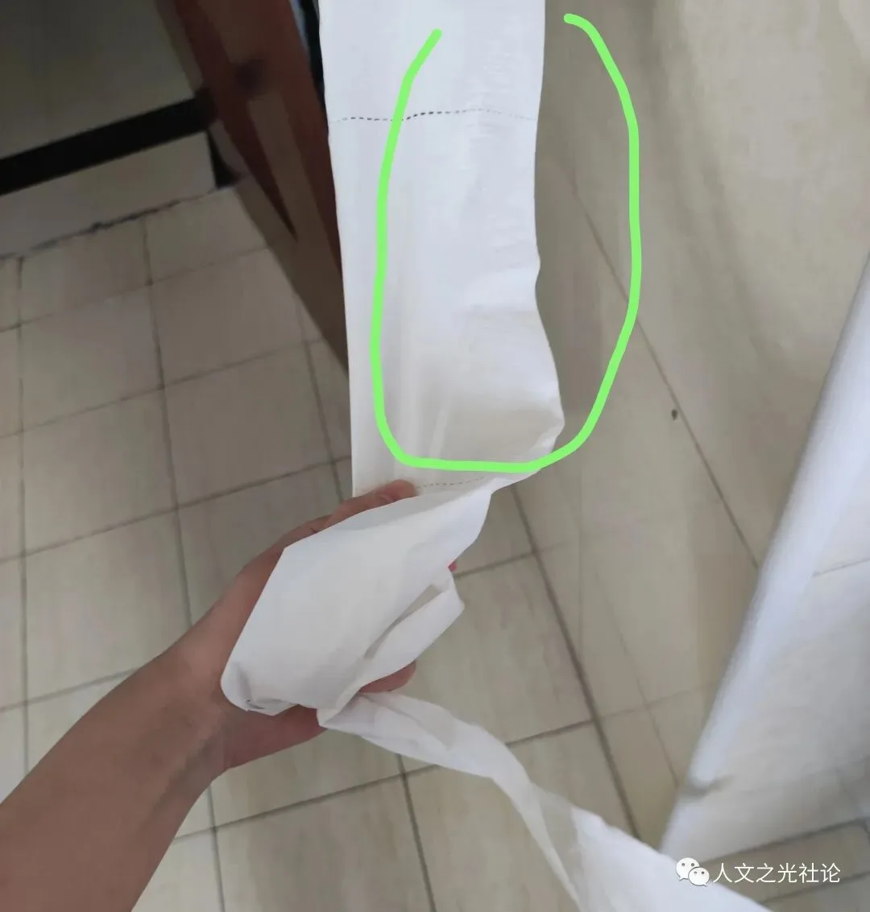
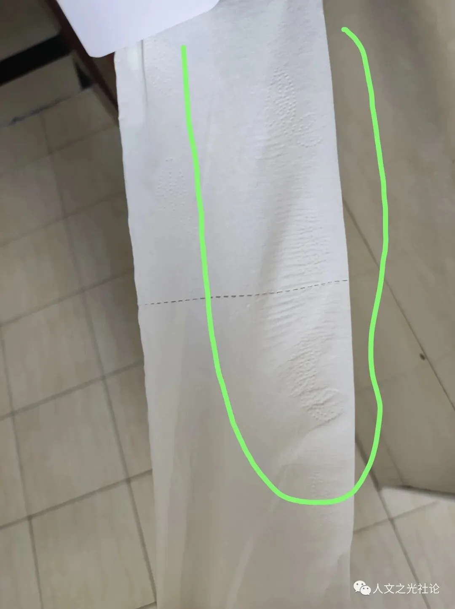
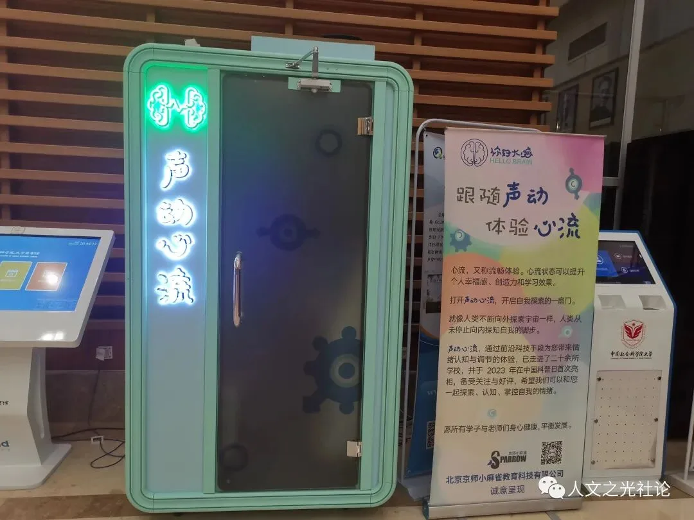

请相关部门及时关注并跟进问题。

## 1 评奖标准

> “【投稿】投一则奖学金相关！虽然是中游学生，也理解学校奖学金有限覆盖率不高，但是想问问能不能也设点覆盖率高点的单项小奖，让同学充实充实简历也好，毕竟很多学校奖学金覆盖率挺高的，就业竞争的时候也算多少有些学校相关的荣誉内容。”

## “看了近期评奖的讨论，确实，除去国奖外，其他等级奖学金评奖也不透明。

根据以往的见闻，很多班级只有班委知道评价标准，而且标准由各班班委讨论决定，同一个学院内不同班级规则都不一样，学校能不能保持公开、透明的原则，至少一个学院内标准应该是统一的。

还有重活动轻论文的倾向太严重，核心不是每个人都能发的，但也不至于发个普刊不如组织个活动～”

## “请问这种情况是啥意思啊？就是这个核心期刊被学校除名的意思吗？”

“社论君您好，对于本次评奖学金，有很多不公平的点在，我也听了一些同学的观点，这是我收集到的他们的意见:

2022级硕博连读生的三高成绩只有三门！而统招生则第一届改为了六门！作为难度极大的课程，这极不合理，在增加挂科率的基础上，更是严重影响参评资格和课程总成绩！不公平！

要么将22届硕博生的六门三高成绩核算为三门！

要么取消三高成绩算了，课程数都不一致，怎么算成绩的分数？

本来硕博连读生之前给分都普遍90多分，比统招生上学年给分高了很多！

强烈呼吁三高合并为三个成绩！”

## “同意这点，“花钱就能水的域外普刊依然在b类之列，这点也算是令人惊诧了”

## “关于奖学金申请的一些事

第一，课题相关要求是否存在矛盾？某学院要求立项书和结项书都要求申请人的名字，那填表要求中增加提供一个立项申报表变更表的意义何在？项目已结项，委托单位还会同意变更？

第二，学院提出一些要求的依据何在？为什么没有发布相关公告？

第三，周三下午发通知，周五下午前交材料。学生导师大多数很忙，且在外地出差。请问学校是否认为一天左右的时间学生能把所有证明材料收集完毕？

第四，学校进行科教融合可以理解，但是部分学院是多个研究所专业组成。请问学校是否要求各研究所派出系秘、助教或相关领导组成评审委员会？请问学院在评审奖学金时是否存在平衡各专业学生比例的情况？”

“英文期刊参照22版标准，SJR(Q1和Q2区)对应B类期刊，或者SJR1区对应A类；SJR2区对应B类。SJR和SSCI不一样！！”

（见《[【读者投稿】评奖标准争议不断](https://mp.weixin.qq.com/s?__biz=Mzg2MjcwNzQ1Mw==&mid=2247486677&idx=1&sn=5dbd66013721994d9f85e3a8551de6f5&chksm=ce028747f9750e511128b617c2c95c0dd5c3a7075270e10fbe7302e1bc4569021fd50d90cab2&scene=21#wechat_redirect)》第1条）

## 2 补助

## “恳请学校在双十一之前发放补助！”

## 3 博士二外

> “【投稿】二外讨论能不能冷静些啊。因为二外成绩低，说打分不公正，不能作为评奖学金标准。那我试问一下，各班有不同专业的学生，选的课也都不一样，各所/院系老师批分也高低差别挺大，那放在一起评是否也不妥当呢？前几篇文章也有反应马院公共课评分院内院外偏差大的，是不是也得取消呀？成绩低，就去解决问题，能看试卷就去看自己试卷到底是错了多少对了多少。这时希望学校层面赶紧出来回应一下，公开透明一下平时打分和试卷情况，都要吵到过年了。一开始选二外的时候，知道是作为培养方案里的学分，所以好好复习了，贸然取消它评奖学金的资格，是否对认真学习的同学不公平？”

## “理性投稿

可能由于奖学金评定在即，个别同学对于博士二外的发言有些过于激进了，这是很不好的。大家都是同学，没有必要针锋相对地引起不必要的误会。非常赞同昨天一位同学的发言：公众号上有些同学的发言戾气过重了。表达个人关切的方式有很多种，反驳不同于己、甚至相反的观念的方式也有很多种，希望大家都以平和的心态陈述自己的诉求和观点，也要包容他人和小院的不完美。入学一年多，确实有看到小院的很多改进和努力。我们提意见的方式和对它的包容和热爱一定会让小院的未来充满更多期待。”

（见《[【读者投稿】评奖标准争议不断](https://mp.weixin.qq.com/s?__biz=Mzg2MjcwNzQ1Mw==&mid=2247486677&idx=1&sn=5dbd66013721994d9f85e3a8551de6f5&chksm=ce028747f9750e511128b617c2c95c0dd5c3a7075270e10fbe7302e1bc4569021fd50d90cab2&scene=21#wechat_redirect)》第2条）

## 4 食堂

> “您好，想对那个针对食堂二楼多刷钱的投稿做个回复，因为觉得有些奇怪。图里是千页豆腐+牛肉粉丝+棒骨，不应该是打了三个菜么？怎么说打了两个呢？今天的棒骨是12元一份，这个在中午的菜单上有，在晚上二楼右侧的菜单里也有的，这么算来还少刷了这位同学3块钱……不知道这位同学为什么会有这个疑问”

## 5 校园卫生

## “学校可不可以安排清洁阿姨打扫一下教室和图书馆的桌子，每次都有灰还有碎屑……”

> “【良乡图书馆三层女厕今日有重大卫生问题，竟给学生用基本湿透的卷纸】我一开始想抽纸用时，摸到了纸上的水渍，起初只以为是上一个使用的同学弄上的，结果发现几乎每隔一格纸都有水渍！这显然是卷纸在放进盒子之前就已经部分湿透了……对学校后勤清洁人员大失所望，简直难以描述遇到的这种恶心情况。（有四图，贴纸码掉的是我的手指。）”

## 5 校园基建

> “良乡校区7号楼西边的公共服务间里边的灯啥时候才能修好，已经坏了一个星期了。晚上吹头发和洗衣服都得手机打着灯进去，反映过多次还没修好，不知道学校的后勤最近是太忙了还是？”

“觉得外面的疫情设施确实该拆了，让人生理心理都不适，还觉得依然被控制，大学就该开放，自由，而不是人脸识别”

“

良乡校区。宿舍楼闸机隔三差五刷不开。校门口既然有了闸机，宿舍楼有必要还装吗？一个闸机口一个阿姨全天候看守。学校如果钱多、想花，可以补给学生或给食堂改善伙食，何必这样伤财不便民呢！”

## 6 图书馆

## “学校能不能少把钱花在这些没有卵用的地方？（尤其图书馆）

有钱多给我们买点书和数据库不好吗？就社科大这个古籍存量能支持做什么学术?”

