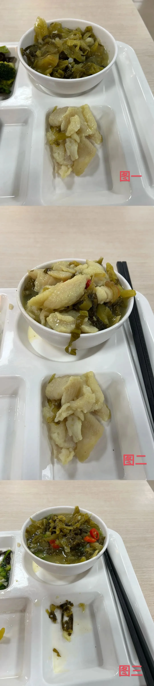

请相关部门及时关注并跟进问题。

## 1 校园卫生问题

> “投稿：针对昨天投稿提到的校园卫生问题，鄙人认为物业阿姨承担着大量宿舍楼垃圾和清理的问题。教室里的卫生，难道不该是我们作为学生也需要共同爱护的吗？随手扔掉自身产生的垃圾，相信不是一件需要上刀山下火海的事情。物业工作人员负责垃圾桶垃圾的集中处理，学生维护好教室课桌、抽屉的整洁。自己上课看着也整洁舒适，也为下一堂课的同学延续着这份整洁舒适。对于学校，是节省人力资源，对于自己，也是养成生活上的好习惯，日后步入社会，平时学校注意维护教室卫生了，工作上的办公桌自然也就自觉的会维护好。学校里把知识学好了，修养也提高了，对于自身长远发展也是有所裨益的。”

（以上问题参见[11.3日【读者投稿】评定标准争议不断，其他问题引发讨论](https://mp.weixin.qq.com/s?__biz=Mzg2MjcwNzQ1Mw==&mid=2247486685&idx=1&sn=102e61783afa6839e4ebe8fc7df508b6&scene=21#wechat_redirect) 第5条）

## 2 奖学金和补贴问题

> “墙，奖学金我想投稿另外一个不公平的地方，班主任评分。首先，在硕博本就很班主任联系很少的情况下，还要班主任给基本情况打分，并且打50（权重另算），这本身就不合理。其次，同班主任联系最多的同学就是班干部同学，但在班干部已经因为活动加分的情况下，班主任再次因为班干部的表现加分的话，这种双重加分是不是不合理呢？最后，就算班主任依据每个人的评述打分，但这一定能做到客观公正吗？如果有同学说班主任统一打一样的分的话，我想问这是不是就意味着其实根本就没有班主任打分的必要？？”

## “社论君，关于奖学金的一些事。

学校的文件里要求的是C刊来源期刊目录，历史学院临近材料截止了突然来个补充说明，把C集刊也算进去了，这可有点意思了。如果学院评奖规定有变更，就不能跟通知一起下发？而且这种关系到全体学生的规定，就不能从今年评完以后再制定？连个正式的公章都没有，发一个补充说明的文件就能当规定？这事做得有多仓促可想而知。为什么不能用只用学校规定的C刊来源期刊目录，而要临时将C集刊纳入，两者的区别还是有的吧，为什么不能从今年评完以后再通告全体学生？”

> “惊悉某学院单独发了奖学金的细则，其中专门特别说明将AMI扩展版等同于CSSCI扩展版及北大核心。震惊之余，只觉可笑。不知全国还有哪所高校在任何成果评定里会认可AMI扩展版。”

## “看了最近关于奖学金的评论：

1.很疑惑奖学金评定细则为什么不是公开透明的，每个学生都有知道的权利，不然怎么保证公平呢，光评审小组知道和制定规则肯定会存在问题，当然会引起大家的质疑和讨论

2.建议学校学工部层面，或者至少学院层面应该在学校奖学金管理办法的指导下，结合本院情况(可能方向不一样，期刊侧重不一样）设置统一标准的细则，且将细则文件公开出来”

## “想问一下新生的奖学金和补贴大概什么时候发呀 ”

（以上问题参见[11.3日【读者投稿】评定标准争议不断，其他问题引发讨论](https://mp.weixin.qq.com/s?__biz=Mzg2MjcwNzQ1Mw==&mid=2247486685&idx=1&sn=102e61783afa6839e4ebe8fc7df508b6&scene=21#wechat_redirect) 第1条）

## 3 校区设施问题

“建议校园内修一处池塘和假山，虽然校园绿化还是不错的，但没有灵性，感觉像是一个大果园子”

> “关于望京宿舍冷水管改造：改完以后：1. 洗澡水忽冷忽热；2. 需要放掉很多冷水才会热，既浪费水，又浪费钱；3. 只要多人同时用水，最靠里面的隔间水温就会突然下降，并且维持低温。虽然学校改造水管是出于好意，也不能不考虑实际效果吧，真的很无语。”

“能不能给望京校区的自行车摩托车停车区加个棚子，或者重新规划一块地方，感觉现在都停不开了”

## 4 食堂

“投稿，希望良乡一食堂对于“酸菜鱼”这类菜进行份量的标准化。投诉起来也闹心。 图一为投诉前，图二为投诉后增加了鱼，图三为吃完鱼之后。

投稿核心：酸菜分量太大，可适当减少，避免浪费。”

