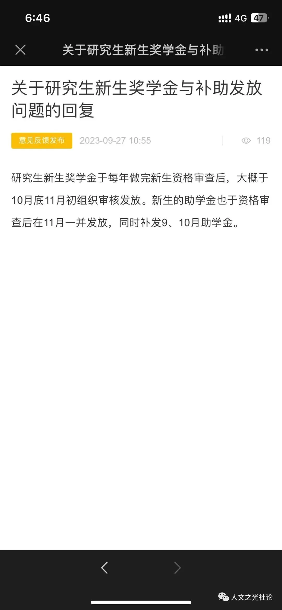
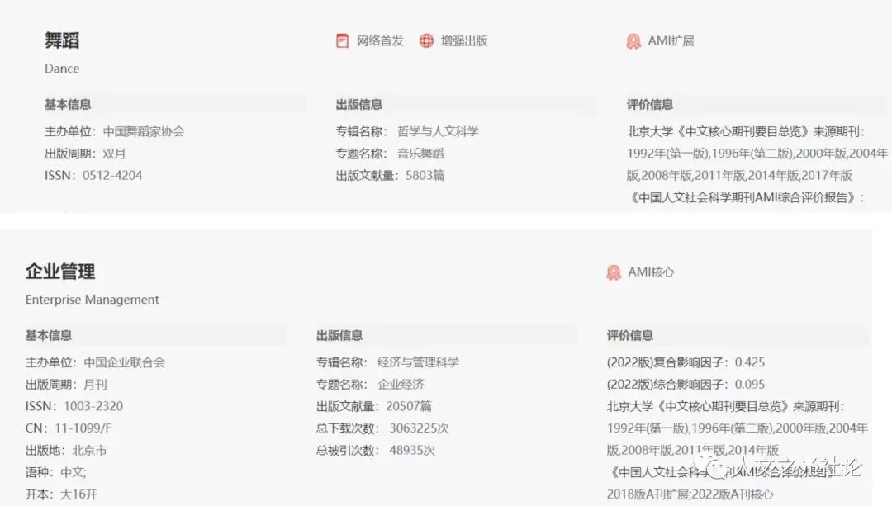
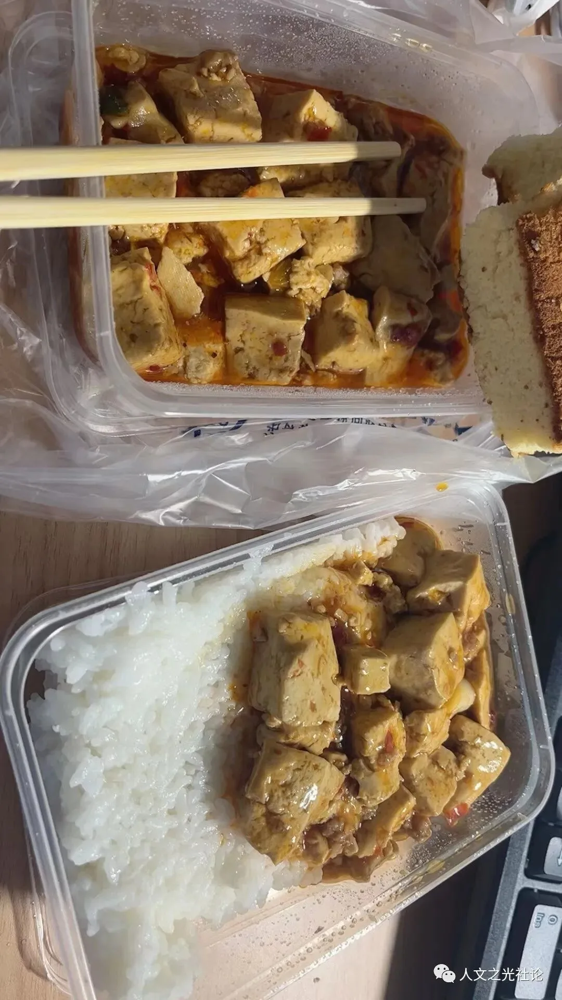

请相关部门及时关注并跟进问题。

## 1 补助问题

> “【新生奖学金和补助】学工部关于新生奖学金的意见反馈能不能理解为最迟应发时间是11月10号？（“大概于10月底11月初组织审核发放”，10月底已经过了，月初是1-10号）当然这个回复的“组织审核发放”也可以解读为审核工作最迟11月10号开始组织，至于审核工作什么时候完成，审核完了什么时候发放等通知。总之投稿希望大家一块催一催。”

“

请问一下咱们的新生补助和入学奖学金什么时候可以发呀”

（见《[【读者投稿】奖学金评定是否公平？校园内部生活问题！](https://mp.weixin.qq.com/s?__biz=Mzg2MjcwNzQ1Mw==&mid=2247486690&idx=1&sn=4c96b3f3dcac4feff79e2c6685800774&chksm=ce028770f9750e66c9dbcab44e0acff63799e39459c73bb1bbc39c7d2361ca4327eeb0cd8a24&scene=21#wechat_redirect)》第2条）

## 2 奖学金问题

## “回应11月3日、4日等关于二外的相关评论。

1.不是戾气重，而是对之前的某些人指责的回应。只是想吐槽一下自己的需求，没想到被指责，本就是一件不太好的事情，自己的因素固然在，只是想提出客观的不公平，因为这件事不只是一方面原因导致的。而有些人的攻击的确让人不爽~当然，那些对自己成绩还满意的同学固然可以按照自己的标准去表达意见，但是公众场合直接指责个人和某些群体的做法是非常恶心的，某些人不是人家的衣食父母，所以没有任何一丁点资格去叉腰指责！希望某些人用居高临下的语气之前可以回去照照镜子再发言，这样的做法对某些人自身也没有什么好处。

2.对这些客观存在在事关学生学习发展和就业前景的无厘头的不公平的现象希望学校能给予及时且正确的回应。学生都是独立的人，而不是提线木偶或者实验动物。如果不及时解决，无论学生还是学校，都不会有好的发展。

3.希望学校能及时出台对学习成绩争议的预后措施，不要因此让学生失去学习的主动性积极性或影响正常毕业及工作。”

（见《[【读者投稿】评定标准争议不断，其他问题引发讨论](https://mp.weixin.qq.com/s?__biz=Mzg2MjcwNzQ1Mw==&mid=2247486685&idx=1&sn=102e61783afa6839e4ebe8fc7df508b6&chksm=ce02874ff9750e591b98f4dee562f8b5f29fcb40290a9e823e80647ef5d8634fe48eafc9f1a1&scene=21#wechat_redirect)》第1条)

“学院的国奖通知改了没话说，期刊分级办法把北核C扩和AMI扩展都摆到D类是要闹哪样，普刊也和北核C扩一个等级是吧，那这样明年一个人发五篇A扩普刊独作铁拿国奖是吧，还有A核怎么算，算C吗，学校最新分级办法C类没有A核，学校补充规定D类只有A扩，A核要是算C类纯属搞笑了，很多A扩和A核就是普刊装不知道是吗？

改规定就是把外文普刊的不公平放到更不公平的中文普刊是吧。”

> “十分赞同同学的观点，Ami顶尖和权威可以用来区分CSSCI的等级，这个没有问题。但是ami核心和扩展就不要参与了。最低等级至少要到北核。学术圈公认的核心至少是北核。我们是两所著名的研究型大学之一，更应该严格标准，不能鼓励大家灌水普通期刊。这些期刊的质量大多数没有任何价值。好一点ami的肯定也是北核或c扩了。仅是ami核心或扩展的期刊，其他学校根本不认可。年年有争议，什么时候能够统一一下，直接统一成教师期刊标准。如果感觉对于学生有点难，就加个第四类c扩和北核。或者可以把c扩等同于c核(c扩数量也很少，一样有难度)。要么就严格按照教师期刊等级执行。”

## “附议昨天关于AMI的讨论。某学院AMI的评分极不合理！

发表AMI文章的难度大家都心知肚明，特别是非北核南核的AMI，通常被叫做“普刊”，发表甚至被认为会留下学术污点。

比较一下，按照这个规则算的话1.8篇AMI独作相当于发了权威一作，2.4篇AMI独作相当于中国社会科学和经济研究这种顶级期刊了。

非常离谱！”

> “投稿：据统计，AMI扩展刊700多本，近800本；而CSSCI扩展板仅230本左右，北核而非CSSCI期刊只有不到100本，某些学院评奖说明将AMI扩展囊括在内，只能说是劣币驱逐良币，以学术质量导向型下的国家奖学金，按现行标准大家都去发非北核C扩的AMI扩展独作即可拿到20分，超于 CSSCI二作的16分，实在不公平。～”

## “之前见有同学说C扩是B类期刊，竟然这两个B类期刊连北核都不是！！”

> “社论君好！关于奖学金评定存在不合理之处，博士三年级有课的学习成绩加权系数为0.2，没课的为0，虽然没课的科研加权系数多0.2，但课程学习和科研难度有很大不同，同一班级有课程成绩和无课程成绩一同参评是否应该按统一的加权系数标准？？而不是按两种算法，就比如课程成绩只要及格60分就能得12分，而科研部分却要C刊二作才能得到差不多一样的分数，没课并不是学生的原因，是因为有的系课程安排就是这样，博一要修完全部学分。因此，分别按两种加权系数算分对无课程成绩的同学很不公平！”

> “国奖奖学金投稿新动态，应用经济学院规定AMI核心与CSSCI等同，简直离谱，有非常多的期刊既非C刊也非北核却是AMI核心，影响因子不超过1，不知道今年出这个新规又是为了谁呢。反正投稿了规则也改不了了，就是想让同学们知道这些莫名其妙的规则。”

> “国奖让中期考核没过的人拿国奖，是要起到什么示范作用呢？对我们辛辛苦苦准备一年中期考核的人公平吗？那我们当时就都别怎么准备先发论文好啦。如果中期考核不重要，干脆不要效仿顶尖学校搞这些没用的，浪费大家多少时间！下一步，是不是拿完国奖拿优秀班干部或者拿三好学生，反正学校也不限制，然后再拿一等学业奖学金啦！是不是还要把中期考核作弊的人放出来拿奖呢？毕竟学校说没有文件支持说人家不能拿，所以就是一起支持他们拿咯！”

（见《[【读者投稿】奖学金评定是否公平？校园内部生活问题！](https://mp.weixin.qq.com/s?__biz=Mzg2MjcwNzQ1Mw==&mid=2247486690&idx=1&sn=4c96b3f3dcac4feff79e2c6685800774&chksm=ce028770f9750e66c9dbcab44e0acff63799e39459c73bb1bbc39c7d2361ca4327eeb0cd8a24&scene=21#wechat_redirect)》第2条)

## 3 宿舍

> “投稿：望京校区。听说1号楼宿舍统一给椅子贴了静音条，那么建议一视同仁，给其他宿舍楼的椅子也统一贴上静音条，大家经常在群里反映楼上拖椅子的声音太，吵苦不堪言，学校出面统一贴上最好了”

## 4 食堂

> “良乡校区一食堂，我点一份西红柿牛肉一份豆腐打包，我回去一看，发现给我盛两份豆腐，但是收的钱还是豆腐和牛肉一起的钱，这个我想知道食堂怎么处理，要不要退我钱？或者说以别的方式弥补？这个事情必须给我解决了。一食堂能干就干，不能干就黄了吧。”

## 5 图书馆

> “你好 反应一下望京图书馆，八点开门，七点五十五到并且图书馆已经开门，但却让在外面等着，说是学校规定，想问问学校是怎么想的？问问学校图书馆已经开门了，虽然差几分钟到八点为什么不让学生进去学习呢，以规则为强制性理由太僵化了吧，在不影响他们的前提下有考虑过学生吗?”
