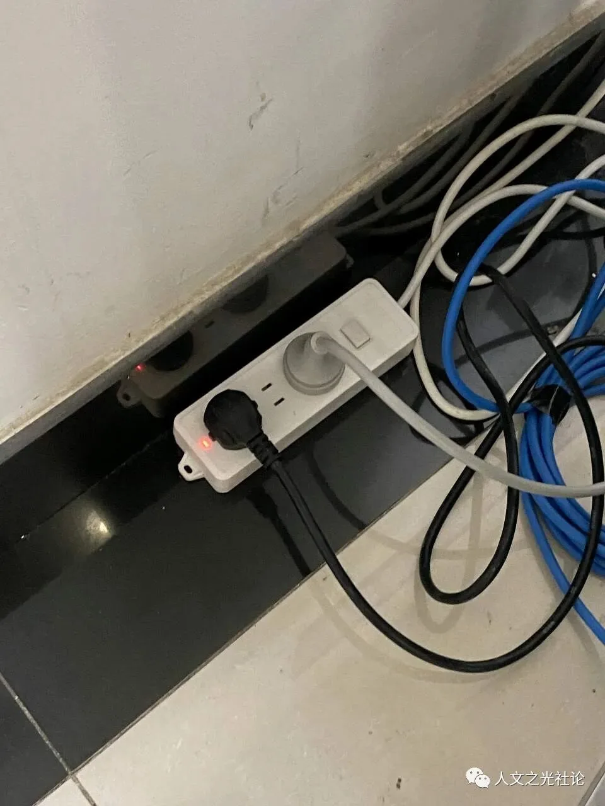
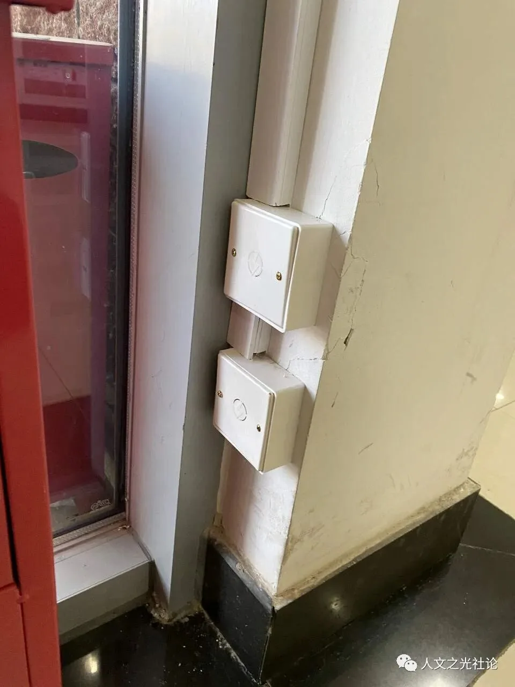
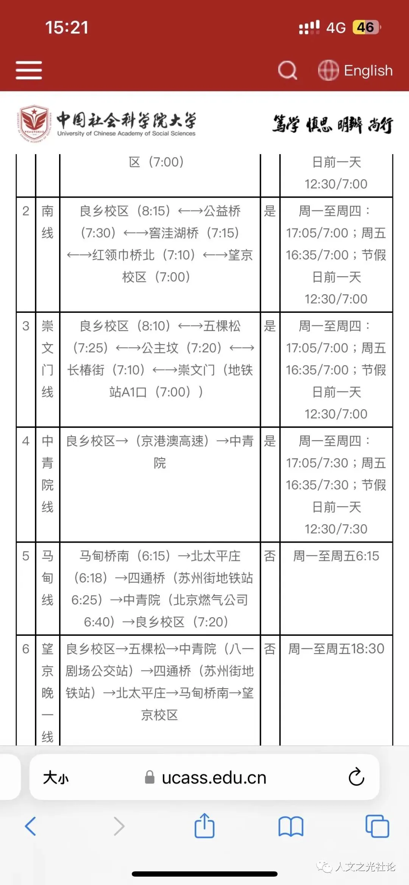
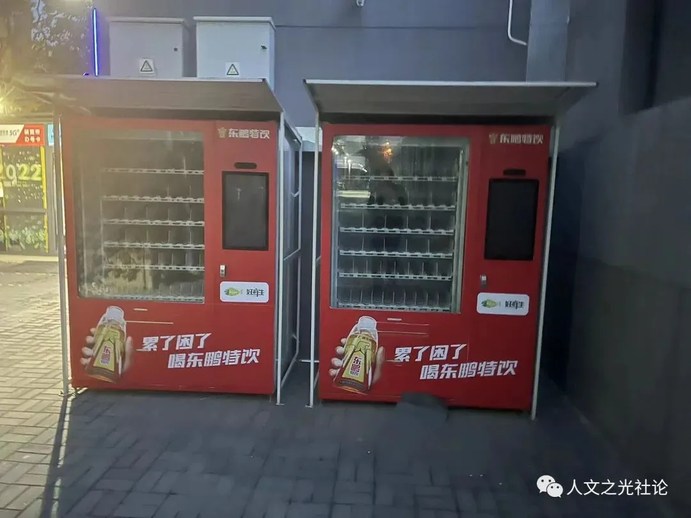
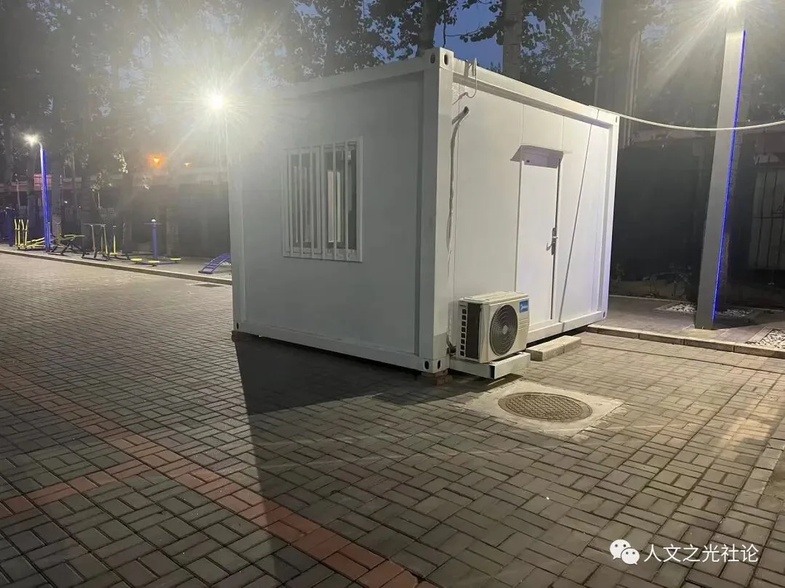
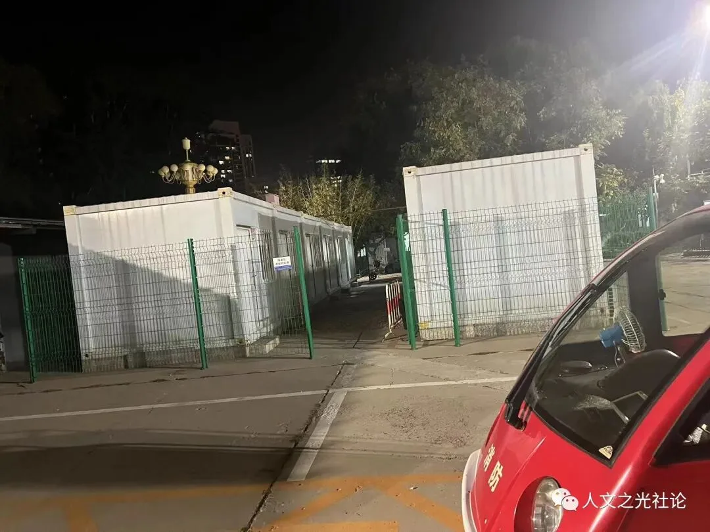

请相关部门及时关注并跟进问题。

## 1 奖学金

“虽然已经事成定局，但不能由于期刊争议太大，而忽略了成绩的争议。需要改的没改，不需要改的却改动了。

三高成绩由三门变六门，二外争议大，约瑟夫给分低，及格标准下降导致分数下降，硕博连读和普通学生成绩数目不一致。

诸多变化和情况似乎没有被奖助办考虑。

参评最低分由70分改为60分更是表示出相关部门对学校政策的不理解。要知道第一学期60多分的同学已经参加重修了，但还能参评奖学金？

真正需要改的是75分以下的门数，不改那今年很多人学业奖学金都没有了。”

（见《[【读者投稿】奖助补费大争议 校园问题仍迭出](https://mp.weixin.qq.com/s?__biz=Mzg2MjcwNzQ1Mw==&mid=2247486708&idx=1&sn=bc737dd93a83ccf27945e10d1194dbfd&chksm=ce028766f9750e707c585c45923c1ca0b79d311a51d0fe072ecb9092837f2d63108290ceb986&scene=21#wechat_redirect)》第2条)

## 2 补助

> “22级博补充一下新生补助发放问题，去年新生每月补助直到12月初财务处将要闭账之前才发放4个月全额，希望今年学校不要又整这死出，说到做到吧。去年催了很久，也提了建议，真的希望学校今年会变好一点。看到又有新生因为这事发人文之光，真的无名火起。以及，11月的博士补助也请尽快发放！”

（见《[【读者投稿】奖助补费大争议 校园问题仍迭出](https://mp.weixin.qq.com/s?__biz=Mzg2MjcwNzQ1Mw==&mid=2247486708&idx=1&sn=bc737dd93a83ccf27945e10d1194dbfd&chksm=ce028766f9750e707c585c45923c1ca0b79d311a51d0fe072ecb9092837f2d63108290ceb986&scene=21#wechat_redirect)》第1条)

## 3 食堂

“【望京食堂】夸夸望京食堂，最近一直在进步哦，各种烤红薯烤玉米烤鸡蛋，还有炒饼丝炒饭各种面也都回归并创新了。还有蟹了呢！好吃！真棒！！！”

## “11月6日一食堂二楼的番茄鸡丝和以前的鸡丁玉米粒超级好吃😋希望可以保留菜单”

## 4 图书馆

> “图书馆的插座本来没几个，大家为了充点电跑来跑去。现在又把机房门口的几个插座堵上了。本来资源就不够，为何还要挤占充电的资源。人文社科的不用做实验，很多东西都需要用电脑，看书也经常用平板。恳请学校解决一下。为了消防安全就不让学生充电是不是矫枉过正了？”

“图书馆一楼的储物架也变成了大纸箱➕垃圾袋，学生的东西都是垃圾吗？储物柜不够东西多才回去储物架放东西，现在这点地方也给剥夺，是不是把所有学生赶出去才高兴?”

## 5 摆渡车

“想问一问班车是还存在吗？我在崇文门周二五点等了二十分钟还没见到，官网上写的2023上是有的”

## 6 望京基建

> “望京卖饮料的的机器不用了，尽快让弄走，还有做核酸的亭子也弄走，把校园空间释放出来，还有隔离房，成了有些人宿舍，本来小院就很小，这么多大小领导，怎么就看不见呢，天天在小院转来转去，为何看不见呢”

