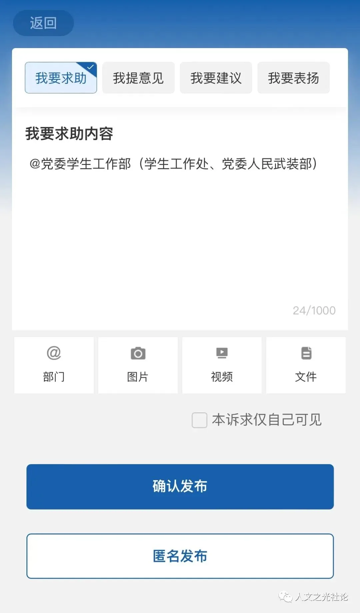
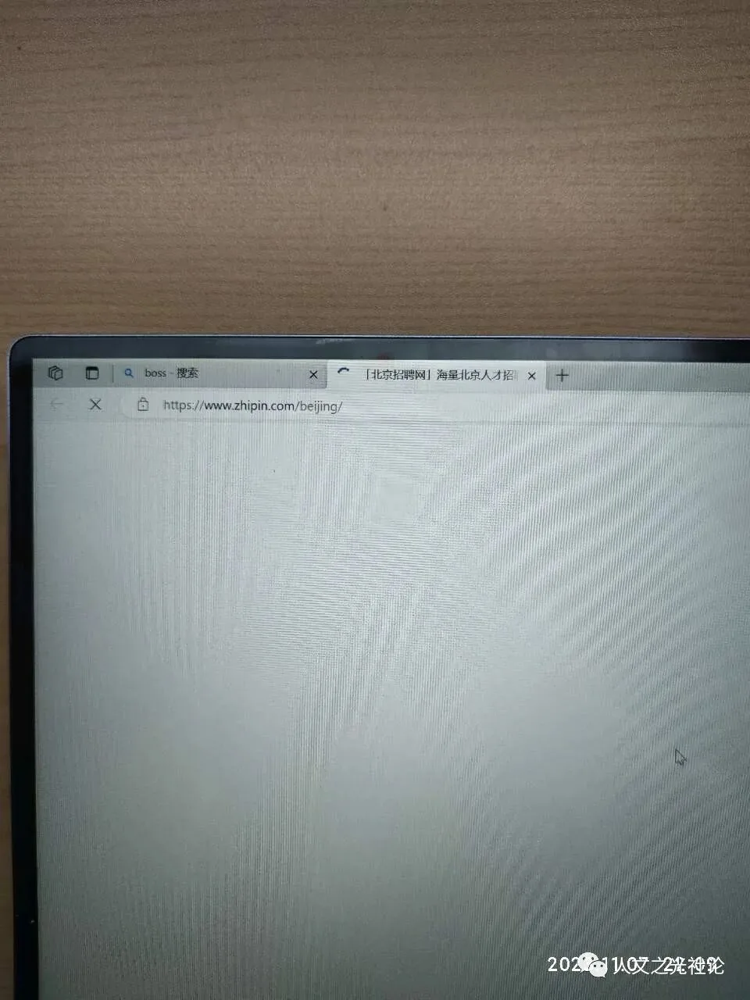
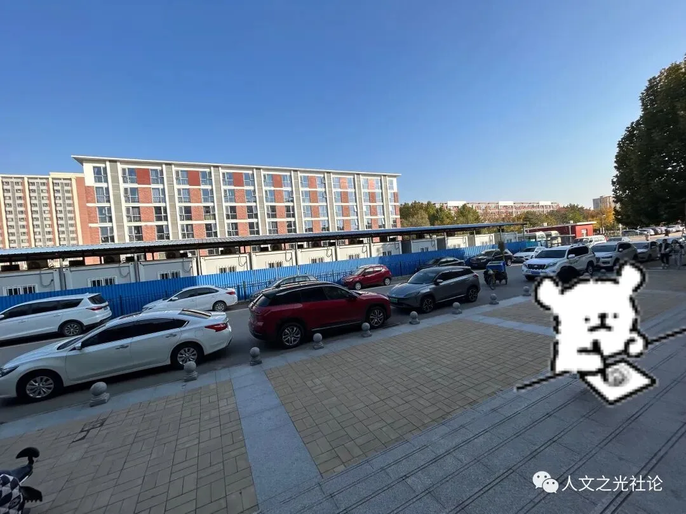

请相关部门及时关注并跟进问题。

## 1 奖学金

> “投稿：奖学金发放流程是学工部审核后提交财务处发放，目前还卡在学工部，请大家多到接诉即办@学工部，到了下个环节大家再@财务处。毕竟新生奖学金和补助skd根本没有制度规定，也就意味着没有截止日期，可以一直拖，那么去年拖到年底闭帐才发也不意外，今年既然有了接诉即办不妨大家都去催一催，等不是办法。”

## 2 校园网

“麻烦学校能治理一下校园网，真的很卡啊，投递简历的时候招聘网站都打不开，一直在刷新多次尝试都不行，这要怎么找工作？”

## 3 本教出口

## “社论君好，投稿素质低光时刻：一排私家车把本教楼进出口全给挡上了。

小狗是给同学打的码（）”

4

宿舍

## “投稿：

1、宿舍通暖气，每天流水声不断，阿姨好心给大家上报检修，结果来的师傅说这也正常。这检修是为了走过场？

2、望京校区这边浴室改装后冷热交替频繁且水流变小，洗澡收费变高。这大冷天也是服气。”

## “六号楼的暖气什么时候才能修好啊，真的要冻坏了……”
