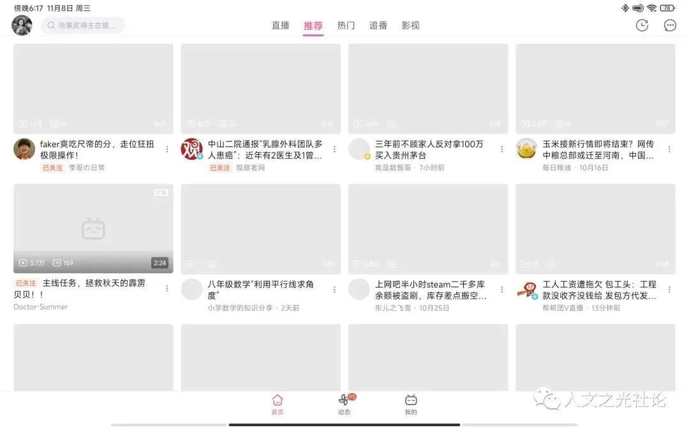

请相关部门及时关注并跟进问题。

## 1 校园网

“昨天用电脑登录校园网卡的不行，今天换平板也一样，视频网站的封面都刷新不出来，真的没人管管吗？”

## 2 食堂

> “我们学校的宵夜好好吃啊！！比晚餐好吃得多！！现在每天都盼着吃宵夜。但是有一个小小的问题，宵夜时间可以提前一点点吗？提前到八点多也好。原因有两点：一是五点五十餐厅的晚餐就已经不剩什么菜了，只能饿着肚子等宵夜！如果宵夜可以八点多就开始的话，也不至于饿到不能忍受的地步～二是九点多吃东西会不会不太利于健康，如果是没课的同学，八点多能吃到宵夜就刚刚好”

## “良乡二食堂吃出一碗头发，甚至卷在烤冷面里面。”

## 3 宿舍

## “回应4.1，流水声不是暖气刚开，刚注水时的正常现象吗?”

“太感谢望京校区的相关部门啦！用心聆听个别同学的真切呼吁，特意赶在北京大幅降温之前为宿舍澡堂更换了水管和龙头，引进了冬天里最需要的冷水管线，同学们终于拥有冷水澡自由了！

更为人性化的是，为提升同学们调水温的微操精度，新龙头设置了发烫、刺骨和忽冷忽热三种模式，甚至在洗头时出现了热水烫头和冷水浇头的交叉环节，在锻炼同学们动手能力的同时磨炼了意志、增强了体质，也替同学们争取医务室增加紧俏开放时间找到了理由；洗澡前的调试水温流程由此前的零秒升级为现在的几分钟，甚至试完了几个澡堂也试不出热水。更为绝妙的是，每次关停水流之后再开启都需要一套精密的流程重新调试热水，虽然大幅增加了水卡扣费和洗澡用时也不一定能洗上热水澡，但磨砺了同学们的耐性，强化了同学们的程序意识，不可谓用心不良苦。

好评！我们望京校区背后的团队真是令人暖心！”

> “望京校区的淋浴室真不如不改，原来只是花洒的问题，温度虽然有时候不合适，但总体还是能接受的，现在水忽冷忽热，冷的时候是冰冷的，出热水之前还要放很久，大冬天的怎么洗，建议提出整改意见的人自己去试试改之后到底好不好用。”

（见《[【读者投稿】原来卡在了学工处?](https://mp.weixin.qq.com/s?__biz=Mzg2MjcwNzQ1Mw==&mid=2247486728&idx=1&sn=1f9131c859f62f5bd71d6bb2dd2a8d01&chksm=ce02869af9750f8c206193ffab1d620fec1a42479c58474611d19356b1ee2d64116bc20c7cab&scene=21#wechat_redirect)》4.1)

“建议在宿舍一楼增加教室门口的显示屏。出门自习往往找教室要半小时，北综和教学楼都有一整个上午（下午）无空教室的情况。一栋宿舍楼只要一台，成本并不高。”
