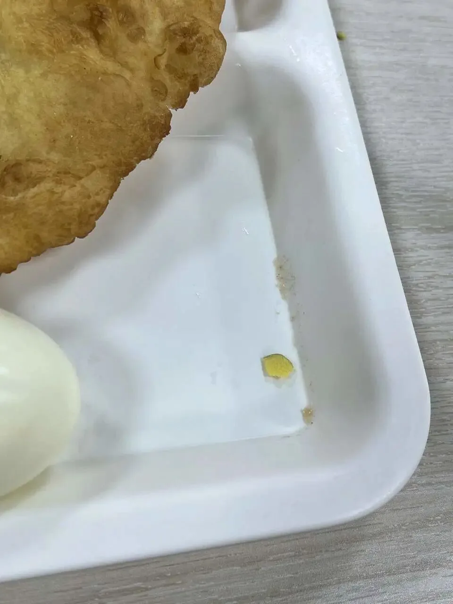
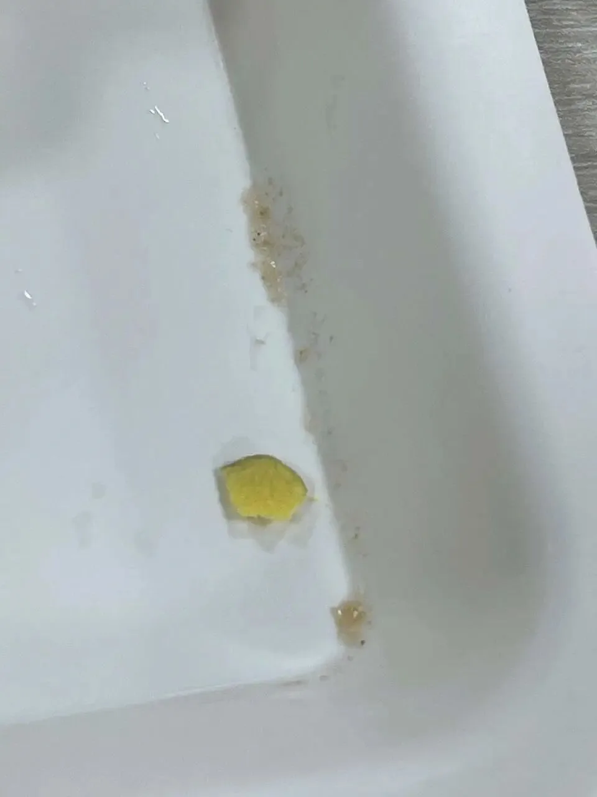

请相关部门及时关注并跟进问题。

## 1 表扬

## “表扬！(可以放在开头吗)

良乡校区早上的热水问题有好多年了，这次改进真的很好！”

## “暖心！图书馆洗手间开了温水洗手，好贴心！”

## 2 教室

> “想问良乡校区图书馆一楼机房苍蝇横行，停在电脑上、书上，还直往人的脸上、耳朵上撞！不卫生、不舒服，很影响人。半个多月前我就已在接诉即办平台上反映此事，但后勤处分别以正在购买灭蝇灯、粘蝇贴进行回应，事实证明这些一点用都没有。请后勤处调查苍蝇横行原因，并提出解决方案并立即落实。”

## 3 奖学金

“专硕交这么贵的学费，为什么不能有新生奖学金！！！难道我们就是韭菜，来花钱买学历吗?”

## 4 食堂

“想问问一食堂能不能好好刷刷盘子并且消毒？好多次吃饭的时候筷子刚刷完放进消毒柜，还没完全消毒就要进行下一轮使用，筷子上都是水，盘子也不是很干净！”

## 5 下限与上限

“近期后勤处的“亮眼”表现得到了不少好评，和其他各部门相较，高下立判。但在赞誉之余，不难想到，作为一个部门的后勤处在近期的表现应该是一个大学行政部门素养的基本之基本，下限之下限，而本不应被误认为是行政工作的上限。

道理非常简单，一个大学的行政部门与师生教职工之间的关系应该是服务与享受服务的关系，而非上下级或者亲子关系。服务得当且态度较好理应是服务者基本的职业素养。面对校方行政部门的种种决策与工作，受到影响的师生教职工当然有权利对此进行监督并提出诉求，否则完全可以采取措施不配合对应行政部门令人不满的工作。服务态度良好且尽可能提供优质服务，本是服务者之所以能够成为服务者的基本条件，而非博得赞誉的理所当然。

这当然并非是对校方行政部门某个工作人员的苛责，而是对作为一个部门的校方行政部门的要求。就像我们感动于辛勤劳动的菜商本人，并不妨害我们要求得到味美价廉的新鲜蔬菜一样。

况且，如果赞誉过于廉价，其内涵亦将贬值千里。如果一个部门的工作缺乏其他声音，想必纵多少好评都如同废纸。也期盼后勤处能不淆虚名，再接再厉，从下限的标杆真正变成上限的标杆。

不由得感慨，我们小院的教职工与学生太久没有得到本应得到的基本服务了，以至于基本下限都可以成为亮眼上限。那么连这个“基本下限”都没有达到的学校其他部门呢？更希望他们能尽快转变态度、迎头赶上。从后勤处最近的表现不难看出，很多本应该解决的事情，其唯一的困难不在外面，正在于所属部门的“里面”;是态度问题，而非能力问题。就像最近的热水问题，大家通过各种途径在数年间都进行了反映，但唯有后勤处一朝转变态度，热水即刻供应。所以学校各部门是时候端正态度，啃下所谓的“堵点”、“难点”问题了。纵观学校行政现状，推诿塞责、大打太极等问题依然普遍存在;有大量的难点问题仍待去“攻城拔寨”，有不少的权责归属、行政效率问题等待着“刀口向内”。那么，不妨让我们一同期待校方各行政部门以实际行动做出的宣示。

但无论如何，最近的接诉即办平台和后勤处的工作仍可说是开了一个好头，让我们看到一所高校的行政起码应该具备怎样的基本素质。只是，不要虎头蛇尾，不要让行政工作基本的下限成为寥寥几个部门所能达到的上限，要让真正的上限能够在各部门端正态度、认真服务中矗立。部门在做，大家在看。学校各行政部门后续会交出的答卷及一流大学的建设成果究竟如何？每一个社科大人都在拭目以待。”
