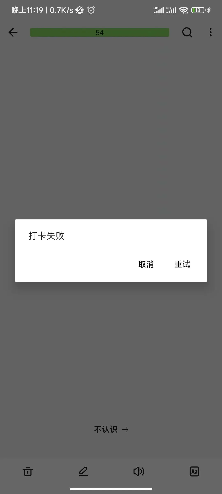

请相关部门及时关注并跟进问题。

## 1 奖学金

> “为什么专硕的新生奖学金要被取消啊，即便不能全覆盖，奖励前10%也可以啊，入学分数差了几十分，但没有任何差异化的激励机制，，也会影响来年的招生啊。不要求专硕有什么特别待遇，和学硕一视同仁都做不到吗。”

“其实学校老师还是很辛苦的在给我们同学准备发放奖学金，补贴等相关工作的，也是很考虑我们学生实际，也在双十一大家需要花钱的时候发放到位的！没必要吐槽啊”

（见《[【读者投稿】上限?下限?](https://mp.weixin.qq.com/s?__biz=Mzg2MjcwNzQ1Mw==&mid=2247486774&idx=1&sn=f7e528629ffc2320ac1caeb21a557821&chksm=ce0286a4f9750fb22e760f71bd11e7881865283aa5a5474cf92815f8f8260b4f02b1fbd4ad1c&scene=21#wechat_redirect)》3.1)

## 2 食堂

> “【良乡校区食堂】请问食堂能不能多备一点菜呀，有时候12点10分下课之后去排队，排到的时候大部分菜都没有了，就剩下几个不好吃的素菜。多备一点菜考虑一下上课的同学呢？”

“投稿良乡校区食堂，请问可不可以正视一下现在午晚下课以后排队和缺菜的问题。后勤处既然最近把自己捧的这么高，这种基本的问题总不能偃旗息鼓了吧。”

## “关于食堂：

1、一食堂一层6、7号窗口长期不用，能不能引进别的商户或者菜品？学校食堂本就饱受争议，竟然还有这么大空间闲置，实在不该。

2、8号清淡窗口，并没有特色菜品，只是把普通窗口中清淡的菜搬过去打而已。每天饭点，别的窗口排长队，8号窗口却基本没人。这个窗口为什么不作为普通窗口给大家打菜呢？还能减少我们排队时间。

3、食堂晚上剩菜的事很多人都说过了。为什么总有剩菜？是为了省事，中午专门多做的吗？而且剩菜还是原价卖，这合理吗？？”

> “对于食堂打饭大叔的小建议 每次晚上6点半以后去一食堂二楼吃晚餐总是遇到同一个大叔打饭，只有他一个人，其实也是有点辛苦，我很能理解。但是今天去打饭时遇到这样一件事:我来到窗口让大叔打了两个菜并说明主食要一个小馒头，但大叔却拿了一个大馒头准备结账，后来我问:“没有小的馒头了吗？”大叔却回答:“你也没跟我说要小的啊。”语气带有责备并且挺不耐烦的。我万分无奈，明明说的很清楚是要小馒头，感到被无缘无故被批评到了，于是回复大叔:“我刚刚说了我要小馒头的。”语气有点严格。大叔听后顿了一下，不耐烦地说了一句:“是我聋了好吧。”后来我也没说什么，刷卡后离开了。 其实，大叔能给我拿馒头说明他还是听清楚了我要什么，其实大和小这两个字读音差别还是非常大的~自己多次在比较晚的时候去吃晚饭，所以基本上每次都是遇到这个大叔打饭。很多时候也会遇到大叔带着不太耐烦的情绪在工作，以前从来没有把这类事情放在心上，直到今天被说了一下才忍不住想吐槽下。 虽然食堂的叔叔阿姨们都已经下班，大叔自己在那里工作难免心里会有不耐烦或者着急的情绪，但是咱们一食堂晚上营业时间到7点是规定好了的~希望同学好好跟大叔们说话的时候，大叔也能以正常的态度对待学生~ 正如今天这件事情，我个人觉得即便是拿错大馒头也是没关系，再换成小馒头就好了呀，没有什么问题的，也不会浪费多少时间，我也不会生气。 总之，无论是自己没听清楚还是别人没说清楚，其实可以不用抱怨的，如果觉得自己是关系的主导反而责备学生，这样子做并不太好。希望同学们和食堂的叔叔阿姨们能和谐相处，相互尊重。”

## 3 宿舍

> “学校什么时候能解决一下男女混宿混寝的问题。每栋楼都有4个门，两边的小门关上，从正门进，男生一个门，女生一个门，同一楼层的女生一边，男生一边，中间加一堵墙隔开。现在真的是不方便。没有人看守的门禁还不如没有。”

“投稿 良乡校区宿舍楼的暖气并不是很热，摸起来只是温温的，希望相关部门能好好烧一下，天冷了真的不想感冒……”

> “【良乡校区】强烈建议学校关注一下宿舍楼（坐标2号楼）噪音问题，尤其是楼上噪音问题！看能不能有什么比较好的客观的解决方法，比如采取一些给宿舍楼椅子脚裹上布，或者给楼上房间地板上贴防噪音的垫子，或者给楼上房间天花板上贴防噪音的壁纸之类的东西等一系列可行性措施，而不是一味靠人和人的沟通交流这种主观性的方法，毕竟这种方法太考验人的良心和素养（只是就事论事，并无任何指涉），而且人的悲喜并不相通。住在楼上房间的人不一定能体会到楼下房间的人的感受，且让别人轻一点什么的这种请求类的协商话语经过屡次实践，收效甚微。在每日紧张忙碌的生活中，噪音实在是让人不堪其扰，尤其是在夜深人静的夜间，疲惫了一天，刚好不容易睡着，楼上人回来了（太晚，十一二点才回来），还一顿噼里啪啦，折腾不休，还有刺耳的拉椅子的声音，反复在耳边刺啦刺啦响，一直折腾一两个小时才消停，早上六七点又开始折腾的情况下，最是让人忍无可忍，这个时候，想要把天花板掀翻的心都有了！！！”

## 4 班车

> “强烈请求学校设置去各个所的班车。 早上七点坐房山线，等了三趟挤上不去，连个下脚的地儿都没！！和各种人挤在一块2小时，直溜溜的站着，手脚都不好动弹，如果每天至少要花4个小时在来回通勤上，人都变成一坨屎了，哪有心情搞学习啊 接驳车来回送到地铁站，这很好，一公里都能考虑到，四五十公里的路程能考虑考虑吗…太痛苦了，每一个去过的人都很痛苦，要因为习惯痛苦就持续忍耐吗 成本问题的话可以该收费收费，不想再痛苦的开始一天的生活了...不行给换个市里的校区那也没问题。只是想要个班车而已，这要求过分吗！！”

## 5 校园网

> “投稿一下：学校的校园网到底能不能好了？我都不求你有什么提升，能不能回到之前的水平。。之前除了看视频很卡其他的加载慢点都还可以接受，现在背单词打个卡都能加载失败，是不是有点太离谱了！！”

> “我真的觉得社科院（望京校区）的网络中心工作人员很擅长推诿塞责，转嫁危机。 上个学期大家抱怨网速太慢，他说他那边测速都正常，让大家有问题去xxx办公室现场反应。这个学期被骂的不行，又换成让大家自己测速上传…… 大哥，我们是学生，不是来上班的……真的每天没有这么多时间去跟你一一对接！我们每天需要上学、实习和自习。我们不像你们坐在那里一天就能拿到一天的钱……望京校区网络差不是一个两个人说差，是人人说差，人文之光和各个群里哪天没有学生实名/匿名抱怨网络差的？你从望京校区随便拦俩学生，有一个说学校网络很好的我把手机吃了…… 此外，差不差你不知道吗？你没有手机吗？你连上校园网别说玩大型游戏了，你刷个抖音，刷个小红书，卡的我以为我活在2008年呢…… 望京校区各个岗位的领导基本都是有问题立刻解决，图书馆、宿舍和食堂只要反映问题抓紧整改。 唯独这个网络中心……真正是xx不怕开水烫。真正做到了事事有回应，件件无着落。实在被骂的不行，那就想个“妙”招转嫁危机，反正我工作人员天天在这里待一天赚一天的钱，你学生总不能一整天来我这里耗着跟我反应网速吧，而且即使耗着也不一定有效果。 网络中心一堆专门搞网络的人，你们摸着良心说你们不知道网络快慢吗？还需要学生给你们反馈？ 再次重申，望京网慢不是一个两个人慢，是所有人都慢。各个平台哪天没有人抱怨网慢？”

## 6 噪音

> “半夜被值班室空调吵得睡不着来投稿： 1.学校有些空调外机声音和拖拉机一样，特别扰民！但没见物业后勤关注过这个问题。声音大可能是底座不牢，也属于安全隐患吧。 2.现在天气不热，已经供暖，为什么有些寝室和公寓值班室还要几乎24小时和整个后半夜都开着空调？”

## 7 后勤处

“可以投稿吗？实在是想说几句。前天看到同学发帖表扬后勤处，昨天看到立刻又有同学来反驳，认为后勤最近的表现完全是他们应该做的，不需要被表扬，只是“下限之下限”。其中他还这么说道：“一个大学的行政部门与师生教职工之间的关系应该是服务与享受服务的关系，而非上下级或者亲子关系。服务得当且态度较好理应是服务者基本的职业素养。……受到影响的师生教职工当然有权利对此进行监督并提出诉求，否则完全可以采取措施不配合对应行政部门令人不满的工作。服务态度良好且尽可能提供优质服务，本是服务者之所以能够成为服务者的基本条件，而非博得赞誉的理所当然。”这种高高在上的姿态与用语让我深感不适。我很难过，把如此刻薄的话说的这么理所当然的人居然是我的校友。

首先，后勤处最近确实改进很大，得到一些同学的表扬完全是合理的。而这位同学却称之为“廉价的赞美”，并认为后勤处如此行为只是“下限之下限”。对此我想说：这不是一种对提出赞美者的pua吗？对后勤处或表扬或批评都是你的权利，但你无权对别人关于后勤处的表扬或批评指指点点，你不可以不允许赞美的存在。我认同这位同学对后勤处的批评，但我不认同他关于其他同学对后勤处的表扬的批评。也许这位同学是怕后勤处骄傲，但真的像极了某些中国式父母的“打压式教育”，让人感受到深深的窒息感。

其次，作为“最接近人文社科”的大学的学生，不能连这点人情味儿都不允许同学有吧？我很高兴看到后勤处的改变，我愿意去感恩、去赞美。如果他们做得不好，我也会去投诉。但我绝不认同这位同学所说的“一个大学的行政部门与师生教职工之间的关系应该是服务与享受服务的关系”。若按照这位同学的说法，岂不是将学校的行政人员与科研人员分为三六九等？这合理吗？自始至终我认为，后勤部、行政老师，或不论是谁，都和我是一种平等的关系，不存在谁就应该服务谁，谁就应该来享受。学校不是休闲娱乐场所，我们也不是来不当老爷的，没有什么是那么理所当然的。做得好就是要被表扬，做得不好也应该被投诉，但或表扬或投诉，都是一种建立在互相尊重的基础上的沟通和交涉，不应该以“享受服务的人面对提供服务的人”的心态先入为主。

最后，我想善意地提醒这位同学，如果你认为学校行政方面做的不够好，你可以做的是在合理范围内进行投诉和沟通，而不是盲目呼吁同学们“采取措施不配合对应行政部门令人不满的工作”。大多数同学还想要的是一个安稳有序的小院儿，于我一点私心而言，我也更愿意积极、知感恩、内心柔软的人来当我的校友。”

（见《[【读者投稿】上限?下限?](https://mp.weixin.qq.com/s?__biz=Mzg2MjcwNzQ1Mw==&mid=2247486774&idx=1&sn=f7e528629ffc2320ac1caeb21a557821&chksm=ce0286a4f9750fb22e760f71bd11e7881865283aa5a5474cf92815f8f8260b4f02b1fbd4ad1c&scene=21#wechat_redirect)》5.1)
